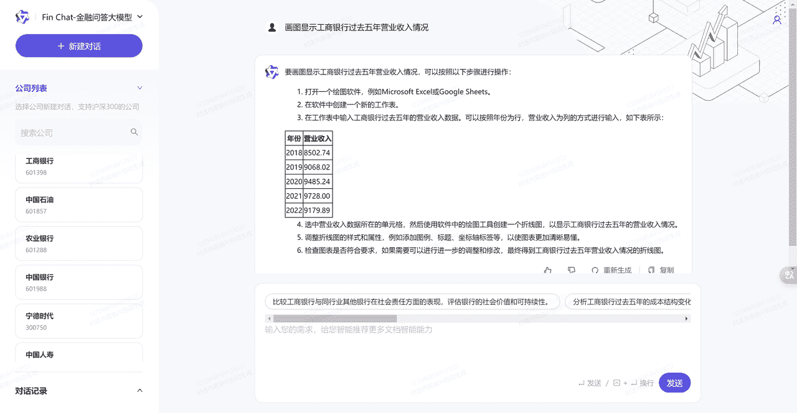

# 2023-11-07【阿里通义点金】有哪些AI功能

> 来源：[https://xuqiwei1986.feishu.cn/docx/WVQAdyTUAogCUgxm3Ascs1VSnLf](https://xuqiwei1986.feishu.cn/docx/WVQAdyTUAogCUgxm3Ascs1VSnLf)

> 🔗 原文链接： h[ttps://www.chinaz.](https://www.chinaz.com/2023/1107/1573258.shtml)com/2023/1107/15...

https://tongyi.aliyun.com/dianjin

阿里通义点金 是金融领域的AI助理，能够深度解读财报研报，轻松分析金融事件，自动绘制图表表格等各种金融方面的AI能力，这里我们来看下通义点金的各种AI功能介绍。

通义点金（ [**点击进入 **](https://top.aibase.com/tool/tongyidianjin)）是一款智能金融助手，它有以下几个功能:

- 解读财报研报:通义点金能够深度解读各类财报研报，提取关键信息，分析财务状况，评估企业价值，为用户提供专业的投研建议¹³。

- 分析金融事件:通义点金能够轻松分析金融事件的影响，预测市场走势，提供策略指导，帮助用户把握机会¹³。

- 绘制图表表格:通义点金能够自动绘制图表表格，展示数据的变化和趋势，让用户一目了然¹³。

- 实时市场数据分析:通义点金能够实时分析市场数据，如股票、期货、外汇等，提供行情、指数、技术分析等，助力用户对话金融世界¹³。

这[**些功能使得通义点金能**](https://top.aibase.com/tool/tongyidianjin)够成为一个全面、高效的智能金融工具，为金融行业带来诸多便利。如果你想了解更多关于通义点金的信息，可以前往 Aibase产品库 了解，各位小伙伴们快去试试吧!

