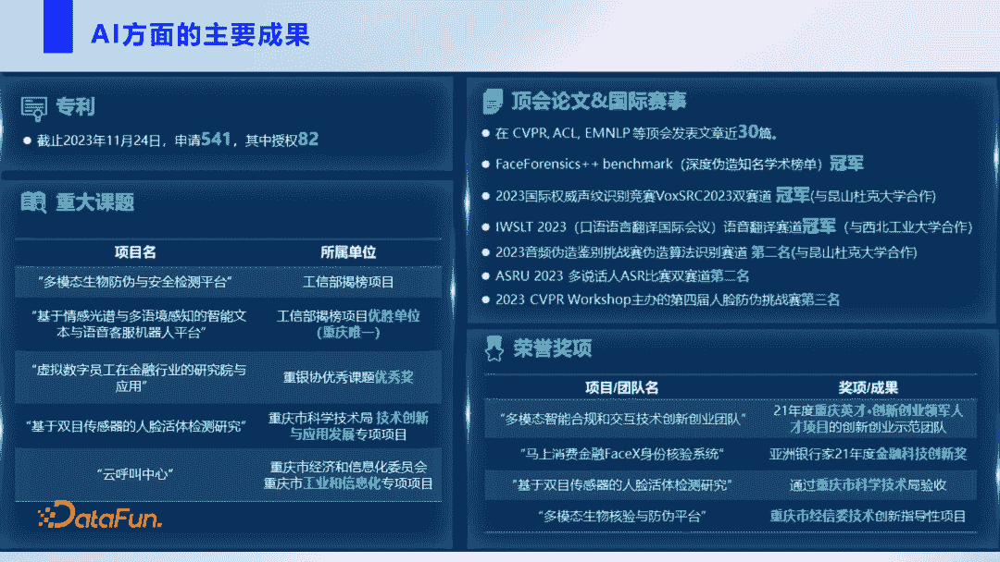
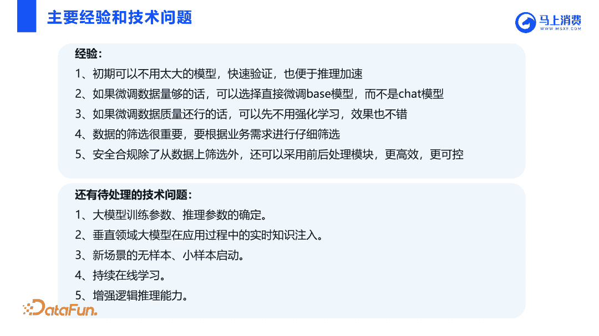

# 2024-02-03LLM 在马上消费金融的应用实践

> 来源：[https://xuqiwei1986.feishu.cn/docx/LoUkd63vLomfnyx1Iqhc6RhtnBh](https://xuqiwei1986.feishu.cn/docx/LoUkd63vLomfnyx1Iqhc6RhtnBh)

> 🔗 原文链接： h[ttps://mp.weixin.q](https://mp.weixin.qq.com/s/BOmmXBofIRqwf4zzfyrIIg)q.com/s/BOmmXBof...

原创 肖冰 DataFunSummit 2024-02-03 17:59 发表于 北京

**导读 ** 本次分享题目为 LLM 在马上消费金融的应用实践 。

**主要内容包括以下几个部分：**

1. 马上消费金融公司介绍

2. 马消已落地大模型场景介绍

3.  营销外呼大模型应用实践

4. 经验总结和问题

5 . 问答环节

分享嘉宾｜ 肖冰 马上消费金融股份有限公司 算法总监

编辑整理｜罗佩

内容校对｜李瑶

出品社区｜ DataFun

---

# **01****马上消费金融公司介绍 **

首先为大家简单介绍下马上消费金融公司。

1. 马上消费，数智驱动的科技创新金融机构

马上消费是一家数智驱动的科技创新金融机构，公司正式员工有 3000+ 人，其中研发人员有 2000+；公司共 1400+ 件专利，已公开 1006 件；目前用户规模已达到 1.8 亿左右。

**2. AI 成果 **

AI 成果主要来自马上消费的人工智能研究院，近两年发表顶会论文近 30 篇，并多次在国内外顶级赛事中获得奖项。

# **02 ****马消已落地大模型场景介绍 **

接下来介绍马上消费已经落地的三类场景及其实践。

**1. 马消已落地大模型应用 **

第一类是对话大模型，主要应用于电话销售、催收和客服场景，早期版本使用了中文版的 Chat 模型，后期则换回了英文版本。由于该模型开始较早，所以当时选的是 Colossal+Chat 训练框架，目前营销版模型训练数据是九十万通对话，起初每个 epoch 需要训练 32 小时，最终对推理框架 fast Transformer 进行适配、修改、优化，目前每个 token 可以达到 5.7 毫秒，此外还有一些特殊处理会在后文提及。电销大模型在 6 月份上线，经过几个版本迭代，目前每日有数百万外呼；催收大模型则由于监管要求较高，最终在 9 月份上线；客服大模型是 12 月份上线，应用于客服辅助，其中一些对客子场景也是 12 月份上线。

另外马消内部已经上线应用的还包括文档问答大模型和 SQL 生成大模型。文档问答大模型主要应用于知识中台和在线客服的一些智能辅助场景，在知识中台场景中，文档问答大模型用于内部的客服相关文档的管理，例如针对在不同时期文档中相同问题不一致、甚至矛盾的答案的寻找和处理。在智能辅助场景中，文档问答大模型配合传统的智能辅助和大模型对话智能辅助形成一个综合的客服人员智能辅助方案。SQL 生成大模型则主要是解决内部提效问题，因为在马消内部有数十万张表，当一个人在写 SQL 的时候第一个问题可能不是 SQL 难写，而是找不到需要的表，所以 SQL 生成大模型在工业界的实际落地第一步是先去找到这张表，第二步才是生成 SQL。因为今天重点是对话大模型中的营销场景，文档和 SQL 生成大模型就不在此赘述了。

**2. 马消大模型基础能力建设 **

因为模型比较多，涉及到开源选型问题，所以马消内部搭建了一套模型训练、推理和部署的平台与框架，很多环节可以自动化或半自动化地完成，目标是能快速验证一些开源大模型。

# **03 ****外呼大模型应用实践 **

营销大模型对客首要考虑的问题就是大模型是否能带来一定价值，是否真的比配置了好几年的传统智能电销强？如果只是为了新颖，就脱离了业务价值。

1. 传统智能营销 VS 大模型应用

一般来讲，传统智能营销已经经过人为的精细化配置，不会出错，但灵活性差。当用户提出一些不在预期中的问题，传统智能营销大概率会解决不了，而只能走到其它兜底逻辑。另外，传统智能营销配置工作繁杂，大模型则正好解决这个问题，因为大模型是基于历史数据端到端训练，且灵活性强。

**2. 大模型应用的难点 **

大模型在对客场景中的应用也面临很多难题。

+   难点一： 对数据质量要求高

直接对客的场景性质决定了对模型的准确性要求很高，这也就意味着对数据质量要求高。众所周知，数据质量对大模型是决定性的。

+   难点二： 金融营销业务场景复杂，子场景亦丰富。

比如营销分的计算涉及首贷、附贷、无余额，而且各场景还有各自的活动专项和特殊特定优惠、临时活动等。

+   难点三： 金融营销场景对信息的准确性要求极高。

用户信息幻觉问题对金融营销模型整体服务质量影响十分明显，比如用户的姓名和年龄基本要保证 100% 的准确性，否则会极大影响营销效果

+   难点四： 金融营销的安全合规、客户隐私保护等要求极高。

+   难点五： 金融营销手段千变万化，营销策略日新月异，大模型敏捷迭代是一大难题。

3. 营销外呼大模型训练主要环节

海量历史对话数据是训练对话大模型的决定性因素，训练的主要步骤包括基础模型选型、数据加工、微调+强化学习、提示工程定制对齐、对话效果评估等。

4. 大模型数据质量与安全合规

在数据加工中，关键事实数据很重要，比如合同金额、逾期天数等，这些数据大模型不能出错，需要我们准确地告诉大模型。因此，除了完整的优质对话数据外，还需要当天的用户事实数据镜像。如果没有历史事实数据镜像，而选择使用NER、关系抽取等其它推理方式从对话中识别信息可能会带来较高的错误率。

合规是金融行业的生命线，数据除了质量外，还需要解决合规问题。合规问题的解决分为线上和线下两步。线上措施比较简单，主要有黑白名单，产品化配置等，比如某个用户说我被电信诈骗了，这个问题不在模型能解决的问题清单里，此时就需要转给人工来处理。

处理从源头开始分为五个环节：训练数据、生成过程、后置处理、智能质检、人工反馈。挑选训练数据环节，首先将大模型的对话数据经过内部合规质检系统过滤，再根据用户的负反馈和双方情绪态度模型等从源头过滤不合规的、业务效果不好的训练数据；生成过程环节用生成参数、提示信息等进行控制；后置处理环节用一些关键字和小模型进行过滤；智能质检环节则是将大模型当成一个特殊员工，所生成的对话都经过质检系统进行过滤；但是质检系统往往也不够，比如虽然对话没有违规，但该对话质量不好，或者疑似是负情绪样本等，因此我们还加入了人工审核和标注环节，通过人工不断地迭代调整，确保对话数据质量。

数据质量对于大模型效果是关键性因素，微软论文“Textbooks are all you need”中也有提到数据质量的关键性，如果你有一些教科书质量的好样本，那就不需要太多的数据。首先要从源头控制质量，找到优秀坐席的话术。各种数据过滤策略因公司和业务而异，最简单的是过滤涉黄涉政内容；针对特定业务，需要根据规则模型和质检系统进行过滤；对话轮次的选择也很重要，不是所有对话都应保留，对于无意义的对话，如接通后被直接挂断的就需要过滤掉，所以对话应考虑是否具有业务意义，需要参考业务上的有效性定义有意义的对话，控制轮次和时间，并考虑对话长度，比如接通多少轮、多少秒，以保证对话包含的信息是完整的、足够的。无论是营销还是客服，都有自己的一套话术流程，希望大模型能学到一个完整的逻辑。

针对 ASR 问题，有专门的处理规则，处理很多特定的转写错误、语气词等。同时我们做了一个分类模型来识别断句，可以设置一个较高的阈值将包含断句的对话去除掉。此外，我们用内部 AI 语音团队标注的大量高质量数据训练了一个基于 n-gram 的传统统计型语言模型 KENLM，之所以不使用深度预训练模型，是因为早期数据量较大，使用传统预训练模型需要较长时间，后来我们改用自有数据训练的 n-gram 模型 KENLM，加通用大模型（大小 20B）一起判断数据质量。

KENLM 是基于内部语料训练的，因此专业话术识别更好，大模型则在通顺度和PPL（Perplexity-To-Logarithm）识别上更胜一筹，两者结合可以更好地对专业话术和对话通顺度、PPL 进行识别和筛选。最终人工判断后，去除了 20% 不符合话术的对话。去重也是关键步骤，包括句内去重、对话级别去重、聚类后类内去重等。

确保对话的多样性同样很关键，需要从业务角度保证对话内容丰富，结合提示词和参数样本进行采样控制，如用户合同金额、产品类型、活动类型等参数，采样不足会影响大模型最好的表达效果。在这个场景下如何定义对话多样性？这与业务目标相关。我们的目标是希望对话能解决用户问题，提供个性化解答，做好营销。比较好的方法就是根据用户意图分布进行对话采样。

传统外呼模型，可以把对话全部标上用户的意图，然后按照意图去采样识别用户意图。但仅有意图采样还不够，因为标注的意图只是用户表达的一个概率分布，是存在长尾的，长尾采样不足会导致遇到长尾表达时大模型回答不好。大模型在线上遇到没有见过的某些表达时可能不知道该怎么回答，虽然大模型也能通过反问来改进识别，但还是要尽量避免这种情况。

我们通过意图类用户话术的聚类和编辑距离进行样本筛选。选择编辑距离的原因是，同小组的营销坐席经常会采用类似的表述，包括内容和语序。PPL 也是一个重要的数据质量评估指标，它衡量了模型预测概率分布的复杂度。当大模型在特定领域完成微调后，我们可以用它来预测对话大模型，通过计算预测数据的 PPL 来评估模型的性能。如果 PPL 值较高，说明模型对某些数据的预测存在困惑，可能是因为模型在特定领域的微调不足，或者样本策略较少，这也可以作为一个筛选样本的原则。另外，在生成模型中，有时候采样数据可能不够，需要采用一些策略来生成辅助样本。

**5. 提示工程 **

提示工程的本质是知识工程，通过引导激发大模型自带的 AI 能力。我们一部分关联事实会用提示的方式构造一些提示词，还有一部分模型容易犯错的重点信息则会用 KV Pair 的方式转化为提示词。对于一些长尾的情况，比如合同个数、合同中的具体金额等信息，由于模型无法生成相应的提示词，我们会以 KV Pair 的形式将其加入提示词中。

关于构建合适的提示词，推荐阅读一篇论文“Making Pre-trained Language Models Better Few-shot Learners”，这篇论文是关于有标签场景的，发表于2021 年，它和 EMNLP 2023 上腾讯的最佳长论文“Label Words are Anchors: An Information Flow Perspective for Understanding In-Context Learning”有异曲同工之妙，文章中用预训练语言模型去预测标签，以及提示中的标签是什么或者提示词是什么，然后反过来拿预测结果去进行微调，微调之后再用各种措施选择更合适的做组合。

这两篇论文给了我们一个很大的提示，我们可以反复让大模型预测下一句或者下一个词是什么，然后尝试将 TOP5 的词句组合起来，再用来微调模型，这样可能会有更好的效果。

**6. 大模型训练与评估 **

训练方面比较简单，直接使用 Hugging Face Transformers TRL 库，即可解决训练问题。早期我们使用了 Firefly 的中文模型，后来发现基于英文基座的模型效果更好。

其实这个观点在前几年谷歌的机器翻译研究中就已经提出了，在数据量较少的情况下，使用预训练的词向量能提升效果；而在数据量较大时，词向量可能会降低效果。这是因为当数据量较少时，我们可以用预训练的词向量作为迁移知识，但由于数量较大，预训练领域与实际应用场景可能存在差异，如果将预训练的词向量扭过来，可能会导致效果更差。

这是一个非常符合直觉的现象。因此，后来我们通过英文基座直接训练模型，扩展了字节拼音词表，并进行全量微调。采用全量微调的方式，并且使用足够大的数据量，是为了确保模型在特定场景下的准确性。下图中的链接提供了一个示例。

评估方面分为客观评估和主观评估。由于我们是垂直领域，有合规风险，所以会使用质检系统算法的评估来查看有多少违规，从而进行客观评估。然而，对话的好坏很多时候无法通过客观评估来衡量。例如，解决用户问题的能力等方面，subjective 评估是困难的。

因此，我们分为两套评估测试集，这非常重要。有了测试集，才能前后一致地评估。有了测试集和评估体系，才能确保模型的效果。在技术层面，我们定义了很多类别的问题，例如幻觉类、断句类和解码类问题。在业务层面，则考虑了业务关系的问题，例如是否解答问题、是否做好营销等。

测试集的构建是一个问题，因为我们的测试集是固定住的，而且只能评估一句。这使得在评估过程中难以考虑到模型的多样性和灵活性。为了解决这个问题，我们可以采用更灵活的评估方法，例如在构建句之后，只要模型能够回答用户提出的问题，都可以算模型比较好地通过测试。

然而，对于某些情况下，需要更客观的评估方法，以便形成前后一致的比较。在这种情况下，可以考虑让业务团队随机评估整通对话，但这种方法可能不够客观，因为评估过程可能受到主观因素的影响。为了提高评估的客观性和准确性，可以采用多种评估方法和数据来源，以便更全面地评估模型的性能。

**7. 幻觉检测与自动纠正 **

在幻觉问题上，需要关注线上和线下的两种情况。例如，将安逸花说成优衣花，在这种情况下，如果用户提出了一个不相关的问题，我们可以通过线上后处理的方式来解决。

具体来说，采取以下两种方案：

（1）在提示词中包含相关内容的情况下，对大模型的输出进行识别。例如，如果模型输出提到了提现金额，可以通过算法或规则识别出这是关于提现金额的内容。然后我们可以将提现金额提取出来，并与提示词进行对比，以判断是否一致。

(2)在系统启动那一刻无法获取用户相关结构化数据、或者数据量太大无法放入 Prompt 的情况下，通过将模型输出使用传统的 NL2SQL 技术生成 SQL 查询数据库，提取所需的信息，提到信息后该实时纠错就实时纠错，如果无法实时纠错就再次生成，它的生成次数也会限制一次，否则会造成延迟问题，如果一次不行，那这个问题就都可以走兜底话术。

然而，需要注意的是，这种方法可能会导致在某些情况下无法提取所需的信息，从而影响模型的性能。因此，在实际应用中，我们需要仔细考虑这种方法的适用性，并根据实际情况进行调整。

关于幻觉产生的原因，其中一个原因是不正确的数据。例如，用户可能认为他们之前联系过，但实际上并没有。为了解决这个问题，可以在提示词中加入昨天联系的信息。如果提示词中无法加入，那么可以在数据中去掉这个信息，以保持数据的均衡。再比如，在实际应用中，我们发现当业务侧提出疫情相关问题时，模型可能会胡乱回答。这是因为模型没有见过这种数据，所以无法给出准确的回答。为了解决这个问题，我们可以通过增加训练数据来改善模型的表现。

**8. 推理加速 **

在推理加速方面，我们采用了基于快速 Transformer 的方法，并通过算子融合等优化技术来提高模型的性能。这些技术可以帮助模型更快地处理问题，提高整体性能。推荐一篇新出的论文“ Dissecting the Runtime Performance of the Training ，Fine-tuning”，主要分析 LLAMA 框架在训练和推理性能上的表现，对选型和推理优化工作有帮助。

最后给大家看几个例子：

案例一：大模型对于个性化场景应对自如，能够在准确理解“客户在开车，可能不方便接听电话”的前提下合理的展开营销步骤：

大模型：“诶，您好，请问这边是冯先生吗？”

客户：“是，谁啊？”

大模型：“诶，冯先生。我是消费安逸花回访专员。就前几天工作人员不是联系过您两次吗？”

客户：”我在开车”

大模型：“这样啊，您是在下班路上吗？“

客户：”嗯“

大模型：“那您今天工作辛苦啦，下班路上可以听听音乐放松下，要不我晚点再给您来电？“

客户：“没事，你现在说吧。”

大模型：“是这样的，先生邀约您把那个 19100 元按需提现到您的银行卡上，保持一个良好的使用记录之后就有机会给到您最高5 万的固定。”

案例二：大模型的安全合规性高，能够准确理解“客户的爸爸不在家，客户是个小孩子”，并主动停止对未成年人进行营销：

大模型：喂，你好，请问是王先生吗？

客户：“爸不在家哦”，

大模型：好的好的。

客户：嗯

大模型：那这边就先不打扰您了哈，小朋友，再见。

他能准确的从“爸爸不在家”推理出对面是小孩。因为国家相关法律法规有规定不能对 18 岁以下小孩做贷款产品营销，所以理应自动终止营销。能识别出这个场景，前面的提示词工程等各方面都起到了相当大的作用。大模型对话的实际效果会比传统智能配置强，因为它基于大量最佳人工对话进行训练。虽然由于数据质量限制，它在某些方面的表现可能不如最优人工，但整体上比一般的人工表现要好。

# **04 ****经验总结和问题 **

目前仍有待解决的难题包括：

+   特定幻觉问题和长尾意图

+    提示入参幻觉问题，比如上次联系过您介绍过 xxx，其实并没有介绍过。 长尾意图，比如开车意图可能 99% 是说开车，但也有 1% 是在说高速，这个 1% 就可能无法很好地识别出来。

+   逻辑问题及一致性

+    可能出现上下文不一致的情况。

+   金融合规问题

+    合规的难点在于标准是不断变化的，重新训练是一个解决方案，但是我们希望寻求更快速的解决方案。 另外，客户有时会有操作类需求，但大模型无法满足。

我们在以往的工作中积累了一些经验，比如：

模型初期可使用 base 模型快速验证，若数据量足够且质量良好，也可以不使用强化学习。强化学习是解决业务的特定要求，如果特定要求的训练数据足够，就不需要强化学习；而如果特定要求的训练数据不足，人工标注仍有一定实用价值，这个时候强化学习还是有用的。

还有些待处理的技术问题包括，参数和推理参数确定，因为参数的训练成本太高了，人工评测一次成本也很高，虽然也经过一些粗略的测试，但是目前最佳参数还是不能很好地评估。实时知识注入也是一个问题，假如新来了一个入参怎么办？新场景无样本、小样本启动、持续学习以及增强逻辑推理能力等都是下一步要解决的问题。

以上就是本次分享的全部内容，谢谢大家！

# **05 ****问答环节 ** ** **

Q1 ：生成式 SQL 是怎么实现结果准确性验证的？

A1：首先是查表，查表是有客观标准的，直接就可以得到准确率，生成准确率有几种方式，一种是人工评估，还有一种是类似于代码评测一样，比如 100 次能编译通过几次，这是常见的几种方式。

**Q2 ：是否有兜底话术？是否有用 到** function call 等技术？

A2：传统的外呼机器人在流程中会有兜底话术，但是大模型什么都能和你聊，所以大模型没有这个问题，也没用到 function call。

Q3 ：是否有用到 RAG 技术和 Agent 技术？

A3：营销大模型从海量数据中筛选出九十万通对话，并进行全量微调，这里没有使用到 RAG 技术和 Agent 技术。其实在客户场景下会用到这些，但是营销模型是相对简单的，营销说错一点点也没有什么问题，但是催收场景不一样，客服解决问题也不一样，所以他们的解决方案是完全不同的。

**Q4 ：为什么用 Base 模型，而不用质量**较差的样本训练大模型？提示词怎么筛选？

A4：谷歌的机器翻译研究表明，如果数据量足够且质量好，可以直接从 base 模型开始训练，无需将从不同领域得到的预训练参数调整到本领域。

Q5 ：大模型的知识更新周期。

A5：大模型的知识更新的周期应与业务变化保持同步，训练成本高，因此需要与业务保持沟通。在业务变化时，先保持固定流程的对话，等待数据积累后，再重新训练模型。一般而言，我们都是积累一周左右的新数据再去重新训练模型，因为单个 epoch 是 32 小时，训练效果要比较好的话需要 4.5 到 5.5 个 epoch，所以要训练一周左右才能上线。

**Q6 ：模型个数。 **

A6：在电销场景下，只有一个模型，但是客服和催收的子场景较丰富，有多个完全不同的模型。

Q7 ：模型的大小和延迟情况。

A7：大模型是 2.6 B，延迟也是推理的性能保障，再加上 ASR 流式生成和全链路优化可提升推理保障。前面讲到推理的 Fast Transformer 的适配也很重要，一些特定的比如算子融合等，要做一些底层的适配，这样性能会大幅提升，经测试可提升 6 倍（使用单卡 A800 做推理）。

以上就是本次分享的内容，谢谢大家。

**分享嘉宾**

INTRODUCTION

**肖冰**

**马上消费金融股份有限公司**

**算法总监**

学历： 中央民族大学 计算机及应用 本科

清华大学 软件工程 硕士

主要经历： 目前在马上消费金融股份公司-人工智能研究院任职算法总监，主要负责公司安逸花等消金产品的电销系统、客服系统、贷后管理相关系统的智能能力建设，参与公司金融云、会员体系、客户运营等业务的 AI 能力支持工作。 在这些工作中，通过深入挖掘马消的金融业务、结合前沿的技术和业界优秀解决方案，落地多个智能产品或智能解决方案，支持了公司消金业务健康快速发展。

曾任职于达摩院阿里小蜜团队，任职期间带领团队设计并开发了国内首个大规模商业化应用的仿真培训多轮对话系统：质培小蜜，注册商家超百万。负责阿里小蜜主动服务覆盖手淘全量消费者，峰值 QPS 大于 400 万。曾推动并落地阿里舆情产品、智能对话质检平台、阿里云智能对话分析平台等多个智能产品 。