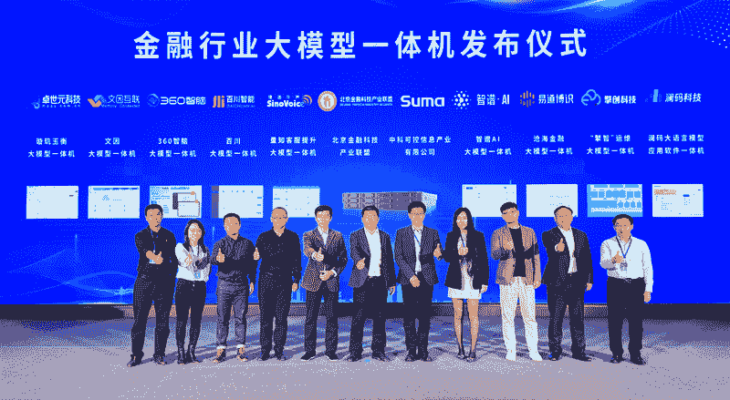

# 2023-11-10金融大模型一体机

> 来源：[https://xuqiwei1986.feishu.cn/docx/Ndy5d3V9qowjrzxbqkJc4lkWnRg](https://xuqiwei1986.feishu.cn/docx/Ndy5d3V9qowjrzxbqkJc4lkWnRg)

> 🔗 原文链接： h[ttps://www.cet.com](https://www.cet.com.cn/xwsd/3476024.shtml).cn/xwsd/3476024...

>

近日，由中国金融电子化集团指导，北京金融科技产业联盟和北京金融信息化研究所联合主办的2023金融科技安全与创新大会顺利召开。大会聚焦金融数据安全、数字基础设施防护、新一代人工智能等议题，吸引了金融科技领域领导、专家学者以及企业代表到场。

**会上**，中科可控联合卓世科技、文因互联、360集团、百川智能、捷通华声、智谱AI、易道博识、擎创科技、澜码信息等9大厂商，发布了9款金融行业大模型一体机，为金融科技领域发展提供了解决方案与技术支持。

联盟在《金融机构AI芯片应用情况专题报告》中提到“研发一批面向中小金融机构的易用产品服务”，旨为鼓励产业机构面向中小金融机构，研发一批模块化、可定制、安全合规的AI产品服务。产品服务需要以功能简单易用、界面简洁明了、操作直观友好、产品开箱即用为原则，使金融机构能以较低的成本、较短的周期引进相关服务能力，提升中小金融机构的业务效率和竞争力。

9款金融大模型一体机均依托于中科可控作为底层算力支撑，具备“高性能、高安全、更便捷”三大核心优势。搭载国产CPU与GPU，能够满足金融领域对AI大模型部署应用需求。搭载全国产核心器件，支持国密算法、可信计算等多种先进安全方案，确保金融企业数据处理安全。具备便捷的开发体验，内置多个AI大模型引擎和功能组件，无需用户开发，即可提升易用性。产品将在金融数据处理、分析和安全方面提供关键支撑，为金融机构提供更全面、高效的解决方案，推动金融科技的安全和创新发展。

中科可控与卓世科技联合推出的“璇玑玉衡知识增强行业大模型”，以多源异构的大模型架构为基础，构建了知识增强型行业模型底座，在金融领域行业模型、中医领域行业模型、康养行业模型和教育行业模型已经得到全面应用。

携手国内大语言模型首批金融领域可落地应用级模型供应商—文因互联，推出大模型一体机解决方案，零周期，快速实现专属大模型建设。

与360集团共同带来“360智脑大模型一体机”，基于360智脑通用大模型，具备强大的生成、对话和理解能力，广泛应用多个领域。

为了帮助企业快速融入人工智能时代，中科可控同百川智能协同发布大模型一体机方案，为企业提供丰富的商业产品解决方案，助力企业提升经营效率。

与捷通华声共同推出的“量知大模型训推一体机”，包含基础的LLM服务以及典型大模型应用，可集成训练平台直接对模型进行定制化训练，将训练和推理更好融合。

智谱AI致力于打造新一代认知智能通用模型，中科可控与其联合发布“智谱通用大模型一体机”，打造以数据与知识双轮驱动的认知引擎，帮助企业实现更智能的决策和创新。

中科可控联合易道博识共同发布“沧海大模型”，该模型可基于赛博智能学习平台，满足用户快速模型训练和场景数据调优的需求。

中科可控与澜码科技联合推出的“澜码大语言模型应用软件一体机”，具备快速部署、低成本、国产化适配等优势，广泛应用于金融、政务、企业办公等领域。

“擎智”运维大模型一体机为中科可控联合擎创科技共同发布，依托超强算力、海量数据以及智能算法，为金融行业IT系统运维提供开箱即用、可靠便捷的大模型建设新思路。

大模型是近年来对金融业影响最为直观的“催化剂”。此次金融行业大模型一体机的发布，将为金融科技安全与创新发展带来有效发展路径，推动金融领域数据安全与新一代人工智能技术的突破，加速金融数字化进程。