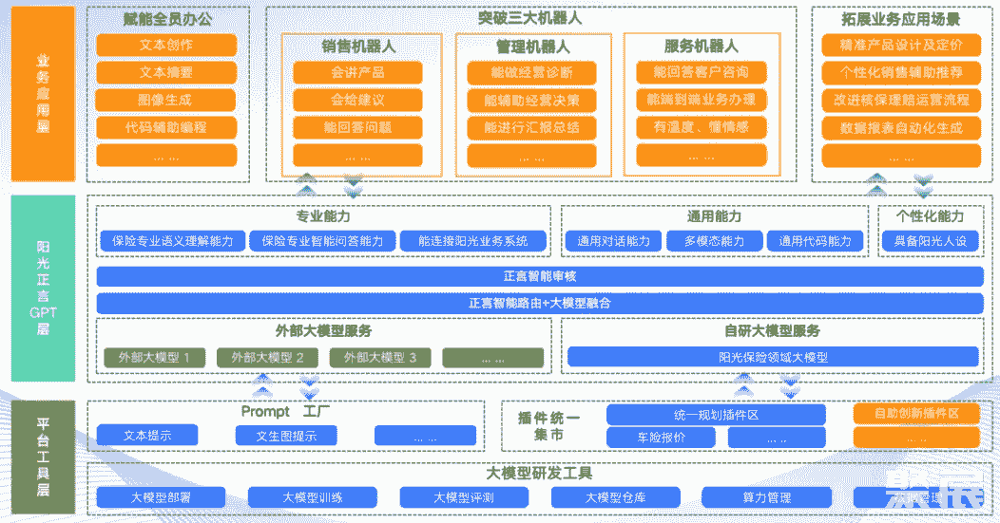
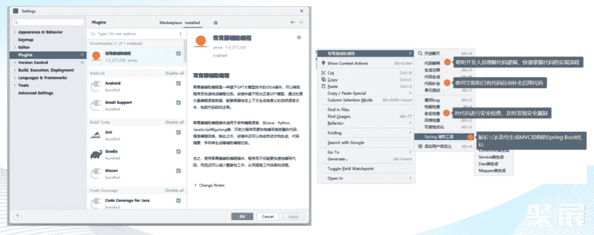
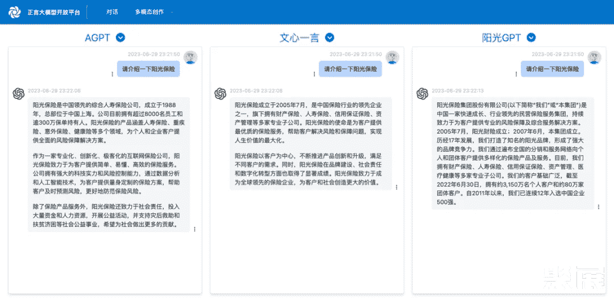

# 2023-08-02阳光保险【正言】办工大模型开放平台在企业办公领域的应用

> 来源：[https://xuqiwei1986.feishu.cn/docx/YzNMdTYWToXJI3xwIjtcWMT9n5e](https://xuqiwei1986.feishu.cn/docx/YzNMdTYWToXJI3xwIjtcWMT9n5e)

> 🔗 原文链接： h[ttps://www.jufair.](https://www.jufair.com/information/54532.html)com/information/...

>

**导语： **[随着Cha](https://www.jufair.com/exhibition-28-220-0-0-0-0-1/)tGPT的推出，标志着以大模型技术为代表的 人工智能 迈向了一个新的里程 碑。大模型技术和AIGC的结合将为办公场景带来巨大的变革，不仅可以提高工作效率，还可以提高工作质量和用户体验。

阳光保险集团科技团队积极推进阳光大模型应用建设，并与大模型头部企业展开深度战略合作，于2023年2月发布“阳光GPT”大模型AIGC智能应用，在公司通用办公领域迅速应用和推广，并于5月初构建完成阳光正言大模型开放平台。平台不仅集成了外部的大模型服务，更部署了阳光自研的大模型，目前已上线文本对话、AI文生图、图生图、图生文等多模态功能，初步实现了自然语言与应用系统的联动，为公司办公场景化应用提供支撑。

# **01构建****大模型****通用能力底座，支撑全域办公场景**

正言大模型开放平台主要由平台工具层、阳光正言GPT层、业务应用层构成，在阳光内部提供企业级的MaaS(Model as a Service)能力，如图1所示。

图1 正言大模型开放平台系统架构图

平台工具层由大模型研发工具、Prompt工厂及插件统一集市构成。其中大模型研发工具，实现大模型的自动训练、自动评测及模型管理；Prompt工厂实现Prompt的管理及优化，充分挖掘大模型在特定领域的能力；统一插件集市建设，实现插件的动态开发与管理。

阳光正言GPT层通过智能路由，实现外部大模型及自研大模型的动态调度，大模型择优与融合；再利用智能审核模型，对所有调用大模型的数据进行监控和检视，在确保数据和模型的使用安全合规的基础上，提供保险专业能力、通用能力及个性化能力。

基于[阳光正言](https://www.jufair.com/exhibition-26-74-0-0-0-0-1/)GPT层提供的通用能力，支撑业务应[用层实现](https://www.jufair.com/exhibition-26-73-0-0-0-0-1/)“1+3+N”三方面建设，其中：“1”是指在办公场景赋能全员办公，支撑文本创作、文本摘要、图像生成等；“3”是指突破销售、管理、服务三大 机器人 ；“N”是指拓展更多的业务应用场景，例如实现精准产品设计及定价、数据报表 自动化 生成等。

# 02打造三大通用能力，助力办公领域全链提质增效

依托阳光正言大模型开放平台，在通用能力建设上实现了通用对话能力、多模态能力、通用代码能力，全面支撑企业内部日常办公、研发运维等各类场景。

## 1. 预制或自定义各类人设，实现智能交互咨询辅助

在通用问答能力建设上，利用平台的智能路由，实现自研大模型与外部大模型的动态调度，借助Prompt工厂建立各类专业领域对话人设，为用户提供问答咨询、文案撰写及润色等多种办公文案类辅助功能。可根据应用场景选择不同的人设，也可以自定义专属人设。例如选定心理咨询师的角色，可帮助员工识别解决情绪问题，分析员工情绪问题的起源和根源，协调员工处理人际关系并使员工间密切合作 ，如下方视频所示。

重播 分享 赞

预制或自定义各类人设，支撑多类办公文案场景

## **2. 多模态图文小能手，促进****UI****设计类工作提质增效**

通过整合封装多模态大模型并在此基础上进行二次开发，构建文生图、图生图等能力，提高公司内部的海报、宣传图等UI设计类工作的效率。基于多模态能力，支撑了公司端午节营销海报的自动生成，如图2所示。在节日当天，寿险公司代理人超过万人次点击查看，生成的海报转发和下载超过2500次。

图2 端午节营销海报生成

## 3. 通用代码能力生成，赋能企业研发运维

在通用代码生成方面，融入阳光编程规范，提高代码质量，同时通过构建VS Code插件，扩大应用范围，如图3所示。此外，基于前期验证和测试多个应用场景，研发基于IDEA的常青藤辅助编程插件，完成了代码生成模型及IDE插件初版建设并在多支开发团队进行试点，在代码补全、代码解释、性能检查等场景助力研发团队生产效率的提升。全公司内部已有近半数开发人员将平台提供的通用代码能力辅助研发。

图3 构建集成开发工具常青藤辅助编程插件，实现代码辅助

## **4. 智能文本与****数据分析****，辅助经营管理与决策分析**

通过将阳光正言大模型开放平台与阳光驾驶舱报表系统融合，在数据分析方面，可将数据分析模型与建表服务进行串联，完成数据自动提取、数据间的关联分析并根据自然语言的报表制作需求，快速生成报表，如下方视频所示。

重播 分享 赞

基于自然语 言，实现报表自动生成

## 5. 多种模型自助切换，支持答案对比与择优

基于外部大模型较强的通用能力，同时考虑到阳光自研大模型在特定场景的个性化语言、语境、领域知识等方面的适应能力，平台为用户提供多种模型的切换功能，方便用户快速找到更优质的答案，如图4所示。

图4 不同模型自助切换，提供更优质的答案

# **03****大模型**在企业办公领域布局初现雏形，未来场景应用广阔

大模型技术与办公领域应用的融合，在国内外的厂商之间已有诸多应用案例。国外企业如微软基于GPT4推出了办公应用Microsoft 365 Copilot、谷歌发布了融合大模型技术与办公应用的Workspace；国内企业金山办公基于大模型发布智能办公助手WPS AI，锚定内容创作、智慧助手、知识洞察三个战略方向发展；科大讯飞也基于自身发布的星火认知大模型，在办公、教育、医疗等多个领域形成布局。

保险公司在快速发展的过程中，积累了大量保险行业领域知识、IT领域相关专业知识、监管合规相关知识和企业调研数据等。利用大模型技术能将数据进行自动归类并提炼要点，方便快速检索并生成报告，如根据数据进行辅助决策支持、监控文案条款与法律法规的冲突点等；基于大模型的图文生成能力，打造高品质的多模态图文小能手，实现在营销、培训等多个场景赋能；此外，利用大模型的代码生成能力，在企业的开发场景中，可帮助IT人员进行辅助编程、代码漏洞排查等，大大提升开发效率。

伴随AIGC技术发展形成的数字内容孪生、编辑、创作三大核心能力，为办公软件嵌入更多新功能提供支撑，推动办公产品迈入智能化发展新阶段，助力办公产品从效率工具向生成工具转变。我们期待GPT模型的不断发展并继续推进阳光正言大模型开放平台建设，持续改变企业的办公模式，为其带来更多的可能性和机会。随着技术的不断进步，阳光正言大模型开放平台定将在阳光保险企业办公领域、乃至客户服务和业务经营管理等领域发挥更大的作用，助力公司和行业开创更美好的未来。