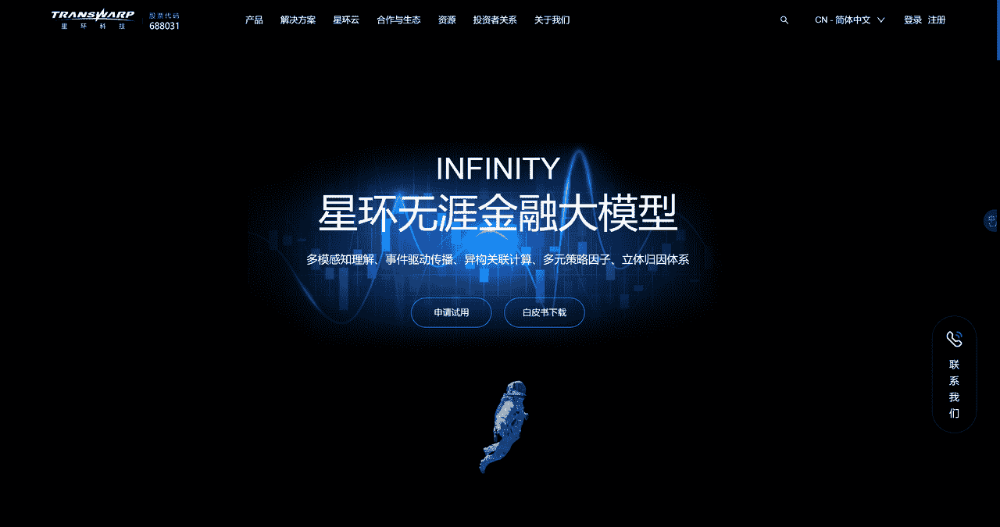
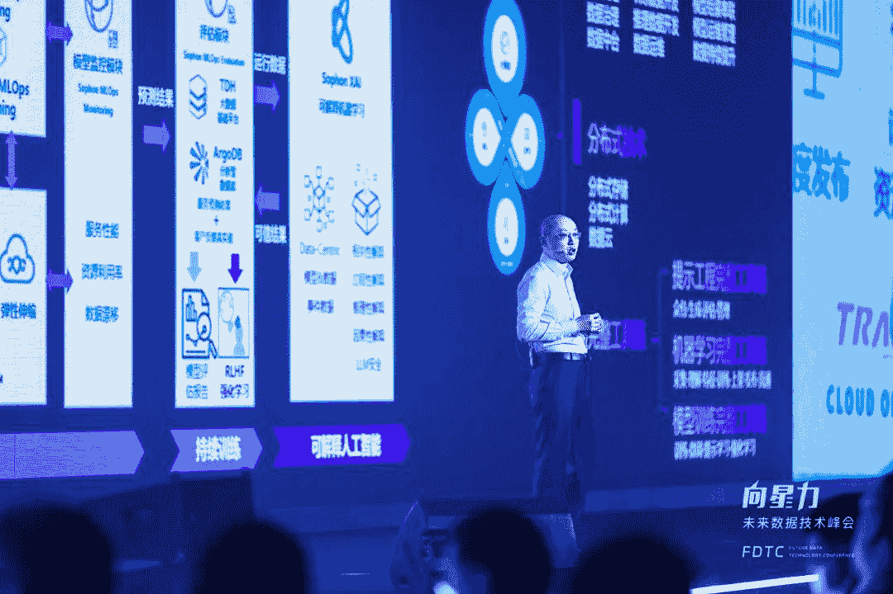

# 2023-05-26星环科技【无涯\求索】金融量化+大数据分析大模型发布

> 来源：[https://xuqiwei1986.feishu.cn/docx/EvS7d0RscoMaD9x3OLPcBpqvnfb](https://xuqiwei1986.feishu.cn/docx/EvS7d0RscoMaD9x3OLPcBpqvnfb)

> 🔗 原文链接： h[ttps://mp.weixin.q](https://mp.weixin.qq.com/s/6rYmk58OypU_Wwu0L7-nTw)q.com/s/6rYmk58O...

>

# 官网

[https://www.transwarp](https://www.transwarp.cn/product/infinity).cn/product/infinity

构建明日数据世界 星环科技 2023-05-30 13:27 发表于 北京

收录于合集

#向星力·未来数据技术峰会（FDTC） 40 个

#新闻动态 477 个

ChatGPT主导的对话式AI的普及，迅速拉近了普通人与人工智能的距离，使人和数据结合、交互比以往任何时候都更紧密、顺畅。

在商业上，大模型正在与企业应用迅速结合，重塑企业应用中人与数据的交互方式，这方面的应用不胜枚举。如在自然语言处理领域，OpenAI的GPT-4模型已经被用于各种任务，包括文本生成、问答和语言理解等。在计算机视觉领域，Facebook的DETR模型被广泛用于图像识别任务。

相**对于通用大模型训练难度大、投资大、运营成本高、对于特定领域的**适用性不佳等问题， 星环科技在行业首家全面布局行业（领域）大模型发展。 在5月26日举办的 向星力·未来数据技术峰会 （FDTC） 上，星环科技行业大模型战略布局全面亮相。

**星**环科技创始人、CEO孙元浩表示，星环科技不仅可以为用户提供大模型应用构建的全栈软件工具，还基于自身在行业应用领域的积累，推出两大行业大模型。

# 推出MLOps工具链，改造和优化现有的通用大模型

在大语言模型快速发展的今天，大语言模型能够更好地帮助计算机了解人类的意图。但是企业在实际使用中会发现，由于通用大语言模型缺乏领域知识和知识推演能力，无法实际完成许多专业任务。

在通用大语言模型和企业应用之间，存在着巨大的差距，需要通过LLMOps工具链来改造和优化现有的通用大模型，形成真正能够在某个行业内专精的领域大模型，真正让大语言模型技术更好地服务企业。

**为**了帮助企业用户基于大模型构建未来应用，星环科技推出了大模型持续提升和开发工具Sophon LLMOps，实现领域大模型的训练、上架和迭代。 Sophon LLMOps服务于大模型开发者，帮助企业快捷地构建自己的行业大模型，通过大模型基础设施，形成具备“新型人机交互”且“敏捷可持续迭代“的人工智能应用。

星环科技Sophon LLM-Ops的工具链优势体现在以下几个方面：

首先，Sophon LLMOps拥有自己的样本仓库能力 ，覆盖训练数据开发、推理数据开发、数据维护等工作，对大语言模型涉及的原始数据、样本数据、提示词数据做清洗、探索、增强、评估和管理等。

第二，Sophon LLMOps具有模型运维管理能力。 除了传统MLOps的六大统一——统一纳管、统一运维、统一应用、统一监控、统一评估、统一解释外，针对大语言模型的微调、持续提升、评估、对齐等提供从计算框架、工具到计算、存储、通信的调度和优化支持。

**第三，Sophon LLMOps具有大语言**模型和其他任务的编排、调度和上线能力。 Sophon LLMOps提供Agent、Ops、DAG，结合星环科技的多款大数据、数据库产品，如向量库Hippo和分布式图数据库StellarDB等，将不同大语言模型、传统机器学习、其他流程等编排成符合用户实际领域和业务需求的任务，并为客户提供服务。

星环科技Sophon LLMOps解决了客户三个核心痛点：

首先，提供一站式工具链，帮助客户完成“通用大语言模型” 的训练、微调，得到满足自身业务特点的领域大语言模型。

其次，帮助客户将原型的大语言模型应用，成功地投入到实际生产中。

第三，帮助客户运营在生产中应用的大语言模型，完成大模型的持续提升等。

# 向量数据库与图数据库联合构建大模型应用，让每个人都拥有个性化的AI助理

**孙元浩表示，数据处理从多模型向多模态转型，从单一模态向多模**态进化，企业数据分析进入了“新的次元”。

**使**用星环科技的向量数据库和分布式图数据库，可以构建基于大模型的应用，让每个人都拥有自己个性化的AI助理。 星环科技推出了自研的向量数据库Transwarp Hippo，拓展大语言模型时间和空间维度；星环科技打造面向图智能、业务分析的多模型企业级分布式图数据库StellarDB 5.0，构建海量数据互联智慧“星”图。

数据库经历了40多年的发展，依然生机勃勃。随着人工智能（AI）的发展，非结构化数据应用日益增多，数据体量大、格式多、存储方式多样，对这些数据的处理，传统数据显然无能为力，从而诞生了一种新的数据库——向量数据库（vector databases）。

向量数据库主要用于AI应用，如机器学习、自然语言处理、图像识别等，并因为支持快速高效的数据存储和检索过程，而成为AI用例的理想选择。

在此次的 向星力·未来数据技术峰会 （FDTC） 上 ，星环科技推出了自研的向量数据库Transwarp Hippo。作为一款企业级云原生分布式向量数据库，星环科技Hippo支持存储、索引以及管理海量的向量式数据集，能够高效地解决向量相似度检索、高密度向量聚类等问题。

与开源的向量数据库不同，Hippo具备高可用、高性能、易拓展等特点，支持多种向量搜索索引，支持数据分区分片、数据持久化、增量数据摄取、向量标量字段过滤混合查询等功能，能很好地满足企业针对海量向量数据的高实时性查询、检索、召回等场景。

大数据时代，应该如何解决海量图数据的存储、计算难题呢？星环科技打造面向图智能、业务分析的多模型企业级分布式图数据库StellarDB 5.0。

在性能上，StellarDB 5.0一骑绝尘，实现了实时短查询场景5倍提升，高并发上万+QPS，近50种图算法，平均8倍性能提升，多度关联关系场景10倍提升，解决无限扩层问题。

同时StellarDB 5实现了图算法可视化，带来全面升级的数据可视化分析引擎KG Explorer 1.3，一款人人易用、面向业务、数据分析的可视化工具。

另外，StellarDB 5.0与星环科技自研的深度图框架ZenGraph结合，基于图数据库的查询计算能力，提供快速、准实时，甚至实时的特征查询和计算；基于图数据库内置算法，提供多元的图特征计算能力；基于图数据库存储能力，提供高速数据写会能力；针对不同业务场景支持多种深度图嵌入算法模型，相比于传统图算法，能够从图中挖掘学习更多的特征知识，预测更精准。

利用向量数据库和图数据库，可以构建特定领域的大模型应用。在大模型应用开发软件栈中，知识图谱、向量数据库、模型仓库和图数据库构成的知识语义层，与模型运行层、大语言模型、提示工程层、应用前端集成层协同，帮助用户创建大模型应用，让每个人都拥有自己的个性化AI助理。

其中，向量数据库可用于应用的文本检索，让查询更满足人性化的需求；可以实现语音、图像、视频检索，覆盖如人脸识别、语音识别、视频指纹等各类AI场景；实现个性化推荐，做到千人千面的个性化推荐效果。

而图数据库和知识图谱联合，与大模型可视化端到端构建工具一起，提供了知识抽取融合、知识建模、知识图谱生成存储、基于大模型的知识问答等闭环功能。客户以知识图谱作为大语言模型提示即可发起模型微调，以较低代价就可获得行业的专属大语言模型问答应用。

而向量数据库、图数据库与大语言模型结合，可以构建业务域知识图谱和业务系统的应用服务，进一步提高人机交互的效率，提供更灵活的组合业务服务，激发出更多更深入的业务场景AI应用。 相较于通用大模型，结合 向量数据库、 图数据库与知识图谱 所存储的具体行业知识，领域大模型更精通特定 行业 的 知识， 具备 高效的语料匹配能力和知识推理能力 ， 能够有效回答 用户 的提问。

# **无涯金融量化投研大模型**

**针对**量化投研领域特定的业务逻辑，星环科技通过预训、提示、增强、推导范式的构建，实现Financial-Specific-LLM的训练，推出了金融行业量化投研大模型无涯 Infinity 。 星环科技基于大模型的事件驱动与深度图引擎，实现对事件语义刻画、定价因子挖掘、时序编码、异构关系图卷积传播，进而构建包含事件冲击、时序变化、截面联动和决策博弈等多个维度的量化投研新范式。

**星**环科技无涯金融大模型，寓意学海无涯，既代表了投资领域终身学习的精神，也蕴含了大模型本身在参数架构方面持续迭代的内涵。 可以说无涯是一款面向金融量化领域、超大规模参数量的生成式大语言模型。主要通过自监督的增量训练和有监督的指令微调，使用星环科技高性能计算集群训练而成。

首先，星环科技无涯使用上百万的高质量的专业金融语料 ，涵盖了研报、公告、政策、新闻等高质量的自然语言文本，作为基础大模型的二次预训练语料，使得无涯具备对包括基本面、技术面、消息面在内的金融通识领域准确的理解能力，满足行业分析师的需求。

其次，星环科技无涯使用了上百类特定事件类型和20多万事件实例 ，完成对大模型的指令微调，从而使得无涯能够对齐专业研究员的分析推理能力，更加智能和可靠。

再次，在此基础上，星环科技无涯构建了包括政策、舆情、ESG、风险、量价、产业链等六类大模型基础因子集，所构建的复合因子体系满足投资经理的需求。

从应用上看，无涯金融大模型强化以下几个能力：

第一，针对金融行业，拥有准确理解和合理分析的能力。无涯擅长处理金融量化领域的各类问题，诸如在政策和研报分析、新闻解读、事件总结和演绎推理上都具备强大的理解和生成能力。

第二，实现事件复盘分析与推演，贯通宏观行业和大类资产分析逻辑。能够对股票、债券、基金、商品等各类市场事件进行全面的复盘、传播和推演。

第三，构建六类大模型基础因子集，支撑复合因子策略体系，能够生成策略因子集合，构建立体的归因解释体系。

毫无疑问，星环科技长期深耕金融领域，服务大量金融行业客户，积累了上百万金融专业领域的语料；基于星环科技对图数据库、深度图推理算法的技术，形成了大规模高质量的金融类事件训练指令集。二者共同铸就了星环科技开发金融领域大语言模型的坚实底座。

# 大数据分析大模型SoLar“求索”，数据库查询平民化

同样在大数据领域探索、积累长达10年的星环科技，基于在SQL编辑器的多年积累，结合大语言模型，推出了星环科技大数据分析大模型SoLar求索。用户可以通过自然语言，生成可成功执行的SQL或Cypher，从而快速获取查询的结果，能够快速降低用户的使用门槛。

星环科技此次发布的SoLar求索，将作为数据查询和分析的智能副手，为数据工程师、数据科学、业务人员等提供更好的使用体验。这些非大数据分析的专业用户，可以利用 SoLar求索，在不需要学习和掌握数据库编程语言的前提下，可以使用自然语言自由地按需查询数据。

星环科技的数据分析大模型 So L ar 求索包含多个数据分析大语言模型。 本次展示的是自然语言进行数据分析（SQL类）的能力。 用户可以通过自然语言提问，从星环科技的大数据平台上的多张数据表中查询出所需结果，并快速做出相应数据分析和相应的分析结果展现。

相较于传统方式，应用星环科技 So L ar 求索的好处包括：

首先，可以使用自然语言描述业务需求，方便对多张数据表进行关联，并使用各种星环科技大数据分析平台提供的函数进行分析计算，让数据库查询平民化。

其次，可以使用自然语言描述涉及多种数据模型的复杂业务需求，借助星环科技大数据平台特有的多模型技术，对不同模态如图数据、文本数据、结构化数据等的数据进行关联分析和展示。

同时，为了保障生产可用和避免大语言模型的“幻觉”问题，星环科技Solar求索还为客户提供了交互式数据分析的方式，方便客户利用数据表与表之间的ER图（实体-联系图），指定想使用的数据库/表，提供数据分析代码的一步步解释，从而生成可被追溯、可被理解、同时更准确的分析能力。

AI大模型时代，正在加速AI应用的普及化。星环科技一方面为为用户提供大模型应用构建的软件工具，同时基于自身在行业应用领域的积累，推出无涯金融大模型和大数据分析大模型SoLar求索两大行业应用大模型，帮助用户应对大模型时代的挑战。

