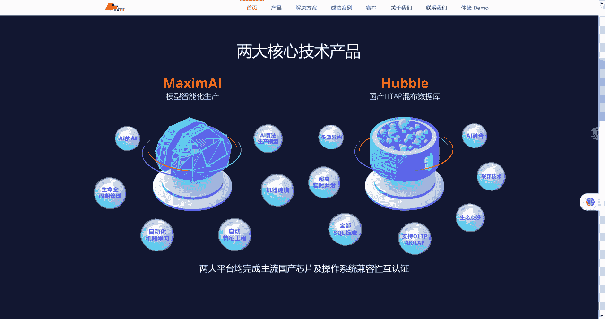
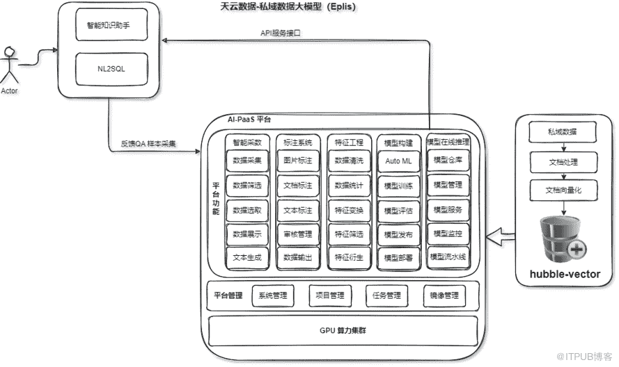
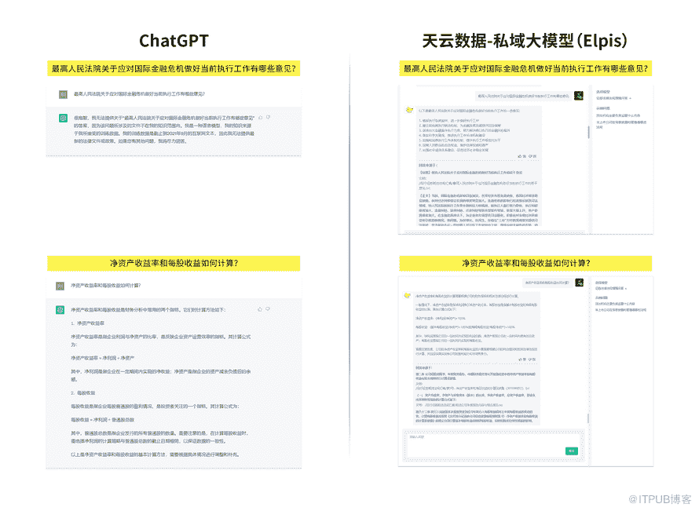
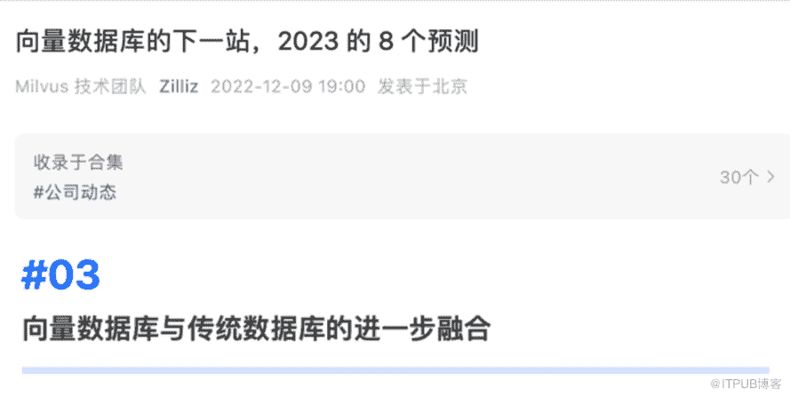
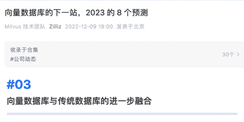

# 2023-04-21天云数据【Elpis】希神星私域数据大模型将大模型能力应用于产业原生动力即工程领域_ITPUB博客

> 来源：[https://xuqiwei1986.feishu.cn/docx/SKHwdarQloJmoBxTxh2cLQ6mndh](https://xuqiwei1986.feishu.cn/docx/SKHwdarQloJmoBxTxh2cLQ6mndh)

# 官网

http://www.beagledata.com

> 🔗 原文链接： h[ttp://blog.itpub.n](http://blog.itpub.net/31545803/viewspace-2947441/)et/31545803/view...

>

今年初，AI大模型开启诸神之战，行业都在蹭热点发布AI大模型，媒体也跟进谈大模型。ChatGPT的火爆如同七年前的AlphaGo一样，AlphaGo并不意味着AI就**只能下围棋，ChatGPT也不意味着AI只能聊天，它们的真实目标都是工程领域。近日**，在上海资产管理协会秘书处、上海资产管理协会金融科技专业委员会联合主办的“上海资产管理协会首次会员专业技术沙龙”上， 智能投研技术联盟(ITL)高级技术顾问、天云融创数据科技(北京)有限公司CEO雷涛在会上演示发布私域数据大模型Elpis，该模型具备专业领域知识，能准确回答问题。

# 对话演示

天云数据私域大模型Elpis通过具备向量能力的数据库Hubble支撑了证监会全部法规(不含更新数据)，并做迁移学习。

# 私域大模型(Elpis)窄场景闭环流程图

(天云数据-私域大模型(Elpis)窄场景闭环流程图)

通过AI-PaaS平台采集相关数据，进行数据标注及数据处理，基于迁移学习对大语言模型进行微调，同时利用Hubble-vector的向量存储及查询能力，使模型语境更适用于当前私域数据场景，并且做到答案可精确溯源，最后通过模型管理进行服务的发布供用户使用。在生成时可以引用原有法条做准确严谨回答，对比通用大模型，更适合机构私有数据。

# 天云数据-私域大模型Elpis与ChatGPT的回答对比图

(以上为天云数据-私域大模型Elpis与ChatGPT的回答对比图)

其实，两年前OpenAI就发布了大模型，但发布应用以后并没有引起北美市场的关注。北美产业市场的反应和中国市场的反应有着天壤之别。国内热谈的ChatGPT，在北美产业内声音很平淡。但另一个值得关注的点是，北美硅谷的资本迅速开始热追向量数据库。我们来谈一谈其中的关键信息：

**马斯克指责OpenAI不Open：OpenAI开放了ChatG**DP应用，OpenAI没有开放的是什么?

OpenAI的创始人马斯克在Twitter上接连指责OpenAI违背了创立时的初心：“OpenAI最初是作为一家开源的非营利性公司而创建的，为了抗衡谷歌，这也是我把它命名为OpenAI的原因。但现在它已经成为一家闭源的营利性公司，由微软有效控制，这完全违背了我的本意。”

作为一个由OpenAI开发的AI模型， OpenAI提供了API，以让开发者在他们的应用程序中使用ChatGPT的能力，但是源代码并没有公开发布，就是基于私域数据迁移学习，基于人类反馈的强化学习。

OpenAI不Open。

**关于ChatGDP北美与中国的关注差异：**国内大谈大模型VS硅谷资本热追向量数据库

技术，应该抛弃表象看本质，才能解决根本。试问一下，ChatGPT的工程架构是如何搭建的，工程的核心在哪里?为什么在国内热追大模型时，北美资本热追的是向量数据库?

目前大模型主要基于的语料数据主要是非结构化数据，各种类型的文档、图片、音视频等训练出来多模态模型，对于训练模型本身，这些非结构化数据就需要预处理转化为向量数据。在应用端与ChatGPT 进行交互的时候，可以输入文字、图片等信息，首先需要处理的是输入进行向量化，然后进入模型，在底层还有海量历史海量数据进行向量计算，还涉及相似问题查询，相似问题最优答案推荐。诸如以上的向量化数据的存储，需要一个分布式向量数据库进行支撑，这是非结构化数据大模型场景工程化落地必然路径。

也就是ChatGPT只是我们看到的应用表象结果， 向量数据库是北美市场看到的核心技术。

科技进步不能把能力构建在一个线上应用上，而要把能力应用在产业的原生动力上。仅仅做一个客服机器人，海阔天空泛泛而谈，不谈专业领域的知识，不能真正的推动行业进步。

主流的数据库必然要面向AI：向量数据库将在AI中发挥关键作用，那么AI原生数据库应该是什么样?

向量数据库在帮助大语言模型的应用方面发挥了重要作用，对AI有非常好的支撑。深度学习被认为是最有效的非结构数据处理方式之一，非结构数据经过深度学习模型的处理会被向量化，所以海量非结构数据的分析处理被转化为对海量向量的近似搜索。

大模型浪潮汹涌而至，向量数据库注定要掀起一波巨浪。但向量数据库厂商Zilliz在自己的官方账号中对向量数据库的2023做了8 个预测，第3点便是： 向量数据库与传统数据库的进一步融合。

我们知道数据库的发展从关系型数据库到NoSQL再到NewSQL，所追求的是**数据库操作的便捷性。但向量数据库并不支持SQL操作，这是他在**使用上的一个门槛。 以后主流的数据库必然要面向AI，面对数据的存储、计算、调度和解析四个层级，因此一定是AI原生数据库。

**那**么AI原生的数据库应该长什么样，应该面向什么样的需求提供服务?在SQL逻辑之上，怎么能够提供更为丰富的企业级数据服务? 互联网带来了产销合一，越来越多的数据并不是面向宏观趋势的供给，做报表、管理驾驶舱、仪表盘，供给领导决策分析。个性化服务，淘宝推荐引擎、千人千面个性化结果，要跑的是贝业斯网络、是协同过滤算法，是这些算法在替代SQL的可视化服务。

所以怎么能够在同一个计算的库体上，面向机器学习的操作面向新兴的数据驱动业务的算法?AI内生数据库是一个必然要走的路径。尤其是应对产业互联网，第三波的机器数据生产，更多的物联网的机器生产、传感器，他的机器数据物理意义人理解越来越难，比如油压、温度、结蜡、工况都是一些科学属性。这些数据它很难用决策，因为它对人类来说需要更强的科学知识才能去理解。

AI原生数据库通过更多的逻辑计划丰富数据消费能力和形态，是面向服务的融合，通过将数据库智能化在AI计算的过程中降低门槛和成本，同时也可以充分地释放数据库的计算资源，进一步突破行业天花板，形成更大产业规模。