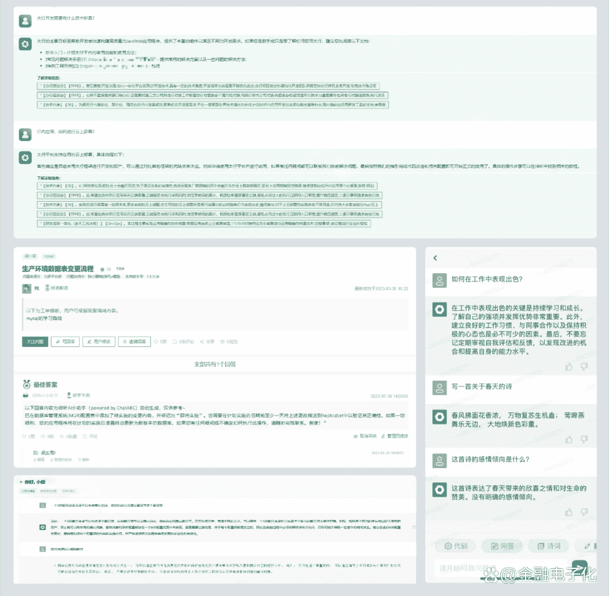
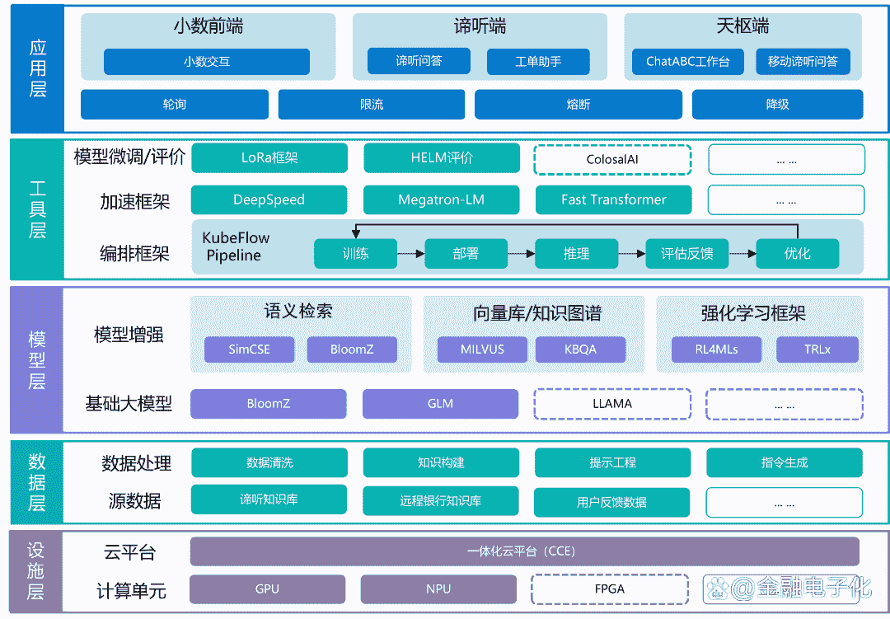

# 2023-03-31农业银行【ChatABC】金融AI大模型产品成功发布

> 来源：[https://xuqiwei1986.feishu.cn/docx/GpXvdRmDroePAWx2MNScXfzVnFh](https://xuqiwei1986.feishu.cn/docx/GpXvdRmDroePAWx2MNScXfzVnFh)

> 🔗 原文链接： h[ttps://baijiahao.b](https://baijiahao.baidu.com/s?id=1761870088300256322&wfr=spider&for=pc)aidu.com/s?id=17...

>

发布｜农业银行金融AI大模型产品ChatABC成功发布

文 / 中国农业银行人工智能研发团队

近日，以ChatGPT等为代表的人工智能大模型应用快速发展，引发了金融行业对人工智能大模型及其场景应用的广泛讨论和探索。农业银行人工智能研发团队（以下简称：AI研发团队）基于在AI领域的深度耕耘和长期探索，依托自主研发的AI创新能力体系，积极探索AI大模型应用，在同业率先推出类ChatGPT的AI大模型应用ChatABC（中文名：小数），并在农业银行科技问答场景进行了内部试点，为后续AI大模型的应用探索了路径，积累了经验。

**创新引领，**

# **试点金融****AI****大模型****应用**

ChatGPT是OpenAI公司发布的一款通用AI对话服务，其在发布以来3个月内的月活用户超1亿，成为历史上增长最快的消费者应用。相较以往的对话机器人，ChatGPT首次同时具备了三项生产力能力：一是拟人化沟通能力，支持多轮次的拟人对话以更准确地理解上下文，可完成常识问答、内容合成等任务；二是具有多任务生成能力，可以从小样本甚至零样本学习中生成知识，可完成文案生成、文本摘要、语言翻译等多类型任务；三是具有思维推理能力，通过人类的提示实现逻辑推理能力，可完成代码生成、逻辑计算等任务。ChatGPT以及类似大模型应用也存在问答知识不够准确、知识更新困难、数据安全与隐私保护等几方面的挑战。

ChatGPT背后的主要技术是拥有千亿级参数的大语言模型。近年来，人工智能“产学研”各界纷纷看好大模型的应用前景，国内外的高科技企业、开源机构、知名高校等均在大模型中投入大量精力和资源。在OpenAI以及微软之外，如谷歌的T5、Bard以及Meta的LLAMA、百度的文心一言以及华为的盘古等产品均在持续推进和快速迭代。大模型的成功依赖于算力、算法、数据、工具、人才等几个方面的持续沉淀和能力突破。

图1 研发服务问答助手

随着大语言模型（LLM）技术上的迅猛发展和场景价值不断涌现，农业银行AI研发团队主动拥抱大模型前沿技术，以场景价值赋能为目标，在同业率先基于自主研发能力打造类ChatGPT的AI大模型应用ChatABC。ChatABC 1.0利用有监督模型微调、强化学习、self-instruct等最新的大模型应用技术，通过异构知识库和知识增强充分融入农业银行IT知识库，具备领域级知识理解和问答能力，并通过农业银行研发支持平台的问答助手、工单自动化回复助手等形式面向内部员工开放试用，为用户提供了更为丰富、个性化、可靠的全新搜索服务体验和智能化、高效率的工单支持服务。

**夯实基础，**

# **探索金融****AI****大模型****能力**

多年以来，农业银行AI研发团队深入贯彻落实数字化转型战略，始终保持对于AI新技术的跟踪和探索，全面推进全栈自主的人工智能服务平台建设，持续探索构建适应AI大模型的算力、数据、模型、工具、应用五位一体的AI大模型创新应用体系，提升大模型试点应用的水平。

图2 五位一体AI大模型创新应用架构

## **1.****算力****：构建云原生异构算力新基础**

基于容器化技术，推进GPU、NPU等各类AI芯片的统一封装管理，实现异构芯片的统一纳管。深度应用kubeflow等云原生编排技术，支持训练任务的细粒度动态调度，充分提升AI算力的利用效率。一体化的云原生算力基础，实现对于多种算力的统一纳管和调度，构成了AI大模型训练的强大算力基础。

## **2.数据：打通****大模型****持续迭代新闭环**

围绕“采建管用”闭环，构建大模型训练和持续提升的基础数据闭环。优配比，合理调节内外部数据比例，清洗提升数据质量。巧回收，巧妙设计用户点赞点踩和用户回答问题的功能，采集人工用户对于问题的回答，作为模型持续优化训练的“燃料”。自强化，应用用户打分数据，持续提升奖励模型（Reward Model）精准度，依托强化学习使模型学会“左右手互博”。

## 3.模型：打造多模型融合开放新生态

AI平台采用开放式的框架，通过组件化方法快速纳入各类开源模型和商业模型。持续跟踪开源模型最新进展，逐步构建适应问答、文本向量化等不同场景的模型库。参考HELM等模型评价体系，初步构建了一套适应金融特色的模型评价体系，模型好不好，指标来说话。

## 4.工具：铺设模型流水线训练新管道

依托kubeflow等基础组件，AI平台构建了多条AI大模型的训练流水线。通过标准化流水线，AI大模型微调训练可以实现自动化流转，构建新训练的效率大幅提升。同时支持多模型并行训练，进而开展模型实验比对和模型调优。深度应用DeepSpeed、FastTransformer等加速框架，解决模型并行、数据并行等训练难题，提升AI大模型训练推理效率。

## **5.应用：探索****大模型****知识融合新架构**

构建异构知识库，支持全文检索、知识推理等各类知识检索场景需求。深度定制全文检索框架，支持文档类知识的高性能精准检索。依托知识图谱技术，构建概念类知识的图谱，通过知识推理提升知识推理能力。打造基于置信度的模型知识问答和知识库检索的评价体系，实现多源知识的无缝融合。

依托五位一体的AI创新能力体系，农业银行AI团队从2020年已开启大模型相关技术研究和试点应用，例如应用BERT（参数量约1亿）构建企业舆情的识别模型，实现舆情内容的抽取分析和情感分类；应用CBNet-v2模型（参数量约4.5亿）构建智慧畜牧的牛只识别大模型，实现对牛只的精准像素级分割、定位和计数等。

ChatABC大模型的建设重点着眼于大模型在金融领域的知识理解能力、内容生成能力以及安全问答能力，对于大模型精调、提示工程、知识增强、检索增强、人类反馈的强化学习（RLHF）等大模型相关新技术进行了深入探索和综合应用，结合农业银行研发支持知识库、内部问答数据以及人工标注数据等金融知识进行融合训练调优，实现了全方位的金融知识理解和智能问答应用。

**开放融合，**

**拥抱金融AI大模型未来**

Ch**atABC大模型1**.0版本的发布是一个金融界AI大模型应用的重要里程碑。随着大模型技术快速发展和**应用场景的不断落地**，大**模型应用前景可期。**目前大模型金融领域应用的天边，还有“三朵乌云”。 一是技术选型难。 大模型技术快速发展，国内国外的商业模型和开源模型快速发展，短短1个月内已经有十数款类似模型发布，且持续向小型化、组件化方向发展，提高了大模型基础选型的难度。 二是可信使用难。 大模型基于概率推理，难以保障结果知识的准确性，且知识更新依赖大模型训练，成本高、效率低。同时大模型作为一个黑盒模型，在模型公平、数据安全、隐私保护等方面的合规应用还需要持续探索。 三是场景拓展难。 大模型作为一项新技术，涉及底层框架支撑、模型训练、数据收集标注、知识库构建等诸多难题，模型训练不收敛、数据质量差、标注成本高、场景发掘难等，都制约着大模型的有效应用。

挑战虽多，但是AI大模型在金融领域的应用仍然有宽广的想**象空间。直面未来，拥抱**变**化，我们需要： 一是保**持技**术开放性， 充分利用好**商业模型和开源模型两方面资源，两条腿走路，构建开放架构和生态，重点提升大模型的插件化服务能力，保障技术开放性。 二是探索使用可信性， 加强大模型+知识库的架构设计，提升大模型问答的可信程度。同时做好一头一尾的管控，数据（一头）端做好数据筛选和清洗，提升数据质量，应用（一尾）端做好应用管控，防控业务应用的风险。 三是提升场景规范性， 面向金融场景应用，沉淀对于数据、标注、模型选择、模型训练、模型评估等方面的规范和组件，持续提升场景应用的规范性，加强培训交流，提升大家对于大模型应用的认知。

随着大模型技术的飞速发展，金融行业应用AI大模型已经不是“要不要用”的选择题，而是“如何用好”的必答题。农业银行AI研发团队将持续提升五位一体AI大模型创新应用能力，按照开放、规范、可信的原则，积极推进大模型能力的试点应用，为金融同业提供更多可供借鉴的经验，赋能金融业提质、增效、降本。

举报/反馈

大家都在搜

[中国农业银行数字化转型 ](https://baidu.com/s?word=%E4%B8%AD%E5%9B%BD%E5%86%9C%E4%B8%9A%E9%93%B6%E8%A1%8C%E6%95%B0%E5%AD%97%E5%8C%96%E8%BD%AC%E5%9E%8B&rsv_dl=feed_landingpage_rs&from=1020853i&rsf=)[中国农业银行科技与产品管理局 ](https://baidu.com/s?word=%E4%B8%AD%E5%9B%BD%E5%86%9C%E4%B8%9A%E9%93%B6%E8%A1%8C%E7%A7%91%E6%8A%80%E4%B8%8E%E4%BA%A7%E5%93%81%E7%AE%A1%E7%90%86%E5%B1%80&rsv_dl=feed_landingpage_rs&from=1020853i&rsf=)[itable农行 ](https://baidu.com/s?word=itable%E5%86%9C%E8%A1%8C&rsv_dl=feed_landingpage_rs&from=1020853i&rsf=)[ai做农业银行logo ](https://baidu.com/s?word=ai%E5%81%9A%E5%86%9C%E4%B8%9A%E9%93%B6%E8%A1%8Clogo&rsv_dl=feed_landingpage_rs&from=1020853i&rsf=)[中国农业银行abc ](https://baidu.com/s?word=%E4%B8%AD%E5%9B%BD%E5%86%9C%E4%B8%9A%E9%93%B6%E8%A1%8Cabc&rsv_dl=feed_landingpage_rs&from=1020853i&rsf=)[中国农业银行(ABC)官方网](https://baidu.com/s?word=%E4%B8%AD%E5%9B%BD%E5%86%9C%E4%B8%9A%E9%93%B6%E8%A1%8C%28ABC%29%E5%AE%98%E6%96%B9%E7%BD%91&rsv_dl=feed_landingpage_rs&from=1020853i&rsf=)