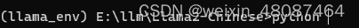
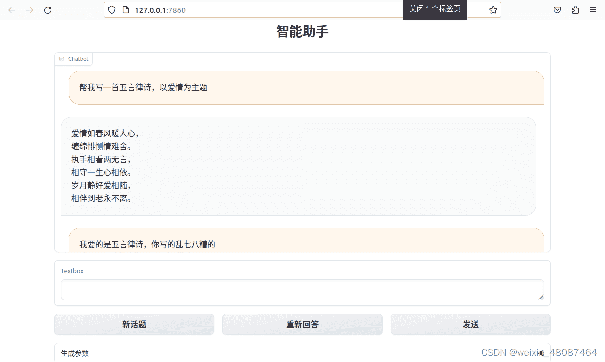

# 2023-10-23Llama中文社区开源预训练Atom-7B-chat大模型体验与本地化部署实测(基于CPU，适配无GPU的场景)_atom模型-CSDN博客

> 来源：[https://xuqiwei1986.feishu.cn/docx/G66sdVFDPoZTGVxzZAWcLprFntf](https://xuqiwei1986.feishu.cn/docx/G66sdVFDPoZTGVxzZAWcLprFntf)

> 🔗 原文链接： h[ttps://blog.csdn.n](https://blog.csdn.net/weixin_48087464/article/details/133810685)et/weixin_480874...

# Llama中文社区开源预训练Atom-7B-chat大模型体验与本地化部署实测(基于CPU，适配无GPU的场景)

##  **一、模型简介**

**原子大模型Atom **由Llama中文社区和原子回声联合打造，在中文大模型评测榜单C-Eval中位居前十（8月21日评测提交时间）。

Atom系列模型包含Atom-7B和Atom-13B，基于Llama2做了中文能力的持[续优化。Atom-7B和A](https://huggingface.co/FlagAlpha)tom-7B-Chat[目前已完全开源，支持](https://github.com/FlagAlpha/Llama2-Chinese#%E5%9F%BA%E4%BA%8Ellama2%E7%9A%84%E4%B8%AD%E6%96%87%E9%A2%84%E8%AE%AD%E7%BB%83%E6%A8%A1%E5%9E%8Batom)商用，可在 Hugging Face 仓库获取模型，详情见 Atom-7B下载 。

Atom大模型针对中文做了以下优化：

####  [大规模的中文数据预训练](https://github.com/FlagAlpha/Llama2-Chinese#%E5%A4%A7%E8%A7%84%E6%A8%A1%E7%9A%84%E4%B8%AD%E6%96%87%E6%95%B0%E6%8D%AE%E9%A2%84%E8%AE%AD%E7%BB%83)

原子[大模型Atom在](https://github.com/FlagAlpha/Llama2-Chinese#-%E6%95%B0%E6%8D%AE%E6%9D%A5%E6%BA%90)Llama2的基础上，采用大规模的中文数据进行持续预训练，包含百科、书籍、博客、新闻、公告、小说、金融数据、法律数据、医疗数据、代码数据、专业论文数据、中文自然语言处理竞赛数据集等，详见 📝 数据来源 。

同时对庞大的数据进行了过滤、打分、去重，筛选出超过1T token的高质量中文数据，持续不断加入训练迭代中。

####  [更高效的中文词表](https://github.com/FlagAlpha/Llama2-Chinese#%E6%9B%B4%E9%AB%98%E6%95%88%E7%9A%84%E4%B8%AD%E6%96%87%E8%AF%8D%E8%A1%A8)

为了提高中文文本处理的效率，我们针对Llama2模型的词表进行了深度优化。首先，我们基于数百G的中文文本，在该模型词表的基础上扩展词库至65,000个单词。经过测试，我们的改进使得中文编码/解码速度提高了约350％。此外，我们还扩大了中文字符集的覆盖范围，包括所有emoji符号😊。这使得生成带有表情符号的文章更加高效。

####  [自适应上下文扩展](https://github.com/FlagAlpha/Llama2-Chinese#%E8%87%AA%E9%80%82%E5%BA%94%E4%B8%8A%E4%B8%8B%E6%96%87%E6%89%A9%E5%B1%95)

Atom大模型默认支持4K上下文，利用位置插值PI和Neural Tangent Kernel （NTK）方法，经过微调可以将上下文长度扩增到32K。

###  [📝 中文数据](https://github.com/FlagAlpha/Llama2-Chinese#-%E4%B8%AD%E6%96%87%E6%95%B0%E6%8D%AE)

我们通过以下数据来优化Llama2的中文能力:

| 类型 | 描述 |
| --- | --- |
| 网络数据 | 互联网上公开的网络数据，挑选出去重后的高质量中文数据，涉及到百科、书籍、博客、新闻、公告、小说等高质量长文本数据。 |
| [Wikipedia](https://github.com/goldsmith/Wikipedia) | 中文Wikipedia的数据 |
| [悟道](https://github.com/BAAI-WuDao/Model) | 中文悟道开源的200G数据 |
| [Clue](https://github.com/CLUEbenchmark/CLUEDatasetSearch) | Clue开放的中文预训练数据，进行清洗后的高质量中文长文本数据 |
| 竞赛数据集 | 近年来中文自然语言处理多任务竞赛数据集，约150个 |
| [MNBVC](https://github.com/esbatmop/MNBVC) | MNBVC 中清洗出来的部分数据集 |

由于自己电脑没有配置独显，想用CPU来跑大模型看看（中间遇到比较多的坑），记录一下完整的过程，给大家予以借鉴。

##  二、模型下载

1、git hub地址

[G](https://github.com/FlagAlpha/Llama2-Chinese/)itHub [-](https://github.com/FlagAlpha/Llama2-Chinese/) FlagAlpha/Llama2-Chinese: Llama中文社区，最好的中文Llama大模型，完全开源可商用 下载源码： GitHub - FlagAlpha/Llama2-Chinese: Llama中文社区，最好的中文Llama大模型，完全开源可商用


2、 可在 Atom-7B-Chat Hugging Face 仓库获取模型

1）由于hugging face无法直接访问，推[荐一个速度较快、好用的“科](https://go.91merry-1.top/auth/register?code=rSHT)学上网”工具 91merry 🪜 ，我买的30/季度，每月100G流量，我百兆带宽实际下载最大能够达到15M/s。

2）把这里面的每一个文件都下载了。（推荐用IDM，浏览器默认的下载没IDM快，总共下载下来大概14G）


##  三、模型部署

1、单独弄一个大模型的python虚拟环境，避免包冲突

```
python -m venv llama_env
source llama_env/bin/activate  # 在 Windows cmd执行 `llama_env\Scripts\activate`  
```



2、下载python相关依赖包

ps: **由**于github下载的代码里面requirements.txt是基于有独显的场景，按照官网的在纯cpu环境会运行不起来 。

打开 [PyTorch ](https://so.csdn.net/so/search?q=PyTorch&spm=1001.2101.3001.7020)官网： Start Locally | PyTorch ，选择自己对应的环境，会生成相应的命令。


```
pip3 install torch torchvision torchaudio
```

安装其它的包

```
pip install scipy sentencepiece datasets evaluate transformers tensorboard gradio
```

3、修改有页面的执行代码，可以在浏览器交互的方式运行(Llama2-Chinese\examples\chat_gradio.py文件)

```
import gradio as gr
import time
from transformers import AutoTokenizer, AutoModelForCausalLM,TextIteratorStreamer
from threading import Thread
import torch,sys,os
import json
import pandas 
import argparse
 
with gr.Blocks() as demo:
    gr.Markdown(&quot;&quot;&quot;&lt;h1&gt;&lt;center&gt;智能助手&lt;/center&gt;&lt;/h1&gt;&quot;&quot;&quot;)
    chatbot = gr.Chatbot()
    msg = gr.Textbox()
    state = gr.State()
    with gr.Row():
        clear = gr.Button(&quot;新话题&quot;)
        re_generate = gr.Button(&quot;重新回答&quot;)
        sent_bt = gr.Button(&quot;发送&quot;)
    with gr.Accordion(&quot;生成参数&quot;, open=False):
        slider_temp = gr.Slider(minimum=0, maximum=1, label=&quot;temperature&quot;, value=0.3)
        slider_top_p = gr.Slider(minimum=0.5, maximum=1, label=&quot;top_p&quot;, value=0.95)
        slider_context_times = gr.Slider(minimum=0, maximum=5, label=&quot;上文轮次&quot;, value=0,step=2.0)
    def user(user_message, history):
        return &quot;&quot;, history + [[user_message, None]]
    def bot(history,temperature,top_p,slider_context_times):
        if pandas.isnull(history[-1][1])==False:
            history[-1][1] = None
            yield history
        slider_context_times = int(slider_context_times)
        history_true = history[1:-1]
        prompt = &#x27;&#x27;
        if slider_context_times&gt;0:
            prompt += &#x27;\n&#x27;.join([(&quot;&lt;s&gt;Human: &quot;+one_chat[0].replace(&#x27;&lt;br&gt;&#x27;,&#x27;\n&#x27;)+&#x27;\n&lt;/s&gt;&#x27; if one_chat[0] else &#x27;&#x27;)  +&quot;&lt;s&gt;Assistant: &quot;+one_chat[1].replace(&#x27;&lt;br&gt;&#x27;,&#x27;\n&#x27;)+&#x27;\n&lt;/s&gt;&#x27;    for one_chat in history_true[-slider_context_times:] ])
        prompt +=  &quot;&lt;s&gt;Human: &quot;+history[-1][0].replace(&#x27;&lt;br&gt;&#x27;,&#x27;\n&#x27;)+&quot;\n&lt;/s&gt;&lt;s&gt;Assistant:&quot;
        input_ids = tokenizer([prompt], return_tensors=&quot;pt&quot;,add_special_tokens=False).input_ids[:,-512:]
        generate_input = {
            &quot;input_ids&quot;:input_ids,
            &quot;max_new_tokens&quot;:512,
            &quot;do_sample&quot;:True,
            &quot;top_k&quot;:50,
            &quot;top_p&quot;:top_p,
            &quot;temperature&quot;:temperature,
            &quot;repetition_penalty&quot;:1.3,
            &quot;streamer&quot;:streamer,
            &quot;eos_token_id&quot;:tokenizer.eos_token_id,
            &quot;bos_token_id&quot;:tokenizer.bos_token_id,
            &quot;pad_token_id&quot;:tokenizer.pad_token_id
        }
        thread = Thread(target=model.generate, kwargs=generate_input)
        thread.start()
        start_time = time.time()
        bot_message =&#x27;&#x27;
        print(&#x27;Human:&#x27;,history[-1][0])
        print(&#x27;Assistant: &#x27;,end=&#x27;&#x27;,flush=True)
        for new_text in streamer:
            print(new_text,end=&#x27;&#x27;,flush=True)
            if len(new_text)==0:
                continue
            if new_text!=&#x27;&lt;/s&gt;&#x27;:
                bot_message+=new_text
            if &#x27;Human:&#x27; in bot_message:
                bot_message = bot_message.split(&#x27;Human:&#x27;)[0]
            history[-1][1] = bot_message
            yield history
        end_time =time.time()
        print()
        print(&#x27;生成耗时：&#x27;,end_time-start_time,&#x27;文字长度：&#x27;,len(bot_message),&#x27;字耗时：&#x27;,(end_time-start_time)/len(bot_message))
 
    msg.submit(user, [msg, chatbot], [msg, chatbot], queue=False).then(
        bot, [chatbot,slider_temp,slider_top_p,slider_context_times], chatbot
    )
    sent_bt.click(user, [msg, chatbot], [msg, chatbot], queue=False).then(
        bot, [chatbot,slider_temp,slider_top_p,slider_context_times], chatbot
    )
    re_generate.click( bot, [chatbot,slider_temp,slider_top_p,slider_context_times], chatbot )
    clear.click(lambda: [], None, chatbot, queue=False)
 
if __name__ == &quot;__main__&quot;:
    parser = argparse.ArgumentParser()
    parser.add_argument(&quot;--model_name_or_path&quot;, type=str, help=&#x27;mode name or path&#x27;)
    parser.add_argument(&quot;--is_4bit&quot;, action=&#x27;store_true&#x27;, help=&#x27;use 4bit model&#x27;)
    args = parser.parse_args()
    tokenizer = AutoTokenizer.from_pretrained(args.model_name_or_path,use_fast=False)
    tokenizer.pad_token = tokenizer.eos_token
    if args.is_4bit==False:
        model = AutoModelForCausalLM.from_pretrained(args.model_name_or_path,device_map=&#x27;auto&#x27;,torch_dtype=torch.float32,offload_folder=&#x27;E:\llm\Llama2-Chinese\llama_env\offload&#x27;)
        model.eval()
    else:
        from auto_gptq import AutoGPTQForCausalLM
        model = AutoGPTQForCausalLM.from_quantized(args.model_name_or_path,low_cpu_mem_usage=True,  use_triton=False,inject_fused_attention=False,inject_fused_mlp=False)
    streamer = TextIteratorStreamer(tokenizer,skip_prompt=True)
    if torch.__version__ &gt;= &quot;2&quot; and sys.platform != &quot;win32&quot;:
        model = torch.compile(model)
    demo.queue().launch(share=False, debug=True,server_name=&quot;127.0.0.1&quot;)

```

4、新建一个py文件，可以命令行模式运行

```
import torch
from transformers import AutoTokenizer, AutoModelForCausalLM
# 这里面是你下载的Atom-7B-Chat模型的文件位置和添加offload的文件位置，cpu环境下必须要有offload
model = AutoModelForCausalLM.from_pretrained(&#x27;E:\llm\Llama2-Chinese\llama_env\Atom-7B-Chat&#x27;,device_map=&#x27;auto&#x27;,torch_dtype=torch.float32,
                                             offload_folder=&#x27;E:\llm\Llama2-Chinese\llama_env\offload&#x27;)
model =model.eval()
tokenizer = AutoTokenizer.from_pretrained(&#x27;E:\llm\Llama2-Chinese\llama_env\Atom-7B-Chat&#x27;,use_fast=False)
tokenizer.pad_token = tokenizer.eos_token
input_ids = tokenizer([&#x27;&lt;s&gt;Human: 请帮我写一篇针对中国足球发展的分析\n&lt;/s&gt;&lt;s&gt;Assistant: &#x27;], return_tensors=&quot;pt&quot;,add_special_tokens=False).input_ids
generate_input = {
    &quot;input_ids&quot;:input_ids,
    &quot;max_new_tokens&quot;:512,
    &quot;do_sample&quot;:True,
    &quot;top_k&quot;:50,
    &quot;top_p&quot;:0.95,
    &quot;temperature&quot;:0.3,
    &quot;repetition_penalty&quot;:1.3,
    &quot;eos_token_id&quot;:tokenizer.eos_token_id,
    &quot;bos_token_id&quot;:tokenizer.bos_token_id,
    &quot;pad_token_id&quot;:tokenizer.pad_token_id
}
generate_ids  = model.generate(**generate_input)
text = tokenizer.decode(generate_ids[0])
print(text)

```

##  四、模型运行

1、运行修改后的Llama2-Chinese\examples\chat_gradio.py文件

```
python examples/chat_gradio.py --model_name_or_path E:\llm\Llama2-Chinese\llama_env\Atom-7B-Chat
```

2、由于是只使用cpu，比较吃内存，原先电脑内存16G的情况下跑不起来，跑到50%就奔溃了，后面加了两根16G内存条，组成了48G内存才能跑起来。跑起来占用内存在38G左右。

3、运行后的界面



PS:使用CPU运行大模型还真是吃内存，生成结果的时候也比较慢，建议大家还是上英伟达的显卡的。

接下来想把本地的一些医学数据进行训练，看看结果怎么样。