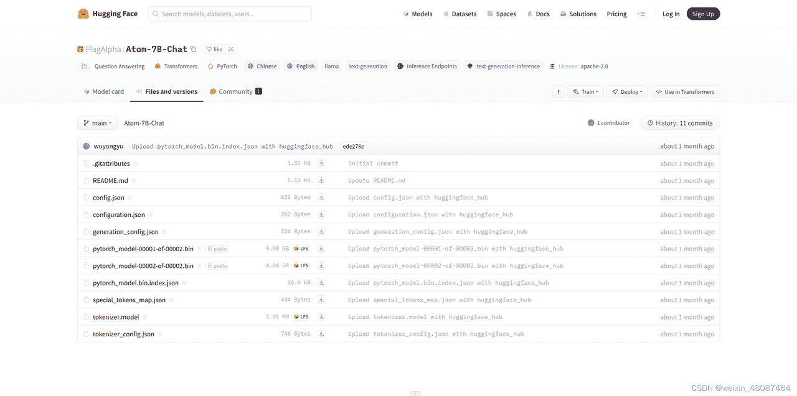
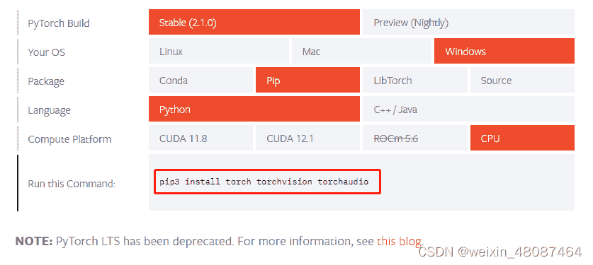

# Llama中文社区开源预训练Atom-7B-chat大模型体验与本地化部署实测(基于CPU，适配无GPU的场景)

> 来源：https://xuqiwei1986.feishu.cn/docx/G66sdVFDPoZTGVxzZAWcLprFntf  
> 🔗 原文链接：https://blog.csdn.net/weixin_48087464/article/details/133810685  
> 发布日期：2023-10-23

## 一、模型简介

原子大模型Atom由Llama中文社区和原子回声联合打造，在中文大模型评测榜单C-Eval中位居前十（8月21日评测提交时间）。

Atom系列模型包含Atom-7B和Atom-13B，基于Llama2做了中文能力的持续优化。Atom-7B和Atom-7B-Chat目前已完全开源，支持商用，可在 Hugging Face 仓库获取模型，详情见 Atom-7B下载。

Atom大模型针对中文做了以下优化：

### 大规模的中文数据预训练

原子大模型Atom在Llama2的基础上，采用大规模的中文数据进行持续预训练，包含百科、书籍、博客、新闻、公告、小说、金融数据、法律数据、医疗数据、代码数据、专业论文数据、中文自然语言处理竞赛数据集等，详见 📝 数据来源。

同时对庞大的数据进行了过滤、打分、去重，筛选出超过1T token的高质量中文数据，持续不断加入训练迭代中。

### 更高效的中文词表

为了提高中文文本处理的效率，我们针对Llama2模型的词表进行了深度优化。首先，我们基于数百G的中文文本，在该模型词表的基础上扩展词库至65,000个单词。经过测试，我们的改进使得中文编码/解码速度提高了约350％。此外，我们还扩大了中文字符集的覆盖范围，包括所有emoji符号😊。这使得生成带有表情符号的文章更加高效。

### 自适应上下文扩展

Atom大模型默认支持4K上下文，利用位置插值PI和Neural Tangent Kernel（NTK）方法，经过微调可以将上下文长度扩增到32K。

### 📝 中文数据

我们通过以下数据来优化Llama2的中文能力:

| 类型 | 描述 |
| --- | --- |
| 网络数据 | 互联网上公开的网络数据，挑选出去重后的高质量中文数据，涉及到百科、书籍、博客、新闻、公告、小说等高质量长文本数据。 |
| Wikipedia | 中文Wikipedia的数据 |
| 悟道 | 中文悟道开源的200G数据 |
| Clue | Clue开放的中文预训练数据，进行清洗后的高质量中文长文本数据 |
| 竞赛数据集 | 近年来中文自然语言处理多任务竞赛数据集，约150个 |
| MNBVC | MNBVC 中清洗出来的部分数据集 |

由于自己电脑没有配置独显，想用CPU来跑大模型看看（中间遇到比较多的坑），记录一下完整的过程，给大家予以借鉴。

## 二、模型下载

1. GitHub地址

   [FlagAlpha/Llama2-Chinese](https://github.com/FlagAlpha/Llama2-Chinese): Llama中文社区，最好的中文Llama大模型，完全开源可商用。下载源码：https://github.com/FlagAlpha/Llama2-Chinese

2. 可在 Atom-7B-Chat Hugging Face 仓库获取模型

   1. 由于Hugging Face无法直接访问，推荐一个速度较快、好用的“科学上网”工具 91merry 🪜，我买的30/季度，每月100G流量，我百兆带宽实际下载最大能够达到15M/s。

   2. 把这里面的每一个文件都下载了。（推荐用IDM，浏览器默认的下载没IDM快，总共下载下来大概14G）

   

## 三、模型部署

1. 单独弄一个大模型的python虚拟环境，避免包冲突

   ```
   python -m venv llama_env
   source llama_env/bin/activate  # 在 Windows cmd执行 `llama_env\Scripts\activate`
   ```

   

2. 下载python相关依赖包

   ps: 由于github下载的代码里面`requirements.txt`是基于有独显的场景，按照官网的在纯cpu环境会运行不起来。

   打开 PyTorch 官网：Start Locally | PyTorch，选择自己对应的环境，会生成相应的命令。

   

   ```
   pip3 install torch torchvision torchaudio
   ```

   安装其它的包

   ```
   pip install scipy sentencepiece datasets evaluate transformers tensorboard gradio
   ```

3. 修改有页面的执行代码，可以在浏览器交互的方式运行(`Llama2-Chinese\examples\chat_gradio.py`文件)


```python
import gradio as gr
import time
from transformers import AutoTokenizer, AutoModelForCausalLM, TextIteratorStreamer
from threading import Thread
import torch, sys, os
import json
import pandas
import argparse

with gr.Blocks() as demo:
    gr.Markdown("""<h1><center>智能助手</center></h1>""")
    chatbot = gr.Chatbot()
    msg = gr.Textbox()
    state = gr.State()
    with gr.Row():
        clear = gr.Button("新话题")
        re_generate = gr.Button("重新回答")
        sent_bt = gr.Button("发送")
    with gr.Accordion("生成参数", open=False):
        slider_temp = gr.Slider(minimum=0, maximum=1, label="temperature", value=0.3)
        slider_top_p = gr.Slider(minimum=0.5, maximum=1, label="top_p", value=0.95)
        slider_context_times = gr.Slider(minimum=0, maximum=5, label="上文轮次", value=0, step=2.0)
    def user(user_message, history):
        return "", history + [[user_message, None]]
    def bot(history, temperature, top_p, slider_context_times):
        if pandas.isnull(history[-1][1]) == False:
            history[-1][1] = None
            yield history
        slider_context_times = int(slider_context_times)
        history_true = history[1:-1]
        prompt = ''
        if slider_context_times > 0:
            prompt += '\n'.join([("<s>Human: " + one_chat[0].replace('<br>', '\n') + "\n</s>" if one_chat[0] else '') + "<s>Assistant: " + one_chat[1].replace('<br>', '\n') + "\n</s>" for one_chat in history_true[-slider_context_times:]])
        prompt += "<s>Human: " + history[-1][0].replace('<br>', '\n') + "\n</s><s>Assistant:"
        input_ids = tokenizer([prompt], return_tensors="pt", add_special_tokens=False).input_ids[:, -512:]
        generate_input = {
            "input_ids": input_ids,
            "max_new_tokens": 512,
            "do_sample": True,
            "top_k": 50,
            "top_p": top_p,
            "temperature": temperature,
            "repetition_penalty": 1.3,
            "streamer": streamer,
            "eos_token_id": tokenizer.eos_token_id,
            "bos_token_id": tokenizer.bos_token_id,
            "pad_token_id": tokenizer.pad_token_id
        }
        thread = Thread(target=model.generate, kwargs=generate_input)
        thread.start()
        start_time = time.time()
        bot_message = ''
        print('Human:', history[-1][0])
        print('Assistant: ', end='', flush=True)
        for new_text in streamer:
            print(new_text, end='', flush=True)
            if len(new_text) == 0:
                continue
            if new_text != '</s>':
                bot_message += new_text
            if 'Human:' in bot_message:
                bot_message = bot_message.split('Human:')[0]
            history[-1][1] = bot_message
            yield history
        end_time = time.time()
        print()
        print('生成耗时：', end_time - start_time, '文字长度：', len(bot_message), '字耗时：', (end_time - start_time) / len(bot_message))

    msg.submit(user, [msg, chatbot], [msg, chatbot], queue=False).then(
        bot, [chatbot, slider_temp, slider_top_p, slider_context_times], chatbot
    )
    sent_bt.click(user, [msg, chatbot], [msg, chatbot], queue=False).then(
        bot, [chatbot, slider_temp, slider_top_p, slider_context_times], chatbot
    )
    re_generate.click(bot, [chatbot, slider_temp, slider_top_p, slider_context_times], chatbot)
    clear.click(lambda: [], None, chatbot, queue=False)

if __name__ == "__main__":
    parser = argparse.ArgumentParser()
    parser.add_argument("--model_name_or_path", type=str, help='mode name or path')
    parser.add_argument("--is_4bit", action='store_true', help='use 4bit model')
    args = parser.parse_args()
    tokenizer = AutoTokenizer.from_pretrained(args.model_name_or_path, use_fast=False)
    tokenizer.pad_token = tokenizer.eos_token
    if args.is_4bit == False:
        model = AutoModelForCausalLM.from_pretrained(args.model_name_or_path, device_map='auto', torch_dtype=torch.float32, offload_folder='E:\llm\Llama2-Chinese\llama_env\offload')
        model.eval()
    else:
        from auto_gptq import AutoGPTQForCausalLM
        model = AutoGPTQForCausalLM.from_quantized(args.model_name_or_path, low_cpu_mem_usage=True, use_triton=False, inject_fused_attention=False, inject_fused_mlp=False)
    streamer = TextIteratorStreamer(tokenizer, skip_prompt=True)
    if torch.__version__ >= "2" and sys.platform != "win32":
        model = torch.compile(model)
    demo.queue().launch(share=False, debug=True, server_name="127.0.0.1")
```

### 4、新建一个py文件，可以命令行模式运行

```python
import torch
from transformers import AutoTokenizer, AutoModelForCausalLM
# 这里面是你下载的Atom-7B-Chat模型的文件位置和添加offload的文件位置，cpu环境下必须要有offload
model = AutoModelForCausalLM.from_pretrained('E:\llm\Llama2-Chinese\llama_env\Atom-7B-Chat', device_map='auto', torch_dtype=torch.float32,
                                             offload_folder='E:\llm\Llama2-Chinese\llama_env\offload')
model = model.eval()
tokenizer = AutoTokenizer.from_pretrained('E:\llm\Llama2-Chinese\llama_env\Atom-7B-Chat', use_fast=False)
tokenizer.pad_token = tokenizer.eos_token
input_ids = tokenizer(['<s>Human: 请帮我写一篇针对中国足球发展的分析\n</s><s>Assistant: '], return_tensors="pt", add_special_tokens=False).input_ids
generate_input = {
    "input_ids": input_ids,
    "max_new_tokens": 512,
    "do_sample": True,
    "top_k": 50,
    "top_p": 0.95,
    "temperature": 0.3,
    "repetition_penalty": 1.3,
    "eos_token_id": tokenizer.eos_token_id,
    "bos_token_id": tokenizer.bos_token_id,
    "pad_token_id": tokenizer.pad_token_id
}
generate_ids = model.generate(**generate_input)
text = tokenizer.decode(generate_ids[0])
print(text)
```

## 四、模型运行

### 1、运行修改后的`Llama2-Chinese\examples\chat_gradio.py`文件

```bash
python examples/chat_gradio.py --model_name_or_path E:\llm\Llama2-Chinese\llama_env\Atom-7B-Chat
```

### 2、由于是只使用`cpu`，比较吃内存，原先电脑内存16G的情况下跑不起来，跑到50%就奔溃了，后面加了两根16G内存条，组成了48G内存才能跑起来。跑起来占用内存在38G左右。

### 3、运行后的界面


PS:使用`CPU`运行大模型还真是吃内存，生成结果的时候也比较慢，建议大家还是上英伟达的显卡的。

接下来想把本地的一些医学数据进行训练，看看结果怎么样。
