# 2022-08-26【澜舟科技】预训练模型在金融 NLP场景下的应用

> 来源：[https://xuqiwei1986.feishu.cn/docx/ATi2dlresoSCQOxHCjrcNvFnnth](https://xuqiwei1986.feishu.cn/docx/ATi2dlresoSCQOxHCjrcNvFnnth)

> 🔗 原文链接：https://mp.weixin.qq.com/s/yT3njMf4MeaRQzFwoR2K9g

周明 机器学习算法与自然语言处理 2022-08-26 00:00 发表于 黑龙江

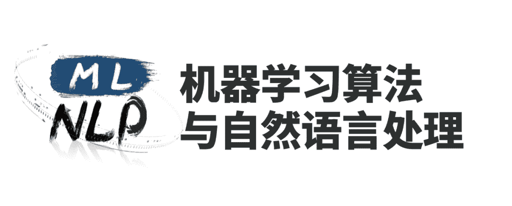

### MLNLP ( 机器学习算法与自然语言处理 )社区是国内外知名自然语言处理社区，受众覆盖国内外NLP硕博生、高校老师以及企业研究人员。

### 社区的愿景 是促进国内外自然语言处理，机器学习学术界、产业界和广大爱好者之间的交流，特别是初学者同学们的进步。

转载自 | 澜舟科技

作者 | 周明

Langboat NLP Meetup

[第二期「澜舟NLP分享会」](http://mp.weixin.qq.com/s?__biz=Mzg5MjY2ODI4Nw==&mid=2247506840&idx=1&sn=59546e7629880e7ff113637fb2580d49&chksm=c0380b88f74f829e1d73c3239abe4faf4157d98c9478429467407192f49a59375b382a765954&scene=21#wechat_redirect)在 8 月 20 日圆满落幕，本期主题为《金融NLP场景下，大模型技术应用趋势》，我司创始人兼CEO 周明 分享了“预训练模型在金融场景下的应用”，我司搜索与金融NLP技术负责人 马永亮 分享了“基于预训练模型的事件抽取与分析”，同时邀请到来自复旦大学、浙江大学、中科院软件所的专家一起探讨前沿技术和实践。

错过直播的小伙伴可以通过 B 站“澜舟孟子开源社区”、🛰️视频号“澜舟科技”观看回放视频。另外，大家可以关注本公众号，在后台回复关键词 “0820” 获取 PPT 资料。我们也将陆续整理演讲图文实录，分享给大家。

本文根据澜舟科技创始人兼CEO 周明 在「澜舟NLP分享会」上的演讲整理，介绍了大模型技术在金融NLP场景的应用，以及澜舟的实践。

全文约 5200 字，预计阅读时长 10 分钟。

⬆️点击上方观看直播回放

近三年来，大规模预训练模型深入应用于金融场景中，大幅度地提升了业务系统的开发效率。本次报告将分享目前大模型技术在金融场景下的应用现状及未来发展趋势，并介绍澜舟团队基于孟子轻量化模型支持金融场景并通过SaaS输出各项标准 NLP 能力的技术进展。

## 大模型技术背景

我先谈谈大模型的一些背景。此前十余年人工智能在感知智能方面进展迅速。而在2017年谷歌提出了`Transformer`，随后预训练模型`BERT`提出，随后以2019年阅读理解超过人类水准为代表，NLP能力在各项任务上大幅度提升。

### 1. 认知智能崛起

我们今天看到的一个明显趋势是AI正由感知智能快速向认知智能迈进。AI正在从能听能说会看，这些都是感知智能的能力，走到能思考、能回答问题，做总结，能翻译，能创作（音乐、对联、诗歌、散文，写报告），走到决策和推理。这些都是认知智能的能力。认知智能的应用例子比比皆是。

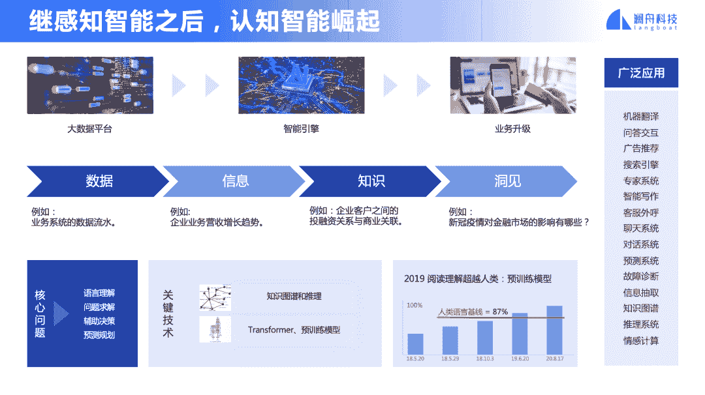

图 1

在图 1 右侧可以看到其广泛的应用。例如，达到了接近人类水准的机器翻译已经在手机和桌面普遍使用，聊天机器人几乎可以通过图灵测试，搜索引擎得益于阅读理解以及预训练模型，搜索相关度大幅度提升，自动客服系统已经普及，知识图谱在金融等领域得到快速应用，都在推动产业发展。

从大数据，到建立信息检索，到建立知识图谱实现知识推理，到发现趋势形成观点和洞见。认知智能在大数据支持下，推动企业的业务数智化，正在深刻影响产业的发展。可以说NLP和认知智能代表了人工智能的未来发展。

### 2. 大规模预训练模型的新范式

在认知智能崛起过程中，预训练成为了认知智能的核心技术。2017年推出的`Transformer`，催生了`BERT`、`GPT`、`T5`等预训练模型。这些模型基于自监督学习（也就是不需要人工标注），利用大规模文本，比如互联网的浩瀚的数据，学习一个语言模型。利用语言模型对输入句子的每一个词在当前上下文的句法、语义和搭配有一定程度的理解。在此基础上，针对每一个NLP任务，用有限的标注数据进行微调。

这种迁移学习技术推动了NLP发展，各项任务都上了一个大台阶。更为重要的是，产生的预训练+`微调`技术，可以一套技术解决不同语言NLP、不同的NLP任务，有效地提升开发效率。原先NLP不同任务要用不同的模型，需要不同的技能人员，而且语言之间也不能互通。现在用预训练加微调，可以一套机制应对多有语言的所有任务，这标志着NLP进入到工业化实施阶段。

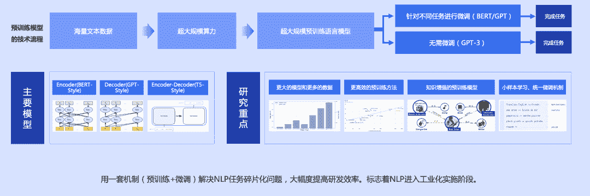

图 2

当前在预训练模型领域较为关注的研究重点包括：

+ 如何训练超大规模参数的模型。各大公司推出越来越大的模型，千亿甚至万亿参数。对已有模型架构的创新性研究、更加有效的训练方法和训练加速的方法。

+ 简化微调的步骤，比如像`GPT-3`那样用一套提示机制来简化下游任务的微调，推动零样本学习和小样本学习。

+ 多模态预训练模型也引起关注。图文、文图、视频、`code`生成。最后就是推理的加速方法也是目前的研究焦点，用硬件来实现加速训练也是重要方向。

## 金融 NLP 场景

### 1. 场景与应用举例

NLP在金融有很多应用，概括来讲有智能风控、智能投顾、智能投研、智能营销等等。无论哪一个场景，目前的技术水平，虽然可以用了，但是都还是面临很多挑战。

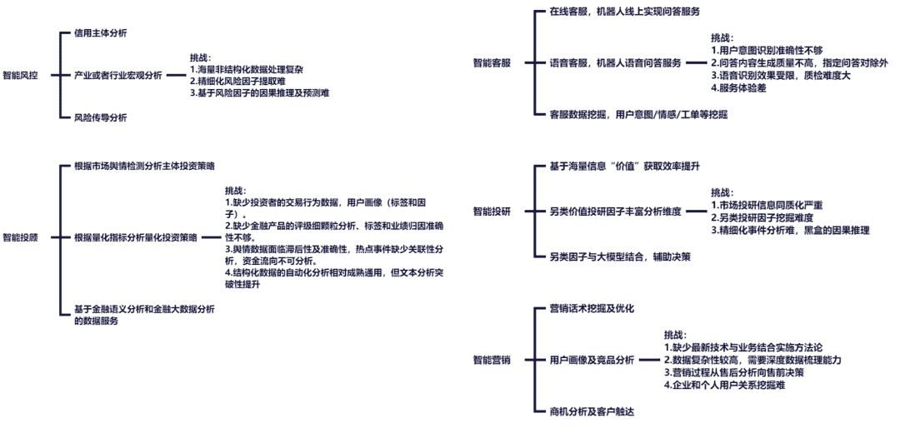

图 3 NLP在金融领域的应用划分

金融行业主要包含银行、保险、券商、资管等三大类机构。每一类机构都有很多NLP的应用场景。这里我归纳如下（图 4）。

银行的NLP应用场景主要有，信贷辅助决策，公司债业务审核、智能客服、企业知识库建设等。每一个场景涉及到一系列的任务，比如信贷辅助决策，涉及到财务报告解析、公司舆情智能挖掘、信贷流水材料智能处理、公关行业景气度分析、风险事件传导分析。这些任务的背后涉及到一系列NLP技术，诸如信息抽取、`OCR`、表格解析、分类、情感、事件抽取和打标签、领域和专家知识等等。

保险的NLP应用场景主要有，包括智能合同审核、智能付款材料审核、智能工单处理等等。同样也涉及到一系列任务和NLP技术。

券商和资管的NLP应用场景也是一样（如图 4 所示），此处不再赘述。

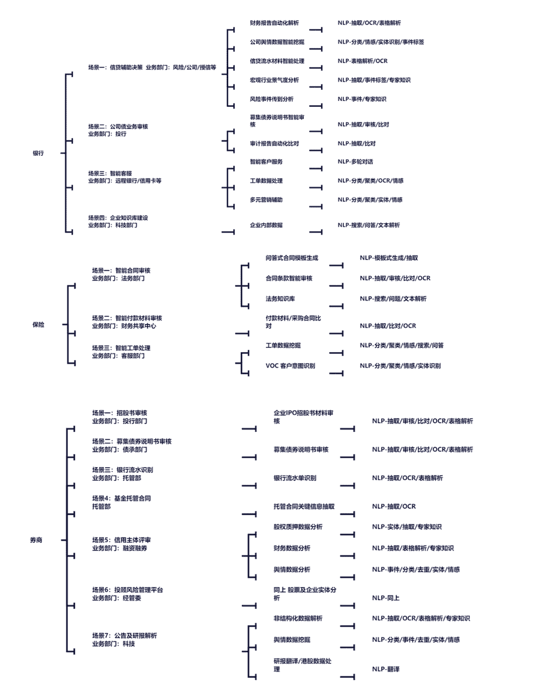

图 4 NLP 与银行、保险、券商资管场景

### 2. 传统NLP开发存在的问题和解决方案

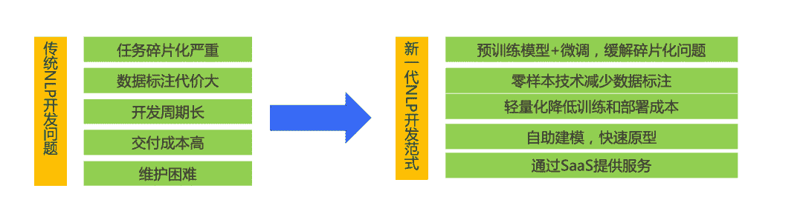

图 5

过去这些场景下NLP任务的开发碎片化严重，泛化能力不足，基本上是一个任务一个模型。由于每一个任务都需要训练，需要的标注代价大。还有就是开发周期长：从谈判，到了解客户需求，到开发，然后迭代。期间用户需求经常变化。而且交付成本比较高，一般要求到用户现场交付，要教会用户，要设置相应的硬件环境和软件环境。还有维护困难，用户遇见各类事情，产生新的需求，都可能找你。

为了加速NLP在金融场景的开发效率，澜舟科技基于`孟子`轻量化模型技术，训练了一个金融大模型。用大模型+`微调`的新的开发范式，开发了信息抽取、信息检索、机器翻译、文本生成等多类技术，并通过`SaaS`提供标准化的全栈式金融场景NLP的能力。

同时，利用澜舟的预训练模型的零样本能力和模型定制平台，可以帮助客户自行快速建模以便快速验证业务流程，有助于快速获客和建立服务。

澜舟的技术通过同花顺、华夏、云从等合作，在金融真实场景下得到了广泛验证。

## 澜舟在金融 NLP 场景下的实践

### 1. NLP 技术全景

下图澜舟的金融NLP技术全景。分三大部分，第一部分是澜舟的`孟子`预训练模型技术，第二部分是澜舟基础NLP能力，第三部分是澜舟在金融NLP的应用场景。

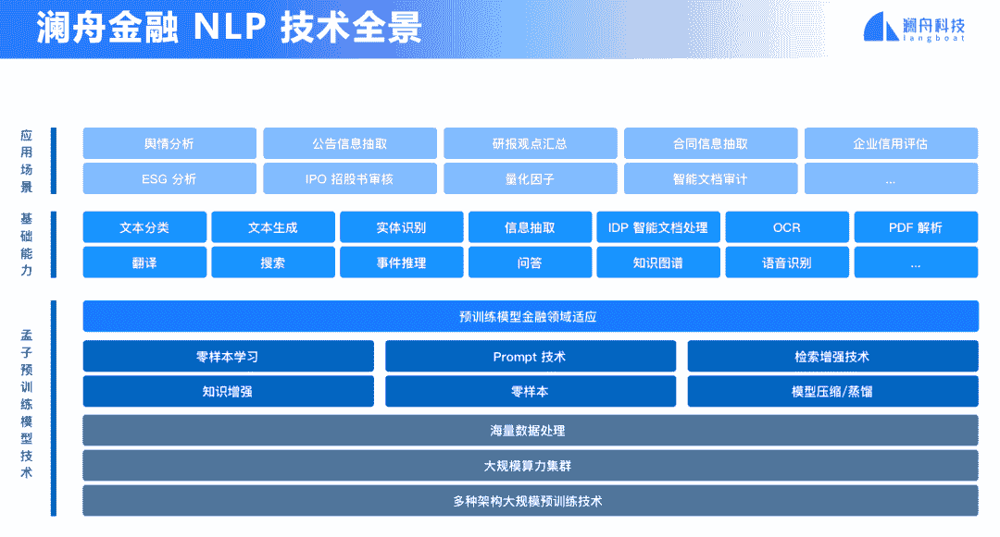

图 6

第一部分`孟子`预训练模型技术具备多种架构，比如`BERT`、`GPT`、`T5`等架构的预训练模型的能力。包括只是增强、零样本技术、模型压缩和蒸馏。然后针对金融需要，用金融预料继续训练得到金融领域的预训练模型。

在此基础上，第二部分NLP基础能力，包括文本分类、生成、实体识别、信息抽取、智能文档处理（从PDF、扫描等文件中抽取重要信息）、`OCR`、`PDF`解析、翻译、搜索、事件推理、问答、知识图谱、语音识别等等。

第三部分就是应用场景，覆盖舆情分析、公告信息抽取、研报观点汇总、企业信用评估、ESG分析、IPO招股书审核、量化因子、智能文档审计之类的场景。

我们希望用一个`孟子`预训练模型，加上微调，解决所有NLP基础能力和应用场景的开发。这样大幅度克服碎片化，提高开发效率。

### 2. 产品全景

在NLP技术矩阵的基础上，我们开发了一系列的金融NLP产品。

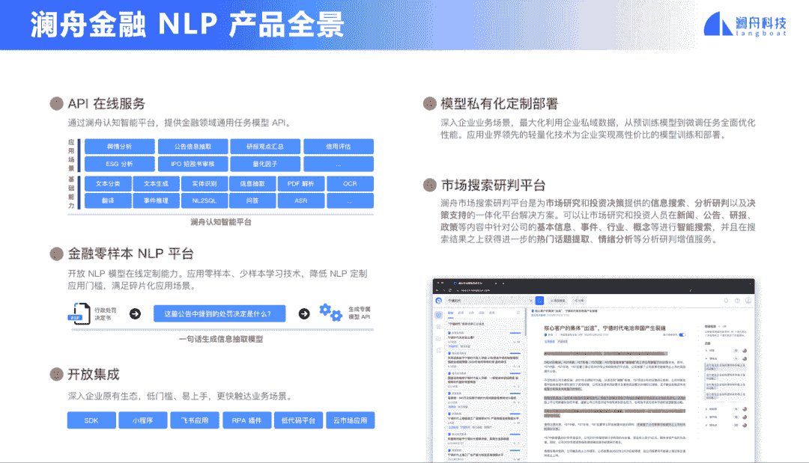

图 7

`API`（`SaaS`）服务，提供基础NLP能力和可标准化的金融的NLP能力。目前已经公开测试了，大家可以在澜舟官网上试试（`langboat.com` ->产品服务）。

另外，我们也在开发`金融零样本NLP平台`，开放模型定制能力，应用零样本、少样本学习技术，降低NLP定制门槛，满足碎片化应用场景。未来几个月内将会发布出来。我们跟金融企业密切合作，深入企业原有生态，方便接入`RPA`和无代码编程体系，实现低门槛、易上手、更快触达金融业务场景。

我们也提供`私有化定制部署`，深入企业业务场景，最大化利用企业私域数据，从预训练到微调任务全面优化性能，用`孟子`轻量化技术为企业实现高性价比的训练和部署。

`澜舟市场搜索和研判平台`为市场研究和投资决策提供信息搜索和分析研判提供帮助。在新闻、公告、研报、政策等频道，针对公司的基本信息、事件、行业、概念进行搜索，并在搜索结果上显示话题、情绪分析等研判信息。目前已经开始邀测，即将开启公测。

下面我们分模块，详细介绍澜舟的NLP技术与产品矩阵。

### 3. 孟子轻量化预训练模型

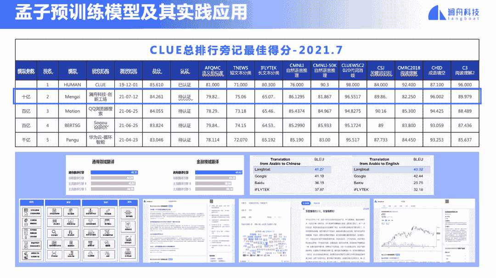

图 8

澜舟的`孟子`轻量化预训练模型在 2021 年 7 月以十亿级的规模，荣获了中文NLP权威`CLUE`榜单的第一名，超过了许多大公司的大模型。我们在此基础上开发了机器翻译、本文生成、搜索等各项技术。目前，我们也通过开源释放了四个模型，包括金融模型。我们这些技术跟同花顺、华夏基金等展开了合作。

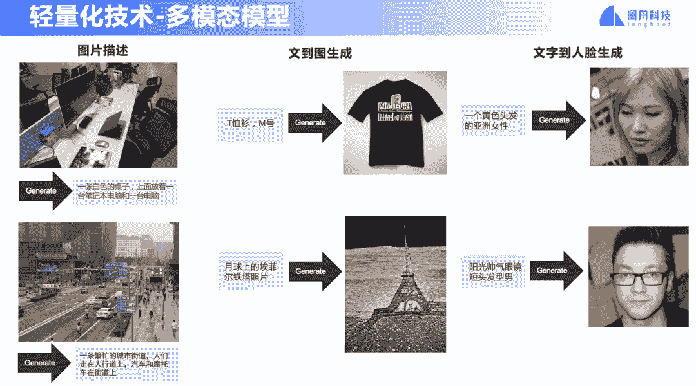

图 9

我们也开发了`孟子`轻量化多模态模型。其中包含了图片生成描述任务：输入为图片，输出为对该图片的文字描述；文到图的生成任务：输入为自然语言，输出改文字描述对应的图像；文字到人脸的描述任务：输入为人脸相关的文本描述，输出为对应描述的图片。可以看到我们的多模态模型的效果还是很不错的。

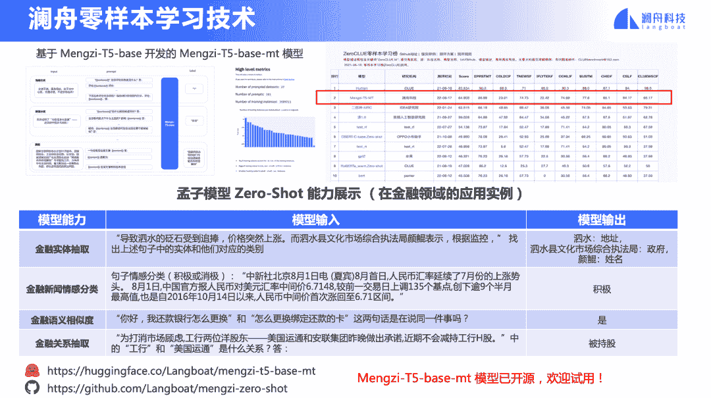

图 10

`孟子`多任务模型（`Mengzi-T5-base-mt`），是在`Mengzi-T5-base`模型的基础上集成了多任务训练技术，涵盖了27个数据集，对应编写了301个`prompt`。该模型已在 2022 年 8 月 22 日提交零样本学习权威榜单`ZeroCLUE`和小样本学习榜单`FewCLUE`，均排名第一。

`孟子`多任务模型在模型规模上优势明显，参数量仅0.22B。目前该模型已开源，大家可以在`huggingface model hub`网页`api`直接试用模型及下载，或者在`Github`上查看我们澜舟的开源的`SDK` project。其中，`Zero-Shot SDK`目前已支持八项任务（涵盖了情感分类、新闻分类、文本相似度、实体抽取、金融实体关系抽取、评论对象抽取、广告文案生成、医疗领域意图识别等），具体信息详见这篇文章。

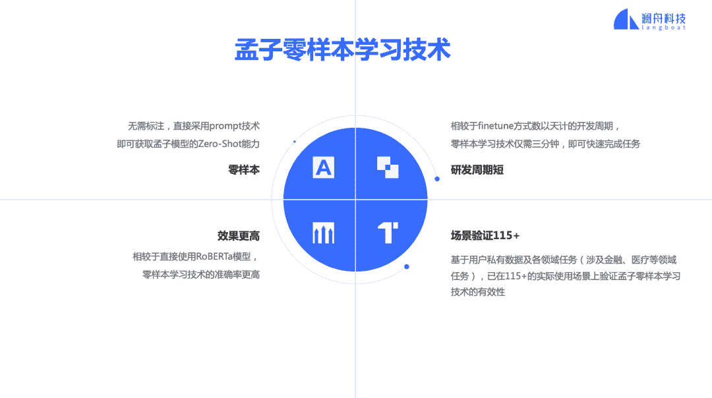

图 11

用户无需标注，直接采用`prompt`技术即可获取`孟子`多任务模型的`Zero-Shot`能力。研发周期短，相较于`finetune`方式数以天计的开发周期，零样本学习技术仅需三分钟，即可快速完成任务。

同时，效果相比于`RoBERTa`模型，我们现在零样本学习技术的准确率更好一些。并且我们基于用户私有数据及各领域任务（涉及金融、医疗等领域任务）训练，现已在大量的实际使用场景上验证`孟子`零样本学习技术的有效性。

举例，如下图所示，

输入：

`input_string`：为打消市场顾虑,工行两位洋股东——美国运通和安联集团昨晚做出承诺,近期不会减持工行H股。实体1是工行，实体2是美国运通。

`Prompt`：“`{input_string}`”中的“`{entity1}`”和“`{entity2}`”是什么关系？

`孟子`的输出：被持股。

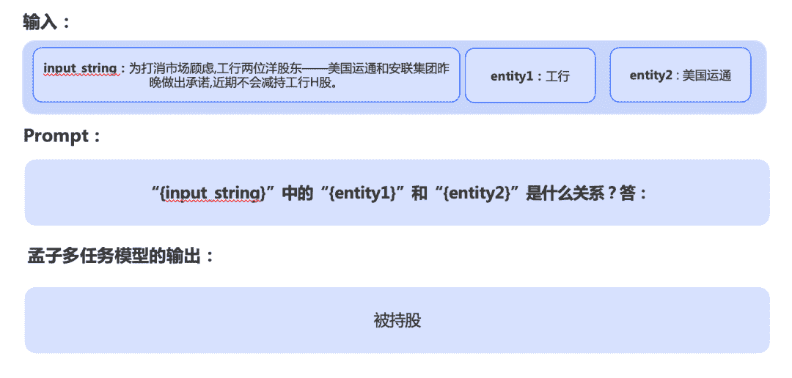

图 12

再举一个例子，如下图所示：

输入：导致泗水的砭石受到追捧，价格突然上涨。而泗水县文化市场综合执法局颜鲲表示，根据监控，...

`Prompt`：找出上述句子中的实体和他们对应的类别。

`孟子`的输出：泗水：地址；泗水县文化市场综合执法局：政府；颜鲲：姓名。

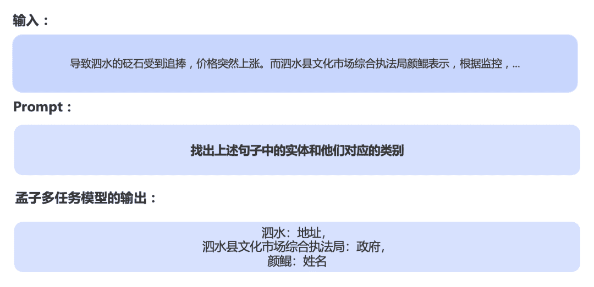

图 13

### 4. 金融翻译引擎（中、英、日）

下图是金融机器翻译实例。金融领域的翻译首先是术语比较多，需要单独处理，其次是句型非常严谨。我们通过努力，在中英金融机器翻译取得了目前最好的翻译水准。目前通过了中金公司招标，中金将使用我们的引擎翻译金融文献。

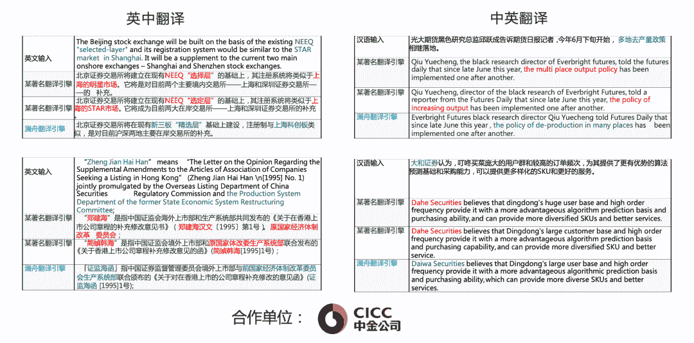

图 14

### 5. 营销文案生成引擎

澜舟的`孟子`预训练模型，在创作方面体现巨大潜力。这里展示了营销文案产品。根据用户关键词，生成一篇文章。

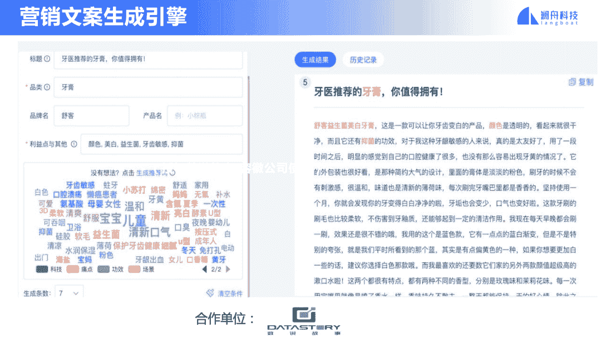

图 15

### 6. 企业社会责任（ESG）报告生成

企业社会责任报告（即ESG报告），ESG报告格式固定，一般会有一个大纲，涉及到对多项内容的整理分析，人工编制较为繁琐，而我们开发的ESG报告生成算法可以根据公司的资料，经过抽取整合，自动生成ESG报告，再交由人工review确认，大大加快撰写速度。

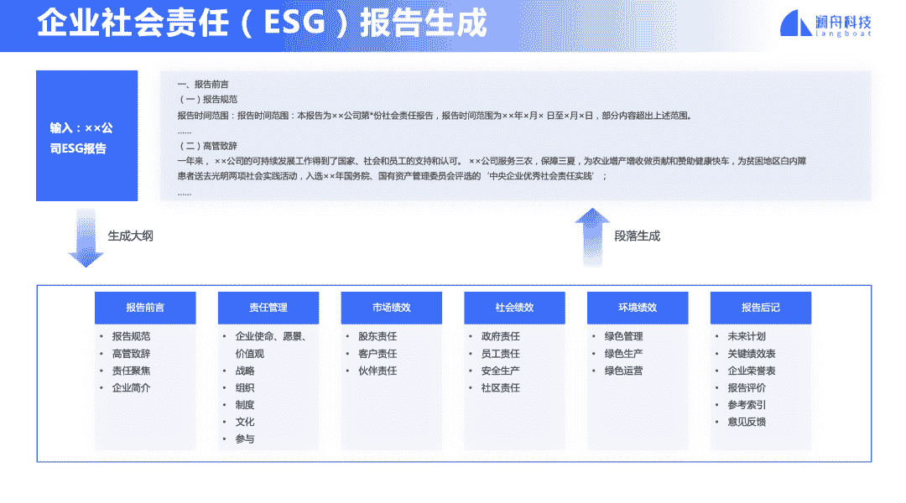

图 16

### 7. 智能文档处理

基于`孟子`多模态预训练模型，我们开发了智能文档处理。可以从`OCR`中抽取重要的字段，比如金额、单位、公司名称等。

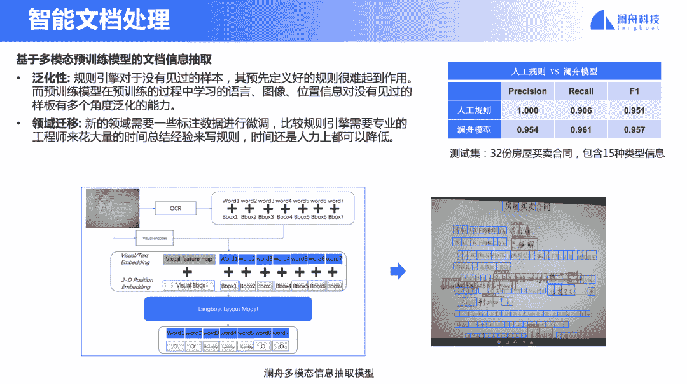

图 17

### 8. 澜舟市场搜索研判平台

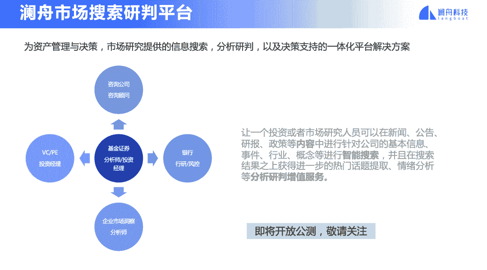

图 18

这里重点介绍一下`澜舟市场搜索研判平台`，投资或者市场研究人员可以通过该产品，在新闻、公告、研报、政策等内容中进行针对公司的基本信息、事件、行业、概念等进行智能搜索，并且在搜索结果之上获得进一步的热门话题提取、情绪分析等分析研判增值服务。

图 19

上图是澜舟搜索研判平台背后的能力。底层是大模型，核心功能包括信息检索、分析研判、决策支持。目前搜集了新闻、公告、研报和政策四大类数据源，具备以下特点：

图 20 功能示意图

+ 在搜索结构中点击文章打开文章内容，对情绪和话题进行了分析和标注。

+ 可以快速理解文章重点和背后蕴含的情绪。
+ 可以发现情绪变化趋势，感知风向变化。
+ 通过关键词提取、聚类、同义词识别，为每一篇文章提取重要话题关键词，帮助用户快速了解文章重点。对每一个话题提供了情绪的统计分析。

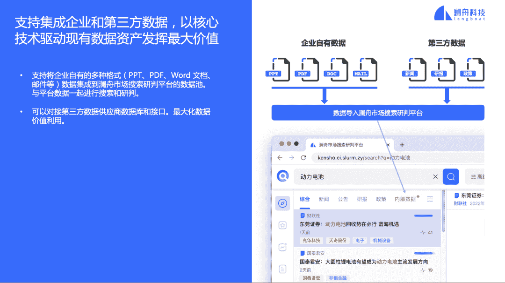

图 21

目前澜舟市场搜索研判平台支持将企业自有的多种格式（PPT、PDF、Word文档、邮件等）数据集成到澜舟市场搜索研判平台的数据池。与平台数据一起进行搜索和研判，也支持对接第三方数据供应商数据库和接口，最大化实现数据价值利用。

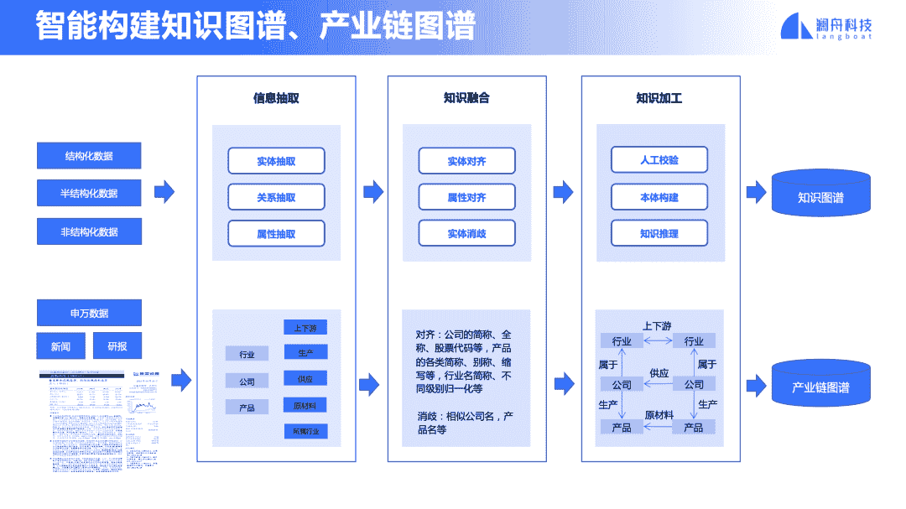

图 22

通过NLP技术可以构建知识图谱和产业链图谱。首先，通过结构化数据（数据库）、半结构化数据（网页）、非结构化数据（自然语言文本），经过信息抽取获得实体、实体之间关系和实体的属性。然后经过知识融合，把不同的知识图谱合并，再经过知识加工，最后人工校验等手段建立起行业或者企业的知识图谱。类似地，利用自然语言技术，可以获得一个企业，所在行业，上下游的企业，形成了一个产业链的知识图谱。

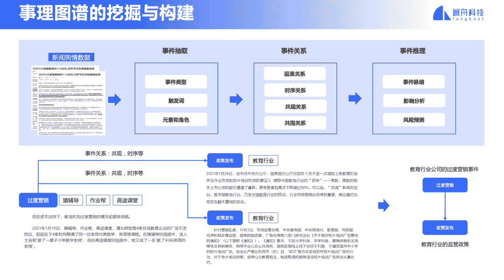

图 23

我们也可以建立事理的图谱。所谓事理图谱体现事件的关系，包括因果、时序、共现、共指关系。就是事件之间的关联关系，用于发现事件A出现之后，事件B出现的可能性有多大，从而提出决策建议。图23有一个例子，从这个新闻发现事件“过度营销”事件的主题，以及它跟另外一个事件“政策发布”，事件主体“教育行业”，有什么关联。

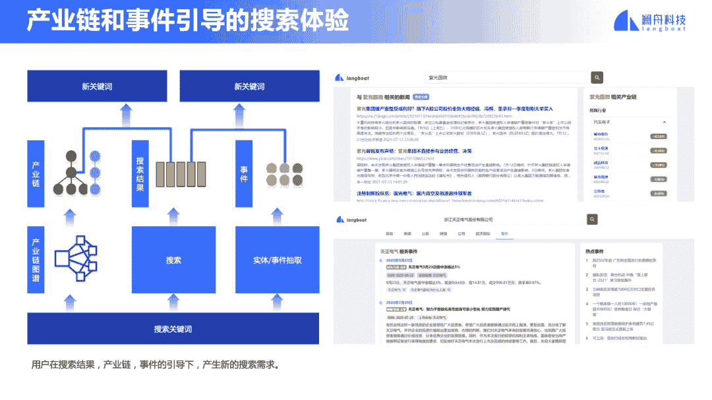

图 24

有了产业链和事件链，就可以进行一定程度的推理。我们正在建立一个新型的搜索引擎（见 图24右侧），为用户提供更好的搜索体验。根据用户搜索关键词，找到新闻，研报，公告等，发现其中的事件——找到事件主体的产业链——找到相关事件——再形成产业链和事件链，最后用户上下滑动页面就能看到上下游的影响，了解事件之间的关联。

## 总结

+ 预训练模型+微调机制带来了新的突破，NLP各项能力大幅度提升，同时有效地解决了开发碎片化问题。
+ 澜舟通过API（SaaS）服务，提供基础NLP能力和可标准化的金融NLP能力，覆盖文档智能理解、翻译、生成、搜索功能。
+ 正在开发金融零样本NLP平台，我们还开放模型定制能力。用户应用零样本、少样本学习技术，降低NLP定制门槛，满足碎片化应用场景。
+ 澜舟跟金融企业密切合作，深入企业原有生态，方便接入RPA和无代码编程体系，实现低门槛、易上手、更快触达金融业务场景。
+ 提供私有化定制部署，深入企业业务场景，最大化利用企业私域数据，从预训练到微调任务全面优化性能，采用孟子轻量化技术为企业实现高性价比的训练和部署。
+ 澜舟市场搜索和研判平台为市场研究和投资决策提供搜索和研判能力。

目前，澜舟公司跟 [同花顺公司](http://mp.weixin.qq.com/s?__biz=Mzg5MjY2ODI4Nw==&mid=2247506728&idx=1&sn=12bf05bc3f76d96dc4c4efdc39d0b4dc&chksm=c0380b38f74f822ed43a48446c05ccb3f5b5b46345f8dc517af351ea5635a5cf397143a3ba74&scene=21#wechat_redirect) 建立了深度合作。聚焦认知智能领域，共同突破和创新NLP技术，升级金融科技领域产品和服务，提升业务价值，为客户带来更好的用户体验。目前利用孟子轻量化模型及其上的技术，服务于同花顺的多项业务，合作取得了顺利进展。

[2022](http://mp.weixin.qq.com/s?__biz=Mzg5MjY2ODI4Nw==&mid=2247505612&idx=1&sn=a47a1536a48d77e3cbf02d43ec53bd1f&chksm=c03806dcf74f8fca724e439fe5f3b7198cfbc5372db820fca39fbb81076bff7830e14f19e951&scene=21#wechat_redirect) 年 6 月，澜舟也和 华夏基金 共同成立了金融NLP的联合实验室。面对金融领域文本专业性强、应用场景多变的情况下，如何构建落地快、易迭代、可适配金融垂直领域的中文NLP模型着这一系列问题，我们和华夏基金密切合作。以联合实验室的形式，针对金融业务痛点和需求逐一突破，促进人工智能创新，创造新的价值。

大家若对澜舟金融 NLP 领域技术和产品感兴趣，可以访问官网 `langboat.com` 体验部分产品功能，或发送邮件至 bd@langboat.com 咨询。

- END -

## 关于我们

MLNLP社区（机器学习算法与自然语言处理）是由国内外自然语言处理学者联合构建的民间学术社区，目前已经发展为国内外知名自然语言处理社区，旗下包括 万人顶会交流群、AI臻选汇、MLNLP英才汇 以及 AI学术汇 等知名品牌，旨在促进机器学习，自然语言处理学术界、产业界和广大爱好者之间的进步。

社区可以为相关从业者的深造、就业及研究等方面提供开放交流平台。欢迎大家关注和加入我们。

