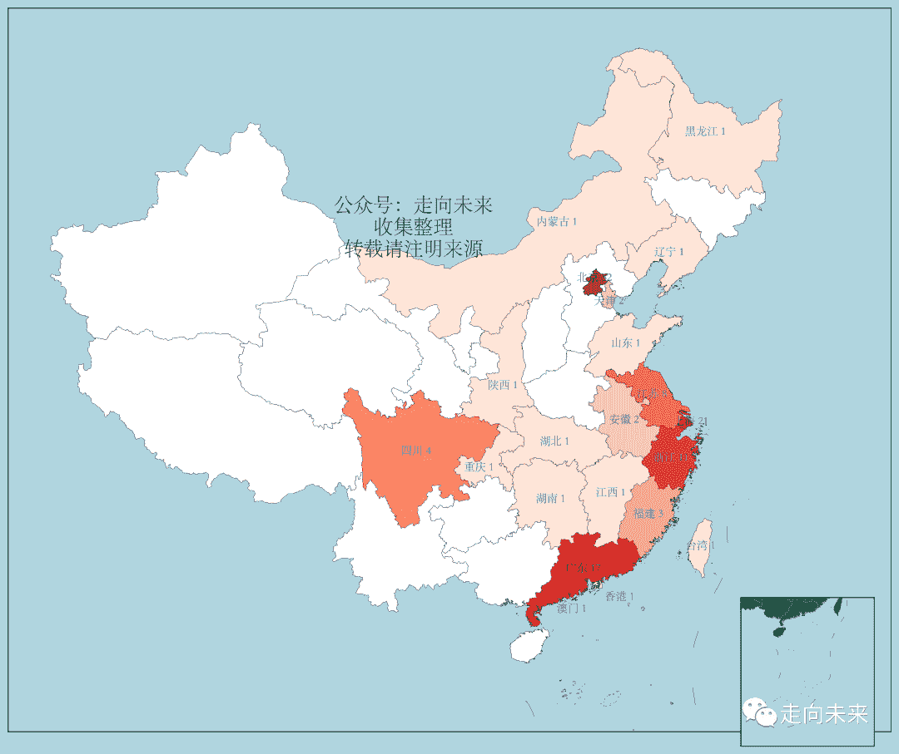
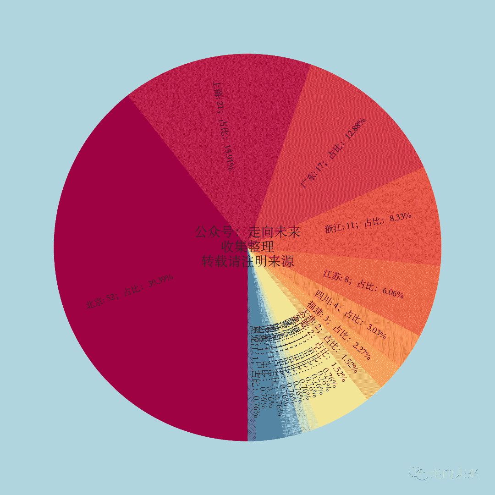
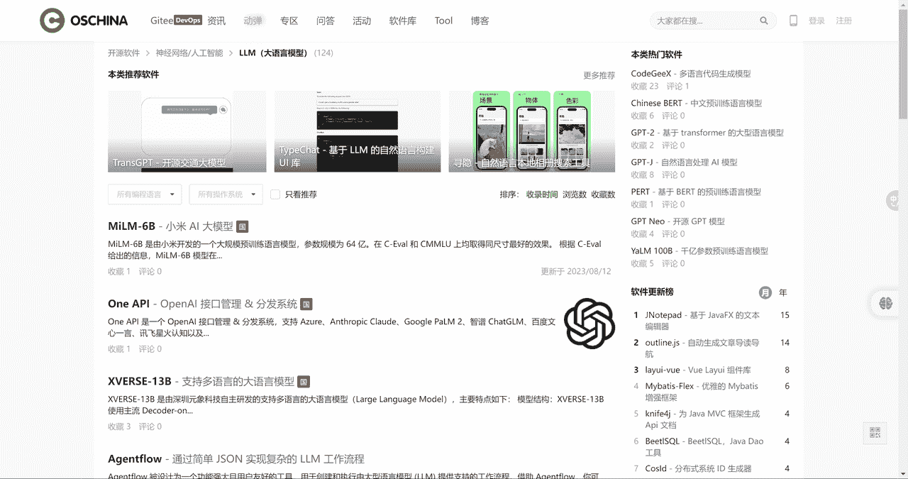
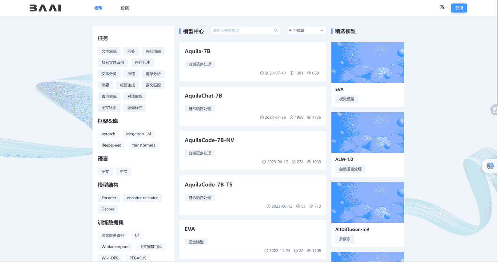
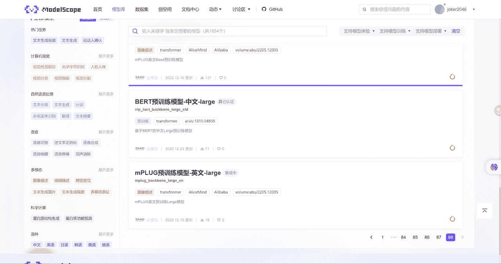
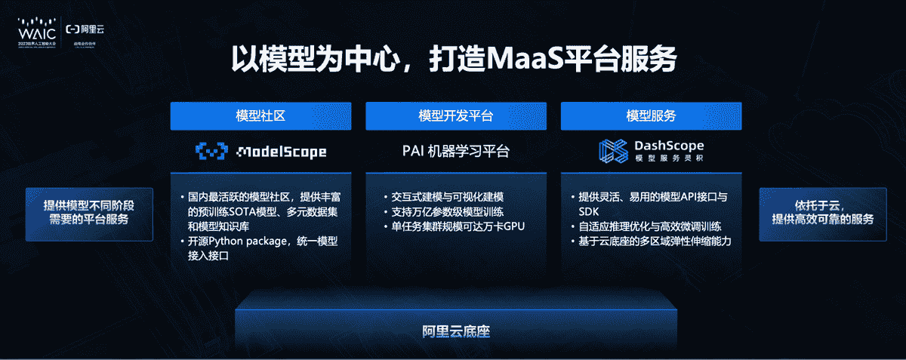
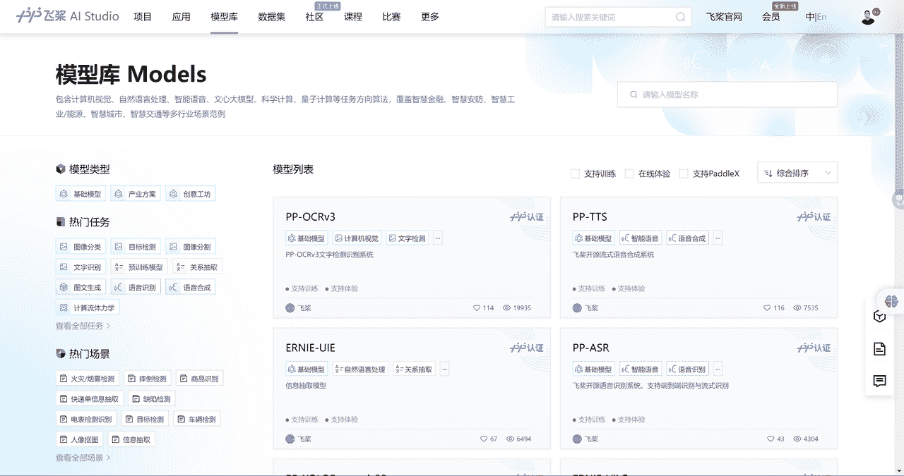

# 统计源5+

> 来源：[https://xuqiwei1986.feishu.cn/docx/VXSjdT3fGoWbyzx3SRmctlBvnof](https://xuqiwei1986.feishu.cn/docx/VXSjdT3fGoWbyzx3SRmctlBvnof)

# **中国****大模型****github**

[https://github.com/wgwang/LLM](https://github.com/wgwang/LLMs-In-China/tree/main)s-In-China/tree/main

| 省 | 发布数 |
| --- | --- |
| 北京 | 52 |
| 上海 | 21 |
| 广东 | 17 |
| 浙江 | 11 |
| 江苏 | 8 |
| 四川 | 4 |
| 福建 | 3 |
| 天津 | 2 |
| 安徽 | 2 |

# OSCHINA-LLM收录

[LLM(大语言模型) - 开源软件 - ](https://www.oschina.net/project/tag/503/llm)OSCHINA - 中文开源技术交流社区

# 智源模型中心

https://model.baai.ac.cn/models

# 魔搭社区模型库

魔搭(ModelScope)是阿里联手 CCF 开源发展委员会共同发起的 AI 模型社区

2022 年 11 月上线,现已成为国内规模最大的 AI 模型社区

拥有活跃用户 160 多万

累计开源开放 900 多个优质 AI 模型

模型下载总量超过 2500 万次。

https://modelscope.cn/models

# 百度飞桨

https://aistudio.baidu.com/modelsoverview

