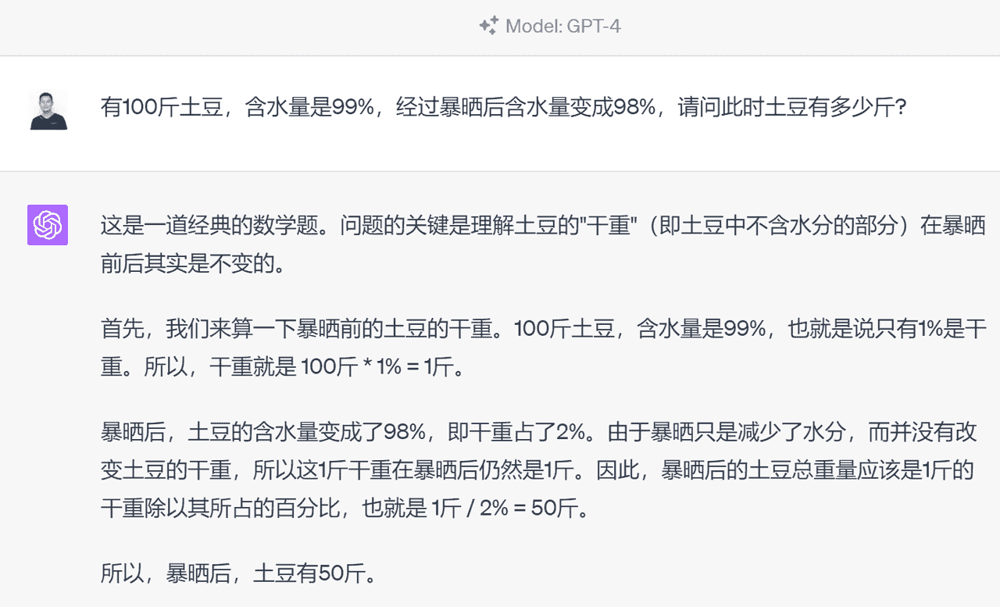
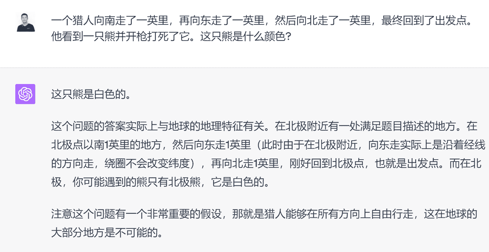
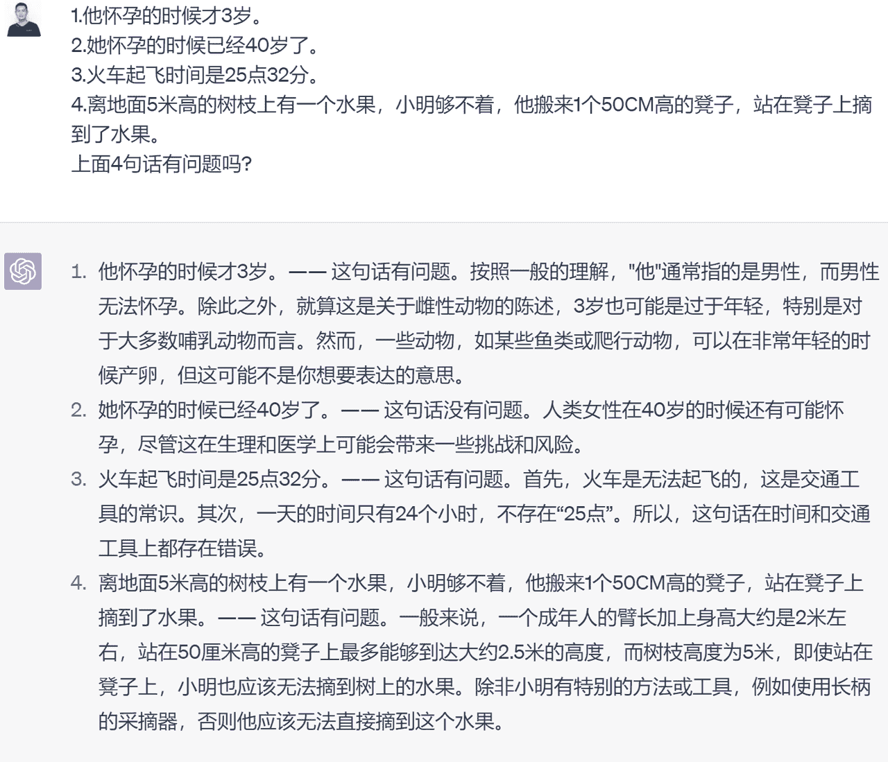
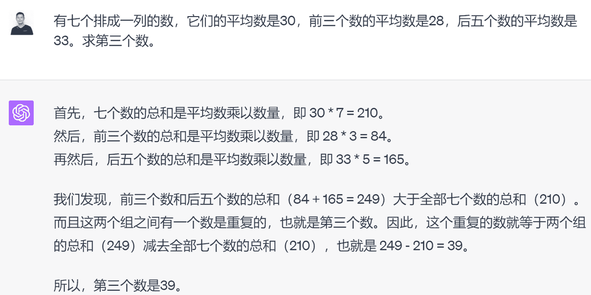
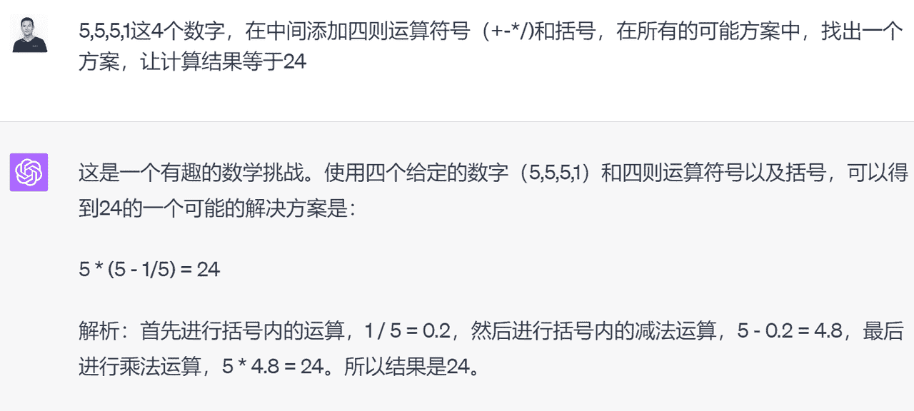
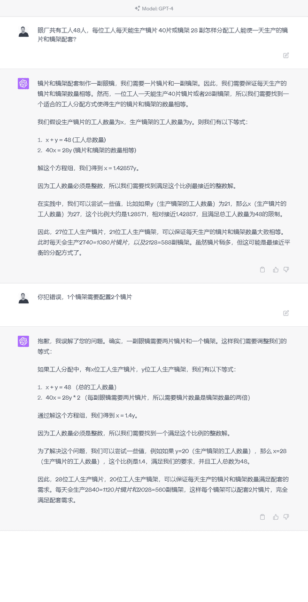
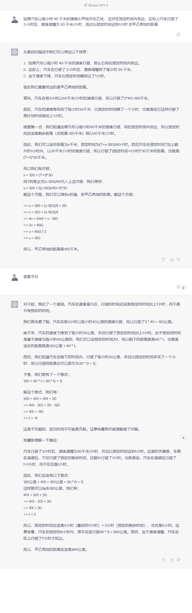

# GPT评分测试题

> 来源：[https://xuqiwei1986.feishu.cn/docx/BTwtdah72ovUqkxbYpbcWHiAnfe](https://xuqiwei1986.feishu.cn/docx/BTwtdah72ovUqkxbYpbcWHiAnfe)

## 二、数学类计算，简单计算错误

简单乘除法计算，388*8899=？

真实答案3452812

## 逻辑1

有100斤土豆，含水量是99%，经过暴晒后含水量变成98%，请问此时土豆有多少斤?

## 逻辑2

一个猎人向南走了一英里，再向东走了一英里，然后向北走了一英里，最终回到了出发点。他看到一只熊并开枪打死了它。这只熊是什么颜色?

一个猎人向北走了一英里，再向东走了一英里，然后向南走了一英里，最终回到了出发点。他看到一只动物并开枪打死了它。这只动物是什么颜色?

## 逻辑3

下面4句话有问题吗?

1.他怀孕的时候才3岁。

2.她怀孕的时候已经40岁了。

3.火车起飞时间是25点32分。

4.离地面5米高的树枝上有一个水果，小明够不着，他搬来1个50CM高的凳子，站在凳子上摘到了水果。

## 逻辑4

有七个排成一列的数，它们的平均数是30，前三个数的平均数是28，后五个数的平均数是33。求第三个数。

## 逻辑5

5,5,5,1这4个数字，在中间添加四则运算符号（+-*⑴)和括号，在所有的可能方案中，找出一个方案，让计算结果等于24

## 小学计算题

眼厂共有工人48人，每位工人每天能生产镜片 40片或镜架 28 副怎样分配工人能使一天生产的镜片和镜架配套?

## 小学计算题2

如果汽车以每小时 40 千米的速度从甲地开往乙地， 正好在预定时间内到达，实际上汽车行驶了 3 小时后，速度减慢为 30 千米/小时，因此比预定时间迟到1小时.求甲乙两地的距离

