# 2023-07-26【语聚AI】内测邀请中——ChatGPT插件市场的替代方案

> 来源：[https://xuqiwei1986.feishu.cn/docx/JXnids9MzoX5PTx11zgc2Up2nn4](https://xuqiwei1986.feishu.cn/docx/JXnids9MzoX5PTx11zgc2Up2nn4)

> https://yuju.jijyun.cn/index.html

https://www.jijyun.cn/index.html

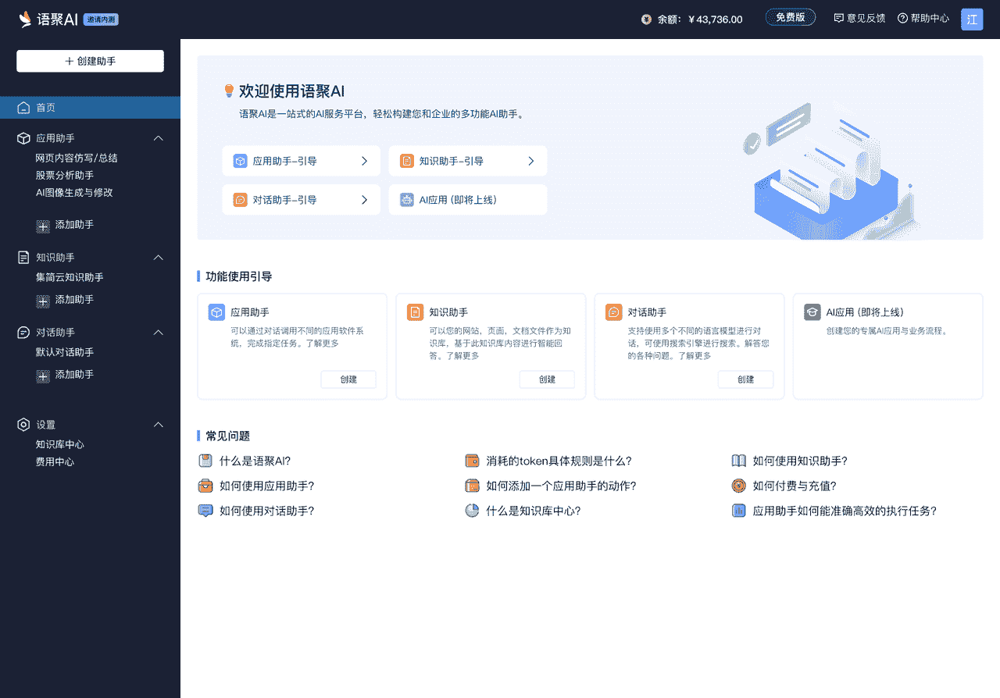

>

>

> 🔗 原文链接： h[ttps://mp.weixin.q](https://mp.weixin.qq.com/s/CdMXhs_DwQloKbgm8viRTg)q.com/s/CdMXhs_D...

>

原创 jijyun.cn 集简云平台

2023-07-26 08:31:06

精确发文时间由壹伴提供

2023-07-26 08:31 发表于 北京

手机阅读


**大家好，很**高兴为大家介绍，集简云新发布的产品： 语聚AI 。

语聚AI基于集简云强大的应用软件“连接器”的功能，目前提供下列功能：

+   **工具延展： **让AI语言模型可以调用超过700款应用软件，15000+应用接口的功能，用于延展其功能，更好地完成之前无法完成的任务。

+   **知识延展： **提供强大的知识问答能力，可以支持上传最高1GB的网站/网页，知识文档（支持使用pdf, csv, pptx, docx, xlsx, json, mbox, md, epub, eml, html等多种格式）作为“知识库”，让AI语言模型基于您自有“知识库”内容进行回答，创造性地解决问题。

+   **模型延展： **支持调用多种语言模型包括：GPT3.5，GPT4，百度文心一言，ChatGLM， MINIMAX等数种不同语言模型，Stable Diffusion，Midjourney， 百度文心绘图等300余款AI图像生成模型。

+    **嵌入集成： **提供页面嵌入，API调用，集简云（流程对接）等方式，将语聚AI的能力服务于您的内部与外部用户。

**目前语聚AI还有很多不足的地**方，因此我们希望 邀请更多的用户加入产品内测 ，收集产品建议，完善产品功能。

请点击下方卡片链接提交内测申请。


**语聚AI产品设计初衷**

自今年2月集简云开始对接AI语言模型以来，我们不断思考如何将AI语言模型的能力更好地服务于我们的用户。

并且我们也不断地在基于AI语言模型和AI图像生成模型创建集简云的产品功能，包括：

+   ChatGPT应用（API对接，免费体验）

+   [ChatGPT文档问答](https://mp.weixin.qq.com/s?__biz=Mzg5MjcxODg4Mw==&mid=2247510470&idx=1&sn=7ba2326d6b0a42933983d27aa260a412&scene=21#wechat_redirect)

+   [多种语言模型接入](https://mp.weixin.qq.com/s?__biz=Mzg5MjcxODg4Mw==&mid=2247512007&idx=1&sn=d2a92c1949635b5bc42992c17868538f&scene=21#wechat_redirect)

+   [AI图像生成](https://mp.weixin.qq.com/s?__biz=Mzg5MjcxODg4Mw==&mid=2247512170&idx=1&sn=2d82eb60c675f58c76be49f705b6212f&scene=21#wechat_redirect)

+   [AI图片处理](https://mp.weixin.qq.com/s?__biz=Mzg5MjcxODg4Mw==&mid=2247514376&idx=1&sn=a0a79f9eaeffdf1133909df284b2ac7f&scene=21#wechat_redirect)

我们发现用户除了希望将AI语言模型，AI图像模型对接到自己的办公软件外，还希望有对话界面产品直接调用语言模型，图像模型。因此，我们也在思考是否可以有更好的方式延展AI语言/图像模型的功能。

➢  ChatGPT插件延展AI语言模型能力，但限制较多

ChatGPT插件市场的出现，让我们看到大语言模型与软件API的结合方案，这与集简云目前的产品功能非常契合：可以通过大语言模型与软件API对接的方式，扩展大语言模型的使用场景和能力。

但是ChatGPT插件市场目前还有很多限制与不足，包括：

+   只能通过Web页面使用，且需要GPT4模型的能力。使用限制高，每3小时25次。

+   每次最多只能同时使用3个插件工具。

+   缺乏对国内软件的支持。

+   只能使用软件开发者默认的接口配置，无法自定义如何使用软件功能，字段配置，使用场景等。比如：如果表格类型软件，每个用户多个不同表格，表格下每个用户的字段不同，这样需要用户参与选择与配置的场景无法使用。

+   不支持API接口调用，无法集成到用户现有的业务流程中。

+   只能在有限的插件列表中选择，无法支持用户自定义软件/自研软件的使用。

+   只能单人使用，不支持团队使用。

➢ 知识文档功能文档空间大小，支持文档类型少，成本高

大语言模型的另外一种常有的方式是通过上传用户自有的知识文档文件，向量化做为“知识库”，大语言模型可以基于已上传的“知识库”进行回答。

但是：

+   只能支持单一的文档上传，支持的文档格式少：用户的知识内容可能在多种不同的文档类型中（产品介绍PPT，用户手册doc，帮助中心页面等），同时也需要多个文档，不同类型的文档结合使用。

+   只能支持几MB的文件上传，部分第三方软件支持几十MB的文件上传，这不足以满足用户的需求，一个产品的帮助中心网页，用户手册，培训手册合计可能有数百MB,甚至更高。

+   向量数据库成本高：知识问答往往需要依赖于向量数据库完成，但是无论是自建向量数据库，还是使用云端向量数据库服务成本都很高。

➢  多种语言模型/图像模型各有所长，如何选择？

在ChatGPT之后，大语言模型迎来了蓬勃发展，国内外各种语言模型逐步出现，预计到今年年底或者明年会有数十种不同的语言模型，数百种不同的AI图像模型出现。由于训练数据、训练方式、算法、参数的不同，各语言模型可能各有所长，如何选择适合用户指定场景的模型是一个新的问题。

基于我们看到的这些问题和集简云的现有能力，我们研发了“语聚AI”。

**语聚AI包含了3大不同类型的AI助手，每个类型的助手有着**不同的功能和使用场景。我们分别介绍一下：

应用助手：ChatGPT插件市场的替代方案

应用助手：赋予AI语言模型使用“工具”的能力。

可以使用集简云上 **700+ **应用软件， **15000+ **应用软件接口的能力，扩展AI语言模型的能力。

**同时支持集简云**的浏览器页面操作， 读取页面信息 。

也可通过Webhook、数据库、集简**云开放平台的方式，与现有**应用列表以外的 应用软件/自研系统对接 。

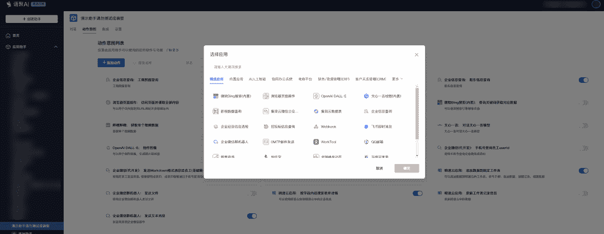

支持选择不同的账户，自定义软件的使用场景，方式等。

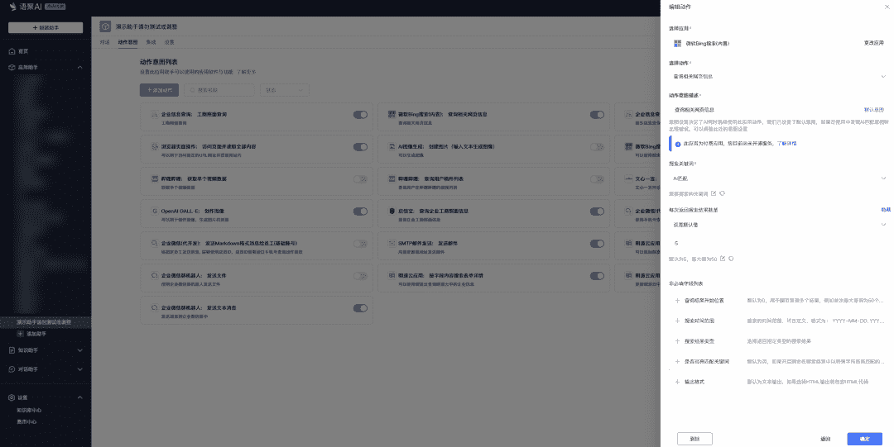

+   **示例： **读取指定网页内容，根据页面内容仿写或者总结，然后发送到OA/邮件或者文档软件中

+   **示例提示词： **请读取http://bj.people.com.cn/n2/2023/0718/c14540-40497796.html中的内容，并根据此内容生成一篇近似文章，要求500字，然后发送到企业微信群中。

+   **效果：**

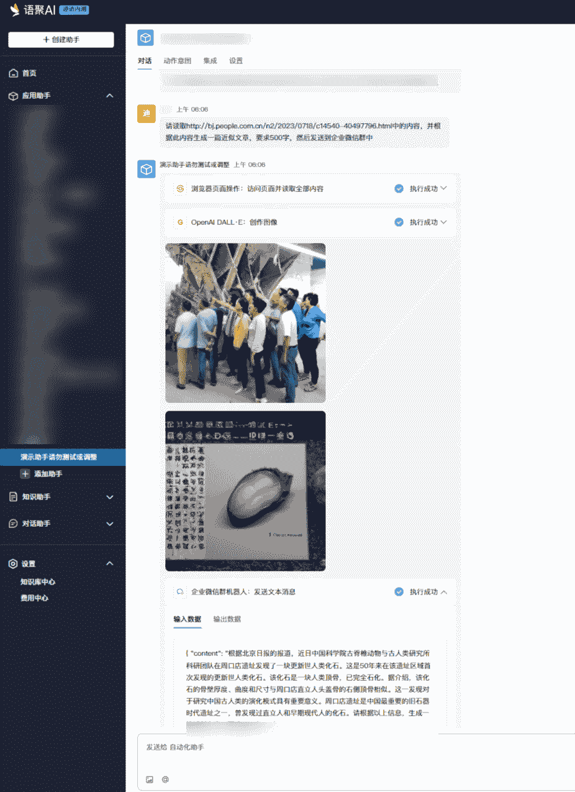

+   AI语言模型根据提示词内容，自主选择了适合的工具软件，包括：浏览器读取页面内容，OpenAI DaLL.E 图像创作，企业微信群机器人：发送文本 等应用软件，创作了新的文章和配图，并完成了将内容发送到企业微信群的任务。

用户可以根据自己的需要配置各种软件作为工具，延展AI语言模型的能力，完成更加有价值的任务。

知识助手：基于自有知识创建AI助手

知识助手支持用户上传多种不同格式的文件，也可自动抓取网站页面作为“自有知识库”，AI语言模型可以基于自有知识库，进行回答、总结、创造性地完成任务。

**支持多种格式内容的上传：**

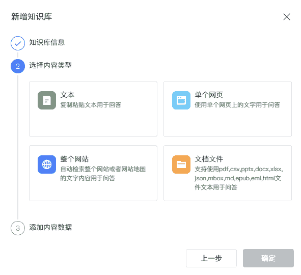

可支持最高数十万页面，5GB空间的文件上传：

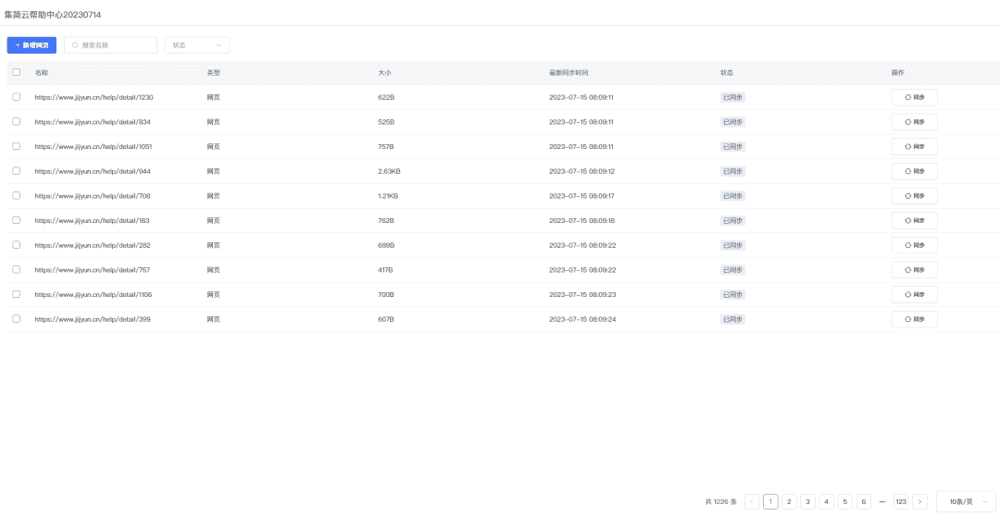

**支持手动修改和调整内容：**

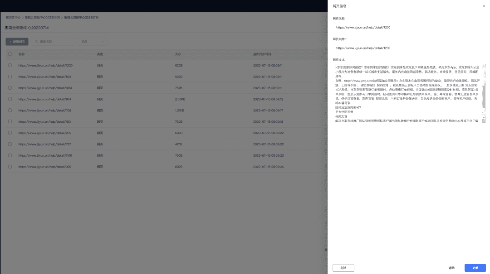

数百MB文件，数千页面内容的知识库，也可快速搜索与内容总结：

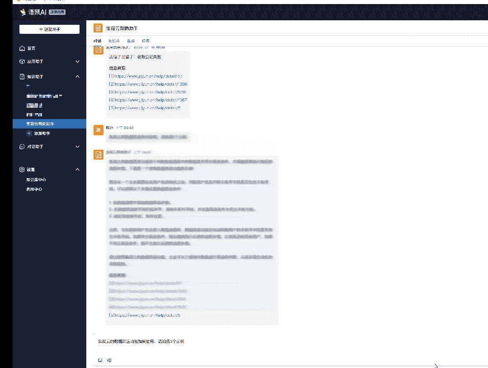

+   **示例： **集简云产品知识问答

+   **知识库： **自动收录集简云帮助中心： https://jijyun.cn/help 下 3000+网站页面

+   **提示词： **集简云的数据筛选功能如何使用，请给我3个示例

+   **回复内容：**

```
集简云的数据筛选功能可以通过设置筛选条件来对数据进行逻辑判断，并根据判断结果执行相应的流程步骤。以下是三个示例：

示例1：筛选手机号码
假设您需要在给用户发送短信前，判断用户信息中的手机号字段是否包含手机号码。您可以在数据筛选的字段匹配环节设置筛选条件，选择手机号字段，并设置匹配方式为包含。这样，只有手机号字段包含手机号码的数据才会继续执行后续的流程步骤。

示例2：筛选特定日期范围内的数据
假设您有一个数据表，其中包含了订单的日期信息。您希望筛选出某个特定日期范围内的订单数据。您可以在数据筛选的字段匹配环节设置筛选条件，选择日期字段，并设置匹配方式为在指定日期范围内。这样，只有日期字段在指定范围内的订单数据才会被筛选出来。

示例3：筛选满足多个条件的数据
假设您有一个客户信息表，其中包含了客户的性别、年龄和地区等信息。您希望筛选出同时满足性别为女性、年龄在25岁以上、地区为北京的客户数据。您可以在数据筛选的字段匹配环节设置多个筛选条件，并选择逻辑关系为“并且”。这样，只有满足所有条件的客户数据才会被筛选出来。

通过以上示例，您可以了解到集简云的数据筛选功能如何使用，并根据具体需求设置相应的筛选条件。

信息来源:
[1]https://www.jijyun.cn/help/detail/1206
[2]https://www.jijyun.cn/help/detail/67
[3]https://www.jijyun.cn/help/detail/938
[4]https://www.jijyun.cn/help/detail/1067
[5]https://www.jijyun.cn/help/detail/1209
```

对话助手：快速切换多种不同的语言模型，匹配最佳回答

**➢ 对话助手支持在多个不同的语言**模型下切换使用，以体验不同的语言模型功能

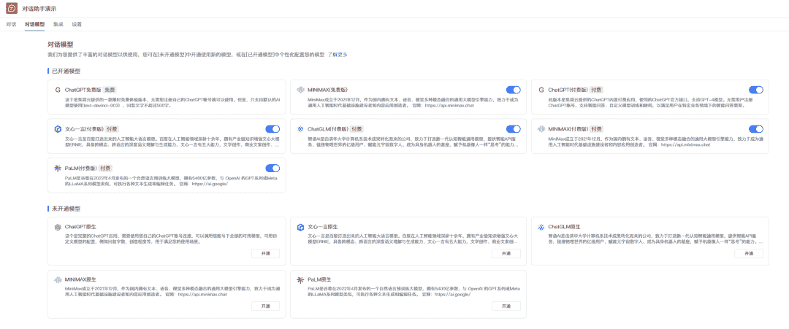

**目前支持的AI语言模型包括：**

+   ChatGPT免费版本 （每日免费20次使用）

+   ChatGPT付费版本 （支持GPT3.5 16K 和GPT 4)

+   MINIXMAX免费版本 （每日免费20次使用）

+   MINIXMAX付费版本

+   ChatGLM

+   百度文心一言

+   Google PaLM2

同时如果您已有上述语言模型的账户API权限，也可使用您自己的API授权与账户。

后续新增模型我们将逐步补充。

➢ 支持使用Bing搜索引擎，搜索实时内容

➢ 支持上下文对话记忆，可以基于前面的问题与回答进行对话


嵌入与集成：将语聚AI功能嵌入到您的网页或者办公系统中使用。

语聚AI提供了 网页浮窗代码、页面URL访问、API对接、集简云内置应用调用 的方式，帮助您轻松将语聚AI的功能嵌入到您的网站页面或者办公系统，业务流程中使用。

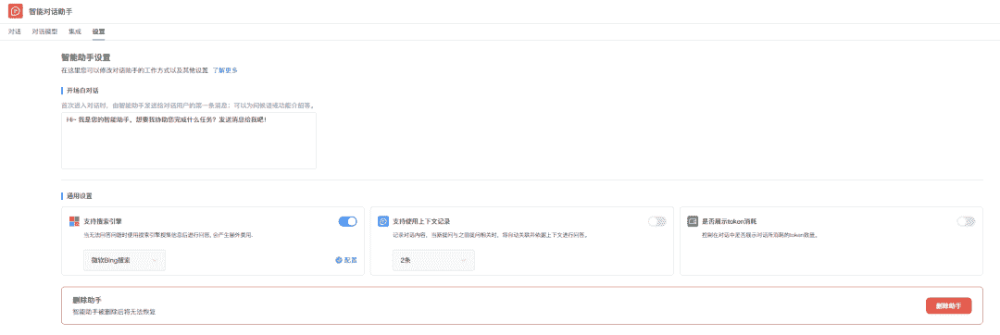

**网站页面嵌入示例： **

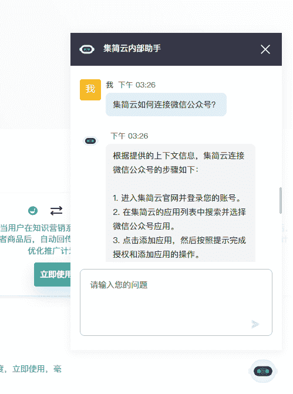

**企业微信侧边栏嵌入示例： **


**邀请您参与产品内测**

由于产品功能还在完善中，为了提供更好的用户体验，目前语聚AI开放邀请内测。

您可以点击下方卡片链接，提交内测申请。

如果通过我们的内测申请，我们将在1-3个工作日内与您联系并开放内测账户。

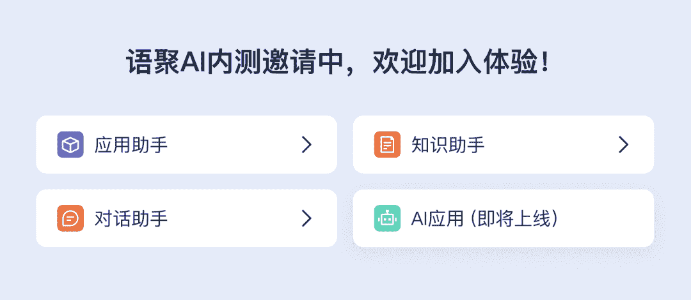

---

**Q**

# **关于集简云**

ABOUT JIJYUN

**集简云：让连接更简单**

集简云是一款超级软件连接器，无需开发，无需代码知识就可以轻松打通数百款软件之间的数据连接，构建自动化与智能 化的业务流程。 通过自动化业务流程，每月可节省您数百甚至数万小时的人工成本。

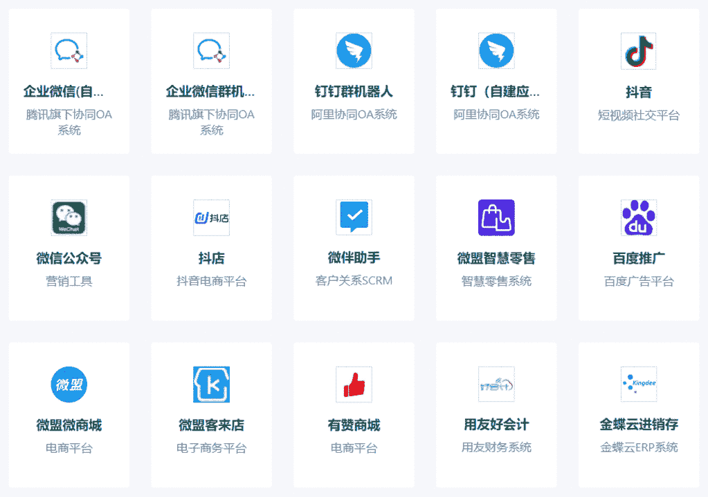

700+集成应用

集简云介绍

集简云开放平台： 让您的系统拥有与700+款软件连接的能力

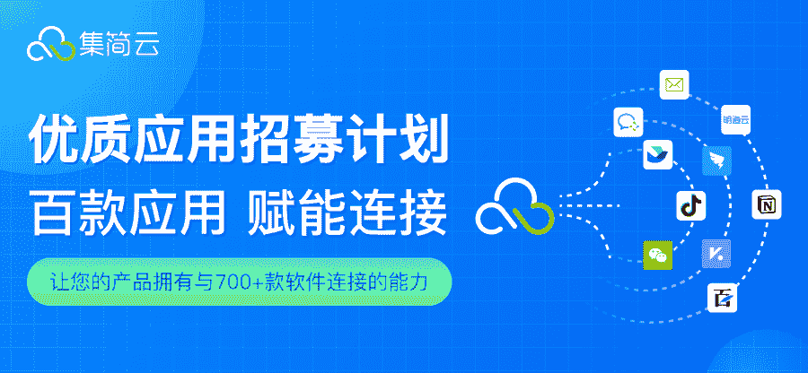

---

集简云开放平台现开启“优质应用招募计划”，诚邀您参加！免费入驻集简云应用中心，让您的产品拥有与700+款软件连接的能力！

前100位入驻将获得专属技术支持，助您快速完成上架！

百万级市场曝光，帮您获取更多商机！

如您资源紧张无排期，也可将您的产品介绍、接口文档及测试账号发送至chengguo@email.jijyun.cn，评估后我们将按照排期顺序安排接入。


点击 **阅读原文 **，马上免费体验集简云