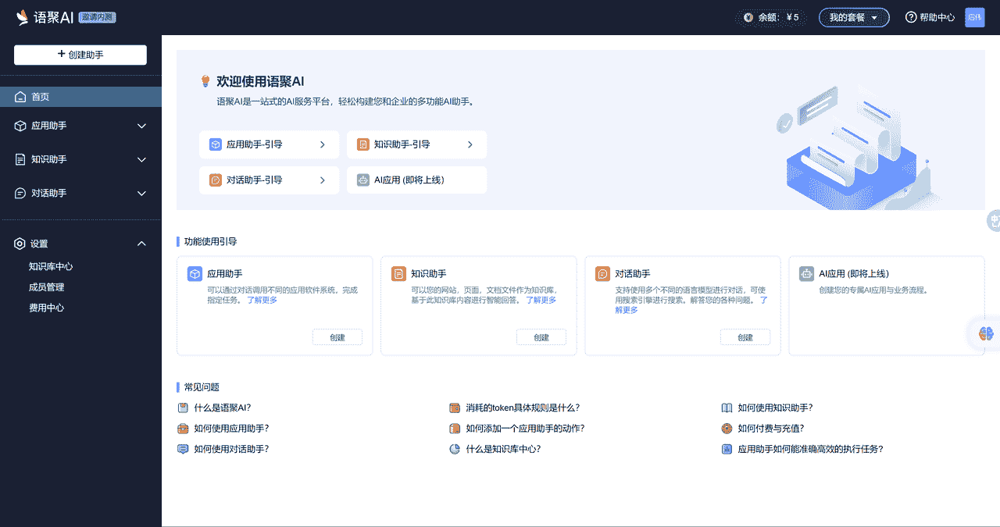
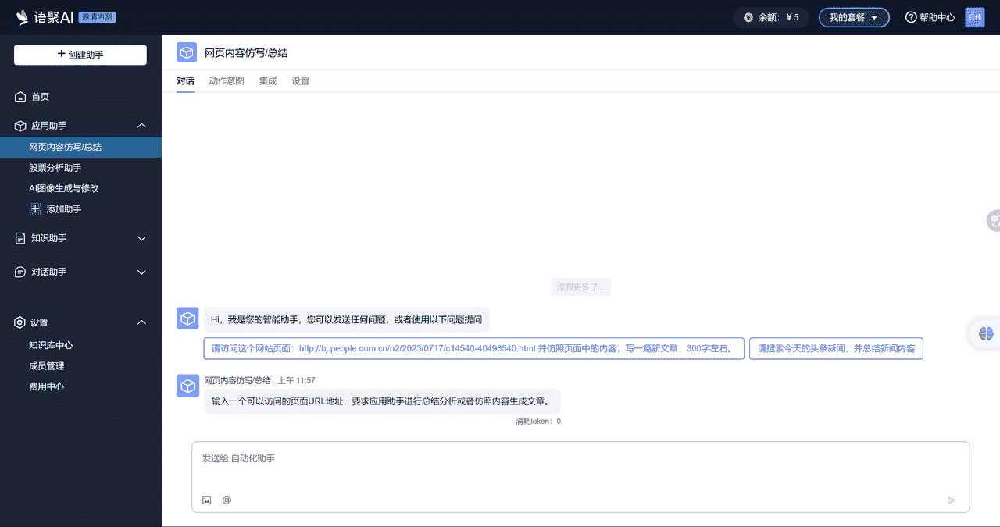

# 2023-08-16【语聚AI】集简云-全国首款AI模型连接器，可连接AI模型，软件工具与知识信息

> 来源：[https://xuqiwei1986.feishu.cn/docx/Fv12dRAiYotli8xNo10c69lbnNc](https://xuqiwei1986.feishu.cn/docx/Fv12dRAiYotli8xNo10c69lbnNc)

# 官网

https://chat.jijyun.cn/home

https://yuju.jijyun.cn/

基于集简云强大的应用软件“连接器”能力，语聚AI提供以下功能：

# 连接AI模型与软件工具：

让AI语言模型可以调用超过700款应用软件，15000+应用接口的功能，用于延展其功能，更好地完成之前无法完成的任务。

# 连接AI模型与知识信息：

提供强大的知识问答能力，可以支持上传最高1GB的网站/网页，知识文档（支持使用pdf, csv, pptx, docx, xlsx, json, mbox, md, epub, eml, html等多种格式）作为“知识库”，让AI语言模型基于您自有“知识库”内容进行回答，创造性地解决问题。

# 连接多种AI模型协同工作：

支持调用多种语言模型包括：GPT3.5，GPT4，百度文心一言，ChatGLM， MINIMAX等数种不同语言模型，Stable Diffusion，Midjourney， 百度文心绘图等300余款AI图像生成模型。

# 嵌入集成：

提供页面嵌入，API调用，嵌入企业微信/钉钉/飞书OA系统，接入微信公众号、抖音，集简云（流程对接）等方式，将语聚AI的能力服务于您的内部与外部用户。