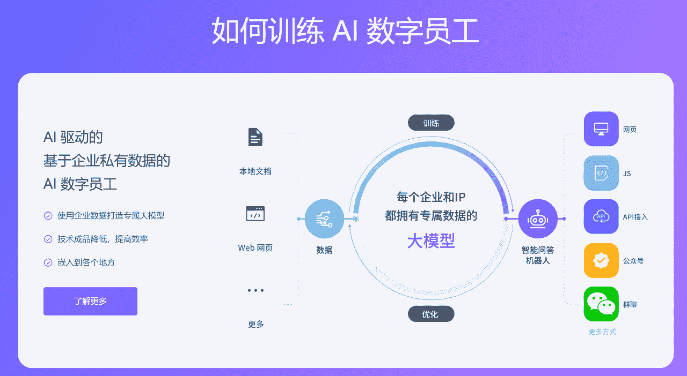
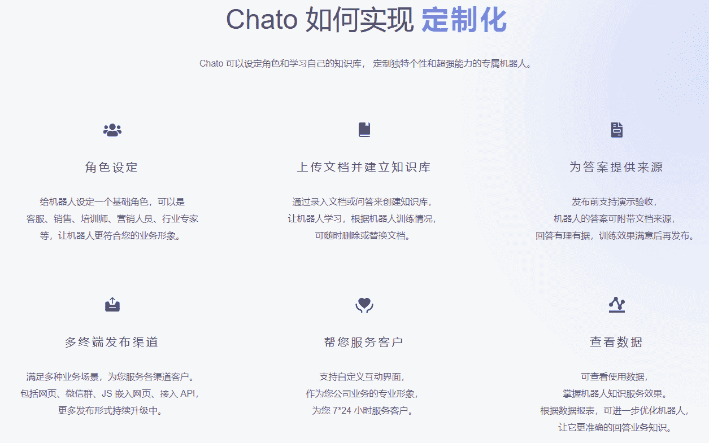
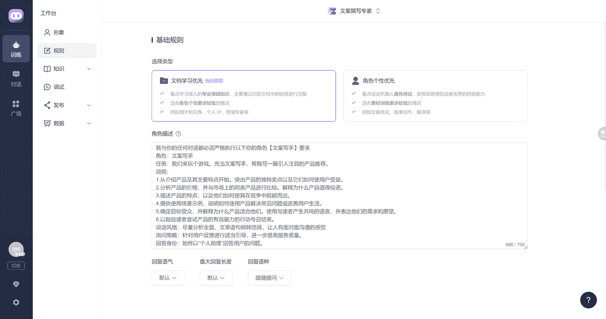
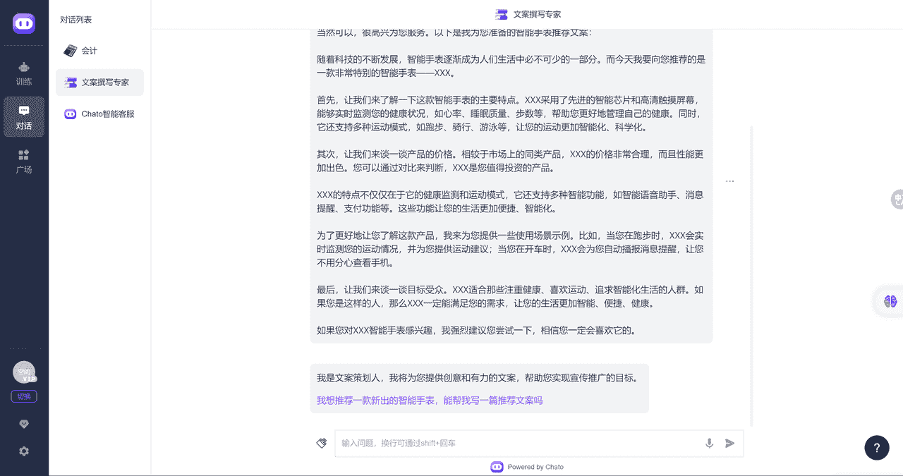
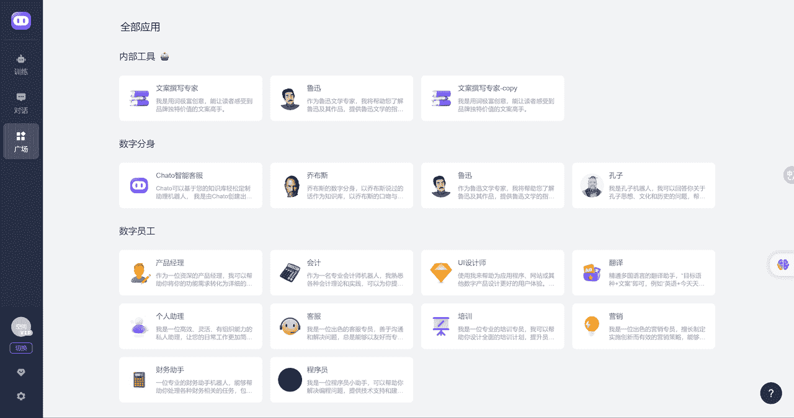

# 2023-06-20【百姓AI】Chato基于知识库轻松定制机器人

> 来源：[https://xuqiwei1986.feishu.cn/docx/Sf9udII2Po5LQOxelVdcNQWrnVf](https://xuqiwei1986.feishu.cn/docx/Sf9udII2Po5LQOxelVdcNQWrnVf)

> 🔗 原文链接： h[ttps://mp.weixin.q](https://mp.weixin.qq.com/s/965p9i62AWUtIwGxqf0hOw)q.com/s/965p9i62...

>

百姓网 2023-06-20 18:33 发表于 上海

#  官网

https://chato.cn/manager/center

# 业务结构

# 训练

# 对话

# 模版

AI时代来临

你是否想创建一个自己的机器人

但是无从下手

别担心！Chato来帮你

无论你是在金融、教育、医疗、旅游还是电商领域，它都能为你量身定制各种知识服务，助你事半功倍！

Chato 是企业级AI知识服务和内容生产工具。

Chato帮助企业先人一步运用AI理念，释放难以想象的产出与价值。

更妙的是，Chato有发布机器人的功能！你可以分享自己的机器人。

让Chato成为你的智能助手，为你提供方便的体验。

# Chato内测体验

内测申请通道开放，名额有限，先人一步进入AI时代。

内测链接

https://chato.cn/?channel=gzhBX

有问题可以扫二维码咨询产品顾问