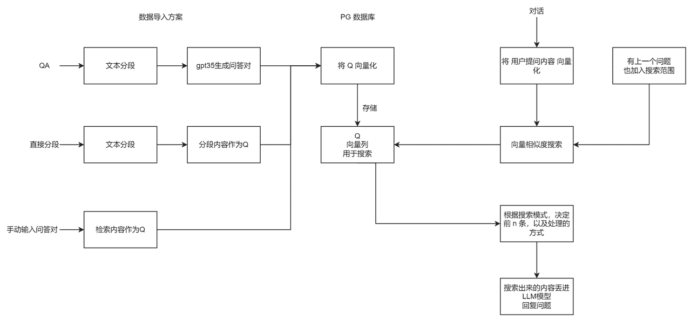
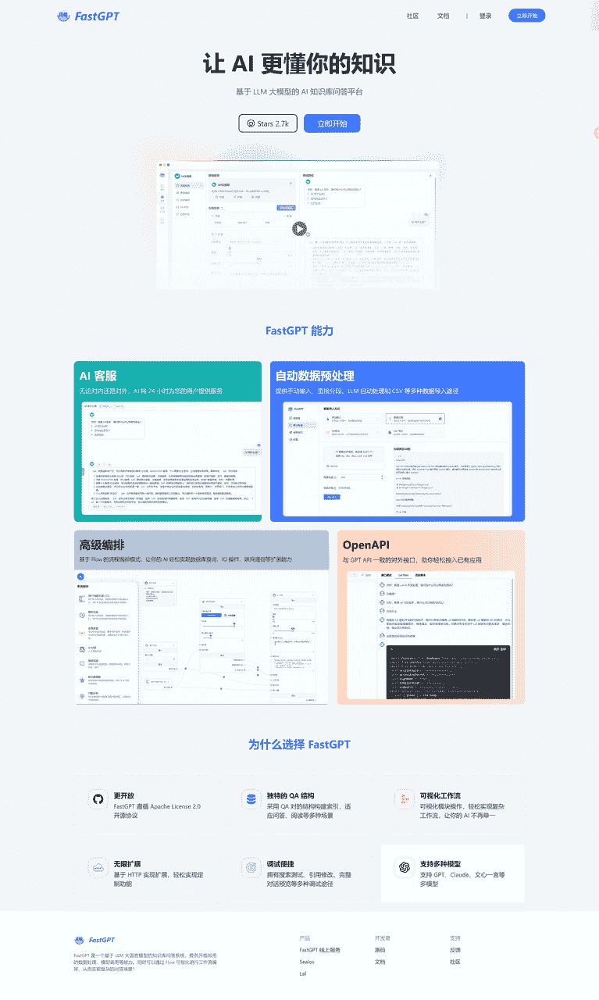
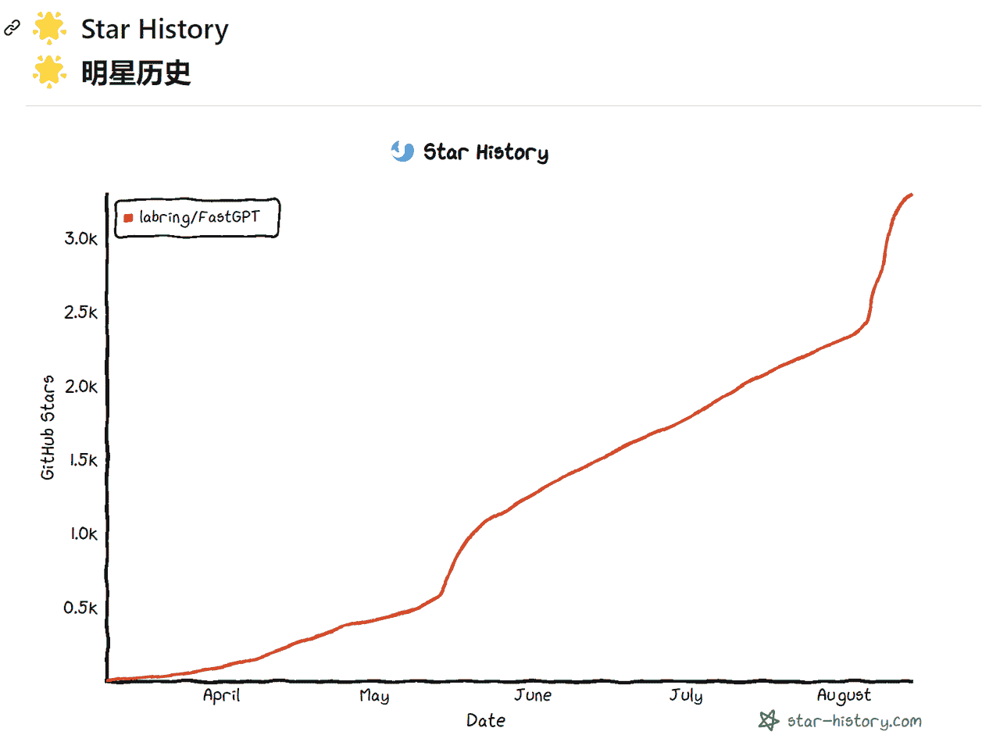
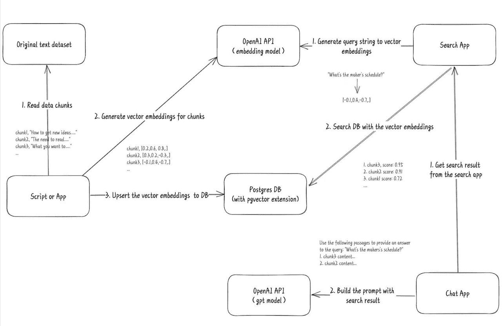

# 2023-04-07【FastGpt】基于 LLM 大语言模型的知识库问答系统

> 来源：[https://xuqiwei1986.feishu.cn/docx/MhAAdCddvoSiB2xajYPcayafncc](https://xuqiwei1986.feishu.cn/docx/MhAAdCddvoSiB2xajYPcayafncc)

FastGPT 是一个基于 LLM 大语言模型的知识库问答系统，提供开箱即用的数据处理、模型调用等能力。同时可以通过 Flow 可视化进行工作流编排，从而实现复杂的问答场景！

项目体验地址：https://fastgpt.run

代码仓库：https://github.com/c121914yu/FastGPT

常见问题: [FastGpt 常见问题](https://kjqvjse66l.feishu.cn/docx/HtrgdT0pkonP4kxGx8qcu6XDnGh)

快速了解 FastGpt | FastGpt

FastGpt v4.1-beta 版本更新：

预计将在 8.14发布正式版。下周会补齐高级编排的使用文档和示例

1.  高级编排增加内容提取和http模块，可以轻松将数据库查询、联网搜索等复杂操作接入。

1.   对话中间状态提醒

1.   支持文件和文件夹拖拽上传

1.  sealos一键部署 v4 版本，仅需设置 root 用户密码和 openai key，自动初始化 root 用户和 pg 数据库。

**FastGpt**实际流程：

其他问题可评论区补充

FastGpt roadmap:

[FastGpt Roadmap](https://kjqvjse66l.feishu.cn/docx/RVUxdqE2WolDYyxEKATcM0XXnte)