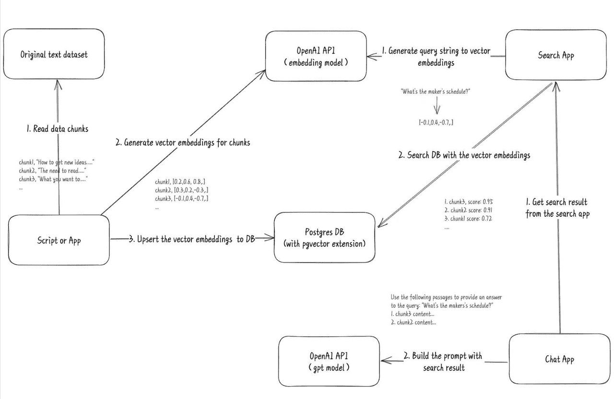
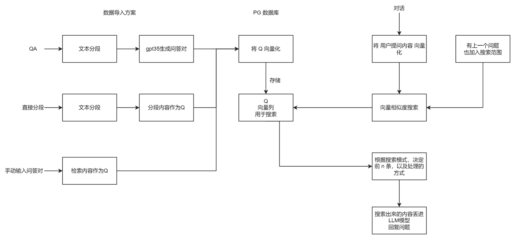
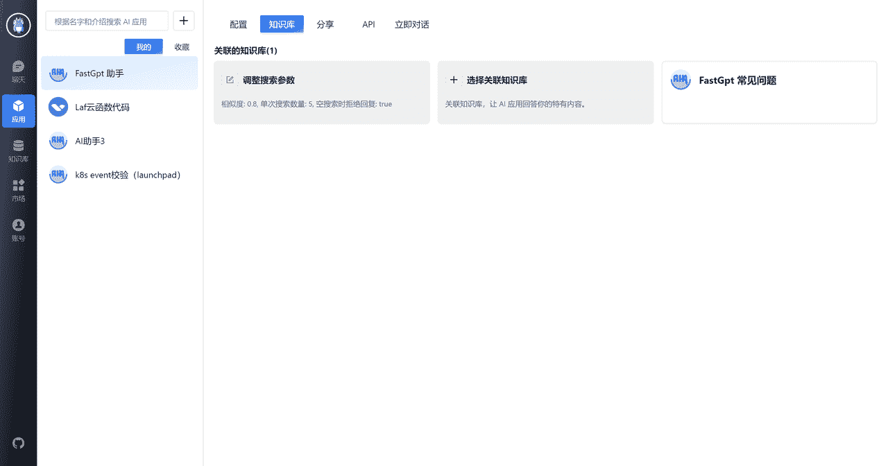
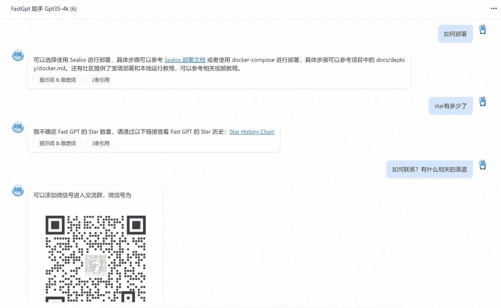
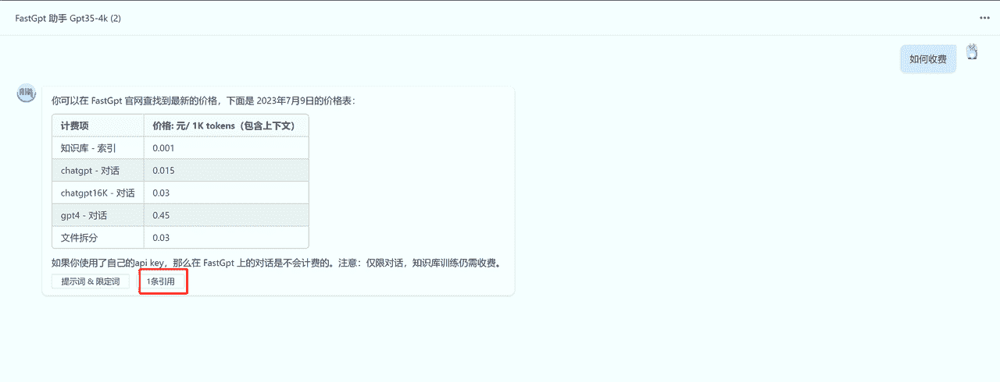

# 2023-08-04使用 FastGPT 构建高质量 AI 知识库 - 知乎

> 来源：[https://xuqiwei1986.feishu.cn/docx/SxrjdgG3mopW1jxhngZcFhVTnqh](https://xuqiwei1986.feishu.cn/docx/SxrjdgG3mopW1jxhngZcFhVTnqh)

> 🔗 原文链接： h[ttps://zhuanlan.zh](https://zhuanlan.zhihu.com/p/647960390)ihu.com/p/647960...

>

> 作者：余金隆。FastGPT 项目作者，Sealos 项目前端负责人，前 Shopee 前端开发工程师

> FastGPT 项目地址： [**https:// github.co**](https://link.zhihu.com/?target=https%3A//github.com/labring/FastGPT/)m/labring/Fast GPT/

## 引言

自从去年 12 月 ChatGPT 发布以来，带动了一轮新的交互应用革命。尤其在 GPT-3.5 接口全面开放后，大量的 LLM 应用如雨后春笋般涌现。然而，由于 GPT 的可控性、随机性和合规性等问题，很多应用场景都没法落地。

## 起源

3 月份，我在 Twitter 上刷到一个老哥使用 GPT 训练他自己的博客记录，成本极低（相比于 Fine-tuning）。他提供了一个完整的流程图：

看到[这个推文后，我灵机一动，应用场景就十分清晰了。直接上手](https://link.zhihu.com/?target=https%3A//www.bilibili.com/video/BV1Wo4y1p7i1/)开干，不到一个月的时间，我在原有的助手管理基础上，为 FastGPT 加入了向量搜索功能。于是就有了最早的一期视频： https://www. bilibili.com/video/BV1W o4y1p7i1/

## 初步发展

三个月过去了，FastGPT 依然延续着早期的思路去完善和扩展。目前，其在向量搜索 + LLM 线性问答方面的功能基本已完成。然而，我们始终没有发布关于如何构建知识库的教程。因此，我们打算在 V4 版本开发过程中，写一篇文章来介绍《如何在 FastGPT 上构建高质量知识库》。

## FastGPT 的知识库逻辑

在正式开始构建知识库之前，我们需要了解 FastGPT 的知识库检索机制。首先，我们需要了解几个基本概念：

### 基础概念

1.  **向量 **：将人类的语言（文字、图片、视频等）转换为计算机可识别的语言（数组）。

1.  **向量相似度 **：计算两个向量之间的相似度，表示两种语言的相似程度。

1.  **语言大模型的特性 **：上下文理解、总结和推理。

这三个概念结合起来，就构成了 "向量搜索 + 大模型 = 知识库问答" 的公式。以下是 FastGPT V3 中知识库问答功能的完整逻辑：

FastGPT 与大多数其他知识库问答产品不同的地方在于，它采用了 QA 问答对进行存储，而不仅是 chunk（文本分块）处理。这样做是为了减少向量化内容的长度，使向量能更好地表达文本的含义，从而提高搜索的精度。

此外 FastGPT 还提供了搜索测试和对话测试两种途径对数据进行调整，从而方便用户调整自己的数据。

**根**据上述流程和方式，我们以构建一个 FastGPT 常见问题机器人为例，展示如何构建一个高质量的 AI 知识库。

> FastGPT 仓库地址： [**https:// github.c**](https://link.zhihu.com/?target=https%3A//github.com/labring/FastGPT)om/labring/Fast GPT

## 创建知识库应用

首先，我们创建一个 FastGPT 常见问题知识库。

### 基础知识获取

我们先直接把 FastGPT GitHub 仓库上一些已有文档，进行 QA 拆分，从而获取一些 FastGPT 的基础知识。下面以 README 为例。

### QA 修正

我们从 README 中获取了 11 组数据，整体质量还是不错的，图片和链接都提取出来了。然而，最后一个知识点出现了一些截断，我们需要手动修正一下。

此外，我们注意到第一列第三个知识点，该知识点介绍了 FastGPT 的一些资源链接，但 QA 拆分将答案放在了 A 中。然而，用户的问题通常不会直接问“有哪些链接”，他们更可能会问：“部署教程”，“问题文档”等。因此，我们需要对此知识点进行简单处理，如下图所示：

接下来，我们可以创建一个应用，看看效果如何。首先创建一个应用，并在知识库中关联相关的知识库。另外，还需要在配置页面的提示词中，告诉 GPT：“知识库的范围”。

### 导入社区常见问题

接着，我们把 FastGPT 常见问题的文档导入。由于之前的整理不到位，我们只能手动录入对应的问答。

导入结果如上图。可以看到，我们均采用的是问答对的格式，而不是粗略的直接导入。目的就是为了模拟用户问题，进一步的提高向量搜索的匹配效果。可以为同一个问题设置多种问法，效果更佳。

FastGPT 还提供了 OpenAPI 功能，你可以在本地对特殊格式的文件进行处理后，再上传到 FastGPT，具体可以参考： FastGPT Api Docs

## 知识库微调和参数调整

FastGPT 提供了搜索测试和对话测试两个功能，我们可以通过这两个功能来进行知识库微调和参数调整。

我们建议你提前收集一些用户问题进行测试，根据预期效果进行跳转。可以先进行搜索测试调整，判断知识点是否合理。

### 搜索测试

通过搜索测试，我们可以输入问题，查看返回的知识库数据，来测试知识库的查询效果。下面是搜索测试的界面：

我们可以看到，系统返回了与之相关的问答数据。

你可能会遇到下面这种情况，由于“知识库”这个关键词导致一些无关内容的相似度也被搜索进去，此时就需要给第四条记录也增加一个“知识库”关键词，从而去提高它的相似度。

### 提示词设置

提示词的作用是引导模型对话的方向。在设置提示词时，遵守 2 个原则：

1.  告诉 GPT 回答什么方面内容。

1.  给知识库一个基本描述，从而让 GPT 更好的判断用户的问题是否属于知识库范围。

### 更好的限定模型聊天范围

首先，你可以通过调整知识库搜索时的相似度和最大搜索数量，实现从知识库层面限制聊天范围。通常我们可以设置相似度为 0.82，并设置空搜索回复内容。这意味着，如果用户的问题无法在知识库中匹配时，会直接回复预设的内容。

由于 OpenAI 向量模型并不是针对中文，所以当问题中有一些知识库内容的关键词时，相似度 会较高，此时无法从知识库层面进行限定。需要通过限定词进行调整，例如：

> 我的问题如果不是关于 FastGPT 的，请直接回复：“我不确定”。你仅需要回答知识库中的内容，不在其中的内容，不需要回答。

效果如下：

当然，GPT-3.5 在一定情况下依然是不可控的。

### 通过对话调整知识库

与搜索测试类似，你可以直接在对话页里，点击“引用”，来随时修改知识库内容。

## 结语

1.  向量搜索是一种可以比较文本相似度的技术。

1.  大模型具有总结和推理能力，可以从给定的文本中回答问题。

1.  最有效的知识库构建方式是 QA 和手动构建。

1.  Q 的长度不宜过长。

1.  需要调整提示词，来引导模型回答知识库内容。

1.  可以通过调整搜索相似度、最大搜索数量和限定词来控制模型回复的范围。

发布于 2023-08-04 12:17 ・IP 属地浙江