# 2023-05-19利用FastGPT和Laf将GPT接入企业微信 - Sealos 开发者社区

> 来源：[https://xuqiwei1986.feishu.cn/docx/CaaBd4JbYoGfmYxNQjic1gW9n1e](https://xuqiwei1986.feishu.cn/docx/CaaBd4JbYoGfmYxNQjic1gW9n1e)

> 🔗 原文链接： https://forum.laf.run/d/556

>

FastGPT一个快速使用 openai api 的平台。支持一键构建AI知识库，支持多用户、多模型管理。

这篇文章教你用两分半的时间，利用FastGPT和Laf将GPT接入企业微信 😂

## 条件

1.  你需要有企业微信管理权限

1.  你需要一个 [FastGPT ](https://fastgpt.run/)账号

1.  你需要一个 [Laf（国区） ](https://laf.run/)账号

>

## FastGPT操作

1.  前往“AI助手”页面，创建一个AI助手，并记录这里的modelId（用FASTGPT_MODEL_ID表示）

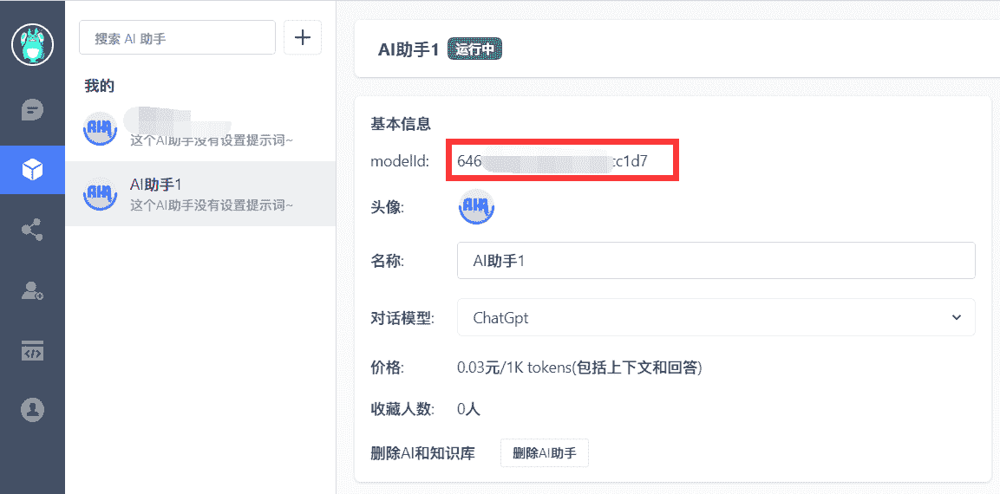

1.  前往“开发”页面，创建一个API KEY，记录这里的API KEY 为 FASTGPT_APIKEY

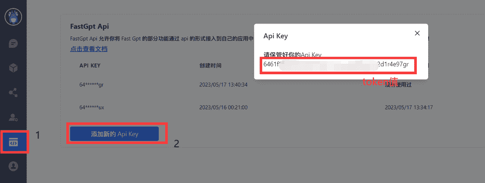

## 企业微信操作

1.  进入企业微信管理后台-我的企业，记录这里的企业ID为 WXWORK_CORPID


1.  进入应用管理页面，点击【创建应用】进入创建页面，填写应用信息后点击【创建应用】。如果已经有现成的应用，可以跳过此步骤。

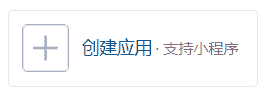

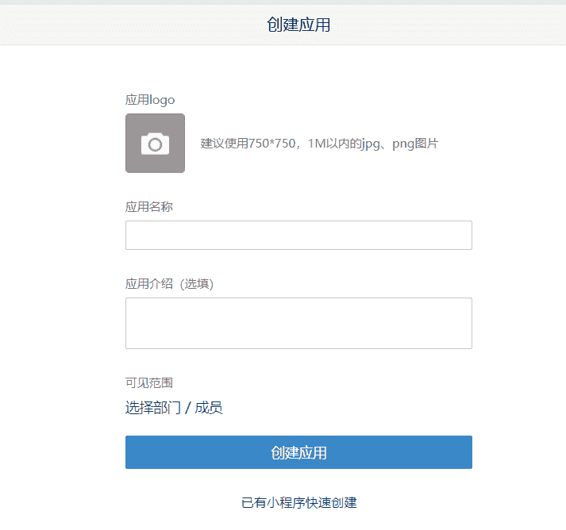

1.  在应用管理页面点击刚刚创建好的应用，进入应用详情页面。记录这里的AgentId和Secret（需要点击获取按钮，在企业微信聊天窗口里面获取），分别为WXWORK_AGENTID和WXWORK_CORPSECRET。

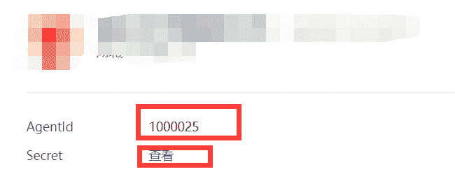

1.  在应用详情页面，接收消息处点击【设置API接收】。

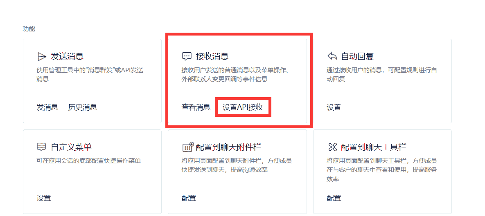

在API接收消息页面，点一下两个【随机获取】按钮，它会自动生成一个Token和EncodingAESKey，我们分别记为WXWORK_TOKEN和WXWORK_AESKEY。注意，不要关掉这个页面，Laf侧配置完毕后我们再来填写URL。

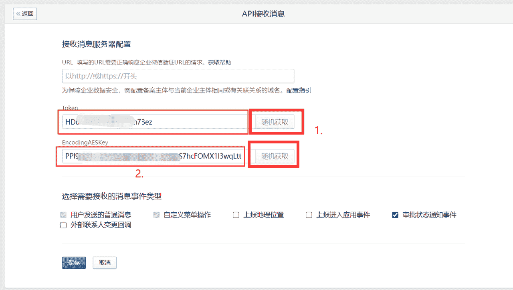

## Laf 操作

1.  进入 [Laf控制台 ](https://laf.run/dashboard)，新建一个应用。

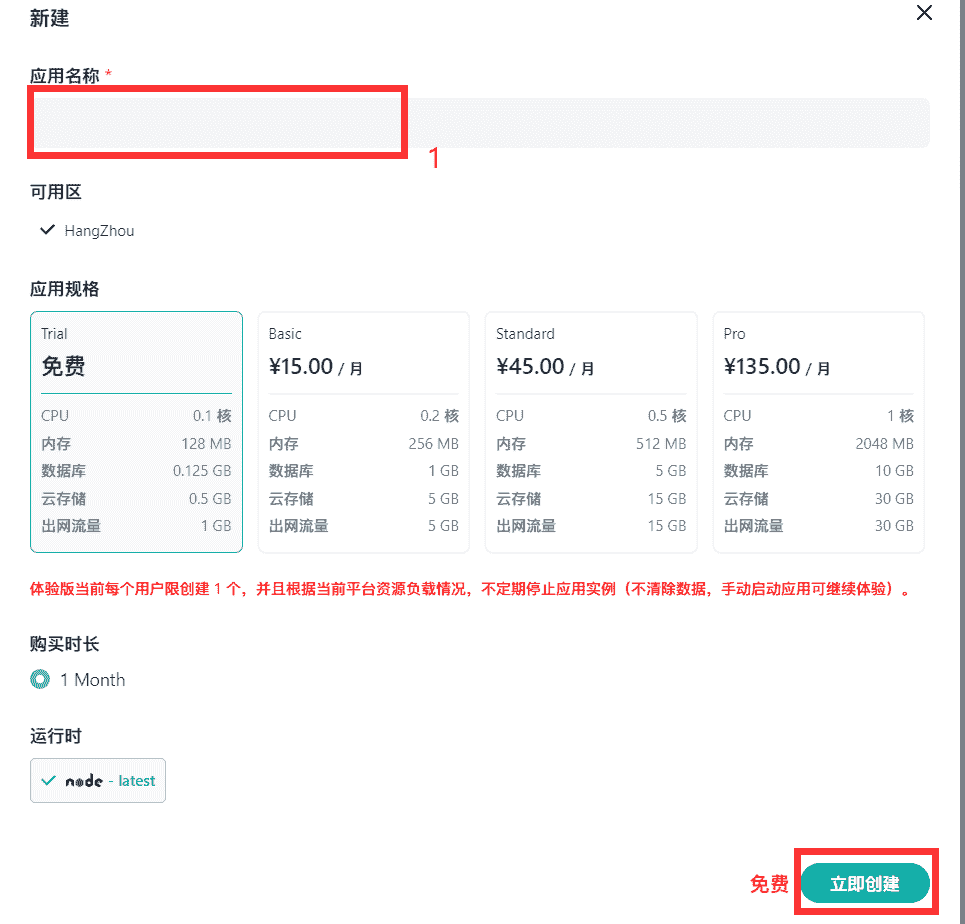

1.  进入开发页面，先安装两个npm依赖：

1.  xml2js

1.  @wecom/crypto

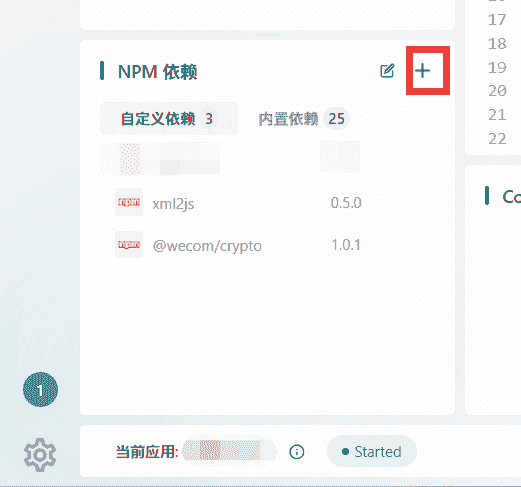

1.  创建一个云函数 chatgpt （不可改名），取消所有请求方法，填写下面的代码并发布。

```
import cloud from &#x27;@lafjs/cloud&#x27;

export async function sendGptMessage(message) {
  console.log(&#x27;send gpt message&#x27;, message)
  const res = await cloud.fetch({
    url: &#x27;https://fastgpt.run/api/openapi/chat/chat&#x27;,
    method: &#x27;POST&#x27;,
    headers: {
      apikey: process.env.FASTGPT_APIKEY
    },
    data: {
      &quot;modelId&quot;: process.env.FASTGPT_MODEL_ID,
      &quot;isStream&quot;: false,
      &quot;prompts&quot;: [
        {
          &quot;obj&quot;: &quot;Human&quot;,
          &quot;value&quot;: message
        },
      ]
    }
  })
  console.log(&#x27;send gpt message result&#x27;, res?.data)
  return res.data?.data
}
```

1.  创建一个云函数 wxwork (不可改名)，取消所有请求方法，填写下面的代码并发布。

```
import cloud from &#x27;@lafjs/cloud&#x27;

export async function getToken() {
  const cache = cloud.shared.get(&#x27;access-token&#x27;)
  console.log(&#x27;checking cache&#x27;, cache, cache.expires &gt;= Date.now())
  if (cache &amp;&amp; cache.expires &gt;= Date.now()) return cache.token;
  console.log(&#x27;start to get token of&#x27;, process.env.WXWORK_CORPID)

  const res = await cloud.fetch({
    url: &#x27;https://qyapi.weixin.qq.com/cgi-bin/gettoken&#x27;,
    method: &#x27;get&#x27;,
    params: {
      corpid: process.env.WXWORK_CORPID,
      corpsecret: process.env.WXWORK_CORPSECRET,
    }
  })
  const token = res.data.access_token
  cloud.shared.set(&#x27;access-token&#x27;, { token, expires: Date.now() + res.data.expires_in * 1000 })
  return token
}

export async function sendMessage(message, user) {
  console.log(&#x27;send messagge&#x27;, user, message)
  const res = await cloud.fetch({
    url: &#x27;https://qyapi.weixin.qq.com/cgi-bin/message/send&#x27;,
    method: &#x27;POST&#x27;,
    params: {
      access_token: await getToken()
    },
    data: {
      &quot;touser&quot;: user,
      &quot;msgtype&quot;: &quot;text&quot;,
      &quot;agentid&quot;: process.env.WXWORK_AGENTID,
      &quot;text&quot;: {
        &quot;content&quot;: message
      },
      &quot;safe&quot;: 0,
      &quot;enable_id_trans&quot;: 0,
      &quot;enable_duplicate_check&quot;: 0,
      &quot;duplicate_check_interval&quot;: 1800
    }
  })
  console.log(&#x27;send message result&#x27;, res.data)
}
```

1.  创建一个云函数 wxwork-gpt-api (随便改名)，开放GET和POST请求，填写下面的代码并发布。

```
import cloud from &#x27;@lafjs/cloud&#x27;
import { decrypt, getSignature } from &#x27;@wecom/crypto&#x27;;
import { sendMessage } from &#x27;@/wxwork&#x27;
import { sendGptMessage } from &#x27;@/chatgpt&#x27;
import xml2js from &#x27;xml2js&#x27;;

export default async function (ctx: FunctionContext) {
  const { query } = ctx;
  const { msg_signature, timestamp, nonce, echostr } = query;
  const token = process.env.WXWORK_TOKEN;
  const key = process.env.WXWORK_AESKEY;
  console.log(&#x27;start to invoke wxwork-gpt-api&#x27;)

  // 签名验证专用
  if (ctx.method === &#x27;GET&#x27;) {
    const signature = getSignature(token, timestamp, nonce, echostr);
    if (signature !== msg_signature) {
      return { message: &#x27;签名验证失败&#x27;, code: 401 }
    }
    const { message } = decrypt(key, echostr);
    return message
  }

  const payload = ctx.body.xml;
  const encrypt = payload.encrypt[0];
  const signature = getSignature(token, timestamp, nonce, encrypt);
  if (signature !== msg_signature) {
    return { message: &#x27;签名验证失败&#x27;, code: 401 }
  }
  //ctx.response.sendStatus(200);
  const { message } = decrypt(key, encrypt);
  const {
    xml
  } = await xml2js.parseStringPromise(message)
  // 由于GPT API耗时较久，这里提前返回，防止企业微信超时重试，后续再手动调用发消息接口
  ctx.response.sendStatus(200);
  await asyncSendMessage(xml)
  return { message: true, code: 0 }
}


async function asyncSendMessage(xml) {
  if (xml.MsgType[0] !== &#x27;text&#x27;) return;
  sendMessage(&#x27;AI思考中, 请耐心等待~~&#x27;, xml.FromUserName[0])
  try {
    const result = await sendGptMessage(xml.Content[0])
    await sendMessage(result, xml.FromUserName[0])
  } 
  catch (e){
    console.log(e, e.config)
    sendMessage(&#x27;接口请求失败，请联系管理员查看错误信息&#x27;, xml.FromUserName[0])
  }
}
```

1.  点击左下角设置，选择环境变量，将刚刚收集的WXWORK_TOKEN、WXWORK_AESKEY、WXWORK_CORPID、WXWORK_AGENTID、WXWORK_CORPSECRET、FASTGPT_APIKEY、FASTGPT_MODEL_ID 填入，并点击更新按钮。

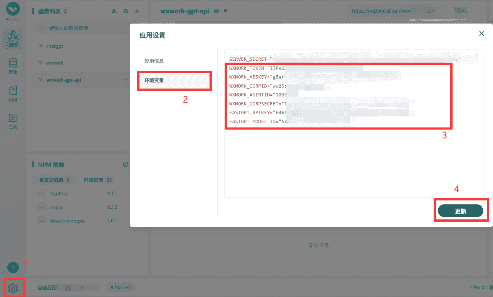

1.  复制 wxwork-gpt-api 这个云函数的调用地址，将它填写到企业微信管理后台【API接收消息】页面中的URL中，并保存上述信息。


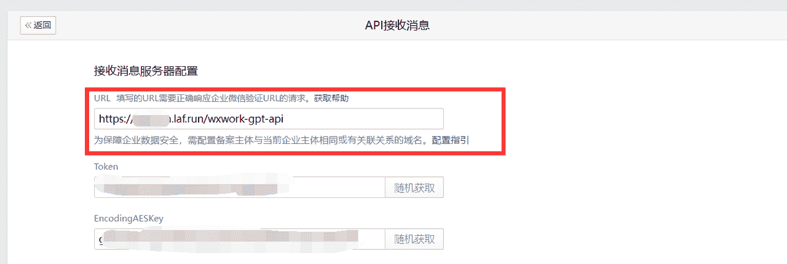

1.  在企业微信中，进入你刚刚创建的应用，就可以跟机器人愉快的聊天了~~

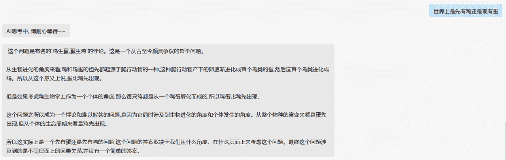

+   3

+

+

+

+