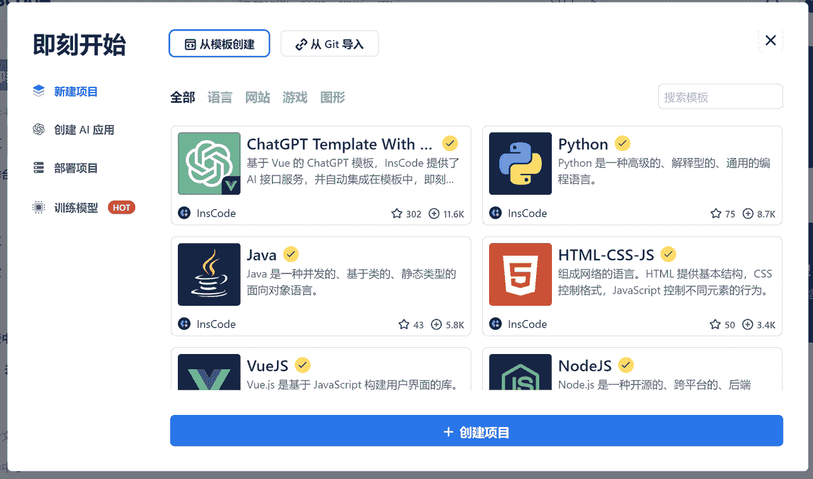
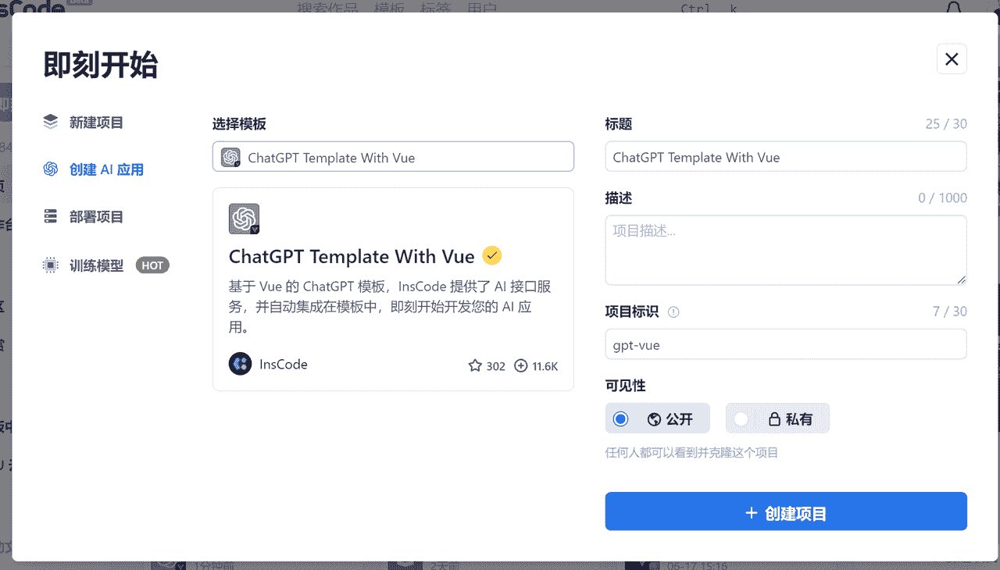
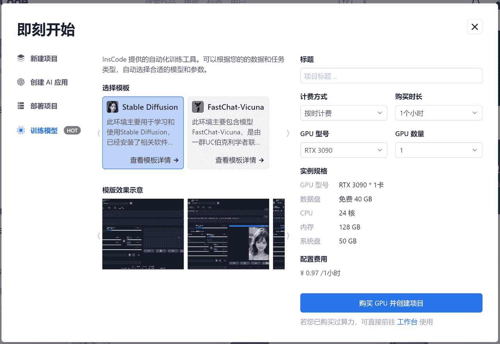
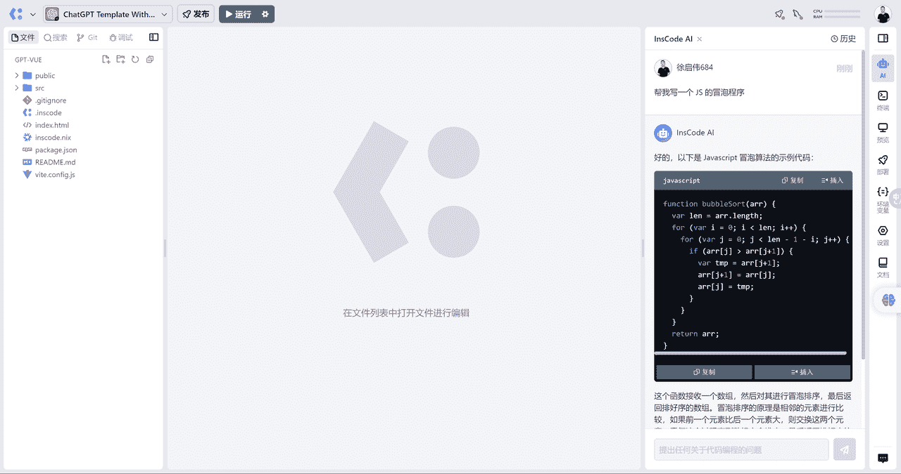
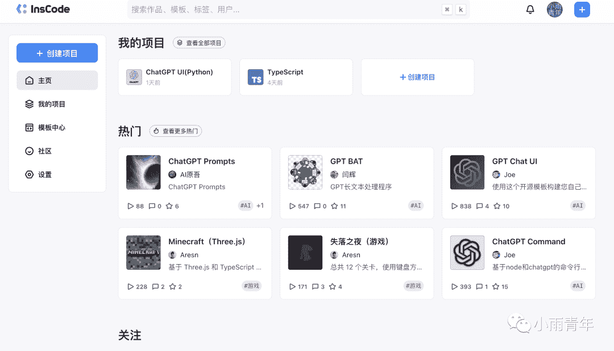
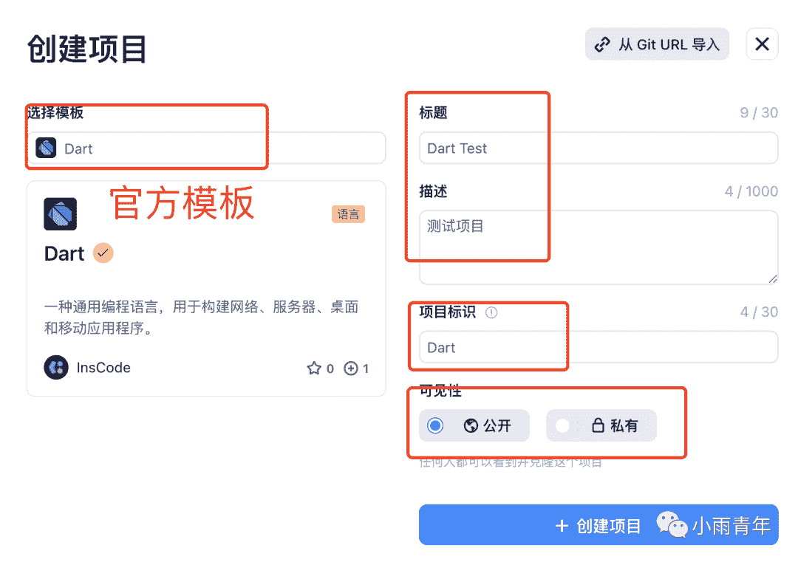
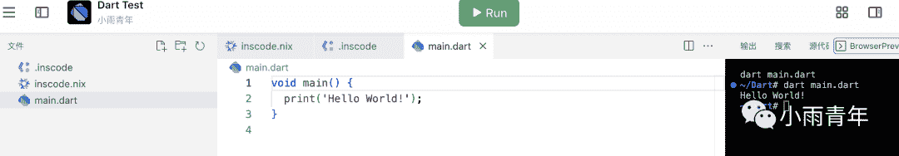
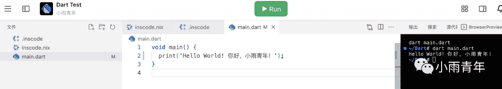
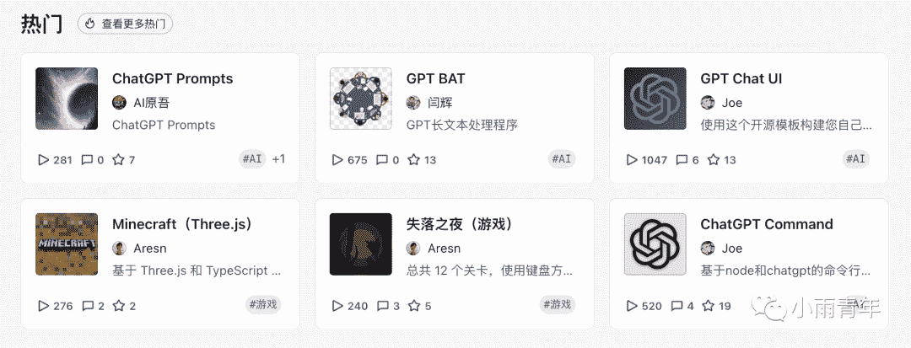

# 2023-04-04【InsCode】 CSDN展示你的编程实力

> 来源：[https://xuqiwei1986.feishu.cn/docx/CMLrdJse4olpnXxIe3WcPdXDnOb](https://xuqiwei1986.feishu.cn/docx/CMLrdJse4olpnXxIe3WcPdXDnOb)

# 官网

https://inscode.csdn.net/

# inscode

# 部署模型

> 🔗 原文链接： h[ttps://mp.weixin.q](https://mp.weixin.qq.com/s/li8UGTPhj49ysCZvyUnoLw)q.com/s/li8UGTPh...

> 原创 小雨同学ver30 小雨青年 2023-04-04 12:30 发表于 北京

收录于合集

#工具集 4 个

#CSDN 4 个

## **一、缘起**

最近，我在线下参与了 CSDN 主办的 AIGC 与 大模型技术应用峰会，并参与了 ChatGPT 创新营活动。

在这个活动上，我们在两个小时内快速实现了自己创意产品的MVP，并运行在线上平台 InsCode 上。

这次，我们来聊一聊这个可以在线跑项目代码的平台 https://InsCode.csdn.net/ 。

## **二、详解**

### **1. 导入项目**

InsCode 导入项目的方式有两种，一种是从平台提供的模板导入，另一种是导入Github 的项目。

下面我们以平台模板为例，进行项目演示。我们在点击选择模板后，可以选择自己需要的项目模板，目前 InsCode 支持大部分主流语言，模板右侧的标题、描述、项目标识和可见性，分别对应了项目创建之后 在 gitcode 的项目中的名称、描述、URL和项目可见性。

比如这个测试环境的dart项目，在我创建之后，就会在对应的 gitcode 中创建一个对应的项目，而这之后的操作都是基于这个项目的。

### **2. 在线演示、在线修改**

让我们把注意力回到 InsCode 上，这个项目目前有三个文件：

+   . inscode ；

+   inscode . nix ；

+   main . dart 。

前两个文件是 InsCode 的项目配置文件，记录对应的入口文件等信息。

当你点击页面上的Run按钮，项目就会执行，如果是web项目就会自动在页面右侧打开网页浏览器，这是个终端项目，右侧自动打开的是个终端，已经输出了对应的内容。

你可以在页面上直接对代码修改，然后运行程序，而你修改的内容会自动提交到对应在 gitcode 的项目中。

### **3. 发布作品**

如果你对自己的 Code 比较满意，还可以通过发布操作在社区中展示，这样在平台上别人就能看到你的 Code ，你也可以通过 Show 出你的 Code 结交更多同好。

当然示例的代码太简单，提交到社区不太好，我在这里稍微提交了一些内容，临时做了一个可以查询天气的小工具。

在社区页面，你可以看到社区精选的项目，可以直接在项目上运行，也可以 Fork 下来学习。

## **三、如何用好 InsCode**

基于以上 InsCode 平台的快速执行代码、所见即所得的特点，我建议你这样用：

1.  写博客的时候，将需要展示的代码片段放到 InsCode 中，做成可执行的demo，让你的代码增加信服力

1.  在 InsCode 平台的社区发布一些优质项目，在平台初期不卷的情况下增加个人的影响力

1.  需要项目演示的时候，临时上传为私有项目，可以不纠结环境搭建，直接演示项目

## **四、总结**

Linus Torvalds 曾经说过 “Talk is cheap. Show me the code .”。

InsCode 就能帮我们 Show 自己的 Code ，让别人快速认识你的代码，也就能快速熟悉你。

你可能需要

[2023，我想和你聊聊](http://mp.weixin.qq.com/s?__biz=MzA3OTIwOTcyMQ==&mid=2247483971&idx=1&sn=de15cca9d88ff30a6ff996133acb0436&chksm=9fb7b7d5a8c03ec3686f9d7ef01ab8e8e4118c046dd6e32954bf5702d4c59859e5d4044fd670&scene=21#wechat_redirect)

