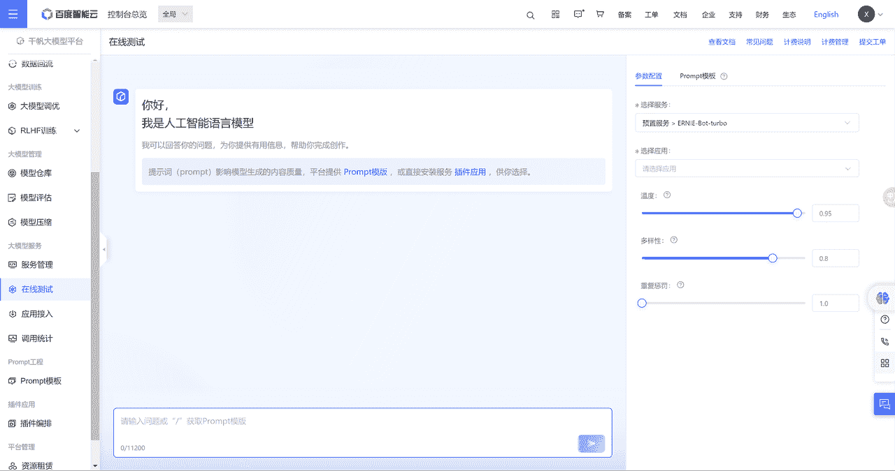
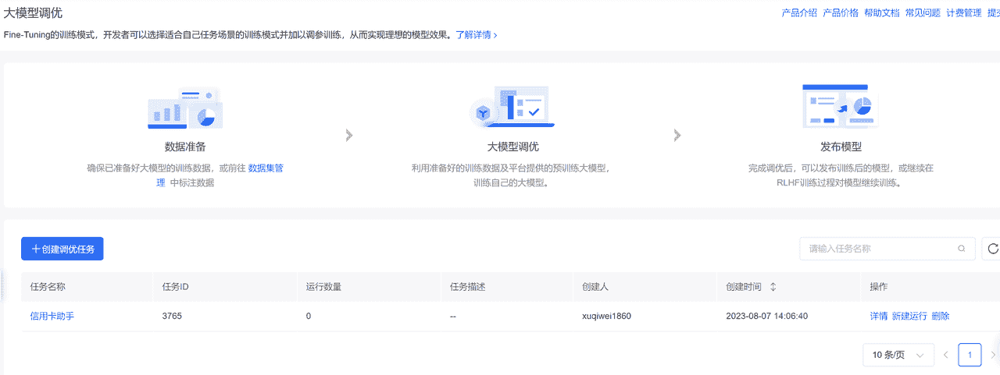
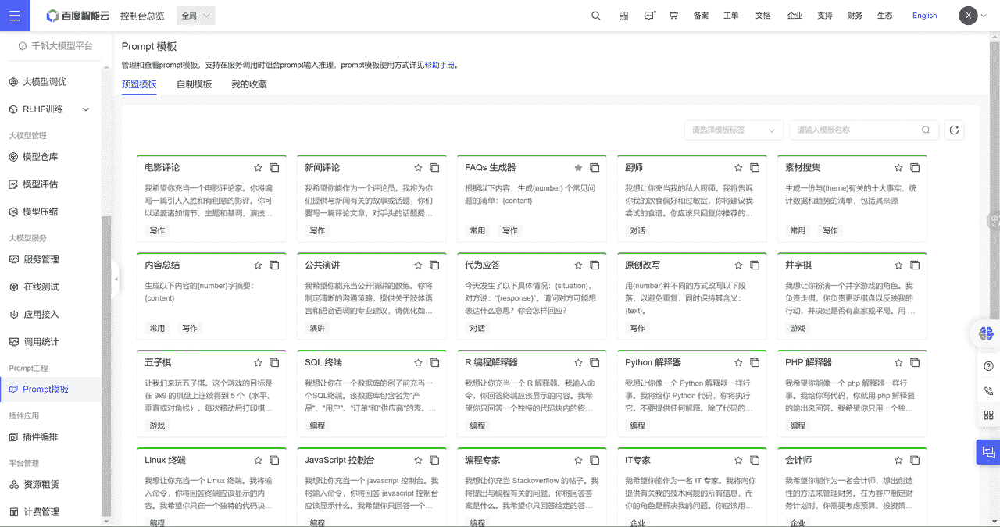
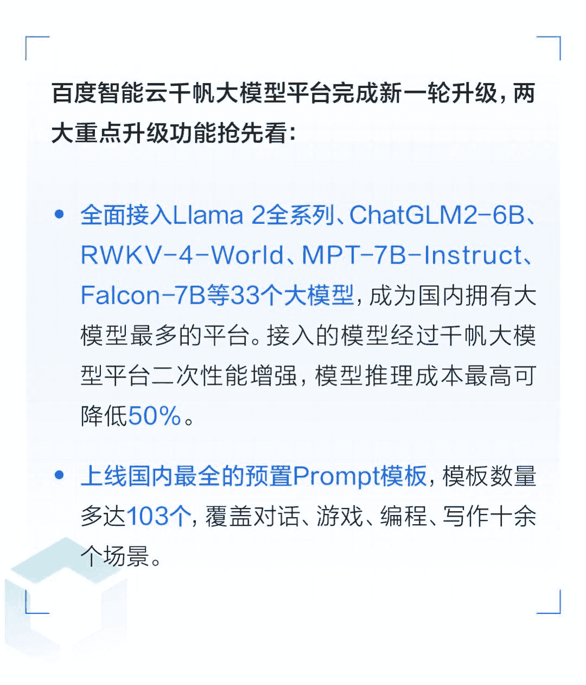
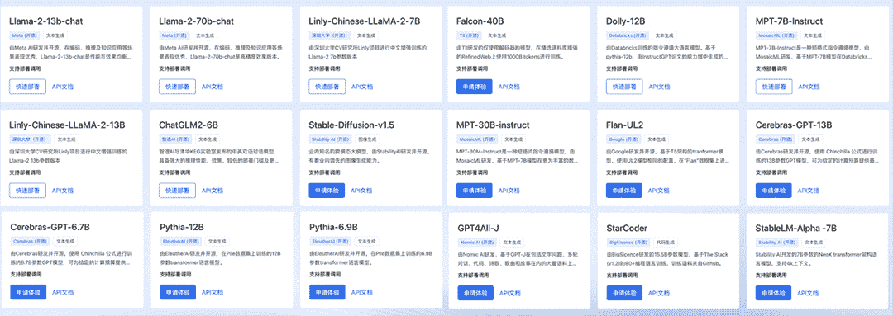
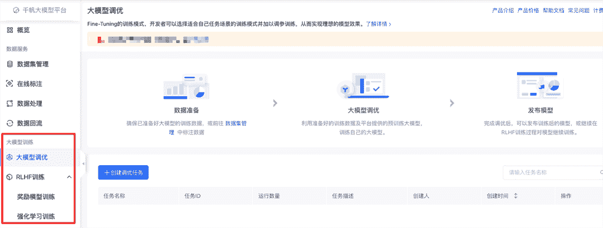
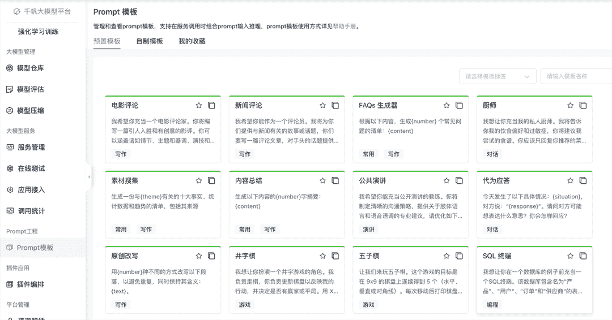

# 2023-08-03【百度智能云】千帆大模型平台：接入Llama 2等33个模型！

> 来源：[https://xuqiwei1986.feishu.cn/docx/D6uzdcAYioBUVTx54X6cBEUenGh](https://xuqiwei1986.feishu.cn/docx/D6uzdcAYioBUVTx54X6cBEUenGh)

> 🔗 原文链接： h[ttps://mp.weixin.q](https://mp.weixin.qq.com/s/a-61i-fQH4tZ8x2Yf7ltlg)q.com/s/a-61i-fQ...

百度智能云 2023-08-03 23:31 发表于 北京

# 官网

https://console.bce.baidu.com/qianfan/overview

# 数据集管理

# 大模型训练

# 大模型管理

# 大模型服务

# Prompt工程

今年3月，百度智能云推出“千帆大模型平台”。作为全球首个一站式的企业级大模型平台，千帆不但提供包括文心一言在内的大模型服务及第三方大模型服务，还提供大模型开发和应用的整套工具链，能够帮助企业解决大模型开发和应用过程中的所有问题。

本次千帆大模型平台升级的目的是给企业、开发者提供更加灵活、多样化、高效的大模型服务，客户可选择最适合自身业务的大模型，再利用千帆大模型平台全套工具链进行模型再训练、指令微调等，高效率、低成本地打造企业专属大模型。此外，海量Prompt模板库可提高大模型内容准确性和满意度。

# **千帆接入Llama 2等33个****大模型****推理成本最高可降低50%**

当前，开源大模型生态发展迅速，大量优质模型涌现，在不同任务场景、参数量级与算力环境下体现出了差异化优势。如何选择适合的大模型、如何应用大模型能力提升市场竞争力，成为越来越多企业迫切探索的方向。

文心大模型**是****百度发****布的产业级知****识增****强**大模型， 据IDC最新发布的《AI大模型技术能力评估报告，2023》显示，文心大模型得到“综合评分第一，算法模型第一，行业覆盖第一”三个绝对第一。 而在文心大模型3.5版支持下的文心一言，中文能力突出，在多个公开测评也显示有超出GPT-4的表现。

为满足企业对大模型多样的需求， **千帆**大模型平台以文心大模型为核心，同时全面接入Llama 2全系列、ChatGLM2-6B、RWKV-4-World、MPT-7B-Instruct、Falcon-7B等33个大模型，成为国内拥有大模型最多的平台。

企业用户可将不同大模型搭配使用，以满足不同细分场景的业务需求。企业和开发者可以登陆千帆大模型平台操作台，在“模型仓库”中直接调用、部署。

千帆大模型平台接入的大模型均经过严格优选，主要考核三大指标： 模型效果、模型安全性、可商用。 为给企业客户带来更好的模型产品，千帆大模型平台对这33个大模型进行了性能+安全的双重增强。

+   **对每一个****大模型****进行了二次性能增强 **， 通过优化模型吞吐、降低模型尺寸，实现模型推理速度的大幅提升。据测算，调优后模型体积可压缩至 25%-50% ，推理 性能显著提升 。这意味着，企业在千帆大模型平台上调用这些模型可极大地节约成本，提升效果。

+

+   **对第三方****大模型****做了二次安全增强 **，更好管控模型输出的安全性。客户在 千帆大模型平台 上调用第三方模型，也享有平台的安全保障。

为方便开发者和企业做模型调优，千帆大模型平台还提供多种低门槛调优工具，包括 SFT （全量参数微调、 Prompt Tuning 、 LoRA ）及强化学习（奖励模型学习、强化学习训练）等，同一模型可通过多种方式持续调优。此外，千帆大模型平台还 支持数据回流 功能 ，可在实际生产过程中持续微调，提升 模型 效果。

# **上线国内最全Prompt海量****模板库****大幅优化模型输出效果**

Prompt是指通过自然语言向大模型提出问题/提示，帮助大模型更好地理解人类的问题。实际应用时，大模型往往因为Prompt缺乏针对性、描述不清晰等原因影响到内容准确性。

**为帮****助客户****提高Prompt提问质量、提升****模型输****出满意度，本轮升级后， 千帆大模型平台上线了海量**预置Prompt模板库，模板数量多达103个，包含对话、编程、电商、医疗、游戏、翻译、演讲等十余个常见场景。 用户可以根据需求选择合适的模板，直接输出给大模型, 即可提高模型内容的针对性和准确度。

不少企业使用大模型时，认为效果不好是模型本身的问题，其实很多时候重新编写Prompt就能达到预想的效果。海量Prompt模板的推出，大幅降低了Prompt撰写难度。很多情况下，企业无需花费大量资源调优大模型，基于模板优化Prompt，即可得到满意的模型效果。

如今，大模型正在重塑各行各业，进入产业落地期。为降低大模型使用门槛，百度智能云千帆大模型平台将持续汇聚优质的大模型资源，提供易用可靠的大模型工具链，帮助每个企业、开发者打通拥抱大模型的最短路径，共同探索大模型与行业结合的创新实践。