# 2023-07-26【揽睿星舟】支持联邦学习实现大语言模型微调训练，隐私安全保护与效率双突破

> 来源：[https://xuqiwei1986.feishu.cn/docx/Q2ngdfxKoorZurxqKPPcy4Sonib](https://xuqiwei1986.feishu.cn/docx/Q2ngdfxKoorZurxqKPPcy4Sonib)

# 官网

https://www.lanrui-ai.com/

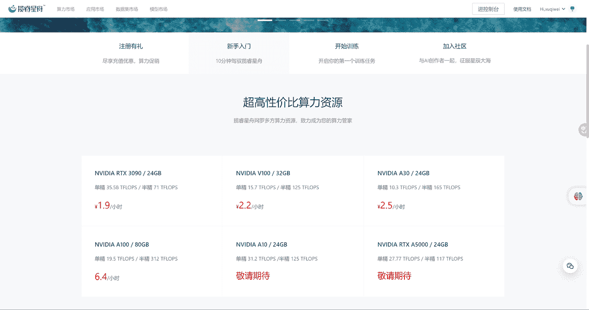

> 🔗 原文链接： h[ttps://mp.weixin.q](https://mp.weixin.qq.com/s/jJWPRT6vy_eJMZEkVx35aQ)q.com/s/jJWPRT6v...

>

翼方健数 揽睿星舟 2023-07-26 09:02 发表于 上海

**前 言**

人工智能企业翼方健数近日宣布 自主研发的工业级联邦学习框架XFL已成功支持大型语言模型的训练微调 ，并已于近期在Gitee平台上开源全部相关代码。值得一提的是，XFL大语言模型微调训练的开发、测试工作都在翼方健数旗下揽睿星舟平台上完成。作为 高性能、高性价比的AI训推一体算力及生态平台，揽睿星舟已开放支持XFL大模型联邦化训练微调。

揽睿星舟不仅能够提供 丰富多样的GPU计算资源 ，平台内的AI应用商城内汇聚丰富的自研与生态伙伴提供的 AI工具链与预训练模型 ，可供开发者用户与AI服务商在平台内使用。

开发者用户和服务商可以通过简单易用的用户界面以及平台 开箱即用的训推环境 ，在开发测试阶段立刻进入工作状态，提升工作效率。

**官网地址：**

https://www.lanrui-ai.com/

**注册地址：**

https://www.lanrui-ai.com/register?invitation_code=9918

**欢迎注册体验！**

以下内容来自公众号 BaseBit翼方健数：

[《翼方健数开源解决方案，以联邦学习实现大语言模型微调训](http://mp.weixin.qq.com/s?__biz=Mzg3ODU0NDIyMg==&mid=2247497699&idx=1&sn=6803788d4b27df0295c77e8e983eb43b&chksm=cf10a3d2f8672ac4142723ba928ac33876a7efaa3c34c23b1f2086e1e82d46d5ca6ca4f70d13&scene=21#wechat_redirect)练的隐私安全保护与效率双突破 (上篇)》

[《联邦学习实现大语言模型微调训练的隐私安全保](http://mp.weixin.qq.com/s?__biz=Mzg3ODU0NDIyMg==&mid=2247497738&idx=1&sn=b052de8c94e08a60c562786a38061365&chksm=cf10ac3bf867252d87fd751595fdc5969dd181470c0c6877d6da949a90f84acf2d4f0fb65dc7&scene=21#wechat_redirect)护与效率双突破；揽睿星舟赋能 (下篇)》

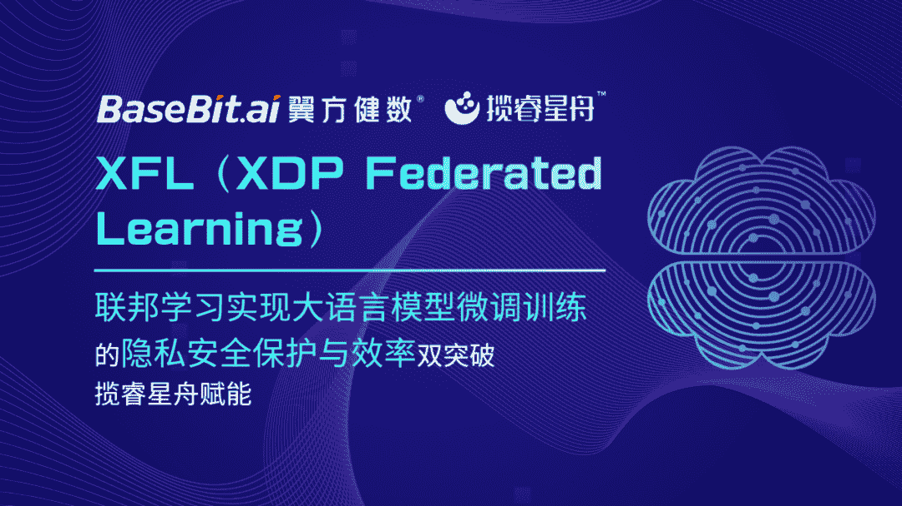

大型语言模型的发展日新月异，推动人工智能在各领域各行业的广泛应用。基于私有数据构建针对特定领域的大型语言模型以适应具体的业务场景是重要的趋势之一，而挑战在于包括如何在保护隐私、尊重知识产权，并且控制成本的前提下，使用私有数据进行大型语言模型的训练。

实现这个目标，需要解决一些现有的困难，比如如何保护数据隐私、如何处理海量数据、如何在客户端设备的内存有限的情况下进行训练，以及如何提高现有训练算法的效率等。为此，翼方健数进行了深入的研究，并在此宣布， 翼方自主研发的工业级联邦学习框架XFL，现已成功支持大型语言模型的训练微调， 并已于近期在Gitee平台上开源全部相关代码，为大型语言模型在特定领域中的应用提供了一个可行的解决方案。

# **01****什么是翼数联邦学习？**

联邦学习技术是一种隐私保护、安全加密的分布式机器学习模式，旨在让分散的各参与方在满足不向其他参与者披露原始数据的前提下，互相协作完成机器学习模型的训练。 翼方健数自主开发的XFL翼数联邦学习框架是一种高性能、高灵活度、高适用性、轻量开放的联邦学习框架，支持横向联邦、纵向联邦等多种联邦模型。 此外，通过叠加运用同态加密、差分隐私、多方安全计算等多种加密计算技术保护用户的原始数据不被泄露，使用安全通信协议保护通信安全，使用户在合法合规的基础上进行联合建模，实现数据价值。

# **02****为什么要用联邦学习来进行****大模型****的微调**

微调模型的数据往往是模型使用者的私有数据，例如聊天对话记录和企业内部文档，和基础模型（Foundation Model）的训练数据相比规模较小，用户可使用联邦学习来联合多方的数据来扩充本地数据集，联邦学习在保护数据隐私安全方面的特性也保障了各个参与方的私有数据不发生泄漏。同时，联邦学习在保证安全性的前提下也能获得和集中式训练基本相同的模型效果。

# **03****如何实现XFL****大模型****微调**

由清华大学和智谱 AI 联合研发并开源的国产语言模型ChatGLM-6B因其在很小的参数规模下展现了高质量的中文对话能力而备受关注。ChatGLM-6B模型基于 General Language Model (GLM) 架构，能在智能问答、文章创作等领域给出符合人类偏好的回答。

由于大规模语言模型的预训练需要消耗大量的计算资源和时间，全参数微调的效率也相当低。为此， XFL引入了多种策略以提高效率和保护数据安全。 在横向联邦场景中，XFL采用了Adapter适配器和Prompt等高效的聚合方法，而在参数微调方面，支持Lora和P-Tuning V2。

XFL使用Secure Aggregation方法进行加密，以保护在传输过程中的模型参数。 这种方法结合了密钥交换、伪随机数生成、一次一密等密码学技术，模型参数在被送往聚合方进行聚合操作之前会被加密。

在模型兼容性方面，基于广受欢迎的HuggingFace的Transformers库构建，因此可以兼容Trainer中的大部分参数。此外，其LoRa微调可以兼容Peft库中的adapter参数，而P-Tuning v2参数则兼容官方模型给出的参数。 通过这些策略，XFL既保证了模型训练的效率，又提高了数据的安全性，体现出其专业和综合的特性。

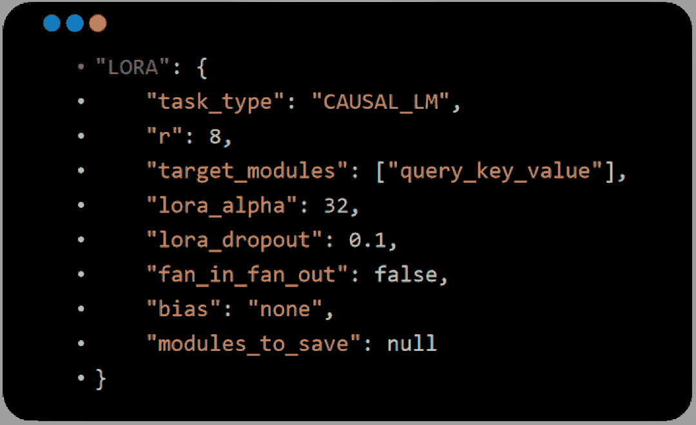

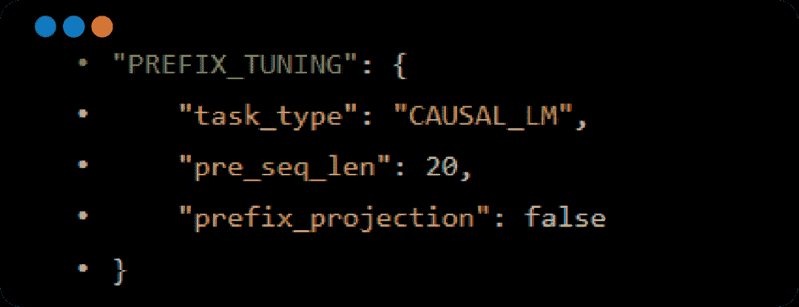

XFL为联邦大模型微调引入了细粒度的聚合机制，能实现Step级别的安全聚合，这与经典的横向联邦学习在Epoch级别进行聚合的方法有显著区别。 这种改进的动机在于，对于大模型来说，每个Epoch的微调时间可能会较长，如果仅在Epoch级别进行聚合，其时间间隔过长，聚合次数不足，可能会对模型的性能产生负面影响。通过实现更高频率的Step级别的安全聚合，XFL能够更频繁地更新和优化模型，从而提高模型的学习效果和性能。

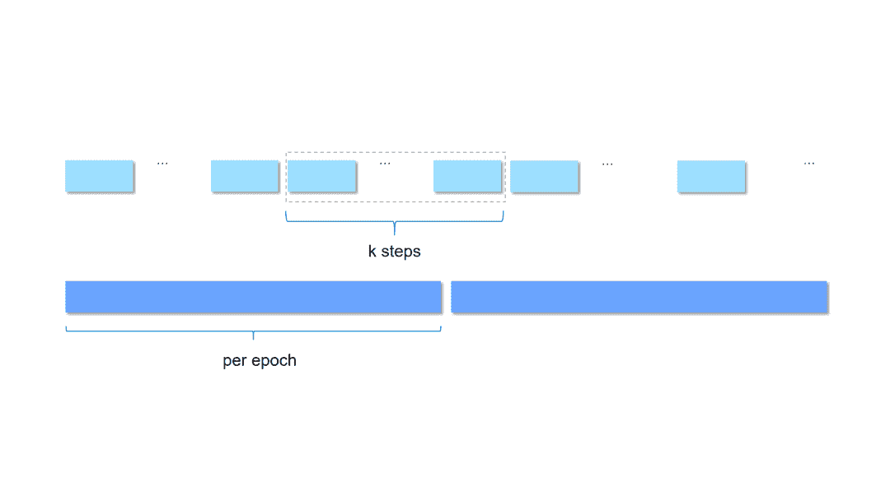

此外，XFL还提供了独立模式（standalone模式） ，这使得在非联邦学习的环境下，单个参与方也能进行模型的微调。这种灵活的设计使得XFL既可以满足大规模联邦学习的需求，同时也可以适应单一参与方独立进行模型微调的场景。

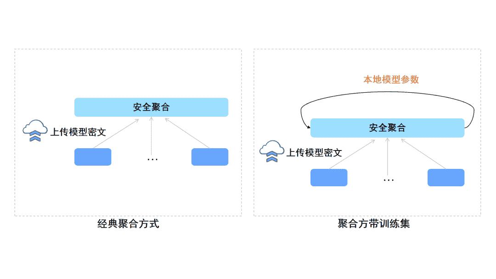

# **04****XFL****大模型****微调功能亮点**

综上所述，XFL在联邦大模型微调和数据安全保护方面做了许多创新性的改进。为了更好地适应大规模联邦学习的需求以及确保数据的安全性，XFL实现了以下显著的功能亮点：

**1. 细粒度的聚合： **不同于传统的在Epoch级别进行聚合的方法，XFL实现了Step级别的安全聚合，使得模型可以更频繁地进行更新和优化，从而提高学习效果和性能。

**2. 数据安全保护： **XFL引入了Secure Aggregation方法，结合了密钥交换、伪随机数生成、一次一密等密码学技术，使得模型参数在传输过程中被加密，保护了数据的安全性。

**3. 模型的保存： **XFL允许用户通过配置来指定一个或多个参与方来保存最终的模型，为模型的管理提供了便利。

**4. 独立模式： **除了支持大规模联邦学习，XFL还提供了独立模式，使得单一参与方在非联邦学习的环境下，也能进行模型的微调。

# **05****如何实现快速联邦化改造**

XFL为横向联邦封装了加密和聚合功能，并在此基础上进一步封装了FedAvg、FedProx、Scaffold等主流聚合方法，用户可以直接调用这些聚合方法。对于横向大模型的改造，为了兼容Transformer的Trainer类，我们利用Trainer的Callback函数，在Callback中调用底层的加密聚合函数，来实现step级别的安全聚合。核心代码如下：

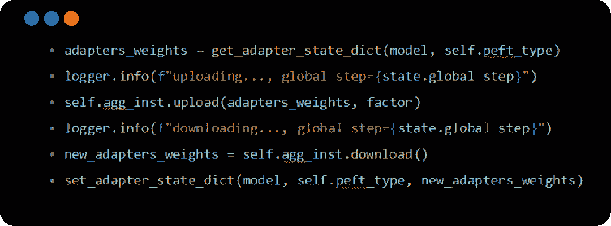

通过调用内置的聚合函数，以上代码实现了模型参数的上传和聚合后参数的下载。然后，在XFL中封装算子类，定义fit函数，主要代码如下：

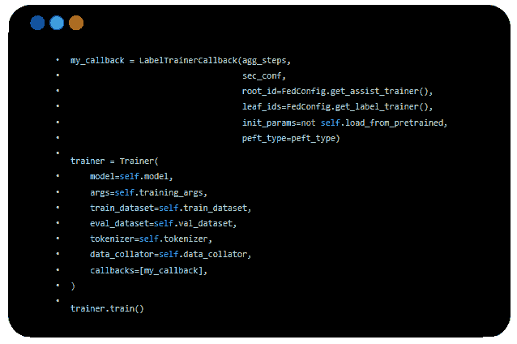

最后，可以通过XFL内置的命令行工具调用新增的算子类。

# **06****三方数据微调**

以三方微调为例，该微调任务是让模型学习写藏头诗，训练集分为3份，每方训练集样本量分别为18,800、21,332、20,368条。训练集的示例如下：

{"instruction": "根据提示词，写一首藏头诗。", "instances": [{"input": "公携人地水风日长", "output": "公子申敬爱，携朋玩物华。人是平阳客，地即石崇家。水文生旧浦，风色满新花。日暮连归骑，长川照晚霞。"}]}

LoRA参数配置如下：

LoRA模型大小为14.7MB。

总训练轮数为1个Epoch，每0.04个Epoch聚合一次，每方的Batch大小为16，GPU均为3090，总训练用时约1小时54分。

微调前和XFL联邦学习支持大语言模型微调后模型推断的效果如下：

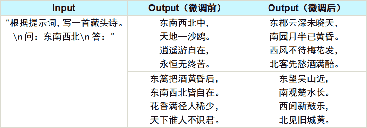

# **07****解决****大模型**微调的数据缺失与隐私安全保护困境

通过联邦学习进行大语言模型微调的改造主要解决了以下两个问题：

**1. 训练数据不足。 **通过联邦学习的方式联合不同数据来源，弥补本地数据不足的缺点，提高模型的性能；

**2. 保护数据安全性。 **联邦学习通过加密等手段保护原始数据的隐私性，使得数据在不出域的情况下安全进行训练和微调。

未来XFL将会继续开源更多的大模型联邦微调解决方案，如LLaMA、 Stable Diffusion等。除此之外，翼方也将充分利用分散数据和联邦学习方法，支持不同行业领域的应用。

**XFL的开源地址：**

https://gitee.com/basebit-ai/XFL

附 大模型微调技术解释

#01 LoRA微调

LoRA，英文全称Low-Rank Adaptation of Large Language Models，是微软的研究人员为了解决大语言模型微调而开发的一项技术。LoRA的基本原理是冻结预训练好的模型权重参数，往模型中加入额外的旁路网络层，先降维再升维，并只训练这些新增的网络层参数。由于新增参数数量较少，不仅使得finetune的成本显著下降，还能获得和全模型微调类似的效果。

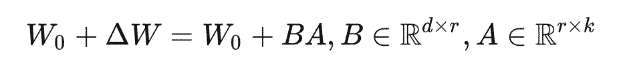

在LoRA训练中，W 0 是预训练矩阵，B和A是待训练的网络参数。具体的，在transformer结构中，LoRA仅是在QKV Attention的计算中增加一个旁路。

LoRA的结构示意图如下：

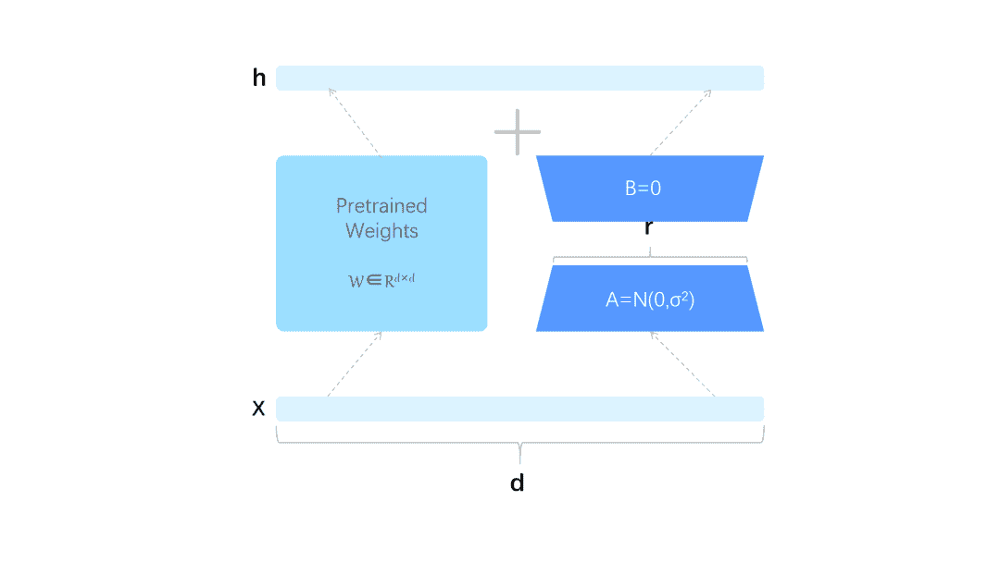

#02 P-Tuning v2微调

P-Tuning v2对P-Tuning进行了改进，不同层中的提示作为前缀token加入到输入序列中，并独立于其他层。一方面， P-Tuning v2有更多的可优化的网络参数（从0.01%到0.1%-3%）；另一方面，添加到更深层的提示可以对输出预测产生更直接和重大的影响。P-Tuning v2的结构如下：

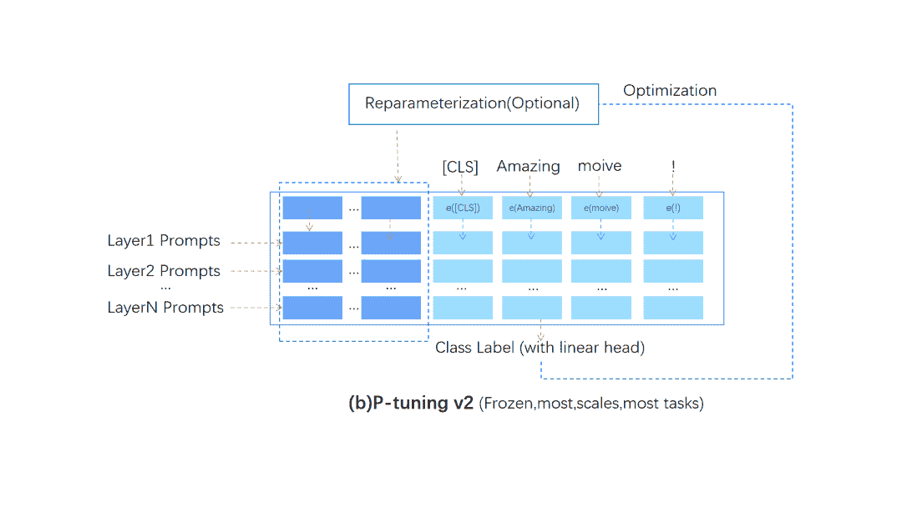

+

**关于揽睿星舟**

揽睿星舟（Lanrui-ai）是人工智能企业翼方健数自主研发的基于隐私安全计算护航的AI服务平台。作为“数据和计算互联网（IoDC）”的可信AI计算节点，揽睿星舟提供AI全流程一站式服务，用技术解决AI协作过程中的安全信任问题，通过生态力量加速数据与AI价值释放。

揽睿星舟作为一款高性能、高性价比的训推一体算力平台，为机器学习用户提供丰富多样的GPU计算资源，开箱即用的训推环境，大容量、高可用的分布式文件存储以及开放的镜像生态。用户可以通过简单易用的用户界面，快速获取高性能GPU计算能力，从而高效地完成各种训练和推理任务，提升工作效率。

揽睿星舟致力于实现人工智能生态开放，赋能长尾AI应用场景，让AI“用得起、用得好、用得放心”。

合作联系：arki_pr@basebit.me