# 023-08-24ZelinAI又双叒叕上新啦！变量功能等你解锁

> 来源：[https://xuqiwei1986.feishu.cn/docx/Jd63d1dEqo77g0xagq6cNndenyg](https://xuqiwei1986.feishu.cn/docx/Jd63d1dEqo77g0xagq6cNndenyg)

> 🔗 原文链接： h[ttps://mp.weixin.q](https://mp.weixin.qq.com/s/9hXIAP199pXld1t8AapG0g)q.com/s/9hXIAP19...

>

ZelinAI ZelinAI 2023-08-24 17:00 发表于 北京

# **ZelinAI新功能**

# **变量的使用**

ZelinAI上线变量功能啦！可以在模型参数中设置变量，限定用户在使用应用时的输入内容，让用户更高效地使用应用。

下面将从变量介绍和应用示例让你完全理解变量该如何使用，结尾处还有示例应用的链接和二维码哦。

**01**

**介绍变量**

变量由开发者在模型参数中添加并设置，由用户进行选择或者填写。

**01.开发者设置变量**

变量可以在角色定位/风格定义/输入内容中添加。以chatgpt3.5和MJ模型为例

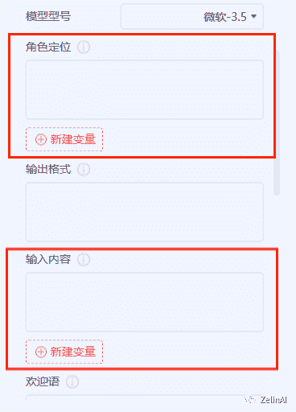

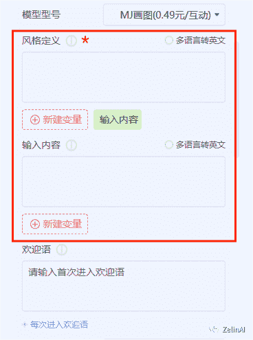

**I**. 角色定位 /风格定义即为模型的prompt。当开发者允许用户修改prompt中的一些内容时，可以使用变量字段。

例如, 角色定位中的内容是：你是一名经验丰富的HR，现在请根据XX岗位生成我需要的内容。此处的XX就可以设置成变量，让用户进行填写。

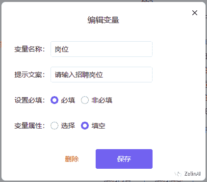

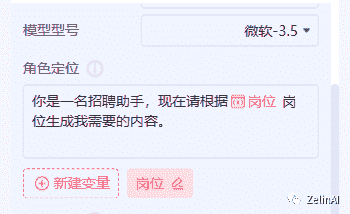

**I**I. 输入内容 是一项新增的模型参数，用于限制用户在输入框中输入的内容格式和规范，以获得最佳的输出效果。

例如, 输入内容中填入：帮我生成对应的招聘内容。此时“招聘内容”可以设置成变量，让用户进行填写。

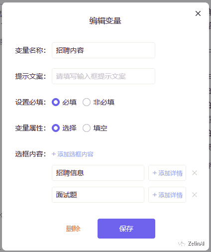

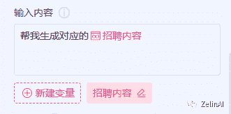

**02.用户填写变量**

I. 用户填写角色定位/风格定义中的变量。

用户在首次进入模型或应用时会出现弹窗，按需求填写即可。后续可在右上角设置处进行修改。

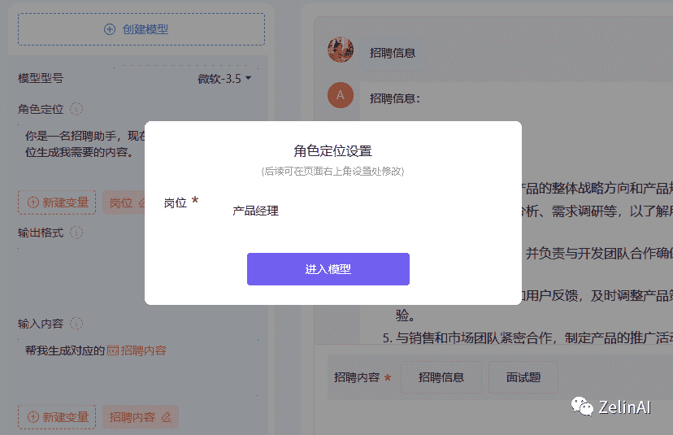

II. 用户填写输入内容中的变量。

变量在输入框中显示，用户按需求进行选择或填写，点击发送按钮获取输出内容。

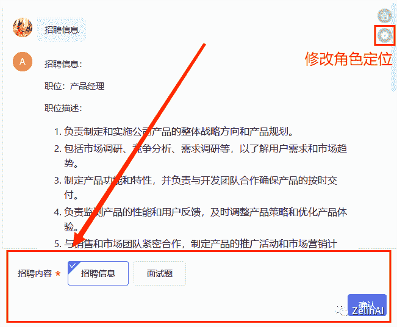

**02**

**绘图应用-变量示例**

**1**

**设置风格定义**

添加尺寸变量，将尺寸变量设置到风格定义中。

**注意！ **如果允许用户修改尺寸、质量等参数，开发者需将相应的模型参数值修改为“空置”。

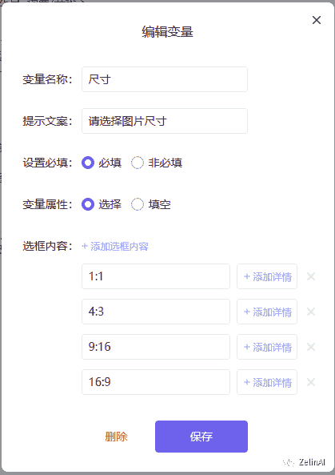

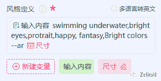

开发者可以按需求自行设置 “输入内容”在 风格定义中的插入位置。

**2**

**设置输入内容**

添加头像主体变量，设置到输入内容中

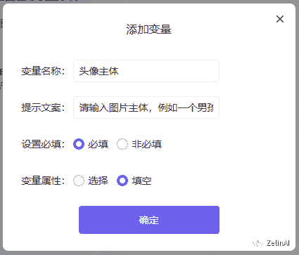

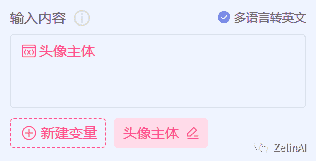

**3**

**用户填写变量**

用户进入模型或应用时按需选择尺寸

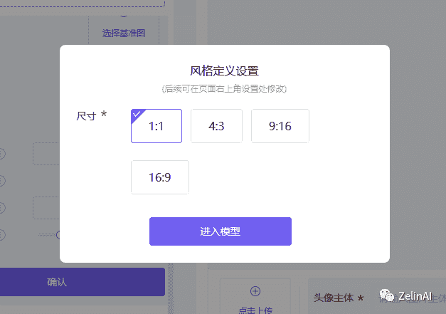

用户按需输入头像主体的内容

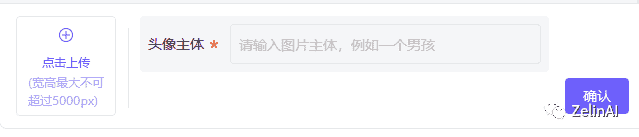

**4**

**输出效果**

用户选择图像尺寸为1:1，头像主体内容处填写“一只可爱的熊猫”

**招聘助手应用-变量示例：**

[https://zelinai.com/s/a2](https://zelinai.com/s/a2kAMCitMU4j9o8Yf4e2KC)kAMCitMU4j9o8Yf4e2KC

**绘图应用-变量示例：**

[https://zelinai.com/s/bY](https://zelinai.com/s/bYbS78otGxRAFbQdhJeLSP)bS78otGxRAFbQdhJeLSP

欢迎大家使用变量功能，变量可以帮助我们更好地使用模型。

之后，我们将举办一场创建应用（含变量功能）的活动，欢迎所有开发者报名参加。

**ZelinAI**

扫描二维码，加入ZelinAI粉丝群！

我们一起拥抱AI！