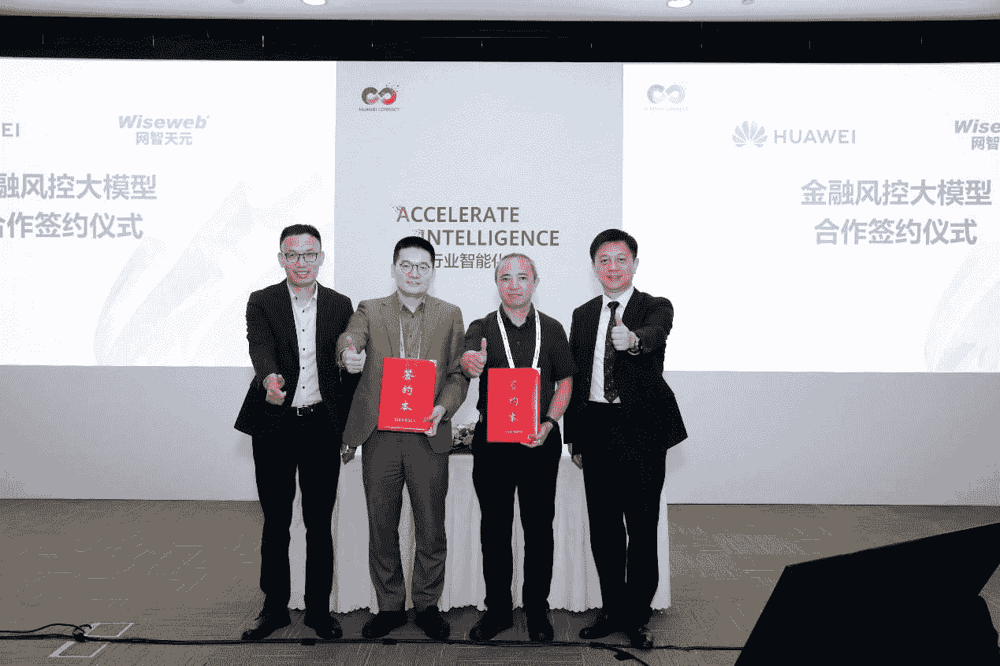

# 2023-09-25网智天元与华为云签约共建金融风控大模型，助力金融行业创新升级_服务_技术_领域

> 来源：[https://xuqiwei1986.feishu.cn/docx/TsCpd5gZbo3zdFxB5oXcdBN2nkc](https://xuqiwei1986.feishu.cn/docx/TsCpd5gZbo3zdFxB5oXcdBN2nkc)

> 🔗 原文链接： h[ttps://www.sohu.co](https://www.sohu.com/a/723330040_120932824)m/a/723330040_12...

>

# 网智天元与华为云签约共建金融风控大模型，助力金融行业创新升级

[2023-0](https://www.sohu.com/a/723330040_120932824?spm=smpc.content.content.1.1695787306356mmyaPDt)9-25 11:54 来源: 搜狐资讯报道

发布于： 北京市

9月20-22日，华为全联接大会2023在上海举行，在以“华为云昇腾AI云服务打造大模型沃土，赋能百模千态茁壮成长”为主题的论坛上，网智天元科技集团股份有限公司（以下简称“网智天元”）与华为云计算技术有限公司（以下简称“华为云”）正式签署金融全域风险管控大模型（以下简称“金融风控大模型”）合作协议。双方将基于华为云盘古大模型打造金融行业的AI大模型，实现金融行业高度智能化发展，推进更深层次的行业数字化转型。网智天元高级副总裁张传文与华为云北京总经理李亚为代表双方签约，网智天元创始人兼首席战略官莫倩博士与华为云EI服务产品部部长尤鹏作为见签人见证签约。

网智天元作为聚焦于大数据和AI大模型在金融领域应用的创新企业，2022年入选工信部人工智能产业创新任务揭榜挂帅单位，紧跟全球技术发展趋势，致力于金融风险领域的大模型智能服务，作为国家级专精特新“小巨人”企业，采用新理念、新模式、新技术及应用实践，十年磨一剑，在产品、解决方案上服务和赋能国家监管单位和金融机构，累计承担了18项国家级科研课题和创新工程，服务国家金融安全战略。

为加速AI在千行万业的落地，华为云始终坚持AI for Industries的方向，将AI技术与行业知识相结合，基于盘古大模型持续创新，打造了政务，金融，制造，矿山，气象、电力、铁路、药物分子等行业大模型，赋能行业智能化升级。聚焦金融服务领域，华为云将充分发挥算法、算力、人才、技术、市场等方面的优势，与网智天元开展全方位深度合作。

此次网智天元与华为云的联合创新，旨在发挥各自优势，积极开展联合创新和技术攻关，共创金融风控大模型。双方将结合大模型领域优势，构建一个强大的、高度智能化的金融全域风险管控[系统，实现金融全域风](https://www.sohu.com/?strategyid=00001&spm=smpc.content.content.2.1695787306356mmyaPDt)险的实时监测和分析预测金融市场的态势，为金融机构提供全面分析且可追溯的风险评估和管理，服务国家金融安全。双方还将共建领域生态，加强金融市场的深度开发合作，促进金融行业数智化转型。  返回搜狐，查看更多

责任编辑：

平台声明：该文观点仅代表作者本人，搜狐号系信息发布平台，搜狐仅提供信息存储空间服务。

阅读 ( 111 )

内容举报