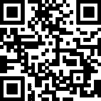
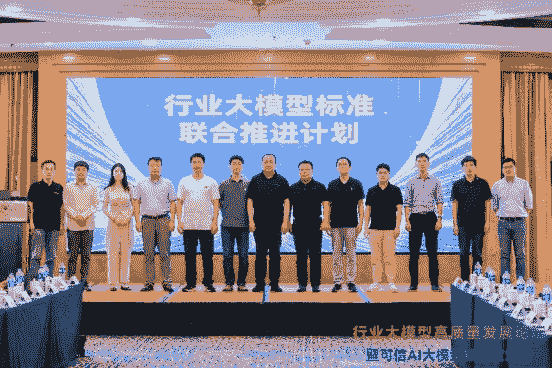
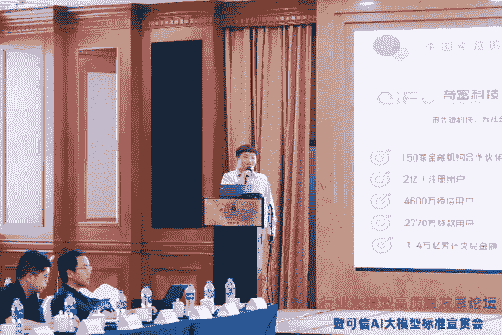
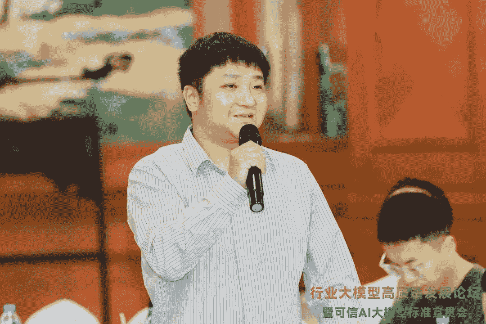

# 2023-07-28奇富科技引领编制国内首个金融行业大模型标准

> 来源：[https://xuqiwei1986.feishu.cn/docx/OcWhdiTGjopDznxA5iIcTIKkn6e](https://xuqiwei1986.feishu.cn/docx/OcWhdiTGjopDznxA5iIcTIKkn6e)

> 🔗 原文链接： h[ttps://mp.weixin.q](https://mp.weixin.qq.com/s/zm7Gx8IF1Sjf9KnUnTNyEA)q.com/s/zm7Gx8IF...

>

奇富科技

2023-07-28 19:38:24

精确发文时间由壹伴提供

2023-07-28 19:38 发表于 北京

手机阅读

7月28日，由中国信息通信研究院（以下简称中国信通院）组织的“行业大模型高质量发展论坛暨可信AI大模型标准宣贯会”在江苏南京召开。会议发起了行业大模型标准联合推进计划，启动了多个行业的大模型标准编制工作，其中，由中国信通院牵头、奇富科技作为主要参编单位、四十多家企业共同编制的国内首个金融行业大模型标准《面向行业的大规模预训练模型技术和应用评估方法第一部分：金融大模型》标准计划将于八月底正式发布。

图： 奇富科技作为金融行业标准牵头方出席大模型标准宣贯会

作为国内布局金融行业大模型最早的公司，奇富科技在会上阐释了金融行业开发行业专属大模型的必要性，并展现了金融科技企业在行业大模型推进中的独特优势。

“从金融这个行业诞生以来，对技术的需求和推动，都远超人们的想象。”奇富科技大模型专家杨剑向与会现场各位介绍道。

从19世纪电话与电报发明以来，华尔街与欧洲的交易商们便成了最先拥抱新技术的群体，以此加快交易频次，加速商品与资金的流动。而到了20世纪，计算机浪潮、互联网革命，金融行业始终走在潮头。而在21世纪，科技创新直接推动金融变革，金融科技融为一体，金融科技时代正式到来，也使得金融行业直接成为了技术演进的领潮者。

如今，ChatGPT带动生成式AI大行其道，信通院主办此次大模型标准宣贯会，正是旨在促进大模型在各个行业精准落地，并为大模型技术能力与应用方向制定详尽标准。随着大模型成为科技创新领域的显学，金融科技领域同样步履不停。

**◈ **** **专属行业大模型，金融+大模型释放积累

**通**用大模型能力有目共睹，而在高度数据化、专业复杂度较高的金融领域，需要依靠专业背景与行业洞察，优化与适配特定应用需求。 杨剑介绍，作为中国典型的以人工智能技术驱动的金融科技服务平台，奇富科技通过7年以来的数据与场景积累，逐渐探明了金融领域大模型的各式应用方向：让大模型全面理解与运用金融专业术语，并产生具备专业属性的反馈，应用到金融行为前-中-后多个阶段。

在杨剑以《大模型在金融场景的落地路径》为主题的演讲中，提出了奇富科技率先走入金融大模型时代的根基所在。

图： 杨剑带来演讲 《大模型在金融场景的落地路径》

在杨剑看来，金融+大模型归根结底是“软硬结合”的金融科技探索与实践方向。“软”在于对金融业务层面的深入理解，“硬”则在于技术、数据、算力方面的积累。

**在**“软”层面，以奇富科技为代表的金融科技企业，探索金融大模型的优势在于深刻的业务场景洞察，以及高效清晰的反馈结果合规化操作。 作为国内最为成熟的金融科技企业之一，奇富科技积累了足够丰富的业务洞察与场景分析，将金融业务流程拆分成一系列可智能化节点，以此打开更全面的大模型落地空间，渗透优化全业务细节。生成式AI的一大痛点便是内容真实性与内容合规，而奇富科技依靠一系列政策规范文档与条款，形成了丰富的信贷合规处置经验，并以此完成信息围栏的构建，让大模型安全可控。

而在“硬”层面，更多指向的是奇富科技作为一家科技公司的技术力。

基于长久以来金融业务的持续开展，奇富科技在数据行为、语料、问答、金融图谱等方面积累了大规模数据，持续以此精进服务满意度过程中，也可将其转化为大模型训练的基础素材，与用户体验形成正反馈。而在技术积累方面，奇富科技一直具有优越背景，互联网&金融双重身份，AI视觉、语音文本互换，自然语言处理与神经网络算法都处于互联网公司第一梯队。算力基础直接关系到大模型的训练速度，这一方面，奇富科技则通过分布式训练优化推理性能，弹性调度，多样性混合部署等措施，保证大模型拥有适配金融行业需求的充沛算力。

**通过技术不断加深对金融行业与用户需求的理解，并持续优化数据分析与处理能力、算法与AI技术、夯实**算力储备，软与硬相互绑定，是奇富科技在大模型方向上，引领国内金融行业的先发条件 ，而在此基础上，逐渐为金融行业提供大模型标准的框架与细则。

**◈ **** **大模型阶梯式发展，针对性落地应用

大模型之所以被认为将会成为改变世界的力**量，可用性与落地表现将始终是决定因素。 金融大模型将比传统策略与模型具备更丰富的专业知识**与泛金融知识，能够将更多场景与金融联动融合，相较于金融从业人员，金融大模型更为稳定，也有更高效的理解能力与分析总结能力。

以奇富科技的大模型奇富GPT为例，刚刚崭露头角，已经迅速应用到获客、运营、风控、贷后服务等业务环节。杨剑展示了两个已经获得数据收效的落地应用。在营销层面，通过大模型构建对话金融业务场景，训练现有电销对话系统，帮助电销机器人精准理解真实用户需求，提高对答拟真度与服务专业度。“经过大模型陪练机器人的帮助，我们的电销系统通话时长提升了15.1%。”杨剑介绍，通话时长的拉升，意味着用户的对话体验有了明显改善。

图：与会现场 杨剑介绍奇富科技金融大模型的应用场景

杨剑提供的另一个落地应用展现在营销内容生成方面，大模型生成素材元素，并与人工创作素材整合变化，形成大批量广告素材，随后大模型对素材进行标注，并通过AI系统给与多维度评级，经过渠道投放后，最终收获数据效果最佳的素材。“大模型应用在营销素材方面后，我们的客户触达规模提升了21.4%。”杨剑介绍道。

此外，杨剑还介绍了奇富金融大模型的阶梯式落地方案：

第一阶段，金融行业大模型初步成型，能够深入理解与应用金融行业知识，投射到各个业务角落。

到了第二阶段，金融大模型能够对外输出，赋能各类金融机构，同时，分不同场景持续数据优化，服务于不同任务。

**训练数据数量和质量，以及对金融业务的理解**和洞见，是金融行业大模型的核心竞争力。 在大模型时代，随着奇富科技金融大模型应用不断落地，金融行业运用技术推动业务升级的发展进程中，或将迎来的崭新范例。