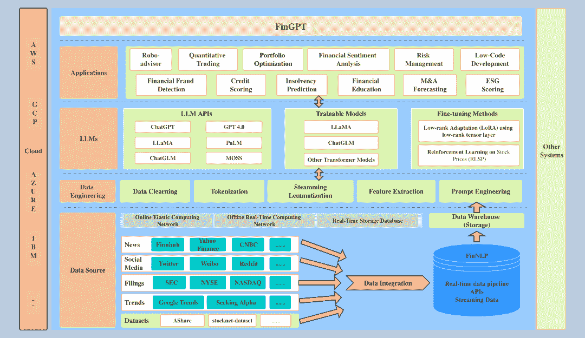
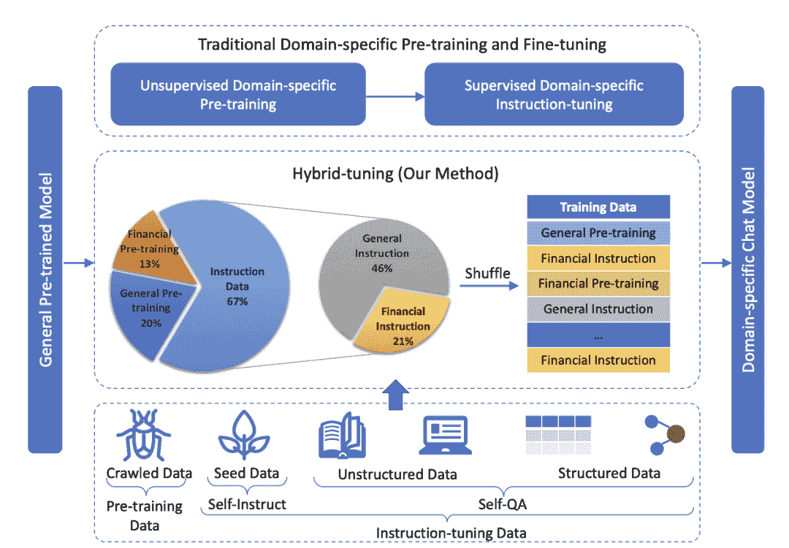
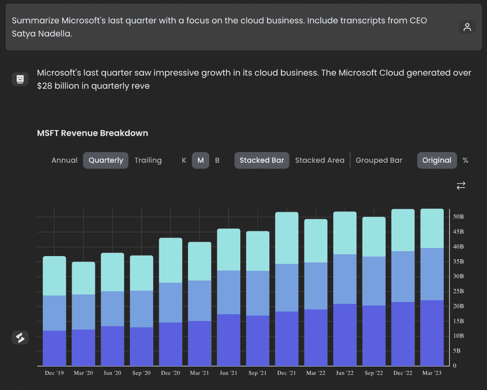
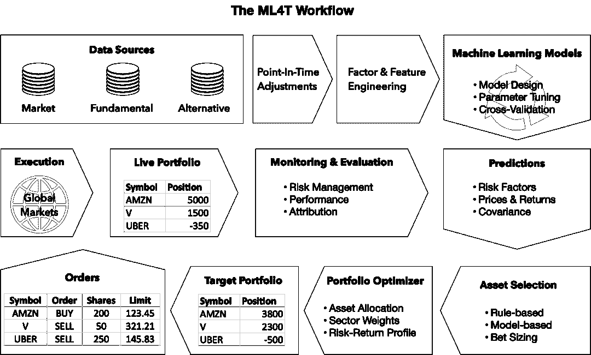
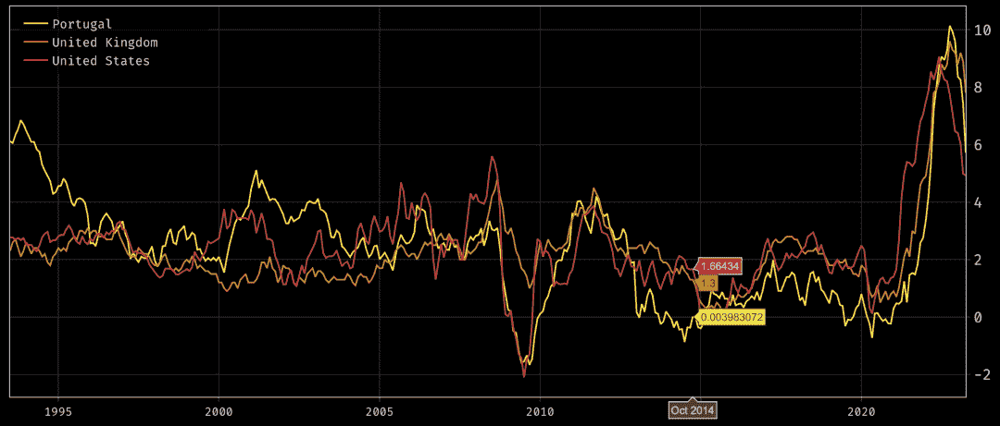
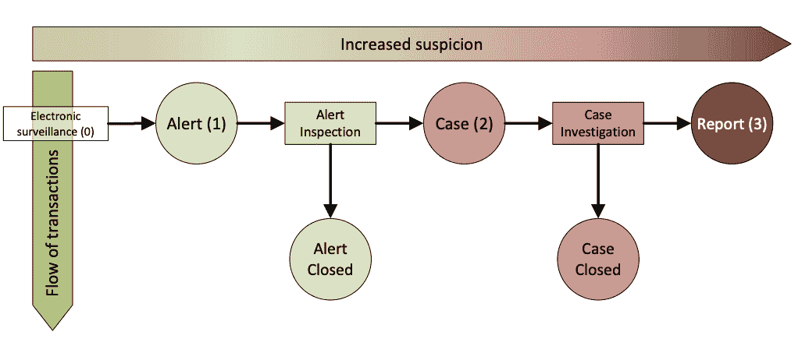
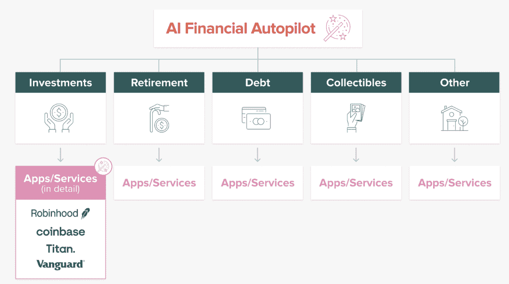

# 2023-08-20精选10个金融领域AI开源工具/应用

> 来源：[https://xuqiwei1986.feishu.cn/docx/NOK7dZusRoLrC6xUAVscBpJ5n6e](https://xuqiwei1986.feishu.cn/docx/NOK7dZusRoLrC6xUAVscBpJ5n6e)

> 🔗 原文链接： h[ttps://mp.weixin.q](https://mp.weixin.qq.com/s/J4BK-OEm86moaszHmloj_g?poc_token=HLm_4mSjwA3f8wqIv7ETLl5KHNcdVS4JtjKafBCx)q.com/s/J4BK-OEm...

>

原创 漫话开发者 漫话开发者 2023-08-20 09:26 发表于 北京

收录于合集

#ai 90 个

#开源 2 个

#金融 1 个

###

### 1. FinGPT，金融创新的开源语言模型

近日，一篇介绍开源人工智能模型 FinGPT 的论文引起了广泛关注。该模型是为金融领域量身打造的，旨在为金融研究和开发提供易于使用的工具，包括自动化数据管理和类似机器人顾问和算法交易等应用的潜力。

以下是该模型的三个核心特点：

+   FinGPT 是一个针对金融领域的开源人工智能模型。

+   该模型提供自动化数据管理和类似机器人顾问和算法交易等应用的潜力。

+   FinGPT 的开源特性有助于加速金融创新的发展。

标签： 人工智能 , 金融 , 开源

**附原文链接/1 [1]**

---

###  2. 轩辕：首个千亿级中文金融开源对话模型

轩辕是国内首个开源的千亿级中文对话大模型，同时也是首个针对中文金融领域优化的千亿级开源对话大模型。轩辕在BLOOM-176B的基础上针对中文通用领域和金融领域进行了针对性的预训练与微调，它不仅可以应对通用领域的问题，也可以解答与金融相关的各类问题，为用户提供准确、全面的金融信息和建议。

##### ** 划重点 **

+   千亿级的轩辕模型已可以在Huggingface中申请下载

+   模型涉及金融名词理解、金融市场评论、金融数据分析和金融新闻理解等四大领域

+   除了在金融领域的突出表现，轩辕还在通用处理能力方面表现优秀

标签： 金融 , 开源模型 , 轩辕

**附原文链接/2 [2]**

---

###  3. FinChat - ChatGPT的金融版

FinChat.io是你的AI股票投资分析师，利用人工智能生成有关上市公司和投资者问题的答案。FinChat 拥有750多家公司的数据，100多位超级投资者的信息，10,000多个财务指标和10,000多页的投资资料。

##### ** 划重点 **

+   FinChat是金融领域的ChatGPT

+   可访问超过750家公司，包括著名公司如苹果、微软、亚马逊和Alphabet等

+   提供毛利率、生产和交付数据，并允许用户查询特定公司的特定指标

标签： 金融 , 金融工具 , FinChat

**附原文链接/3 [3]**

---

###  4. 金融应用中的AI机器学习：GitHub开源150个示例笔记本

800页的教程和150个示例笔记本构成了一份令人惊叹的资源，可以帮助人们学习实用的机器学习知识以及如何在金融应用中应用它。

##### ** 划重点 **

+   这个GitHub仓库包含了800页的教程和150个示例笔记本，是一个学习机器学习和金融应用的宝贵资源。

+   通过这个资源，人们可以学习实用的机器学习知识，并了解如何将其应用于金融领域。

+   这些示例笔记本可以帮助人们更好地理解机器学习在金融应用中的作用和应用方法。

标签： 机器学习 , 金融应用 , GitHub仓库

**附原文链接/4 [4]**

---

###  5. 利用openBB和LlamaIndex优化金融查询

传统的矢量存储方法在金融查询领域中存在一定的局限性，而现在我们可以通过结合元数据和现有的查询语言来显著提高查询结果的质量。openBB和LlamaIndex两个技术在这方面发挥了关键作用。openBB作为一个开放性的基准数据框架，可以为用户提供更加丰富和灵活的查询方式。而LlamaIndex则是一个高效的索引策略，能够在保证查询速度的同时，确保结果的准确性和可靠性。这两者的结合，将为金融行业的数据查询带来革命性的变革，提高数据处理效率，降低企业运营成本。在金融市场竞争激烈的当下，这一技术的应用将成为企业获取竞争优势的重要途径。

##### ** 划重点 **

+   结合元数据和现有查询语言提高查询结果质量

+   openBB和LlamaIndex的优势互补

+   革命性改变金融行业数据查询

标签： 金融查询 , openBB , LlamaIndex

**附原文链接/5 [5]**

---

###  6. 使用图神经网络提升反洗钱系统的效能

这项研究提出了一种新的方法，使用图神经网络来检测洗钱活动。这种网络专为处理由实际银行交易构建的大型、多样化的网络而设计。图神经网络通过对复杂交易网络的深度学习，能够有效地识别和预测可能的洗钱行为。通过这种新的技术方法，我们可以更有效地打击和防止洗钱，保护金融系统的稳定和安全。

##### ** 划重点 **

+   这项研究提出了一种使用图神经网络检测洗钱活动的新方法。

+   图神经网络专为处理由实际银行交易构建的大型、多样化的网络而设计。

+   新方法可以更有效地打击和防止洗钱，保护金融系统的稳定和安全。

标签： 图神经网络 , 反洗钱系统 , 金融科技

**附原文链接/6 [6]**

---

###  7. a16z探讨AI是否能解锁个人财务管理

我们越来越多地看到人们希望掌控自己的财务。金融顾问、基金和财富管理者的费用以及金融科技的有价值进步，都在鼓励人们在个人财务管理方面自立自强。AI是否有机会在这一趋势中扮演主导角色呢？在金融科技的推动下，人们开始寻求自我管理财务的方法，而人工智能可能将在这一转变中发挥关键作用。人工智能的高度计算能力和决策制定能力，使其成为个人财务管理的理想工具。未来，我们可能会看到更多的AI财务管理工具出现，帮助人们更好地理财，实现财务自由。

##### ** 划重点 **

+   人们越来越想要掌控自己的财务

+   金融科技的进步鼓励人们在个人财务管理方面自立自强

+   AI可能会在个人财务管理转变中发挥关键作用

标签： 人工智能 , 个人财务管理 , a16z

**附原文链接/7 [7]**

---

###  8. OpenAI的代码解释器将改变金融行业

OpenAI的代码解释器即将改变金融行业的面貌。该代码解释器以其强大的功能和灵活性，能够执行大部分金融工作所需的任务。这项技术的出现，将极大地提高金融行业的工作效率和准确性，为金融行业的进一步发展提供了新的可能性。我们可以预见，随着这项技术的普及和应用，金融行业的工作方式和业务模式将会发生深刻的改变。OpenAI的代码解释器不仅能够简化金融行业的工作流程，还有可能在很大程度上改变金融行业的就业结构。在这样的趋势下，了解和掌握这项技术将对金融行业的从业人员产生重要的影响。

##### ** 划重点 **

+   OpenAI的代码解释器能够执行大部分金融工作所需的任务

+   该技术的出现将极大地提高金融行业的工作效率和准确性

+   随着这项技术的普及和应用，金融行业的工作方式和业务模式将会发生深刻的改变

标签： OpenAI , 代码解释器 , 金融行业

**附原文链接/8 [8]**

---

###  9. 哈佛数据科学家颠覆金融圈，AI助力艺术品投资大获丰收

人工智能革命正在重塑华尔街。一个哈佛数据科学家和他的精英团队利用AI技术，为普通人提供了之前“禁止入内”的投资机会。使这一切成为可能的公司就是Masterworks，它的独特投资平台使精明的投资者能以极低的成本投资于蓝筹艺术品。他们拥有的专有艺术市场回报数据库在分析艺术市场方面提供了无与伦比的定量优势。到目前为止，Masterworks的所有15次投资退出都实现了盈利，分别提供了+17.8%，+21.5%和+35.0%的年化净回报。

##### ** 划重点 **

+   哈佛数据科学家利用AI帮助普通人参与之前“禁止入内”的投资

+   Masterworks公司的投资平台使投资者能以极低的成本投资于蓝筹艺术品

+   Masterworks的所有15次投资退出都实现了盈利，分别提供了+17.8%，+21.5%和+35.0%的年化净回报

标签： 人工智能 , 艺术品投资 , 金融科技

**附原文链接/9 [9]**

---

###  10. AI与金融科技：创始人需知的五大要点

本文简要探讨了AI与金融科技（Fintech）的几个重要注意事项。这些观点来自于业界知名的Lightspeed，对于创始人和创业者都有非常重要的指导意义。首先，AI技术可以帮助金融科技公司提升服务质量，提供更精准的个性化服务。其次，AI技术可以帮助金融科技公司提高效率，降低成本。此外，AI技术在风险管理、反欺诈等方面也有非常重要的应用。然而，AI技术的应用并不是一帆风顺的，企业需要注意数据安全、隐私保护等问题。最后，企业需要在充分利用AI技术的同时，也要重视人工与机器的协同作用，这样才能充分发挥AI技术的价值。

##### ** 划重点 **

+   AI技术可以帮助金融科技公司提升服务质量

+   AI技术在风险管理、反欺诈等方面有重要应用

+   企业应充分发挥人工与机器的协同作用，提升AI技术的应用价值

标签： AI , Fintech , 创业

**附原文链接/10 [10]**

---

👉关注「 漫**话开发者 」**，精选全球AI前沿科技资讯以及高质量AI开源工具，帮你给每天AI前沿划重点！👀

- END -

### **参考资料**

# [1]

附原文链接/1: https://github.com/ai4finance-foundation/fingpt?utm_source=talkingdev.uwl.me

# [2]

附原文链接/2: https://github.com/Duxiaoman-DI/XuanYuan

# [3]

附原文链接/3: https://finchat.io/

# [4]

附原文链接/4: https://github.com/stefan-jansen/machine-learning-for-trading?utm_source=talkingdev.uwl.me

# [5]

附原文链接/5: https://openbb.co/blog/breaking-barriers-with-openbb-and-llamaIndex?utm_source=talkingdev.uwl.me

# [6]

附原文链接/6: https://arxiv.org/abs/2307.13499v1?utm_source=talkingdev.uwl.me

# [7]

附原文链接/7: https://a16z.com/2023/07/27/money-on-autopilot-ai-personal-finance/?utm_source=talkingdev.uwl.me

# [8]

附原文链接/8: https://every.to/napkin-math/openai-s-code-interpreter-is-about-to-remake-finance-5e1f66df-b74f-4113-9f6e-b72505697499?utm_source=talkingdev.uwl.me

# [9]

附原文链接/9: https://www.masterworks.com/

# [10]

附原文链接/10: https://lsvp.com/fintech-in-ai-five-lessons-for-founders/?utm_source=talkingdev.uwl.me