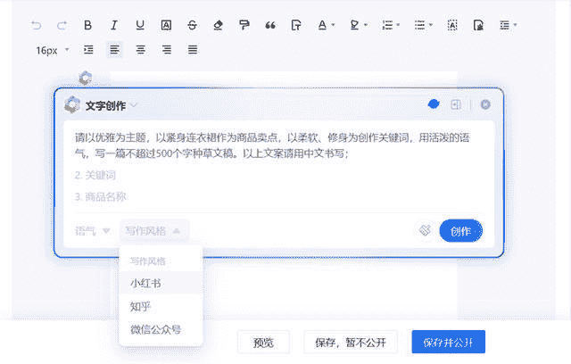

# 2023-07-18当一家公司选择落地大模型，会“遭遇”什么？

> 来源：[https://xuqiwei1986.feishu.cn/docx/RFBsduoeuo3MBdxWJVMcVq8Bnwf](https://xuqiwei1986.feishu.cn/docx/RFBsduoeuo3MBdxWJVMcVq8Bnwf)

### **01 谁能落地****大模型**

中国大模型似乎突然进入产业落地时刻。

在大模型通吃一切的故事席卷半年后，似乎没有人继续宣称要做“中国版OpenAI”——就连腾讯、华为、京东、360等大厂，也纷纷开始发布行业模型方案。

但即便被“产业结合”、“客户共建”的口号裹挟，却很少有人能思考清楚，大模型该如何与自己的业务结合。在WAIC2023期间，36氪就曾遇到过来自工业、制造业等垂直领域，对落地大模型毫无头绪的观展者。

**各路疑惑之中，营销与****大模型****的结合似乎走在千行百业之前。**

一个例证是，美国公司Jasper.AI在2020年就基于GPT3生成营销文案，并成为第一波吃到大模型红利的应用层公司。

在国内，第一批大模型产品的功能也多落在对话、文本、图片生成中。更早前，有平台型企业提及，自己研发大模型的初衷之一是帮生态内的中小客户生产营销素材。

大模型率先应用于营销，合情合理。

生成式AI最惊艳的能力，在于对自然语言的理解力和内容创造力。而在营销领域，流畅的语言理解能让客服机器人的表述更自然，内容创造则能让企业减轻图片、文字素材生产成本。

营销还是一个不用特别苛求精准可控的领域——在其他更追求精准性的产业，大模型在找准场景的前提下，必然要接受对创造力深度“阉割”。

**产品功能和行业需求天然适配，****大模型****不再需要“拿着锤子找钉子”。**营销服务商，成为最先愿“吃大模型螃蟹”的人。

### **02 场景为王**

起家于电商SaaS，如今对多行业提供数字化方案的「微盟集团」，或许是国内第一批尝鲜大模型的公司。

这家服务超1000家头部品牌的企业，自去年起就尝试将生成式AI能力用于自己的产品中，希望帮助自己的客户自动化生成文案、图片等素材，提升它们的运营效率。

**微盟第一次决定研究生成式****AI****产品，要**追溯到2022年6月。这个时间点，国外图片生成模型Stable Diffusion风头正劲。

在Diffusion Model之前，图片生成也存在既定的GAN方案，但精细度一直有待提升。而Diffusion的问世，让人们第一次发现AI生成的图片已能达到栩栩如生，甚至以假乱真的地步。

微盟的技术团队同样被Stable Diffusion所吸引——他们在没有业务要求的情况下，自发关注起Diffusion的开源社区。

“关注Diffusion开源社区两个月后，我们基于这个模型做了一些功能改进，让它有了便于操作的页面，也内置了参数调整功能。”微盟集团AI云产品总经理裘皓萍参与了团队的研发全程。

她告诉36氪，文生图的落地过程始于研发人员的个人兴趣。后来，研发开始和公司内部的设计师沟通交流，“两个研发天天和设计师坐在一起，优化功能。最后形成了通用图片工具和垂直场景图片工具，能生成家居效果图、服装上身图等。”

这款诞生于去年夏天的文生图工具，是微盟尝试生成式AI的第一步。一开始，它仅服务于公司内部的设计团队。目前，这款工具也对外应用于素材生成、创意筛选等场景。

**紧随文生图，文生文伴随****ChatGPT****风靡而来。**在国内，对标OpenAI、以语言大模型为切入点的厂商在数量上出现了“涌现”。

千亿语言大模型的训练门槛极高。**在文****生文场景中，微盟选择**和百度等大模型厂商合作调用模型接口，推出AI产品微盟「WAI」。

这是一套覆盖各类电商营销场景的产品组合。在微盟的介绍中，WAI目前已覆盖“话术生产、短信模板、商品描述、种草笔记、直播口播稿、👸号推文、短视频带货文案”等25个生成式AI场景。

拿话术生产举例，一个品牌销售需每天推送朋友圈、🛰️产品文案，发送给私域中的目标客户。这些内容过去需要人工写作，如今却是文字生成产品的目标场景。

“客户使用后，大部分朋友圈文案情况下只用调一下格式就可以用。”裘皓萍介绍，目前客户已能通过Prompt，尝试“告诉”模型自己需要的文案风格，尝试满足不同渠道的素材要求。

产品示例

**36**氪了解到，微盟如今用“直接采用率”——也就是AI生成内容可被直接使用的比例，评判产品效果。

据介绍，在六月的测试中，微盟WAI产品的商品描述功能达到40%直接采用率；种草笔记正文为36%，商家口播稿达到22%。

### **03 “代价”与期待**

搭起文生图、文生文两套模型架构，再让基于此的应用层产品进入客户业务流——微盟落地大模型的速度，超出不少还在围观的企业。

但在裘皓萍眼中，当前WAI产品和模型基座，依然存在不少提升空间。

由于需求高频、生成内容的可用性高，口播和朋友圈文案写作是最早被商家认可的场景。对比之下，在👸号长文本写作等场景中，模型可能会生产出前后风格不统一的内容，难以被“丝滑”使用。此外，一些商家觉得现在大模型的写作能力还比不上自己的文案，会希望WAI生成的内容更符合自己的个性化风格。

这是文生文，而在文生图中，让多模态模型可控，避免生成形象不连贯等现象，更是世界级难题。

**这时，微盟需要协助自己的客户对模型进行Prom**pt、Fine-Tune或直接提供工具。

在行业中，让语言大模型更可控的方式主要有Prompt、Fine-Tune、增加个性化知识库几种。在效果不同之外，它们还存在着投入成本和技术难度的差异。

一般来说，提示词工程（Prompt）最容易落地——只要用户以更恰当的方式和大模型“沟通”，就会获得更好的反馈。但在真正的业务场景中，不少小B企业还不能娴熟和大模型对话，需要服务商帮助封装Prompt。

另一种Fine-Tune模式，由于使用专有数据，更深入模型内部架构调整，理论上能达到更可控的效果。但是，Fine-Tune需要资深算法人才操作，超出一般企业的人才画像，对直接用户来说难度更大。36氪近期就曾听闻，有企业尝试Fine-Tune反而使得大模型变“愚钝”的事故。

面对客户的使用难题，目前裘皓萍的团队需要不断优化Prompt，并尝试Fine-Tune以提升文生文效果。在文生图方面，为了让图片可以商用，微盟还要研发大模型与PS相结合的工具，方便用户二次修改。

为了持续支持这些功能，研发团队专门成立了一支小分队，每天研究不同场景、不同渠道的Prompt方案，希望让模型效果在各个场景、渠道中都更符合预期。而Fine-Tune模式的接口刚开放不久，微盟还在不断尝试中。

而且，仅研究Prompt、Fine-Tune，提供应用层工具还不够，当大模型开源生态逐渐丰富，研发团队还需不断评估持续冒出来的开源模型，搞明白它们的生成效果、可控性、部署成本等，并考虑是否切换等问题。

**既要收集用户反馈，又要跟上****AI****时代变化多端的技术演进，裘皓萍坦言，这是一种“很吃****人力”的模****式，再加上硬件资源**的投入，押注生成式AI的成本压力并不小。

“现在我们在持续和客户内测，进行定性、定量的反馈收集。”裘皓萍介绍。不过目前由于行业还在早期，使用者的反馈多在定性层面，“我们也在期待和推进更全面的量化指标。”裘皓萍说。

**定量维度的重要性超乎想象**——只有精细、科**学地衡量出每一笔支出的回报，上不上大模型，多大程度地**铺开大模型，才会在企业内部有一个统一答案。在当前的大模型链条中，这件事不仅关乎大模型厂商真实的市场空间，更决定了使用者的推进程度，还将影响众多围观者的心态。

“最开始内测的时候，实际上我们还是想铺开的，看情况决定加大投入这件事。从目前效果来看，我们能够走到今天已经很不容易。”微盟首席运营官尹世明5月底也对外表示，下一步的投入成本，要看产品的反响以及内测反馈来决定。

严密精确的反馈还在路上，但一家公司能让大模型应用进业务流，现阶段已是超出及格线的水平。

接下来的问题是，大模型的应用什么时候能交出一份80分的答卷？

面对这一灵魂拷问，微盟尝试着给出自己的观点——达到80分，一定是多方协力的结果。

“我们希望大模型提供方可以更深度地协同。比如，如果大模型能了解微盟的特定用词和个性化语料，就能帮我们的客户在微盟平台上实现个性化优惠券配置。”裘皓萍举例，类似的场景还存在于各种千人千面的内容生成诉求中。

其实，挨个落地这些诉求对服务商也并非易事。但好在当微盟提出这个期许时，恰逢大模型深入产业的拐点——或许一切将更好实现。