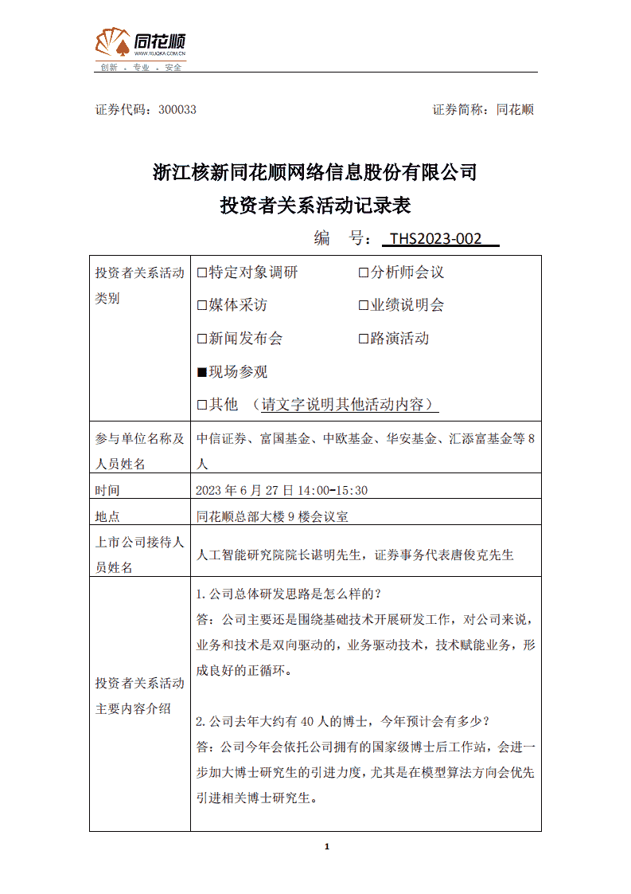

# 2023-06-28同花顺@大模型产品目前在向相关主管部门申请备案阶段

> 来源：[https://xuqiwei1986.feishu.cn/docx/Uq4HdIgYIofiT2x5R6XcFWLKnGh](https://xuqiwei1986.feishu.cn/docx/Uq4HdIgYIofiT2x5R6XcFWLKnGh)

https://36kr.com/newsflashes/2321092847043460

36氪获悉，同花顺接受机构调研时表示，大模型产品目前还处在向相关主管部门申请备案阶段，目前公司各个业务方及产品都在做适配，主要还是聚焦金融行业，强化现有的应用场景，比如iFind金融数据终端、i问财、智能投研等产品及场景。

http://static.cninfo.com.cn/finalpage/2023-06-28/1217153023.PDF

4.公司大模型产品的规划？

答：目前公司各个业务方及产品都在做适配，主要还是聚焦金 融行业，强化现有的应用场景，比如 iFind 金融数据终端、i 问财、智能投研等产品及场景。

5.目前大模型的进展怎么样？

答：目前还处在向相关主管部门申请备案阶段。

6. 何时能够看到 i 问财的大模型技术应用？

答：相关备案完成，且在监管机构允许面向 C 端用户服务的时 候。

7. 怎样理解数十年语料积累的价值或壁垒？

答：我们认为也不能完全说是壁垒，但是会存在一些优势，短 期内可能会在用户意图理解等方面存在优势，但一切还是要取 决于竞争对手在这个领域投入的力度和决心。

[投资者关系活动记录表.PDF](https://internal-api-drive-stream.feishu.cn/space/api/box/stream/download/all/TuEabYAuGoWre6xf3XucULS9nwh)