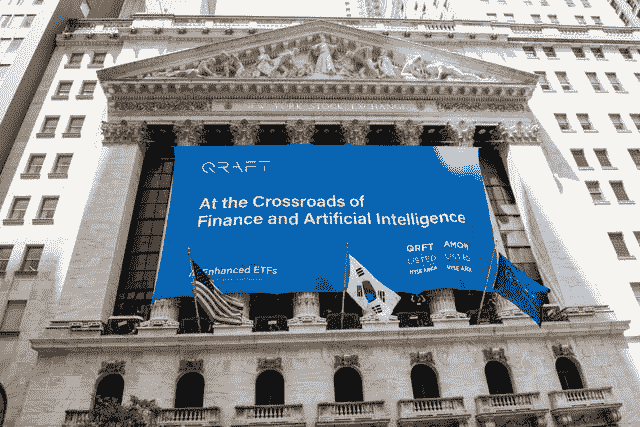
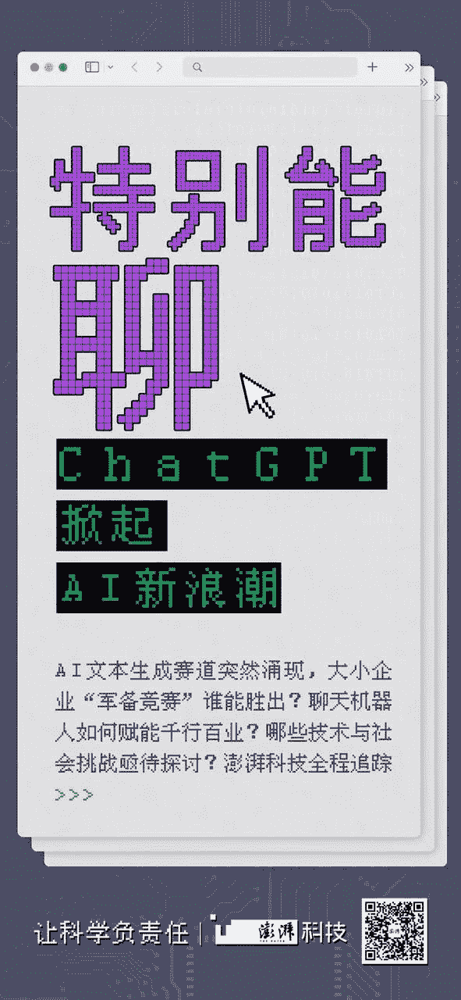

# 2023-06-03对冲基金部署ChatGPT，银行展开“军备竞赛”

> 来源：[https://xuqiwei1986.feishu.cn/docx/KD1wdWjGToaL4vxfAu3cEMIanlb](https://xuqiwei1986.feishu.cn/docx/KD1wdWjGToaL4vxfAu3cEMIanlb)

https://baijiahao.baidu.com/s?id=1767644734005237480&wfr=spider&for=pc

·华尔街正在探索以ChatGPT为主的最新流行工具，希望通过提供足量的金融信息，使机器达到合理地为期权定价、建立投资组合或分析公司新闻的能力水平。

·在最热衷于AI的银行中，大约40%的空缺职位是与AI相关的招聘，如数据工程师、量化分析师以及治理岗位。

包括亿万富翁投资者沃伦·巴菲特在内的许多人认为，热衷于采用复杂的AI系统是未来风险降临的先兆。人工智能革命正在金融界上演。对冲基金公司正在部署ChatGPT处理繁重工作，德意志银行使用人工智能（AI）扫描客户的投资组合，荷兰国际集团利用AI筛选潜在的违约方。摩根士丹利表示，正在安全、可控的环境中试验运用AI技术。与此同时，摩根大通正在广泛吸纳AI人才，提供的相关招聘职位多于任何竞争对手。

**“苦活、累活”都交给****AI**

事实上，AI早已应用于华尔街的各项工作中，比如计算信贷风险的机器学习算法。而现阶段，华尔街正在探索以ChatGPT为主的最新流行工具，希望通过提供足量的金融信息，使机器达到合理地为期权定价、建立投资组合或分析公司新闻的能力水平。金融从业者需要处理大量财经文本数据，如新闻、报告、评级等，甚至更深层次的程序代码编写工作，AI正在逐步接手。

据彭博社5月31日报道，一些对冲基金公司表示，生成式AI已被用于处理市场研究审查、基础代码编写与基金业绩总结等普通任务，这些曾经“折磨”华尔街初级员工的“苦活、累活”都将交由AI消化、完成。

系统性量化对冲基金Campbell & Co的首席执行官凯文·科尔（Kevin Cole）透露，该公司的量化分析师们使用大语言模型总结内部研究报告。凯文表示，AI在补全代码、编辑、查错等方面的能力非常强大。不过，人类员工仍会进行干预。目前的生成式智能工具，尚没有达到能改变人类日常投资方法的地步。

据彭博社6月1日报道，帮助高盛集团和荷兰国际集团等公司开展AI业务的公司Eigen Technologies表示，与去年同期相比，2023年第一季度来自银行的咨询增加了五倍。

咨询企业Evident的首席执行官兼联合创始人亚历山德拉·穆萨维扎德（Alexandra Mousavizadeh）表示，2022年11月ChatGPT的发布，“让每个人——董事会、首席执行官和银行的领导层——更加意识到这是一个改变游戏规则的因素”。她将这种情况描述为“人工智能军备竞赛”。

德意志银行正在部署深度学习技术，以分析国际私人银行客户是否过度投资于某种特定资产，并为个人客户匹配合适的基金、债券或股票。在遵守法规的前提下，真人顾问会向顾客传递AI生成的建议。

德意志国际私人银行数据解决方案全球负责人克里斯汀·安妮·布雷姆克（Kirsten-Anne Bremke）表示：“我非常喜欢这种将人工智能与人类智能结合起来的方式。”

摩根大通出台了类似的计划。据知情人士透露，该公司今年5月为一项类似于ChatGPT的服务申请了专利，它可以帮助投资者选择特定的股票，目前该项目还处于初期阶段。

法国巴黎银行正在使用聊天机器人回答客户问题，利用AI检测并预防欺诈和洗钱行为。法国兴业银行则利用AI的计算能力扫描资本市场中的潜在不当行为。

今年4月，摩根士丹利表示，已经为一个模型申请了专利，该模型以侦测货币政策方向为目标，通过使用AI技术将美联储的信息划分为鹰派或鸽派。

3月21日，华尔街投行高盛的首席信息官马可·阿让蒂（Marco Argenti）表示，内部开发人员已开始使用生成式AI进行编程。“现在这项技术还处于早期阶段。我们不会立即将所有重要工作都交由AI来完成，但当务之急是真正尝试并了解AI的潜力。”阿让蒂感叹道，“我从事技术工作已经将近40年，这是我见过的最大的颠覆之一——可能与互联网、应用程序、云计算相媲美。”

**风险与安全问题**

但这种风潮还是引发了对金融AI透明度和有效性的担忧。包括亿万富翁投资者沃伦·巴菲特（Warren Buffett）在内的许多人认为，热衷于采用复杂的AI系统是未来风险降临的先兆。

银行家负有不根据不可靠信息进行交易的受托责任。纽约Friedman Kaplan Seiler Adelman & Robbins律师事务所的合伙人安妮·博蒙特（Anne Beaumont）表示，随着AI应用的扩大，这是一个问题。“当你在不知道问题是什么的情况下使用了AI回答时，你如何向投资者和监管机构证明你已经履行了职责？”

今年4月，韩国三星电子被曝发生了3起员工使用ChatGPT导致机密数据外泄的事件。该公司员工将公司系统程序代码上传至ChatGPT，要求AI帮助修复错误和改善程序代码，并将会议记录输入至ChatGPT，指示AI帮忙做重点整理，导致工厂性能、产量等机密数据变成GPT模型训练数据的一部分。

博通咨询研究院首席分析师王蓬博曾指出，金融从业者使用ChatGPT，即使用户是无意识的，也很有可能造成个人信息和数据的泄露。

除此以外，无论是GPT-4，还是其他大型语言模型，均存在AI“幻觉（Hallucination）”问题，偶尔会无中生有、捏造信息。假如分析师使用ChatGPT来生成研究报告，内容看似相当可信，但如果报告中发出了虚假信息，错误成为一家上市公司的利空或利多消息，将造成非常严重的后果。

此外，AI模型直接从互联网抓取信息训练数据，有可能夹杂了某些版权作品。对银行或提供财经信息的通讯社而言，此举有侵权之嫌，可能会损害公司声誉。

“金融行业是一个严监管的行业，对于个人信息和相关的商业数据特别敏感。”王蓬博说，金融机构使用ChatGPT类产品，要先进行可控范围的评估，做好预防措施。

咨询公司麦肯锡的合伙人卡罗·乔瓦尼（Carlo Giovine）表示，在与银行和保险公司合作时，他们会重新设计风险框架，以应对知识产权方面的考虑、不确定的监管环境以及AI“幻觉”等风险。

Campbell & Co的科尔表示，公司内部正在试验使用一套开源模型，虽然处理能力不及ChatGPT，但胜在整套系统能够在本地部署、本地运行。科尔称：“我们必须非常小心此类工具带来的泄露风险。”

**开发和运行成本高**

近年来，银行业对于利用技术获取优势并不陌生，纷纷招募数据科学家、机器学习专家甚至天体物理学家。如今，这些投资正开始取得成果。

美国银行首席执行官布莱恩·莫伊尼汉（Brian Moynihan）4月表示，AI可能带来“极大的好处”，有助于减少员工数量，但同时也要谨慎行事。

巴克莱银行在金融AI领域仍处于“认真研究”阶段。首席执行官文卡塔克里什南（C.S. Venkatakrishnan）在一次会议上表示，在整个公司实施任何AI工具都需要“多年时间”。

研究型AI企业Eigen的首席执行官路易斯·刘（Lewis Liu）指出，AI的开发和运行成本高，处理复杂金融文件涉及大量云计算成本。“这些大型语言模型真的很笨重。你需要更有针对性，可能需要使用更适合你用例的、经过精细调整的较小模型。”

针对业界现状，麦肯锡的乔瓦尼称：“我们现在正处于炒作周期，你可以看到行业发展得有多快。一些银行已经开始意识到真正实现这一目标所需的条件，但许多银行仍在努力了解。”同时，他指出，企业需要确定AI可以真正提供帮助的领域，并与高级管理人员制定路线图，同时培训员工并聘请更多专家。

**行业****人力资源****新变化**

根据咨询公司Evident的最新数据，在最热衷于AI的银行中，大约40%的空缺职位是与AI相关的招聘，如数据工程师、量化分析师以及治理岗位。摩根大通在这场对人才的追逐战中居于领先地位，数据显示，这家银行从2月到4月在全球范围内发布了3651个与AI相关的招聘职位，几乎是其竞争对手花旗集团和德意志银行的两倍。

英仕曼（Man Group）波士顿子公司Man Numeric的首席执行官格雷格·邦德（Greg Bond）认为，对于缺乏技术专长，但具有创造力、能提出正确问题的员工来说，“数字员工”岗位可能是一个机会。“他们会对你现有的研究和技术人员起到倍增作用。”邦德说，“但最终，如果我们能够实现创新过程本身的自动化，那将是一件好事。”

(本文来自澎湃新闻，更多原创资讯请下载“澎湃新闻”APP)