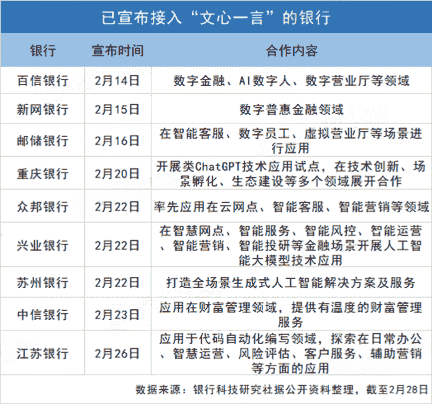

# 2023-05-24ChatGPT对银行业数字化转型的启发

> 来源：[https://xuqiwei1986.feishu.cn/docx/LoAkd9oTooBvtKx5TDXchT6qn4d](https://xuqiwei1986.feishu.cn/docx/LoAkd9oTooBvtKx5TDXchT6qn4d)

引用https://baijiahao.baidu.com/s?id=1766738317669247070&wfr=spider&for=pc

能写论文、能敲代码、通过大学四级考试、成功应聘谷歌程序员……近期，“万能”的人工智能技术产品ChatGPT凭借其“高能”的技术成功出圈。在ChatGPT身上，人们不仅看到了解放生产力的曙光，同时也引发了“狼来了”的焦虑。

金融领域尤其是银行业正在向数字化转型，如何借助“以C**hatG**PT为代表的生成式人工智能（AI **Genera**tedContent，简称“AIGC”）技术”的东风完成华丽转型是值得深思的。本文将结合银行业数字化实践，浅谈 AIGC 给未来银行业数字化转型带来的启发。

### ChatGPT火了

ChatGPT就是在GPT基础上进一步开发的自然语言处理模型，属于生成式人工智能（AI GeneratedContent）范畴。ChatGPT（全名“Chat Generative Pre－TrainedTransformer”，中文译为”生成型预训练变换模型” ）是美国智能研究所Open AI研发的人工智能聊天机器人程序，于2022年11月30日发布。ChatGPT 一经发布立即燃爆全球，注册用户5天超过100万，月活用户两个月突破1亿，创造用户增长新纪录。

ChatGPT**在火遍全**球的同时，国内各大科技巨头纷纷宣布已研发出或正在研发AIGC产**品。3月**27日，百度宣布其同类产品“文心一言”正式上线，成为国内第一家正式推出的对标ChatGPT**的AIG**C产品；随后，360推出人工智能产品“360智脑”，引起股价暴涨；4月9日，阿里达摩院对外宣称“通义千文”正在邀请测试中，预计将于9月2日正式上线；资本市场和数字科技领域对AIGC的推崇度可见一斑。

### 在银行业应用场景

科**技的进步****将对金融**业业务模式产生变革性影响，重塑金融行业。从Bank1.0到4.0，银行业务逐步被新技术变革升级、迭代和重构，AIGC在银行业有广泛的应用场景。虽然国内暂未有AIGC的相关应用落地，但是关于其在金融领域可落地于哪些场景，存在很多想象空间。

**（一）业务前台**

1.  **1. 智能客服**

与传统的智能客服相比，**AIGC****产品可以**提**供更标准**、更贴心的用户服务。AIGC生成的对话不仅可以快速给出相对准确的回答，还能根据历史对话数据不断提高自身的回答能力，提升服务水平。此外， AIGC产品可以与对话机器人相结合，更好地适用于银行的业务需求的同时，降低人工客服成本，提升用户体验

1.  **2. 智能营销**

**AIGC****能帮助银**行根据客户画像开展千人千面的服务与营销，并提供定制化服务。利用AIGC的能力**，可以引**入营销领域专业知识，依托客户画像描述和金融行业特有的“了解你的客户”（KYC）的能力，帮助银行输出更加精准的营销话术，实现精准营销，真正做到千人千面，提升银行的营销价值。AIGC产品还可帮助员工搭建一个全能型数字化服务平台，随时随地获取产品的最新数据、客户喜好、用户需求，结合客户的实时表情行为分析，为客户做好个性化的推荐服务。

1.  **3. 智能反欺诈**

近年**，电信网**络诈骗已成为发案最多、上升最快、涉及面最广最强的犯罪类**型。传统**的风险客户识别、电话回访、账户管控等反欺诈工作不仅耗费大量人力物力，还存在管控不够精准的现象。银行运用AIGC可实现差别化智能外呼、个性化客户识别，将极大减少银行反欺诈工作压力。随着数据的不断丰富和完善，AIGC产品还可精准预测可能发生涉赌涉诈的账户，使得银行管控措施不再是只是事后补救，而是可以做的到事前预防，将极大避免银行损失。

**（二）业务中台**

1.  **1. 智能投研**

在投顾、投研领域，**AIGC****超强的数**据提炼和处**理能力将**是业务专家提升工作效率有力的辅助工具；AIGC产品在财富管理领域还可通过专业知识的增量训练，利用KYC探查，辅助业务专家高效落地客户全生命周期投顾服务；而大模型对投资标的的信息进行精准的筛选和整理，完成对各类投研数据的综合分析以及时间序列的预测，从而提升投研价值；此外，AIGC产品可以提供完整的分析报告，结合报告存在的很多新思路和角度，帮助高级分析师完善报告，提升其分析能力。

1.  **2. 智能风控**

随着**AIGC**的**引入，数**据提炼和处理能力不断提升，在贷中贷后交互过程中可以不断挖掘客户新特征、发现新规则，辅助风控专家高效落地全流程风控。利用AIGC流畅的多轮对话能力，帮助银行在贷中、贷后环节，与贷款客户进行轻松自然的定期沟通，节省人力成本的同时，还可在对话中进行数据信息提炼处理、提取变量，辅助银行实现风控策略的动态调整，有效降低资金风险。

**（三）业务后台**

1.  **1. ****智慧办公**

银行拥有庞大的数据，文本**数据在所**有数据类型中占比较大**，依托A**IGC产品在问**答、情感**分析、摘要生成、文本生成等方面的出色表**现，可将**AIGC接入行内OA，工作人员只需在对话框中输入问题，它就能够像私人助理一样解答各类问题，甚至可以将其拉入群聊中，让所有同事都能享受到AIGC产品带来的便捷功能。除了OA之外，音视频、Office等各类办公软件也都可能被AIGC重塑。

1.  **2. 数字员工**

**AIGC**最吸引人的功能是辅助开发编写和测试代码，**上述工作**在人力密集型部门和岗位非常普遍，**AIGC**产品不仅可以帮助没有编程经验或外语能力薄弱的员工快速提升能力，还可以利用AIGC技术解决日常的大部分重复性、机械性的工作，把员工从繁琐事务中释放出来，投入到更具挑战的创新工作，提升工作效率。

1.  **3. ****RPA****场景拓展**

RPA简称流程自动化机器人（Ro**boti**c Process Automation）。RPA通过模拟人在电脑中的一系列操作，实现业务流程中重复性、规范性、跨系统操作的数据采集、传输、加工等事项自动处理，帮助银行处理大量重复性工作。但RPA只能处理结构化数据，无法处理非结构化数据、复杂业务场景。AIGC以强大的自然语言生成、逻辑推理、多样性、灵活性、可扩展性等特点将推动RPA机器人能够理解人类的语言并作出判断和决策，可协助银行拓展更多RPA应用场景。

### 各银行纷纷试水

3月27日，百度宣布新一代大语言模型“文心一言”（英文名：ERNIE Bot）正式上线。随后，多家银行公开宣布，将成为百度“文心一言”（英文名：ERNIE Bot）首批生态合作伙伴，携手百度推进前沿人机对话AI技术在金融场景的应用。

**（一）邮储银行：邮储大脑**

2月16日，中国邮政储蓄银行宣布接入百度“文心一言”，通过“邮储大脑”接入并应用“文心一言”的能力，将打造更为丰富、个性化的智能金融产品，提供更智能更有温度的普惠金融服务。

邮储银行携手百度针对银行场景开展技术创新与场景孵化，依托智慧互联、创新互联，为客户提供便捷高效、包容普惠的无边界、无障碍金融服务。

“邮储大脑”和“文心一言”的组合，将进一步提高邮储银行在生成式人工智能（AI）、开放式对话、跨模态语义理解等领域的能力，不断提升智能化创新应用效率，为普惠金融、三农金融、绿色金融等发展带来更加广阔的想象和发展空间。

**（二）众邦银行：打造****数字金融****全场景**

2月22日，众邦银行宣布成为百度“文心一言”首批生态合作伙伴，该行将通过百度智能云调用“文心一言”提供的跨模态、跨语言的深度语义理解与生成能力，结合自身产品和技术创新能力，将“文心一言”应用在云网点、智能客服、智能营销等领域。

以智能营销为例，众邦银行将尝试通过大语言模型融入金融行业知识，结合特定AI交互训练等方式进行微调，提升人工智能在客户需求识别、营销响应、营销策略灵活配置等自主交互能力和精准度。

众邦银行表示，未来还将尝试探索“文心一言”在特定服务场景下的需求挖掘及服务支持，例如在供应链金融、小微金融、新市民金融等多场景、多链路的应用落地，为客户提供更加智能化的金融服务体验。

**（三）宁波银行：数字人小宁**

基于AI数字人技术的“宁波银行001数字员工”名为“小宁”，是一位形象清新且极具亲和力的大堂客服经理，能够提供从前端客户接待到后端运营管理的全链条服务支持。在网点，“小宁”可以主动问候和自动接待前来办理业务的顾客，并通过专业、自然的交流和互动，完成各类业务咨询和问题回复，并针对客户不同需求进行自动化引导和智能分流。

此外，“小宁”还连接了银行的运营管理平台，实现知识库的持续更新和业务数据分析，打通服务闭环，促进银行体系的智能化管理和运营，持续优化网点服务质量和效率，增添更多人文关怀。

作为虚拟形象，数字人是银行迈入元宇宙这个虚拟世界的重要入口，是未来虚实融合世界里“基建”的基本组成部分。银行不仅可结合用户诉求和自身的品牌调性，打造独有的数字人IP，创造出更丰富的品牌传播形式，潜移默化地传递品牌理念，使得品牌形象更加年轻化。还可以提升获客与活客效率、优化全流程的风控、提升精细化运营能力，在周期波动之中占据主动、形成优势，率先实现数字化突围。

### 硕眼观点

**AIGC**虽然在金融领域有着较好的应用前景，但是目前这项技术尚不成熟，大规模应用还面临很多问题。具体如下：

**（一）成本问题**

**AIGC**产品之所以强大在于其超大的参数规模。ChatGPT基于8000亿个单词的语料库（或45TB的文本数据），包含了1750亿个参数。8000亿是ChatGPT的训练数据，1750亿是它从这些训练数据中所学习、沉淀下来的内容，并且随着版本迭代，模型参数和数据量也在不断倍增。加之，训练一次的成本介于 200 万美元至 1200 万美元之间，要用本领域的私有、专有数据对它进行增强样本的训练，补足通用模型在其领域的短板，会牵涉到大量的人力财力，短期内应用到银行的具体业务上还存在很多障碍。

**（二）可信度问题**

**AIGC**产品靠其自身的问题求解能力无法解决专业问题**，所以不**能直接应用于垂直型领域，必须先让AIGC产品充分理解金**融专业领**域的相关知识，比如让金融领域已有的专业数据库**、专业知**识图谱和其他的资源与AIGC产品进行对接。此外，对于金融应用来说，金融行业的客户对上线模型的精度要求很高，就目前AIGC水平而言，难以满足金融领域专业化要求。

**（三）信息准确度问题**

由于技术问题，**AIGC****产品目前**还没有解决实时性和准确性的问题**，因为所**用**的语料库****有限，A**IGC产品可能会出现一些**偏差。比**如让AIGC产品推荐某银行理财给客户，但没有考虑客户的实际需求，就会造成真实需求与推荐产品的不一致，导致风险不匹配。再如让AIGC产品推荐股票等金融资产，可能会存在操纵市场的嫌疑。加之，AIGC产品的回答有诱导性，如果AIGC产品给银行客户提供错误方案，很可能会给银行带来信誉风险。

**（四）安全与合规性问题**

使用**AIGC**，数据泄露和信息杀熟等问题也可能会存在。银行业涉及消费者的重大利益，金融交易**的公平性**、可解释性、合规性都很重要，利用AIGC很可能无法保证决策的安全、准确、公平，加之涉及到的网络安全问题，数据的隐私保护和合规性问题都是银行业亟需考虑的问题。

**（五）****知识产权****与监管问题**

目前**AIGC**产**品提供的****是不断接****近人类的**回答，但是并未超越人类思维，只能作为一个智能的百科全书，缺少创造性思维。因此，在实际应用场景中，AIGC生成的内容不具原创性，会存在剽窃的可能性，还可能会涉及侵权行为。使用AIGC产品带来不良后果的责任、相关的法律问题如何解决，以及如何应对AIGC广泛应用后可能存在的无序商业行为并对算法和数据进行监管，消除潜在的隐患，助力技术的良好发展也有待考量。

---

在**AIGC**产品不断推进商业化的背景下，银行业需要加快借助科技**提升服务**模式，强化核心竞争力建设，创新业务模式推动银行业“数智化”转型的力度，从而更好地助力经济高质量发展。随着AI技术的深入发展和应用，定会不断诞生AIGC类的爆款产品，这类产品成功的逻辑是伴随人工智能技术的发展和创新，绑定具体场景应用，以满足用户的认知和期待。

值得注意的是，虽然**AIGC****面临各种**问题，相信随着技术的更迭以及监管的完善，以AIGC为代表的新技术必然会得到普及，未雨绸缪，尽早布局对银行数字化转型是否成功具有重要意义。

关注我们 | 带你深入了解最新金融政策

**声明：**本报告中的信息均来源于公开信息整理，本公司对这些信息的准确性和完整性不作任何保证。本报告中内容呈现、观点阐述及评价分析等，仅代表我方分析人员观点，可能存在理解不充分、解读不到位的情况，相关内容仅供各位读者参考，本公司及其雇员对使用本报告及其内容所引发的任何直接或间接损失概不负责。本公司及作者在自身所知情的范围内，与本报告中所评价或分析的公司和软件没有利害关系。

如引用、转载相关内容，需联系我方，并注明出处为 “硕眼探企”，任何引用、转载不得对本报告进行有悖原意的删节和修改。