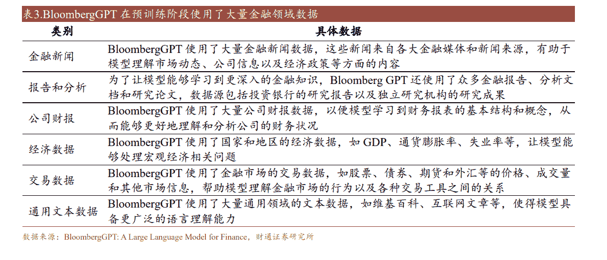
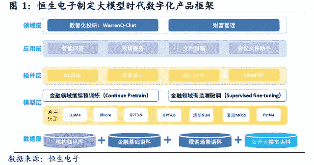
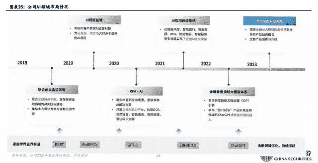
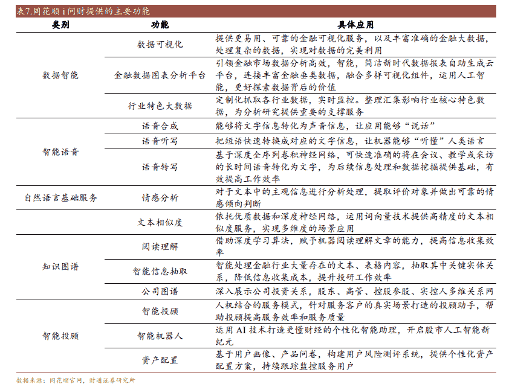

# 2023-07-29国内首个金融行业大模型标准启动编制，机构认为大模型将重塑财富管理业态，金融大模型相关标的梳理

> 来源：[https://xuqiwei1986.feishu.cn/docx/PPWOdrqG2oOPVjxz1gCcxxeLnhd](https://xuqiwei1986.feishu.cn/docx/PPWOdrqG2oOPVjxz1gCcxxeLnhd)

https://baijiahao.baidu.com/s?id=1772759627258466961&wfr=spider&for=pc

财联社7月29日讯（编辑 魏齐）7月28日，腾讯宣布与中国信通院共同启动行业大模型标准联合推进计划。其中，腾讯与信通院将联合牵头开展《面向行业的大规模预训练模型技术和应用评估方法第1部分：金融大模型》编制，这也将是国内首个金融行业大模型标准。

随着金融行业大模型进入规模化应用落地的新阶段，如何在挖掘金融数据价值、深入金融场景需求的同时，全面评估金融行业大模型的应用能效，进一步促进行业大模型的产业化进程，成为金融业数字化转型的重要方向。

**海外开启金融****大模型****浪潮**

近**年来，****金融机构在**业务需求复杂多变、监管趋严、人力成本上升等因素的影响下，对数字化建设的投入意愿与力度逐步强化。当前在海外，以彭博、摩根士丹利为代表的金融巨头积极发力大模型开发与应用。彭博近期发布关于500亿参数的BloombergGPT开发情况的论文，该大模型基于在3630tokens金融数据集、3450亿tokens公共数据集之上进行训练，可全方位支持金融领域NLP任务，表现明显优于其他类似规模的开放模型，在一般NLP基准上的表现也达到甚至超过平均水平。

摩根士丹利宣布采用GPT-4来管理其庞大的内部知识库，知识库中包括涵盖投资策略、市场研究以及分析师见解的海量知识，基于聊天机器人的构建，财富管理人员将得以执行全面搜索。

中信证券杨泽原研报指出，海外以彭博、摩根士丹利为代表的金融巨头积极发力大模型开发与应用，形成大模型+金融的强大示范效应。预计伴随国产大模型逐步突破，国内金融行业生成式AI应用有望逐步开启。

**国内券商积极接入****大模型**

据报道，目前已有海通证券、申万宏源、广发证券、兴业证券、长江证券、西南证券、国海证券、国盛证券、华福证券、财达证券等10家券商宣布成为百度“文心一言”首批生态合作伙伴，各家券商与“文心一言”的合作集中于财富管理领域，应用场景包括智能投研等数字内容生成，基于客户个性化需求的问题解答、服务陪伴及特定任务处理等智能化客户服务，乃至“数字人”、“元宇宙”应用场景及内部运营管理效能提升等，为客户提供更趋智能、更有温度的财富管理服务。

新财富**上榜分析师、财通证券夏昌盛认为，传统**财富管理机构有望通过接入大模型重塑财富管理行业生态：多家券商已宣布接入百度“文心一言”大模型，加速推动人工智能在财富管理场景落地，大模型的接入将从以下方面重塑财富管理业态：1）改革传统人机交互方式，依托海量专业知识库和自我学习迭代能力，大幅优化当前智能投顾下的客户体验；2）大模型在自动化生成营销材料的同时，基于客户背景、收入情况、风险偏好满足客户个性化需求，实现个性化精准营销；3）提升数据提炼和处理能力，提高展业效率和风控水平。

**国内金融****大模型****相关标的梳理**

**恒生电子**和旗下子公司恒生聚源正式发布基于大语言模型技术打造的数智金融新品，金融智能助手光子和全新升级的智能投研平台WarrenQ。此外，恒生电子金融行业大模型LightGPT也首次对外亮相，并公布最新研发进展。根据官方🛰️号介绍，LightGPT拥有更专业的金融语料积累处理和更高效稳定的大模型训练方式，使用了超4000亿tokens的金融领域数据（包括资讯、公告、研报、结构化数据等）和超过400亿tokens的语种强化数据（包括金融教材、金融百科、政府报告、法规条例等），并以之作为大模型的二次预训练语料，支持超过80+金融专属任务指令微调，使LightGPT具备金融领域的准确理解能力。

**金证股份**已成为国内领军的金融科技全领域服务商。金证优智率先打造AI大模型体系，即通用大模型+金融知识库+金融语义检索引擎，目前已经以风控和文档智能为两大抓手，打造了新一代智能产品：金口问答和研报易。未来随着公司金融垂直领域的AI大模型逐步成熟，公司RPA、运维、营销、投顾、量化等业务领域产品有望全线升级。

**同花顺**拥有金融领域海量数据资源，为大模型预训练奠定了坚实基础。B端方面，经过多年积累打造同花顺AI开放平台，为多行业提供多品种智能解决方案。C端方面，公司重点打造的AI投顾平台i问财目前是国内财经领域落地较为成功的自然语言、语音对话交互问答系统。

**东方财富**是中国领先的互联网财富管理综合运营商，海量用户长周期积淀下的财经资讯、交易等金融数据为大模型落地奠定了数据基础。2023年3月23日东方财富在深交所投资者问答平台表示，公司已经陆续研发了东方财富金融数据AI智能化生产平台、多媒体智能资讯及互动平台系统等多个人工智能相关项目，并在公司部分产品及服务中进行了具体应用，公司将继续紧跟AI技术发展前沿，持续加大研发技术投入，不断加强AI能力建设，进一步强化自然语言处理、图像处理、语音识别和多模态融合技术能力，并继续深入AIGC、交互式AI等领域的研究，完善内容生态构建，增强智能运营能力，持续优化用户体验，提升公司整体服务能力。