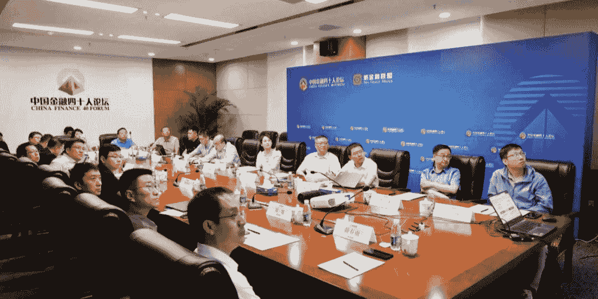

# 2023-06-14如何释放大模型对金融行业的价值？

> 来源：[https://xuqiwei1986.feishu.cn/docx/WWchdJUu2oUQcExrQcJclBW1nkg](https://xuqiwei1986.feishu.cn/docx/WWchdJUu2oUQcExrQcJclBW1nkg)

原创| 如何释放大模型对金融行业的价值?-新闻频道-和讯网

“综合考虑投入和产出性价比，中小金融机构可按需引入各类大模型的公有云API或私有化部署服务，直接满足赋能诉求。”

[——吕仲](http://stockdata.stock.hexun.com/601398.shtml)涛[ 新金融联盟](http://stockdata.stock.hexun.com/601398.shtml)学术理事、工商银行(601398)首席技术官

“类GPT模型是高级复读机，有多少‘人工’就有多少‘智能’。模型100%会犯错，模型之上必须要有运营兜底机制，知错就改。”

——胡时伟 第四范式联合创始人、首席架构师

“AI很容易被媒体炒作，还很容易找到好的case，一开始我们会惊讶于好case，但慢慢发现它不一定能够普世。”

——沈志勇 [民生银行](http://stockdata.stock.hexun.com/600016.shtml)([600016](http://stockdata.stock.hexun.com/600016.shtml))数据管理部总经理

上述观点源自6月1[0日新金](http://stockdata.stock.hexun.com/000001.shtml)融[联盟举办的“](http://stockdata.stock.hexun.com/000001.shtml)金融机构数智化转型与大模型技术应用”[内部研讨](http://stockdata.stock.hexun.com/601988.shtml)会[。会上，吕仲](http://stockdata.stock.hexun.com/601988.shtml)涛、沈志勇、平安银行(000001)数字资产管理与研发中心总经理刘锦淼、胡时伟做了主题发言。新金融联盟理事长、中国银行(601988)原行长李礼辉、中国信通院金融科技研究中心副主任赵小飞进行了点评交流。

56家银行及非银机构、55家科技公司的170多位嘉宾通过线上线下参会。会议由新金融联盟秘书长吴雨珊主持，中国金融四十人论坛提供学术支持。以下为部分精彩内容。

研讨会现场

**大模型****=大****算力****+大数据+强算法**

今年以来ChatGPT风头强劲，带火了大模型技术。大模型即网络参数规模达到亿级以上的“预训练深度学习算法”，在文本图像理解、内容生成等任务表现出显著优势和巨大潜力。

“大模型必须基于‘大算力+大数据+大算法参数网络结构’进行训练。”吕仲涛介绍，大模型技术是一个复杂的体系性工程，涵盖大模型算力集群建设、算法沉淀、配套流水线工具、大模型服务等内容。

赵小飞认为，硬科技对于大模型的发展也很重要。2012年，英伟达将其GPU应用于深度学习研究，GPU的并行计算能力在处理密集数据时效率远高于CPU，为英伟达成为AIGC最大的获利者埋下伏笔。OpenAI在GPU算力升级的加持下，从GPT-1迭代到GPT-4。

“能够支持AI大模型的算力基础设施建设需要持续投入巨大的财力、人力，要花得起钱，找得对人，还要耐得住寂寞，这就势必导致算力集中。一是向主要国家集中，二是向资本巨头和科技巨头集中。”李礼辉表示。

李礼辉指出，算力基础设施的布局和建设应该锚定全球领先的目标，硬件与软件并重并行，国家级与企业级联动联调，新中心与老中心集约集成，人力资源与运营成本统筹兼顾。

“从参数规模来看，百亿大模型具备一定的文本生成和通用能力，但难以处理逻辑复杂、专业性强的任务；万亿大模型因算力消耗极大，短期内难以进行商业推广应用。”吕仲涛表示，千亿大模型平衡了百亿和万亿大模型优势，性价比优势明显，是近几年发展及应用的重点。

ChatGPT是目前最先进的AIGC大模型应用。“要打造与ChatGPT媲美的AI大模型，就一定需要无断层、无障碍[的数据供](http://jingzhi.funds.hexun.com/310368.shtml)给。但是，数据共享模式的局限可能影响数据价值的深度开发，地缘政治冲突可能影响全球数据资源供给格局。”李礼辉认为，要参与数据跨境流动，在维护数据主权的同时，充分利用全球数据资源，打造算力竞争优势。

**有多少人工就有多少智能**

尽管大模型十分强大，但也裹挟着一些风险。

“受制于当前模型黑盒、计算复杂度高等因素，大模型存在答非所问、科技伦理风险等方面问题。比如，ChatGPT生成大量看起来合乎逻辑，但内容可能并非真实甚至是捏造的事实，存在非法利用、造谣等安全隐患。”吕仲涛表示。

李礼辉强调，对AI虚假与AI操纵必须高度警惕，重点是提升深度合成内容鉴别技术；建立AI信任制度，加强AI监管，在国家层级建立预防AI操纵的防火墙。

**如何理性看待****大模型****，胡时伟分享了三点认知：**

第一，要相信科学，没有大模型涌现的逻辑。类GPT模型的背后还是机器学习，要想有一个好的模型能力，必须基于基础大模型的调优以及行业特定操作。

**第二，类****GPT****模型是****高**级复读机，有多少“人工”就有多少“智能”。通用大模型都是用人类现有语料训练，其正确性一定来自于人反馈的数据，行业一定要不断迭代告诉大模型什么是好的、什么是对的，这必须靠人工完成。

**第三，模型之上必须要有运营兜底机制，知错就改。模型100%会犯错，哪怕是GPT4，在行业**专业、严肃场景的应用不可能达到工业可用的效果，人工兜底机制让它从不可用变成可用。

“知错就改有三个机制叠加保障：一是专家给答案；二是专家给示例；三是专家生成的知识反馈给模型，让模型少犯错。”胡时伟表示。

**大模型****对**[**金融行业**](http://jingzhi.funds.hexun.com/510650.shtml)**价值几何**

**要将****大模型**融入具体行业的核心生产经营流程，可谓任重道远。

赵小飞以工业为例分析，工业场景中的很多数据是不可读取的，或者即使读取了也需要一个翻译和解读的[过程。在](http://stockdata.stock.hexun.com/603138.shtml)数[据之外，工业](http://stockdata.stock.hexun.com/603138.shtml)领域对安全、稳定、可靠等指标极其严苛的追求，才是生成式AI不能满足的地方。此外，工业制造细分领域众多，没有海量数据(603138)标签，基本上不可能形成类似GPT的通用大模型。

“金融行业生产经营虽然没有工业那么复杂，但对于民生、经济安全的影响会更高，所以对于新技术应用需要非常谨慎。”他表示。

吕仲涛表示，由于大模型技术尚不成熟，存在伦理风险。短期内不建议直接对客使用，应优先面向金融文本和金融图像分析理解创作的智力密集型场景，以助手形式，人机协同提升业务人员工作质效。不过，虽然大模型有各类安全风险，但同样给银行业数智化转型带来新机遇，其潜力和空间是无限的。

“未来大模型银行业务的应用场景非常丰富。”刘锦淼介绍，从BankGPT反馈的测试情况来看，它已经具备作为一个智能助手适配场景相关落地的能力。目前已经应用的场景有客户服务、信贷审批、投研服务三大类。

他还表示，在AI应用和业务投产方面，AI算法模型对业务发展的价值如何、能多大程度覆盖全行业务场景，让算法替代人还是让算法永远服务人，投产策略能否做到线上化、自动化、投入产出量化根因回溯分析……都是未来可以思考和探索的方向。

**一个超级模型VS.一堆专业模型**

“短期内，大模型和传统模型会共存，同时，大模型可作为中控，将传统模型作为技能进行调用。从长远来看，若大模型计算复杂度降低、可解释性增强，综合性价比来看，大模型将逐步替代传统模型。”吕仲涛分析称。

沈志勇认为，大模型的应用好比炼钢。作为通用底座的炼钢工厂越大越好，要集中力量办大事，避免遍地小高炉。是而作为应用场景的炼钢，则应多元化、市场化。“用钢”部分可以分成两段，AIGC或者其它一些大模型的应用场景端形成市场化，具体应用场景里自己负责。

吕仲涛表示，需要探索形成一套面向银行业的高标准、低门槛的银行业金融大模型应用模式，才能快速推进人工智能在行业的深化应用。

预算是有限的，预算决定了算力，算力决定了参数规模。“我们需要抉择——要一个超级大模型还是一堆专业模型？”胡时伟说。

“一个思路叫大力出奇迹，如果做一个超级大模型，以中国目前的算力情况，要五年后才能实现，但数字化进程不能等，五年之内如果纯粹以大为方向，就是主动把脖子送给别人卡。”胡时伟认为，我们会走另一个方向，用“学件”的思路，做一堆专业模型，各司其职，方便迭代，便于维护，成本可控。就好比一个公司，不能全部都是董事长秘书，还需要销售、产研、行政等。超级英雄成本很高，也很难管理。

（文| 余春敏）