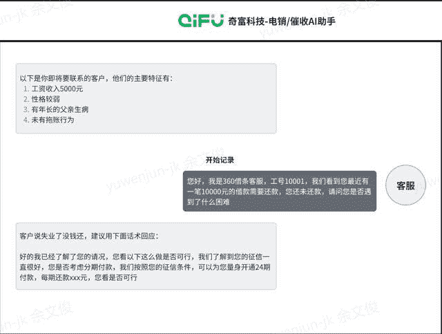

# 2023-05-12奇富科技将发布国内首个自研金融行业通用大模型

> 来源：[https://xuqiwei1986.feishu.cn/docx/ZOr1dTlGQoXvFBxXiQYcuh7Rnae](https://xuqiwei1986.feishu.cn/docx/ZOr1dTlGQoXvFBxXiQYcuh7Rnae)

https://baijiahao.baidu.com/s?id=1765651221887394769&wfr=spider&for=pc

ChatGPT的爆火已经“烧”到了金融行业。

钛媒体App独家获悉，奇富科技（原360数科）自研的行业大模型奇富GPT目前取得阶段性成果。作为国内首个自研金融行业通用大模型，其所支持的产品级应用预计会在年内推出，面向金融机构开放使用。

奇富科技首席算法科学家费浩峻向钛媒体App介绍，作为公司的战略级项目，奇富科技早在去年就启动了相应的团队建设、算力准备和技术研发工作。在过去半年中，公司的大模型工作在各个业务场景中都产生了良好效果，在改善自身业务的基础上，公司计划将运用AIGC的能力逐步开放给金融机构。

今年以来，以ChatGPT为代表的生成式AI在通用任务上表现亮眼，但在行业任务上的表现相对一般。这背后的原因在于，通用大模型是在大规模无标注数据上进行训练，可在不进行微调或少量微调的情况下完成多场景任务。但其由于缺乏特定场景的语料和数据集的训练和模型调优，在特定场景下的专业度欠佳。

基于通用大模型，灌注特定领域的数据和知识，结合自身所积累的行业洞察，以提升大模型针对特定行业及应用场景的准确度和适用性，这就形成了行业大模型。金融行业正是一个高度数据化和专业化的领域，需要大量独特的数据处理和分析，而其高度敏感和隐私的数据属性也导致无法在任何一个通用平台进行预训练。

费浩峻表示，金融行业通用大模型，是对金融行业生产效率以及生产方式的革新，需要全面掌握金融专业术语，理解客户意图，并从与客户的对话中提取线索。给出专业性的应答是金融行业通用大模型必备的基本技能。

以下面客服对话为例，奇富GPT不仅能形成用户画像，还能捕获用户真实意图，为用户提供还款安排。

再以信贷领域最核心的业务环节风控为例，费浩峻介绍，“以奇富GPT为核心衍生的智能征信解读，能够帮助金融机构更加全面、高效地理解和判断用户，这种模式进一步的升级和优化，极有可能替代和优化过去在智能征信解读上千万级变量衍生和众多的深度模型建设工作。”

大模型是对无数AI模型更智能化的替代。钛媒体APP了解到，早在2017年，奇富科技就通过AI算法平台、算法库进行训练，最终提炼出了能够真正用于业务场景的各种模型，如智能营销模型、反欺诈模型、贷前额度模型、贷中调整模型，以及交易风险模型和智能机器人等等，这些模型覆盖了业务的全生命周期。

对于奇富GPT的部署环境问题，费浩峻表示，安全与合规是金融大模型的生命线。金融领域对于大模型的应用一定是在其私有化部署之上的应用，私有化部署的专业金融大模型，加上与之匹配的可扩展的API，这二者相结合，将会充分保护数据安全，让金融机构安心使用。

费浩峻认为，金融行业大模型必须在准确性和适用性两个方面做到极致。训练数据数量和质量，以及对金融业务的理解和洞见，是金融行业大模型的核心竞争力。（本文首发钛媒体APP，作者｜蔡鹏程）