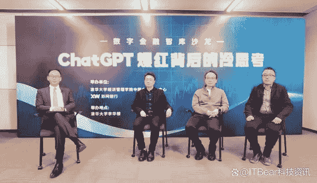

# 2023-07-24【新网银行】举办数字金融智库沙龙，展望ChatGPT在金融业应用前景

> 来源：[https://xuqiwei1986.feishu.cn/docx/QnvhdEzNSo16buxENMgcrAjPn3c](https://xuqiwei1986.feishu.cn/docx/QnvhdEzNSo16buxENMgcrAjPn3c)

> 🔗 原文链接： h[ttps://baijiahao.b](https://baijiahao.baidu.com/s?id=1772265914454299066&wfr=spider&for=pc)aidu.com/s?id=17...

>

新网银行举办数字金融智库沙龙，展望ChatGPT在金融业应用前景

近日，清华大学经济管理学院中国金融研究中心和新网银行共同举办了数字金融智库沙龙活动。此次活动从ChatGPT发展脉络、应用前景、技术缺陷等维度入手，以产学研相结合的视角对ChatGPT进行深度剖析，并展望ChatGPT在金融业的应用前景，畅谈AIGC对金融机构数字化转型的影响。

**ChatGPT热下的冷思考**

当下，金融业正处于数字化转型的重要时期，人工智能已被广泛应用在风控、营销、客服等多个关键领域，对于ChatGPT在金融业的应用前景，新网银行副行长兼首席信息官李秀生表示：银行业正从电子化、信息化走向智能化，数字化转型愈发深入到业务的方方面面，ChatGPT作为AI智能工具，背后所代表的公共服务知识体系，未来可能成为类似于自来水一样的基础设施，从而降低技术的成本与落地门槛，看好其在金融业的长期发展前景。

中国信通院云计算与大数据研究所副所长魏凯认为，人工智能要朝着可靠可控、透明可信、数据保护、明确责任和多元包容的角度健康发展，才能始终在造福人类的正确道路上行稳致远。

光大信托信息技术部副总经理、数据中心总经理祝世虎指出：从体力劳动被取代，到重复工作被取代，到人们逐步相信自动驾驶，到现在“简单创造”的工作被取代，在未来只有存在深度感情交流的工作不会被取代。但取代人们岗位的不是AI，而是先掌握AI的人!

**ChatGPT成功的偶然与必然**

在很多业内人士看来，ChatGPT的爆火正是AI技术长期积累的结果，应理性看待。

正如新网银行李秀生所言，“其实它的出现是人工智能技术长期发展的结果”，加上“它有非常强的反馈强化学习的机制”，使得在人机交互体验上， 用户会发现它的回答越来越接近于人的回答。

显然，ChatGPT的火爆背后，既有一定的偶然性，也有其必然性，对于金融机构来说，包括AI在内的技术能力长期积累，将会是企业的核心竞争力之一，并作为一项长期战略，久久为功。

以新网银行为例，作为新一代数字原生银行，新网银行始终坚持技术立行，十分注重对大数据、人工智能、互联网信息系统等领域的科技人才体系建设，包括研发人员、数据工程师、数字风控专家等在内的科技相关人员占比高达七成。

公开数据显示，新网银行是全国首批把机器学习技术应用到零售信贷全流程实战的银行，国内第2家获得国家高新技术企业认定的银行。截至2022年底，新网银行已累计提交了490多项技术专利申请，获批超140项，先后承担多项人工智能相关的重大专项课题。

举报/反馈

大家都在搜

[智慧金融发展趋势 ](https://baidu.com/s?word=%E6%99%BA%E6%85%A7%E9%87%91%E8%9E%8D%E5%8F%91%E5%B1%95%E8%B6%8B%E5%8A%BF&rsv_dl=feed_landingpage_rs&from=1020853i&rsf=)[金融场景有哪些 ](https://baidu.com/s?word=%E9%87%91%E8%9E%8D%E5%9C%BA%E6%99%AF%E6%9C%89%E5%93%AA%E4%BA%9B&rsv_dl=feed_landingpage_rs&from=1020853i&rsf=)[中央对金融科技要求 ](https://baidu.com/s?word=%E4%B8%AD%E5%A4%AE%E5%AF%B9%E9%87%91%E8%9E%8D%E7%A7%91%E6%8A%80%E8%A6%81%E6%B1%82&rsv_dl=feed_landingpage_rs&from=1020853i&rsf=)[国际投资银行发展趋势 ](https://baidu.com/s?word=%E5%9B%BD%E9%99%85%E6%8A%95%E8%B5%84%E9%93%B6%E8%A1%8C%E5%8F%91%E5%B1%95%E8%B6%8B%E5%8A%BF&rsv_dl=feed_landingpage_rs&from=1020853i&rsf=)[金融大数据的定义 ](https://baidu.com/s?word=%E9%87%91%E8%9E%8D%E5%A4%A7%E6%95%B0%E6%8D%AE%E7%9A%84%E5%AE%9A%E4%B9%89&rsv_dl=feed_landingpage_rs&from=1020853i&rsf=)[银行如何发展科技金融](https://baidu.com/s?word=%E9%93%B6%E8%A1%8C%E5%A6%82%E4%BD%95%E5%8F%91%E5%B1%95%E7%A7%91%E6%8A%80%E9%87%91%E8%9E%8D&rsv_dl=feed_landingpage_rs&from=1020853i&rsf=)