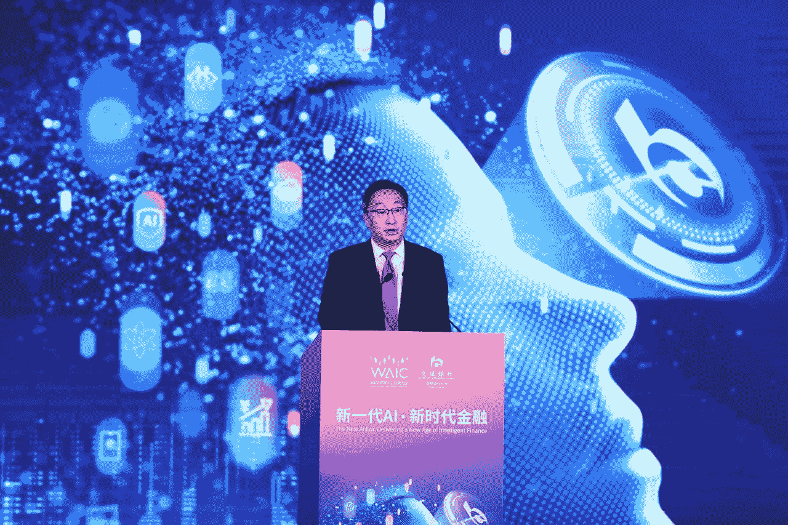

# 2023-07-08【交通银行】刘珺：站在AI新时代拥抱金融创新

> 来源：[https://xuqiwei1986.feishu.cn/docx/ZHged4rteobRDnxOHTccUbrPniR](https://xuqiwei1986.feishu.cn/docx/ZHged4rteobRDnxOHTccUbrPniR)

> 🔗 原文链接： h[ttps://finance.sin](https://finance.sina.com.cn/jjxw/2023-07-08/doc-imyzystp3802285.shtml)a.com.cn/jjxw/20...

>

转自：新华财经

7月8日，2023世界人工智能大会——“新[一代AI•](https://finance.sina.com.cn/realstock/company/sh601328/nc.shtml)新时代金融”论坛在上海举行。 交通银行 ( 5.470 , -0.07 , -1.26% ) 行长刘珺在致辞中表示，站在AI新时代，银行作为传统金融机构正处在十字路口，银行业急切需要思考如何更好地拥抱以ChatGPT为代表的通用型人工智能。交通银行将持续加大AI及科技领域资源投入，着力加强科技与金融的融合发展。

交通银行行长刘珺致辞

2022年下半年以来，以ChatGPT产品为代表的AI大模型热潮席卷全球。刘珺认为，未来国际金融中心之间的竞争极有可能演变为科创中心的竞争，以ChatGPT为代表的人工智能大模型未来很可能引发公共服务知识体系在知识传递、获取、使用方式方面的变革，成为金融基础设施的重要组成部分，人工智能的基础性研发重要性凸显。上海要打造人工智能创新高地，必须要在基础研究，尤其是算法领域更大投入、谋求突破，为上海国际金融中心升级做好准备。

在大模型“千帆竞逐”的背景下，数据要素的重要性不断凸显。刘珺认为，高质量数据是大模型价值跃迁的关键基础，商业银行是数据密集型的行业，也是资金密集型的行业，在确保安全合规与用户隐私保护的前提下，如何用好数据、用活数据，实现高质量的数据供给，将是未来商业银行大模型开发应用的关键。

通用人工智能的崛起实质是AI技术从“单点感知”走向“全面认知”的变革。但在金融业的应用中，还存在底层基础数据难以在不同模型间有效共享，基于人工智能的综合分析能力、统筹规划能力无从体现的问题。刘珺建议，金融业需要从数据、技术、平台、服务等方面建立统一的规范体系，建设业务和技术共同的智能化业务生态。

刘珺同时表示，新AI技术在第四次工业革命中创造了一个明确的分水岭，ChatGPT的广泛适配性和良好应用性，促使大量企业开始真正将人工智能视为核心能力，试水将人工智能全面嵌入业务流程的现实可能。大众在担忧通用人工智能对于人力和人智替代的同时，更要看到新AI对人力和人智的加持和赋能。在健全的AI伦理下，让AI更好为人类所用，而不是人类为AI所困，是摆在大众面前的一个重要课题。“有趣的灵魂是创新的核心要素，（面对人工智能）我们应该边创造边管理，形成合理有效的生态。”刘珺说。

2023世界人工智能大会——“新一代AI•新时代金融”论坛由世界人工智能大会组委会办公室指导，交通银行股份有限公司主办，上海金融业联合会、新华社上海分社、中国经济信息社协办。论坛邀请来自政府机构、知名高校、金融机构、研究机构、科技公司等各领域的专家共同探讨生成式AI等人工智能前沿技术的进展、产业现状与实践挑战，挖掘金融应用创新场景与潜在范式，协同营造创新生态，助力数字中国建设。（杨子华）