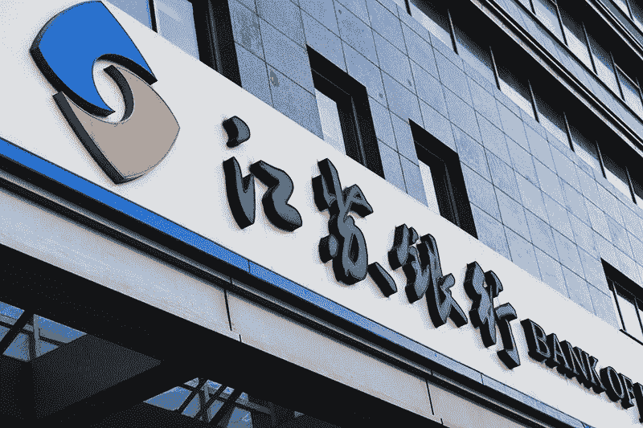

# 2023-07-06【江苏银行】争相入局AIGC，“老银行”能否讲出“新故事”？

> 来源：[https://xuqiwei1986.feishu.cn/docx/Vufbd2pDsoNKxOxeXoncBuUWnYe](https://xuqiwei1986.feishu.cn/docx/Vufbd2pDsoNKxOxeXoncBuUWnYe)

> 🔗 原文链接： h[ttps://business.so](https://business.sohu.com/a/695097979_121203611)hu.com/a/6950979...

>

文 | 新熔财经

作者 | 和花

由ChatGPT引发的“大语言模型热潮”还没有过去。

六月，A股市场ChatGPT概念指数入选后股价涨幅超过20%的就超过30支，涨幅超过50%也有将近20支，像昆仑万维、万兴科技、神州泰岳、汤姆猫等公司，更是借着这股“风”，直接实现了市值翻倍。

**眼见着各行各业都尝到了以ChatGPT为代表的A**IGC概念的“甜头”，银行业也坐不住了。

在百度智能云宣布“文心一言”将通过百度智能云对外提供服务后，百信银行、邮储银行、兴业银行、中信银行、苏州银行、江苏银行等迅速官宣成为“文心一言”首批生态合作伙伴。银行业积极布局AIGC背后，释放了那些信号？

AIGC，打破银行业转型的“数字化焦虑”

**在AIGC的“风”还未刮来之前， 银行业已**经意识到了数字化转型正在成为金融机构焕发新生的重要驱动力和新的利润增长点。

以2022年上市银行金融科技投入为例，已披露相关年报数据的绝大多数上市银行金融科技资金投入占营业收入的比重在2%至6%之间，投入力度较上年均实现了不同程度的增长。

毕竟，科技的投入最终都会反映到银行的业绩与市值上， 比如一直致力于打造“最具互联网大数据基因”的江苏银行，属于在业内较早推进科技、业务双向融合的银行。

在今年一季度江苏银行的财报中，其实现营收187.95亿元，同比上涨10.35%；归母净利润为82.19亿元，同比上涨24.83%。

事**实上，这已经是江苏银行连续17个季度**，在营收同比增速上保持双位数水平；归母净利润同比增速也已连续9个季度保持20%以上， 整体业绩保持行业头部水平，这与其在数字化转型上的深度布局有着不可分割的关系。

并且，从政策层面来看，中国银保监会今年初发布《中国银保监会办公厅关于银行业保险业数字化转型的指导意见》指出，要全面推进银行业保险业数字化转型，并从业务经营、数据能力建设、科技能力建设以及风险防范等方面对于银行业数字化转型予以规范和指导。

数字化转型，已然成为了银行下半场竞争制胜的关键， 但多数中小银行的数字化转型依然停留在较为初级的阶段，推进困难重重。

对此，波士顿咨询公司的负责人直言：“纵观过去5-10年，相较于领先银行对全行层面数字化转型的探索与实践，大多数银行的转型仍停留在规划层而或局部突破的阶段，对照监管要求，在覆盖的广度和深度上或有不足。”

当已经确定前方的山洞中藏着宝藏，大部分人是不会因为守在洞口的巨龙，就选择放弃的，而以ChatGPT为代表的AIGC概念的出现，让觊觎宝藏的人，掌握了打败巨龙的武器。

一方面，从决策端来看，AIGC有望推动银行业的智能决策升级。

数字化转型说白了，就是先从业务中获取数据，然后分析数据，得到结论和洞察，最后基于结论和洞察，反过来制定决策，影响业务。

现阶段的难题主要集中在最后一步，各银行表现出来的水平参差不齐。如今，随着AIGC的出现和落地，可以更加高效的从海量数据中提取有价值的关键信息，为金融决策提供及时准确的参考依据。

另一方面，从业务端来看，AIGC还能提高银行的核心竞争力。

浙江大学国际联合商学院数字经济与金融创新研究中心联席主任、研究员盘和林认为，未来银行数字化转型，从供给来说应面向用户的定制化服务能力，从需求来说应打造流量入口，在获客上形成正反馈循环生态的能力。

与人工相比，AIGC能更高效和准确的通过语义分析识别客户情绪，以更好地了解客户需求和提供更好的服务，为客户提供个性化、差异化、定制化的产品服务。

生成式AI重塑构数字金融经营形态，还只是一个开始。

波士顿咨询公司资深董事经理冯志宇曾公开表示，以ChatGPT为代表的生成式AI只是AI里的一个分支，更多的人工智能技术，以及更广泛的包括移动互联、云计算、边缘计算、物联网等数字化技术，将给中小银行的经营管理带来颠覆式的变化。

欲借AIGC修复估值，仍有三道坎要迈

短短几个月，ChatGPT刮起的这股AI旋风席卷了整个世界,各种相关的实用AI应用也是如雨后春笋般涌现出来，其中，不乏有硬蹭热度的企业与产品，自然也会有人质疑，当名为AIGC的“新酒”，装进银行业这个“旧瓶”后，真能顺利撑起高估值吗？

**在市场此起彼伏的质疑声中，部分银行已**经率先在AIGC领域取得了一些“成果”。

在文**案写作方面，2月，招商银行“小招喵的**掌上生活”微信公号发布了一则信用卡广告，通过ChatGPT对“亲情是什么？”的回答，形成了一篇文采出众、体验新颖、还具有科技感的推文， 作为金融行业首次尝试与ChatGPT搭档生产宣传稿件，达成了不错的营销效果。

**在软件开发上，**

# **江苏银行已尝试运用****ChatGPT****技术提升软件开发生产力。**

至于效果如何，江苏银行信息科技部相关负责人表示，“从测试结果看，代码在生产环境运行，完美完成全部需求且仅耗费了不到1小时，不仅编写功能的时间大大缩短，而且原先需要与厂商对接沟通耗费的时间也由数天缩短到了数小时。”

尝到了一些“甜头”之后，江苏银行信息科技部相关负责人还直言，未来会将ChatGPT新技术进一步融入到日常办公、风险评估、客户服务、辅助营销等领域，更快满足客户在不同场景下的金融需求。

**可见**，“AIGC概念热”的蔓延， 已经让以江苏银行和招商银行为代表的行业头部玩家，先行一步感受到了数字化技术颠覆式的创新推动力，同时也让剩下还未参与的玩家们开始意识到，如果不尝试利用AIGC加速推动数字化转型，极有可能被市场“淘汰”。

不过，在「新熔财经」看来，想要AIGC成为不容忽视的科技力量，深度影响中小银行的前中后台业务，还有一些问题需要解决：

**首先，在实际落地方面，AIGC想要在实际应用领域取得**成绩，需要大量语义数据，并进行大量训练。

在清华大学经济管理学院中国金融研究中心和新网银行共同举办的数字金融智库沙龙上，就有专家表示，即使是ChatGPT，现在还只是一个“通才”，要与金融业务深度结合，解决业务痛点，还需要将其训练为“专才”。

但大量的训练，势必将与极高的初始使用成本划上等号，对中小银行来说，压力不小。

其次，在安全伦理方面，语言模型在金融领域的应用受到一定的限制。

金融行业属于数据密集型，对数据依赖性极强。如何守护好个人信息、更好地保障数据安全、引导数据向善，是金融业必须面对的重要课题。

现阶段AIGC的技术还有一些不足，难免会存在数据泄露风险、被滥用或者被危险分子使用的安全伦理问题。

最后，在人才储备方面，银行需要夯实自身科技队伍。

显然部分银行已经认识到了这一点，九江银行新任行长肖璟此前曾在工商银行科技条线工作近15年；江苏银行发布公告，新任行长葛仁余此前担任江苏银行党委副书记、副行长、首席信息官，为业内少有的科技条线出身的行长。

毕竟，银行机构要想穿越周期，在不确定性中寻找确定，最终的落脚点仍然是自身实力的稳步提升上，科技人才的培养和储备，是关键一步。

总而言之，今年宏观大环境有望进一步趋稳向好，随着政策红利不断释放、消费需求持续复苏，银行股估值有望在相对低位持续向上修复。

在这样的市场环境下，只有积极参与创新和转型的进程，尝试技术架构和业务模式的探索，才是适应未来的唯一途径。

伴随着人工智能的能力越来越强，技术越来越完善，问题逐渐被克服，“对AIGC的认识与应用”正在成为下半场的“制胜密码”，且看哪位玩家能先在“棋盘”上落下“关键一子”。

*本文图片均来源于网络 [ 返回搜狐，查看更多](https://www.sohu.com/?strategyid=00001&spm=smpc.content.content.2.16920067069200rFwrMP)

责任编辑：