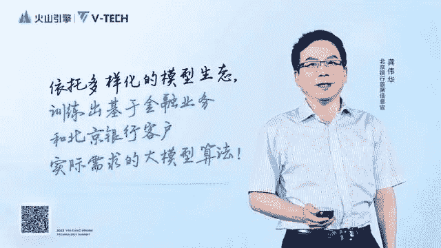

# 2023-07-05【北京银行】从构建到落地，火山方舟助力大模型生态持续繁荣 - 知乎

> 来源：[https://xuqiwei1986.feishu.cn/docx/I4oOdYxAUoPCYvx8GiCcr93UnCd](https://xuqiwei1986.feishu.cn/docx/I4oOdYxAUoPCYvx8GiCcr93UnCd)

> 🔗 原文链接： h[ttps://zhuanlan.zh](https://zhuanlan.zhihu.com/p/641636370)ihu.com/p/641636...

>

[🎦 点击观看视频](https://vdn6.vzuu.com/SD/55720cc4-a2cb-11ed-8a9e-5e5aafd2fc72-v1_f4_t2_ZsOXNzBA.mp4?pkey=AAXasRTTUjwZClMP6kTbxZvAsRz9sm_rdEFLyu9ArCiwHyHLan_bLeVbxq2tErOajXcOFrkqVf2YC3QVkzH7tUiZ&c=avc.1.1&f=mp4&pu=078babd7&bu=078babd7&expiration=1692015917&v=ks6)

近年来，大模型市场开始呈现如火如荼、百花齐放的发展态势，愈来愈多的行业、企业都在加快对大模型的探索和应用。6月28日，2023火山引擎V-Tech体验创新峰会上，火山引擎正式发布了大模型服务平台“火山方舟”。

火山引擎总裁谭待表示：

> “火山引擎将不断降低大模型的使用门槛，解决计算、安全、成本等通用问题，让交易成本足够低、让替代成本足够低，让企业可以更高效地应用大模型技术。”

火山引擎智能算法负责人、火山方舟负责人吴迪介绍：

> “火山方舟致力于帮助千行百业更容易地获取模型，更放心地使用模型，更高效地打造应用，在模型供应方和模型使用方之间促进研究、训练、应用、变现、反哺研究的正向循环。”

## NVIDIA李曦鹏：加速计算，助力大模型产业繁荣

安全互信的环境是大模型生态发展的基础。“火山方舟”持续在探索基于NVIDIA新一代硬件支持的可信计算环境、基于联邦学习的数据资产分离等多种方式的安全互信计算方案，以满足大模型在不同业务场景的数据安全要求。

NVIDIA开发与技术部亚太区总经理李曦鹏表示，NVIDIA与火山引擎过往合作成果丰硕，共同合作的GPU推理库ByteTransformer在IEEE国际并行和分布式处理大会（IPDPS 2023）上获得最佳论文奖，双方还联合开源了高性能图像处理加速库CV-CUDA，并在大规模稳定训练、多模型混合部署等方面的技术合作上取得成效。

未来NVIDIA和火山引擎团队将继续深化合作，包含在NVIDIA Hopper架构进行适配与优化、机密计算、重点模型合作优化、共同为重点客户提供支持，以及NeMo Framework适配等，携手助力大模型产业繁荣。

## 智谱AI张鹏：认知大模型及应用

用好大模型的前提，是对大模型拥有清晰认知。智谱AI CEO张鹏回顾了智谱AI的发展轨迹，并将始终贯彻“让机器像人一样思考”的愿景。

GLM是一种自回归填空模型，使用了全新预训练框架，结合了GPT单向注意力生成式模型和双向注意力填充式模型的优点，且稳定性更好。

目前，ChatGLM大模型服务已经在“火山方舟”陆续上线。基于ChatGLM大模型系列，智谱AI将进一步加深与火山引擎的合作，打造简单易用、功能更强大的MaaS平台，基于火山引擎提供的强大算力、高性能存储、易用的平台等打造全新的大模型应用。

## 百川智能焦可：大模型成为开源生态新引擎

想要充分发挥大模型能力，还需要生态的构建。百川智能联合创始人焦可表示，百川智能自主研发的baichuan-7B开源可商用的中英文大模型，不仅在中英文多个评测榜表现优秀，开源的内容也十分丰富，包括推理代码、INT4量化实现、微调代码以及预训练模型的权重等。用户能够十分便捷地根据自身需求调整和优化模型，实现低成本部署。

对于大模型现有的幻觉、数据更新滞后等问题，百川团队此前在搜索技术方面有着深厚的积累，通过搜索增强可以大幅提升模型的正确性和实时性等关键能力。焦可还表示：“跨时代的技术需要汇集多方的势能。‘火山方舟’的服务涵盖了算力、数据安全、精调以及整个训练推理链路，可以更好地打通大模型的落地壁垒，建立大模型与行业开发者的桥梁。”

## IDEA研究院张家兴：大模型的新范式、新价值、新生态

用好大模型，就需要让更多企业正确理解大模型的价值。IDEA研究院认知计算与自然语言研究中心讲席科学家张家兴认为，大模型是一次技术范式的变革，包括自然语言领域中大量类型的消失和模型逐级迭代生产链的形成。

大模型给产业和社会带来的价值可以总结为：新理解、新界面、新引擎。新理解，意味着任何任务只需要用自然语言去描述。新界面，表示大模型可以实现用自然语言访问数据。新引擎，是指对应大模型在底层驱动，通过文字构建虚拟世界。

未来必然会有两类大模型并存，千亿万亿参数的大模型强调通用性和各种能力，众多几十亿、几百亿参数的大模型百花齐放，会提供各种不同垂直领域的模型能力。

在张家兴看来，“火山方舟”能够在最底层将模型生产方提供的基础模型生产能力汇聚，通过云平台把模型做成生产线，让模型使用方能够在自身平台上面搭建并微调自己的模型，最终基于模型复杂的系统产生解决问题的能力。在模型、云平台基础之上，如SaaS厂家或者企业服务商也可以进一步完成各个行业的深入落地、定制和实施，最终形成大模型的新生态。

## 【北京银行龚伟华】：重塑智慧金融服务

大模型生态的构建，需要模型应用方的积极参与。北京银行首席信息官龚伟华表示，北京银行的数字化转型战略愿景是牢固树立“一个银行、一体数据、一体平台”的理念，运用清单化管理、项目化推进、责任化落实、矩阵式管理的工作方法，以数字化转型统领发展模式、业务结构、客户结构、营运能力和管理方式上的“五大转型”。

基于上述战略，北京银行在业务运营方面，改变传统数据复杂的使用场景，围绕客户旅程提供一站式数据服务，保证一体数据战略愿景的落地；打造企业级一站式AI开发和应用平台“京智大脑”，实现听、说、读、写、看、思六大AI能力，形成智能服务、智能决策和数据员工三个智能应用体系；同时，通过与火山引擎合作，打造了基于统一金融操作系统的全媒体内容平台。

后续，北京银行将利用火山引擎的算法算力能力，结合MaaS平台的大模型服务能力，训练出基于金融业务和北京银行客户实际需求的大模型算法。

面向百花齐放的多模型生态，火山引擎将继续在大模型领域深耕，并希望通过火山方舟，携手合作伙伴，共建“多模型”行业生态，服务好千行百业。

发布于 2023-07-05 14:39 ・IP 属地北京