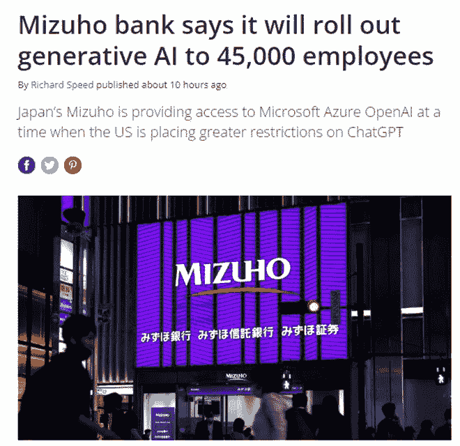
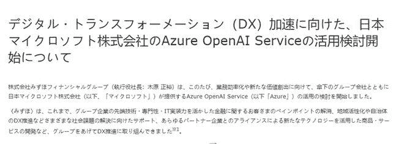

# 2023-06-27【日本第二大银行瑞惠】与微软合作，为45000名员工提供ChatGPT等

> 来源：[https://xuqiwei1986.feishu.cn/docx/OMl8dHI82oiMDwx4i3BcQnb9nUh](https://xuqiwei1986.feishu.cn/docx/OMl8dHI82oiMDwx4i3BcQnb9nUh)

https://www.163.com/dy/article/I8AU56CS055240KW.html

6月27日，日本第二大银行瑞穗（Mizuho）宣布与微软Azure OpenAI达成技术合作，为日本地区的45,000名员工提供ChatGPT等生成式AI服务。

早在今年4月14日，瑞穗就在官网发布消息，考虑使用微软**Azure**** OpenAI**来加速数字化转型实现降本增效。例如，使用ChatGPT起草金融合同、审查法律文件、自动生成金融报告摘要等。

瑞穗数字化负责人牛笃君刚表示，贷款业务部门将首先接入微软Azure OpenAI服务，这使得瑞穗成为日本首批将生成式AI，应用在实际业务中的金融机构之一。

目前，美国银行、花旗集团、高盛和富国银行等都提出了对ChatGPT的使用限制。这主要是因为ChatGPT存在数据安全、隐私泄露、虚假信息等潜在风险。

**牛笃君刚认为**，瑞穗与微软合作使用其Azure OpenAI提供的ChatGPT等生成式AI服务，可极大降低使用风险并且支持业务场景的深度功能定制，进一步扩大了ChatGPT等场景化落地。

此外，**瑞穗的一些员工**已经在日常工作中使用ChatGPT，用于查询资料、总结报告、撰写营销文案等，他们对使用生成式AI充满了兴趣，这将颠覆瑞穗内部很多工作流程和标准。

牛笃君刚表示，7月份，瑞穗将在内部举办一个“创意马拉松”大赛。主要让员工通过ChatGPT等生成式AI，开发各种有创意的业务应用案例，以测试其应用效果和扩大应用范围。

由于老龄化严重、新生人口呈断崖式下跌，从政府到企业日本非常喜欢应用各种创新技术来补充劳动力。

此前，日本神奈川县政府率先在行政工作中开始使用ChatGPT，成为日本首个使用ChatGPT的政府部门。在神奈川县参与测试的公务员中，有10.9%表示工作效率得到大幅提升，有71.6%表示有提升。

此外，有5.8%表示每天都在使用。这次测试已积累了2.6万多个ChatGPT使用的案例，主要应用场景涉及信息的搜索、文案的制作、总结、校对以及新想法的推荐等。

随后，横须贺市政府约4000名公务员尝试使用 ChatGPT进行“会议记录”、“政策制定”等，以验证 ChatGPT在行政工作方面的能力。

埼玉县户田市也成立了研究小组，研究ChatGPT在公务上的使用可能性。软银集团在最新财报发布会上，宣布进军生成式AI领域，打造日本版ChatGTP。

软银集团首席执行官-宫川润一表示，今年3月已成立了一家拥有1000人的新公司，用于开发类ChatGPT产品。

宫川润一说：“孙正义（软银创始人）长期以来非常看好通过AI的力量改变世界。最近他召集了很多工程师来讨论ChatGPT的发展潜力。”

**关于瑞穗金融集团**

日本瑞穗金融集团是2000年9月29日由第一劝业银行、富士银行和日本兴业银行组成，这是日本历史上最大的银行合并案例。

该集团下辖4大金融机构，其中有瑞穗、瑞穗法人和瑞穗信托三家银行，还有瑞穗证券公司。在2022年“世界500强”排行榜中，瑞穗金融集团排名第404位。