# 2023-09-02AI革新之路：14篇AI Agents论文，探讨人工智能未来

> 来源：[https://xuqiwei1986.feishu.cn/docx/XTIKdiTv5oHW3NxjtwEcJdDNnjg](https://xuqiwei1986.feishu.cn/docx/XTIKdiTv5oHW3NxjtwEcJdDNnjg)

> 🔗 原文链接： h[ttps://mp.weixin.q](https://mp.weixin.qq.com/s/apSIgDlU6szfEuKSvvDXGw)q.com/s/apSIgDlU...

>

AMiner科技 将门创投 2023-09-02 10:02 发表于 北京

收录于合集

#AGI 5 个

#LLM 2 个

#AI Agent 1 个

近期，关于通用人工智能（AGI）的技术发展引发了广泛的关注和热议。在这个激动人心的时期，大模型一直扮演着重要的角色，几乎成为了舞台中央的主角。

然而，最近OpenAI的两位重要技术人物，Andrej Karpathy和Lilian Weng，向外界传递出一个令人振奋的信号：基于LLM的AI Agents将成为AGI领域未来的重要发展方向。

Andrej Karpathy的表态引起了广泛的关注。他表示，相较于大模型训练，OpenAI内部目前更加关注Agent领域。这一表态暗示着OpenAI对于开发具备推理和决策能力的AI系统的研究和发展更感兴趣。

而Lilian Weng在这一领域的观点更加具体，她认为Agent的构成要素包括LLM（Language Model），记忆（Memory），规划技能（Planning skills）以及工具使用能力（Tool use）。

这一定义揭示了构建AI Agents的关键要素，也为我们提供了明确的发展方向。

**一、 HuggingGPT: Solving AI Tasks wit**h ChatGPT and its Friends in HuggingFace

本文介绍了一项新的系统，名为HuggingGPT，该系统利用大型语言模型（LLMs）来管理各种人工智能模型，以解决复杂的跨模态和领域的人工智能任务。 作者认为，LLMs在语言理解、生成、交互和推理方面展现了卓越的能力，可以充当控制器，管理现有的人工智能模型来解决复杂的人工智能任务。 文章介绍了HuggingGPT的工作流程： 当接收到用户请求时，使用ChatGPT进行任务规划，根据HuggingFace中提供的功能描述选择模型，使用选定的人工智能模型执行每个子任务，并根据执行结果进行总结。 通过利用ChatGPT的强大语言能力和HuggingFace中丰富的人工智能模型，HuggingGPT能够处理各种不同模态和领域的复杂任务，并在语言、视觉、语音和其他具有挑战性的任务中取得了令人瞩目的成绩，为人工智能的通用智能（AGI）提供了新的思路。

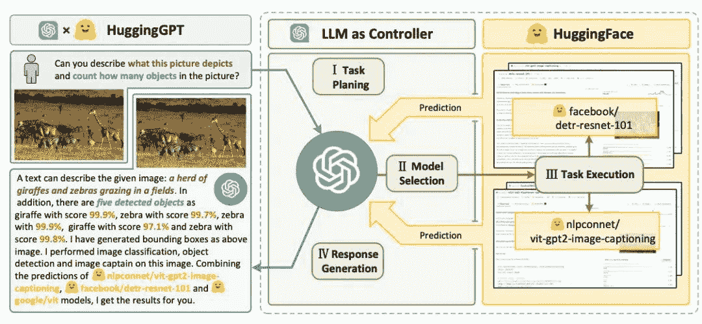

> 论文链接：

> https://www.aminer.cn/pub/64264f7b90e50fcafd68e162

**二**、 Generative Agents: Interactive  Simulacra of Human Behavior

这篇论文介绍了一种新的计算机模拟 软件，称为“生成代理”,可以模拟逼真的人类行为。 这些生成代理可以像真实人一样进行日常生活行为，例如起床做早餐、 去上班、形成意见、互相注意到并开始对话等。 为了实现生成代理，论文提出了一种架构，该架构基于大型语言模型，可以存储生成代理的自然语言体验记录，并将这些记忆随着时间的推移合成为更高层次的反思，然后动态检索这些反思以规划行为。 论文还展示了如何将这些生成代理实例化，用于填充一个类似于《模拟城市》的互动沙箱环境，该环境可与二十五个生成代理进行自然语言交互。 在评估中，这些生成代理产生了可信的个体和群体行为，例如从一个用户指定的观念开始，即一个代理想举办情人节派对，代理们在接下来的两天内自主传播派对的邀请，结交新朋友，互相邀请参加派对，并协调在正确的时间一起参加派对。 论文通过消融证明了生成代理架构的各个组成部分——观察、计划和反思——对于代理行为的可信度都至关重要。 通过将大型语言模型与计算交互代理相结合，该工作为实现逼真的人类行为模拟提供了架构和交互模式。

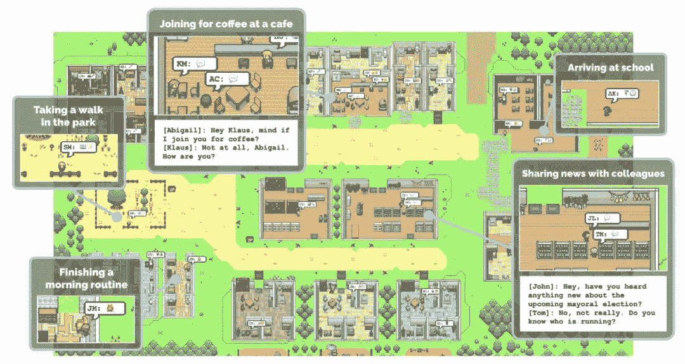

> 论文链接：

> https://www.aminer.cn/pub/64337e3190e50fcafd76ef32/

**三、 Introspective Tips: Large Langu**age Model for In-Context Decision Making

这篇论文讨论了使用大型语言模型 (LLM) 进行上下文决策制定的方法。近年来，大型语言模型 (LLM) 已经在自然语言处理领域产生了重大影响，在多种任务中取得了出色的结果。在这项研究中，作者使用“内省提示”来帮助 LLM 自我优化其决策制定。通过内省地检查轨迹，LLM 生成简洁且有价值的提示，来改进其政策。这种方法在很少或没有示例的情况下提高了代理的表现，考虑了三个重要场景：从代理过去的经验中学习、集成专家演示，并泛化到不同的游戏。重要的是，我们实现这些改进并不需要微调 LLM 参数，而是调整提示以概括上述三个场景的洞察力。我们的框架不仅支持，而且强调使用 LLM 进行上下文决策制定的优势。通过超过 100 个 TextWorld 游戏的实验，我们展示了我们的方法的优势。

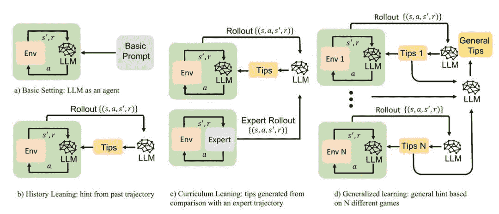

> 论文链接：

> https://www.aminer.cn/pub/646aecaad68f896efa05a6f6

**四、 Interactive Natural **Language Processing

这篇论文综述了交互自然语言处理 (iNLP) 的概念及其在不同领域的应用。iNLP 是一种新兴的自然语言处理 (NLP) 范式，旨在解决现有框架中存在的限制，同时与人工智能的最终目标保持一致。在这个框架中，语言模型被视为能够观察、行动和从外部实体获得反馈的代理。具体而言，语言模型可以与人类进行交互，更好地理解和满足用户需求，个性化回答，符合人类价值观，并改善用户体验;与知识库进行交互，增强语言表示，提高响应的上下文相关性，并动态利用外部信息生成更准确、明智的回答;与模型和工具进行交互，有效地分解和处理复杂的任务，利用特定领域的专业知识解决特定子任务，并促进社交行为模拟;与环境进行交互，学习着地表示语言，有效处理推理、计划和决策等任务。该论文提出了 iNLP 的统一定义和框架，并对 iNLP 进行分类，包括交互对象、交互界面和交互方法等各个组件。此外，论文还探讨了该领域的评估方法、应用、伦理和安全问题，并讨论了未来的研究方向。该综述论文为对 iNLP 感兴趣的研究人员提供了一个全面的指南，并为该领域的当前景观和未来趋势提供了一个广阔的视角。

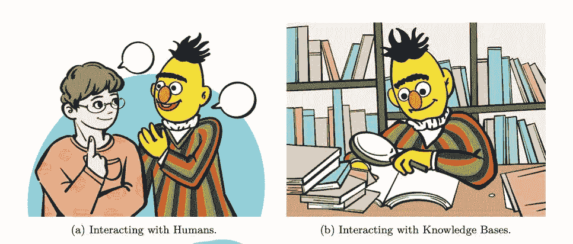

> 论文链接：

> https://www.aminer.cn/pub/646c3addd68f896efa5d195b/

**五**、 Voyager: An Open-Ended Embodied Agent with Large Language Models

Voyager是 Minecraft 中第一个由 LLM 驱动的嵌入式终身学习代理，可以在没有人类干预的情况下不断探索世界、获取各种技能并做出新发现。Voyager由三个关键部分组成：

1）最大化探索的自动课程；

2）用于存储和检索复杂行为的不断增长的可执行代码技能库；

3）结合环境反馈、执行错误和自我验证以改进程序的全新迭代提示机制。

Voyager 通过黑盒查询与 GPT-4 进行交互，从而避免了模型参数微调的需要。Voyager 所开发的技能具有时间扩展性、可解释性和组合性，能迅速增强代理的能力，减少灾难性遗忘。从经验上看，Voyager表现出很强的在情境中终身学习的能力，在玩 Minecraft 时表现出非凡的熟练程度。与之前的 SOTA 相比，它获得的独特物品数量增加了 3.3 倍，旅行距离延长了 2.3 倍，解锁关键技术树里程碑的速度提高了 15.3 倍。Voyager 能够在新的 Minecraft 世界中利用学习到的技能库从头开始解决新任务，而其他技术则很难做到这一点。

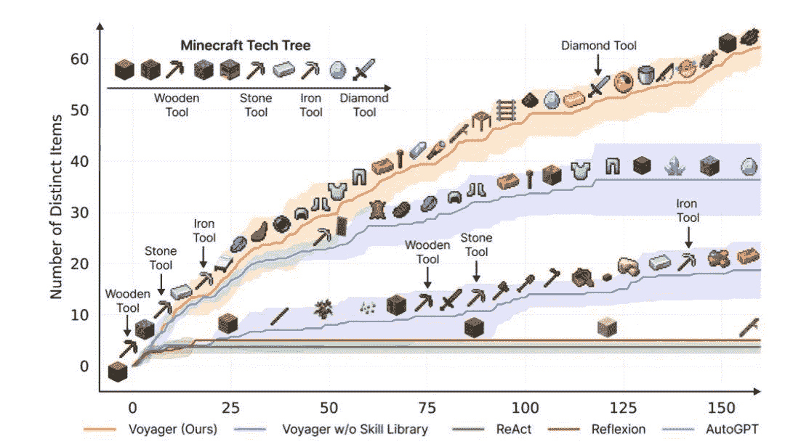

> 论文链接：

> https://www.aminer.cn/pub/64702deed68f896efa5202ea/

**六**、 Decision-Oriented Dialogue for Human-AI Collaboration

这篇论文描述了一种名为“决策导向对话”的人机合作方法，用于帮助人类做出复杂决策。在该方法中，人工智能助手必须与一个或多个人类通过自然语言进行合作，以帮助用户做出最佳决策。论文涵盖了三个日常决策场景：选择将审稿人分配给会议论文、在城市中进行多步骤旅行计划以及与朋友协商旅行计划。在这些场景中，人工智能助手和用户拥有不同的能力和需求，必须相互结合以做出最佳决策。为了每个任务，论文建立了一个对话环境，使代理人根据他们最终决策的质量获得奖励。使用这些环境，论文收集了人类与人类之间的对话，人类扮演助手的角色。为了比较当前人工智能助手在这些场景中的沟通能力，论文还提供了基于大型语言模型的自我对弈的基础线。最后，论文强调了决策导向对话中面临的许多挑战，包括高效沟通、推理和优化，并释放了我们的环境作为未来建模工作的测试平台。

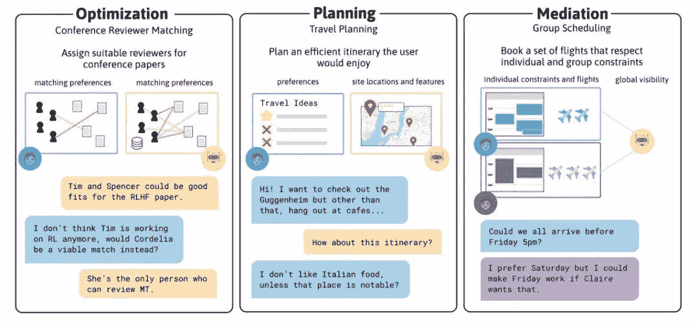

> 论文链接：

> https://www.aminer.cn/pub/647817b2d68f896efa85106e/

**七**、 Minimum Levels of Interpretability for Artificial Moral Agents

这篇论文的主题是人工道德代理（AMA）的最低可解释性水平。随着人工智能（AI）模型的不断扩展和应用，如何理解和信任这些模型的内部推理机制变得尤为重要。对于参与道德决策的模型，即人工道德代理，可解释性提供了一种途径。本文概述了这个迅速发展的 AI 可解释性子领域，并引入了“最低可解释性水平”（MLI）的概念，为各种类型的代理在现实世界的安全部署提供了建议。

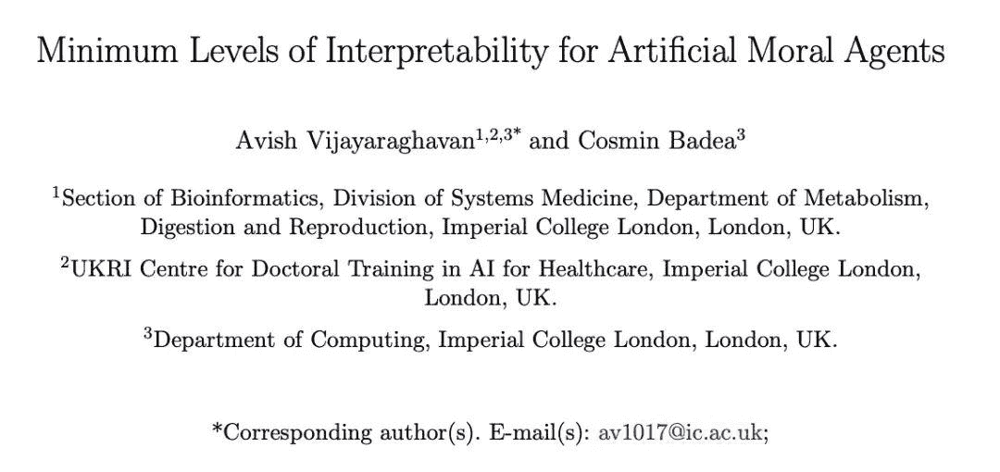

> 论文链接：

> https://www.aminer.cn/pub/64a39885d68f896efa31e1ca/

**八、 Unleashing Cognitive Synergy in Large Language Models: A** Task-Solving Agent through Multi-Persona Self-Collaboration

这篇论文主要探讨如何在大型语言模型（LLM）中实现认知协同作用，以提高其解决复杂任务的能力。尽管 LLM 作为通用任务解决代理表现出一定的性能，但在需要深入领域知识和复杂推理的任务中，它们仍然存在挑战。作者提出了一种名为 Solo Performance Prompting（SPP）的方法，通过与多个角色进行多轮自我协作，将单个 LLM 转变为认知协同者。这种认知协同者是指一个智能代理，它与多个智能体合作，结合各自的优势和知识，以提高在复杂任务中的问题解决和整体性能。通过根据任务输入动态识别和模拟不同的角色，SPP 释放了 LLM 中认知协同的潜力。作者发现，为 LLM 分配多个、细粒度的角色比使用单个或固定数量的角色能更好地解决问题。SPP 在三个具有挑战性的任务上进行评估：知识密集型的 Trivia 创意写作，推理密集型的 Codenames 协作和 Logic Grid 谜题。与仅提高 LLM 推理能力的先前工作（如 Chain-of-Thought）不同，SPP 有效地激发了内部知识获取能力，减少了虚构现象，并保持了强大的推理能力。相关代码、数据和提示可访问：  https://github.com/MikeWangWZHL/Solo-Performance-Prompting.git 。

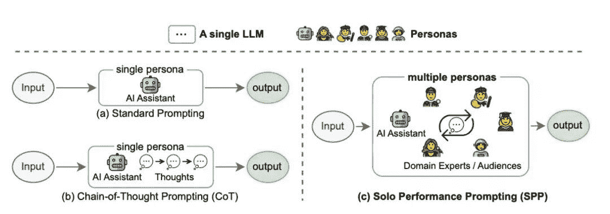

> 论文链接：

> https://www.aminer.cn/pub/64ae259c3fda6d7f0658f403/

**九、 Communicative Agents for **Software Development

这篇论文介绍了一种用于软件开发的通信代理范式，该范式利用大型语言模型在整个软件开发过程中进行自然语言沟通，简化和统一关键过程，从而消除了每个阶段需要专门模型的需要。 该范式的核心是 ChatDev,一个由聊天驱动的软件 development 公司，类似于传统的瀑布模型，将开发过程分为四个明显的时间阶段： 设计、编码、测试和文档。 每个阶段都涉及一组代理，如程序员、代码审查人员和测试工程师，促进协作对话并提供无缝工作流程。 聊天链充当促进者，将每个阶段分解为原子子任务，从而具有双重角色，允许提出和验证解决方案，以高效解决特定子任务。 instrumental analysis of ChatDev 表明，它具有出色的软件生成能力，能够在不到七分钟内完成整个软件开发过程，成本不到 1 美元。 它不仅识别和缓解潜在漏洞，而且还纠正潜在幻觉，同时保持出色的效率和成本效益。 ChatDev 的潜力揭示了将 LLMs 集成到软件开发中的新可能性。

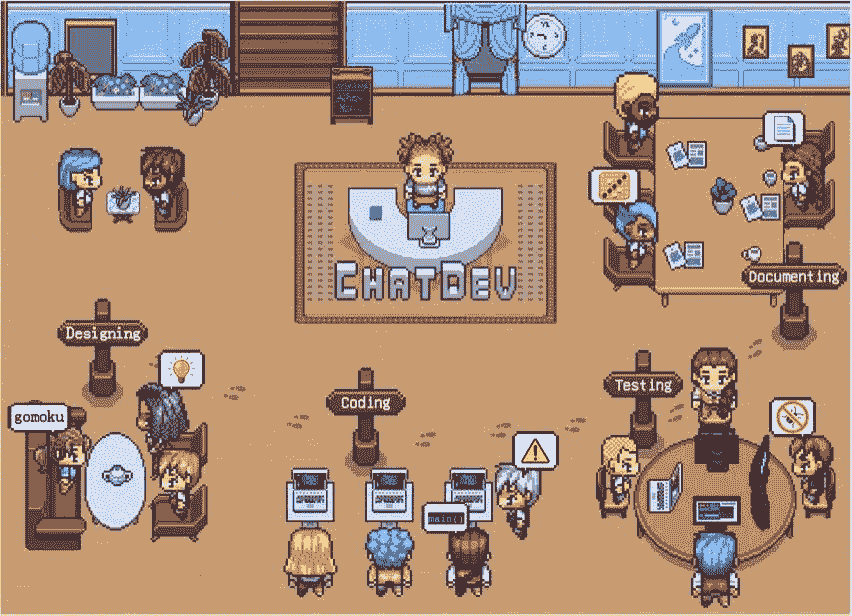

> 论文链接：

> https://www.aminer.cn/pub/64b60eaa3fda6d7f06eaea2a/

**十、 AgentBench: Evalu**ating LLMs as Agents

这篇论文介绍了一个名为 AgentBench 的多维度演化基准，用于评估大型语言模型 (LLM) 作为智能体的能力。随着 LLM 变得越来越智能和自主，在传统自然语言处理任务之外的现实世界实用任务中发挥作用，因此评估 LLM 在交互环境中的挑战性任务上作为智能体的能力变得紧迫。论文测试了 25 个 LLM(包括 API 和开源模型),发现顶级商业 LLM 在复杂环境中作为智能体的表现很强，但与开源竞争者之间存在显著的性能差距。该基准是正在进行的一个更广泛覆盖和更深入考虑系统评估 LLM 的项目的一部分。相关数据集、环境和 AgentBench 的集成评估软件包已发布在 https://github.com/THUDM/AgentBenc h 上。

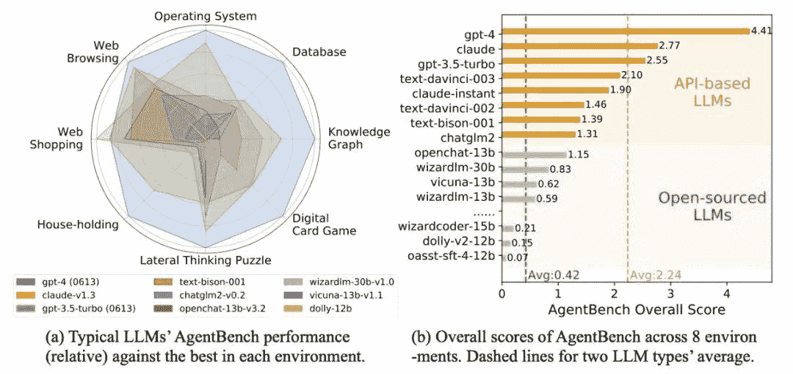

> 论文链接：

> https://www.aminer.cn/pub/64d1bdf93fda6d7f06ec4af3

**十一、 Forming Effective Human-AI Teams: Building Machine Learning** Models that Complement the Capabilities of Multiple Experts

论 文涉及的问题是在与人类专家共同工作的应用领域中，如何构建机器学习模型以补充多个专家的能力。 之前的研究主要集中在只有一个不同专家的场景上，但实际情况中可能有多个能力不同的专家可供选择。 为了解决这个问题，该论文提出了一种训练分类模型的方法，使其能够补充多个人类专家的能力。 通过与分配系统一起进行联合训练，分类器学习准确预测那些对人类专家来说很难预测的实例，而分配系统学习将每个实例分配给最合适的团队成员，可以是分类器或某个人类专家。 该方法在多个实验中使用“合成”专家的公共数据集和由多个放射科医生注释的真实医疗数据集进行评估。 该方法优于之前的研究，比最好的人类专家或分类器更准确。 此外，该方法适应能力强，可以灵活地适应不同规模和不同水平的专家多样性的团队。

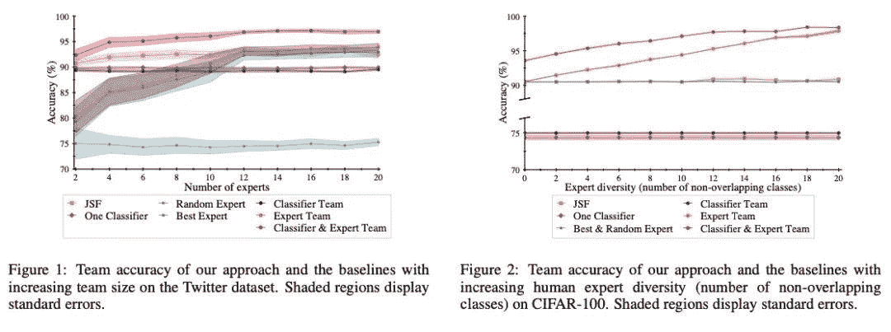

> 论文链接：

> https://www.aminer.cn/pub/634d809c90e50fcafd4e75bc

**十**二、 Human-AI Symbiosis: A Survey of Current Approaches

这篇论文旨在对人工智能与人类协同合作的不同方法进行全面概述。文章突出了人类与 AI 团队合作的各个方面，如互补流程、任务范围、模型表示、知识层次和团队目标，并根据这些维度对近年来的工作进行分类。作者希望这份调查能为人工智能与人类团队之间的研究提供更清晰的联系，并给该领域的新研究人员提供指导。

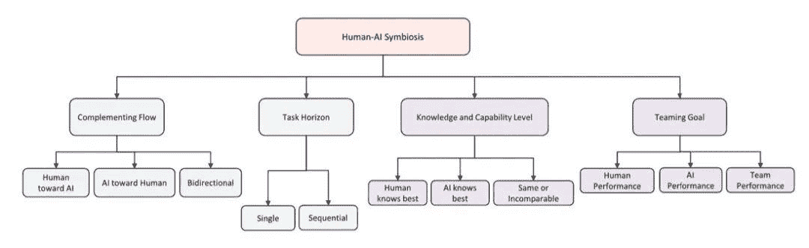

> 论文链接：

> https://www.aminer.cn/pub/6054791591e0116f82f2d5f4/

**十三、 MindCraft - Theory of Mind Modeling for **Situated Dialogue in Collaborative Tasks

这篇论文主要研究了如何让自主代理能够在人类世界中以人类的方式进行合作。 其中，心智理论在人类合作和交流中起着重要的作用。 为了实现心智理论建模在情境交互中的应用，作者引入了一个由人类主体在 Minecraft 的 3D 虚拟方块世界中执行的协作任务的细粒度数据集。 这个数据集提供了在交互过程中合作伙伴对世界和对方的信念信息，为研究人类在情境语言交流中的协作行为提供了丰富的机会。 作为实现我们目标的第一步，即开发能够推断协作伙伴情境信念状态的具身 AI 代理，我们构建并展示了计算模型对于几种心智理论任务的结果。

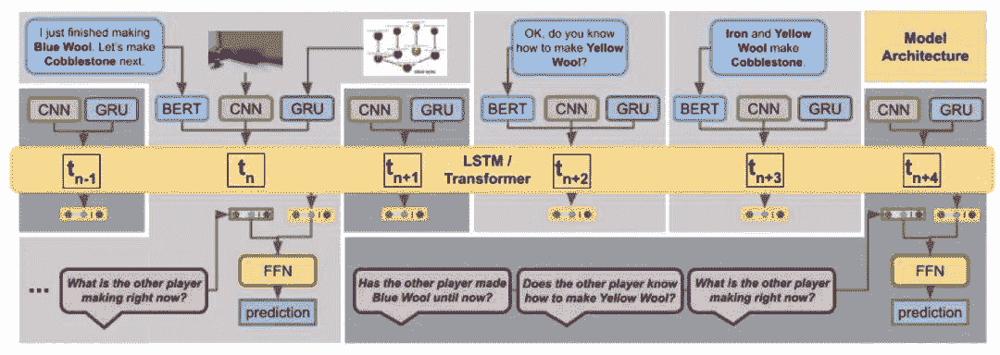

> 论文链接：

> https://www.aminer.cn/pub/614164545244ab9dcb9dd85a/

**十**四、 It Takes Two to Tango: Towards Theory of AI's Mind

这篇论文讨论了人工智能（AI）与人类协作的必要性，并提出了一种名为“AI 心智理论（ToAIM）”的方法。论文认为，要让人机协作团队有效运作，不仅要让 AI 更理解人类，还要让人类更好地理解 AI。作者在视觉问答（VQA）领域中实例化了这些观点，发现只需使用少量示例（50 个），非专业人士就可以通过训练更好地预测复杂 VQA 模型的响应和即将出现的故障。此外，论文还评估了现有解释（或可解释性）方法在帮助人类建立 ToAIM 方面的作用。出人意料的是，获得模型内部状态——例如对前 k 个预测的置信度、显式或隐式注意力图等——并不能帮助人们更好地预测其行为。

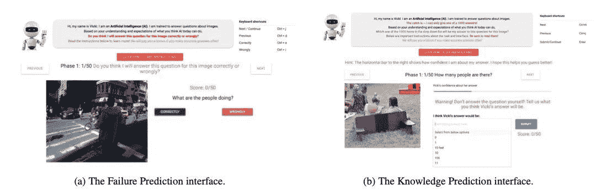

> 论文链接：

> https://www.aminer.cn/pub/599c7971601a182cd263e0b6

>

> 来源： 👸号 【  AMiner科技  】

Illustration by IconScout Store from IconScout

-The End-

**扫码 观看 ！**

**本周 上新！**

**“AI技术流”原创投稿计划**

TechBeat是由将门创投建立的AI学习社区（ www.techbeat.net ） 。 社区上线480+期talk视频，2400+篇技术干货文章，方向覆盖CV/NLP/ML/Robotis等；每月定期举办顶会及其他线上交流活动，不定期举办技术人线下聚会交流活动。我们正在努力成为AI人才喜爱的高质量、知识型交流平台，希望为AI人才打造更专业的服务和体验，加速并陪伴其成长。

**投稿内容**

// 最新技术解读/系统性知识分享 //

// 前沿资讯解说/心得经历讲述 //

**投稿须知**

稿件需要为原创文章，并标明作者信息。

我们会选择部分在深度技术解析及科研心得方向，对用户启发更大的文章，做原创性内容奖励

**投稿方式**

发送邮件到

chenhongyuan@thejiangmen.com

或添加 **工作人**员🛰️（chemn493） 投稿，沟通投稿详情；还可以关注“将门创投”👸号，后台回复“ 投稿 ”二字，获得投稿说明。

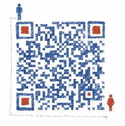

**>>> 添加小编🛰️！**

**关于我“ 门 ”**

**▼**

**将门 **是一家以专注于 **数智核心科技领域 **的 **新型创投机构 **，也是 **北京市标杆型孵化器 **。 公司致力于通过连接技术与商业，发掘和培育具有全球影响力的科技创新企业，推动企业创新发展与产业升级。

将门成立于2015年底，创始团队由微软创投在中国的创始团队原班人马构建而成，曾为微软优选和深度孵化了126家创新的技术型创业公司。

如果您是技术领域的初创企业，不仅想获得投资，还希望获得一系列持续性、有价值的投后服务， 欢迎发送或者推荐项目给我“门”:

bp@thejiangmen.com

点击右上角，把文章分享到朋友圈