# 2023-8-22基于大语言模型的AI Agents—Part 1 | Breezedeus.com

> 来源：https://xuqiwei1986.feishu.cn/docx/W1YcdoPhOoKdKdxSjOTc7IxwncK
>
> 🔗 原文链接：https://www.breezedeus.com/article/ai-agent-part1
>
> ⏰ 剪存时间：2023-08-30 15:43:54 (UTC+8)
>
> ✂️ 本文档由飞书剪存一键生成

代理（Agent）指能自主感知环境并采取行动实现目标的智能体。基于大语言模型（LLM）的 AI Agent 利用 LLM 进行记忆检索、决策推理和行动顺序选择等，把Agent的智能程度提升到了新的高度。LLM驱动的Agent具体是怎么做的呢？接下来的系列分享会介绍 AI Agent 当前最新的技术进展。

## 什么是AI Agent？

代理（Agent）这个词来源于拉丁语“agere”，意为“行动”。现在可以表示在各个领域能够独立思考和行动的人或事物的概念。它强调自主性和主动性 [1]^[1]。智能代理/智能体是以智能方式行事的代理；Agent感知环境，自主采取行动以实现目标，并可以通过学习或获取知识来提高其性能 [8]^[8]。

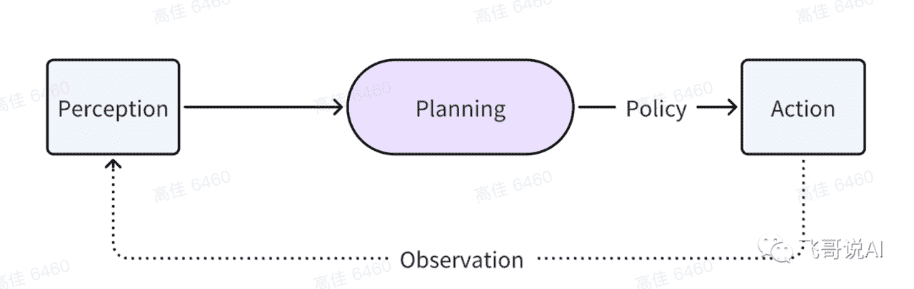

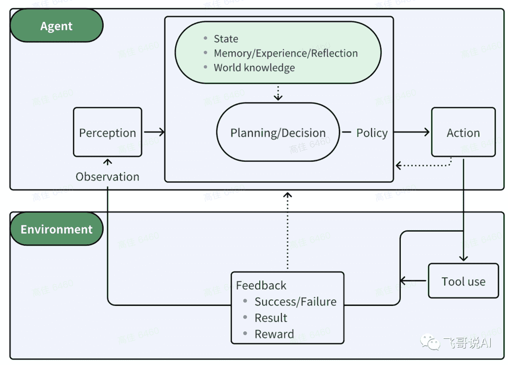

一个精简的Agent决策流程：

Agent：P（感知）→ P（规划）→ A（行动）

### 感知（Perception）

是指Agent从环境中收集信息并从中提取相关知识的能力。

### 规划（Planning）

是指Agent为了某一目标而作出的决策过程。

### 行动（Action）

是指基于环境和规划做出的动作。

其中，Policy 是Agent做出Action的核心决策，而行动又通过观察（Observation）成为进一步Perception的前提和基础，形成自主地闭环学习过程。

类 `LangChain` 中的各种概念 [4]^[4]：

+   `Models`，也就是我们熟悉的调用大模型API。
+   Prompt Templates，在提示词中引入变量以适应用户输入的提示模版。
+   `Chains`，对模型的链式调用，以上一个输出为下一个输入的一部分。
+   `Agent`，能自主执行链式调用，以及访问外部工具。
+   `Multi-Agent`，多个Agent共享一部分记忆，自主分工相互协作。

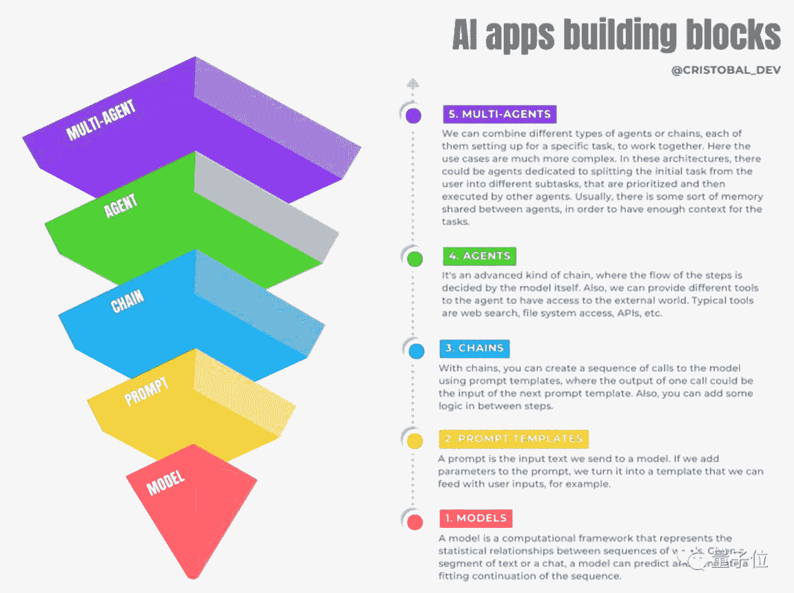

### LangChain 中 Agent 和 Chain 的区别

📌

The core idea of agents is to use an LLM to choose a sequence of actions to take. In chains, a sequence of actions is hardcoded (in code). In agents, a language model is used as a reasoning engine to determine which actions to take and in which order.

## 背景知识

做决策的过程中，一个很重要的信息来源是记忆（Memory）。作为重要的背景知识，下面简单介绍下都有哪些种类的记忆 [2]^[2]。

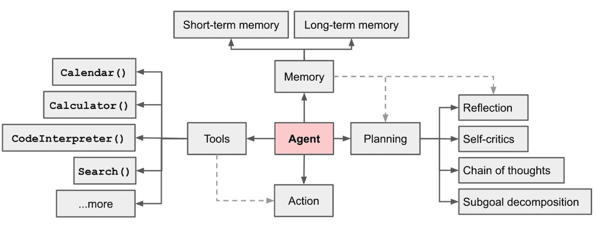

### 记忆（Memory） [2]^[2]

记忆可以被定义为获取、储存、保留以及后来检索信息的过程。人脑中有几种类型的记忆。

+   感觉记忆（Sensory Memory）：这是记忆的最早阶段，提供在原始刺激结束后保留感官信息（视觉、听觉等）的印象的能力。感觉记忆通常只持续几秒钟。子类别包括视觉记忆（iconic memory）、回声记忆（echoic memory）和触觉记忆（haptic memory）。
+   短期记忆（Short-Term Memory, STM）或工作记忆（Working Memory）：它储存我们当前意识到的信息，以执行复杂的认知任务，如学习和推理。短期记忆被认为有大约7个项目的容量（Miller 1956）并持续20-30秒。
+   长期记忆（Long-Term Memory, LTM）：长期记忆可以储存信息很长一段时间，从几天到几十年，其储存容量基本上是无限的。LTM有两个子类型：
    +   显性/陈述记忆（Explicit/declarative memory）：这是对事实和事件的记忆，指的是那些可以被有意识地回忆的记忆，包括情景记忆（事件和经验）和语义记忆（事实和概念）。
    +   隐性/程序记忆（Implicit/procedural memory）：这种记忆是无意识的，涉及自动执行的技能和例行程序，如骑自行车或在键盘上打字。

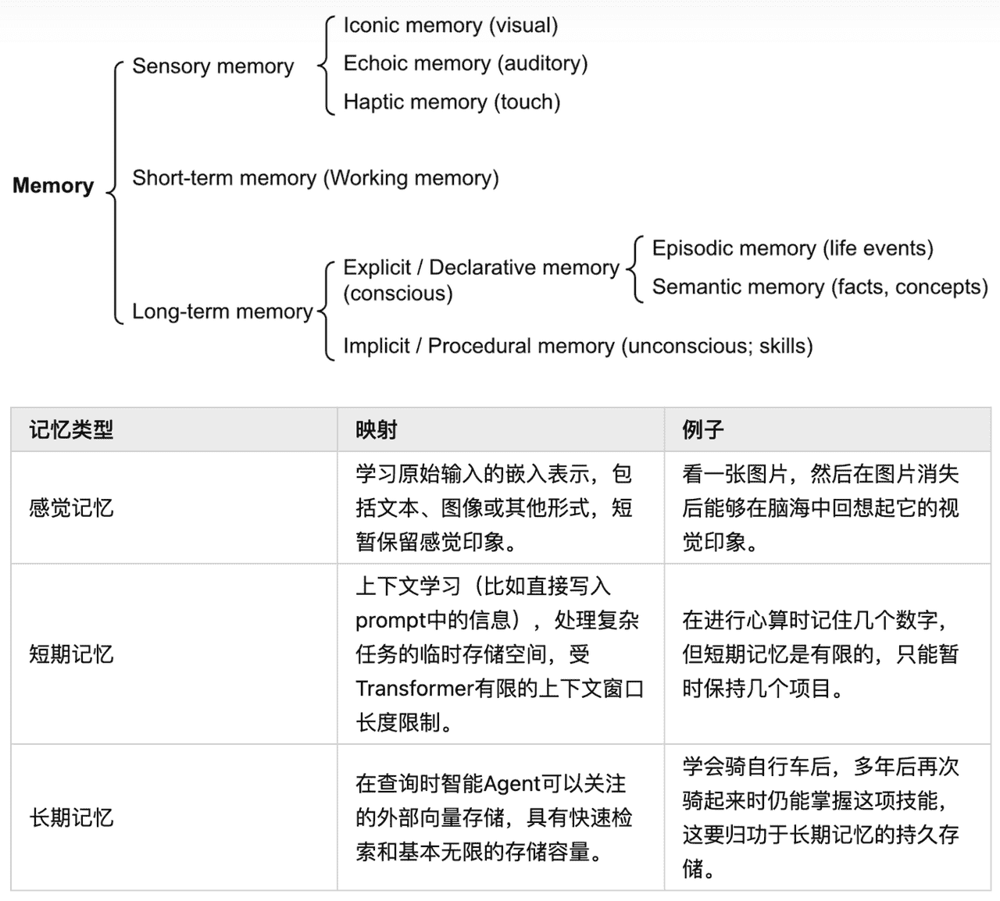

可以大致考虑以下对应关系：

+   将感觉记忆视为学习原始输入（包括文本、图像或其他模式）的嵌入表示；
+   将短期记忆视为在上下文中（prompt）学习。它是短暂且有限的，因为它受到Transformer的上下文窗口长度的限制。
+   将长期记忆视为代理在查询时可以注意到的外部向量存储，可以通过快速检索访问。

### 怎么写好Prompt：ReAct

+   Home: https://react-lm.github.io/
+   LangChain中的ReAct：https://python.langchain.com/docs/modules/agents/agent_types/react.html

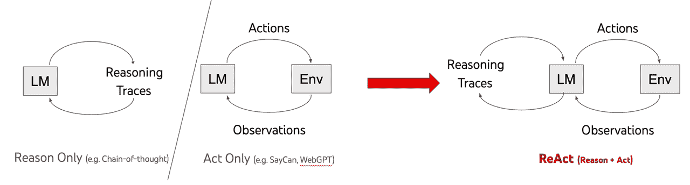

ReAct 指：Reason and Act。

### 特色

+   CoT 只是在prompt加入了静态的“Let’s think step by step”。ReAct 的prompt是动态变化的。
+   CoT 只调用LLM一次即可，ReAct是多次迭代调用LLM。

📌

ReAct 可能是当前Agent中使用最多的prompt结构：少样本 + Thought, Action, Observation。也是调用工具、推理和规划时常用的prompt结构。🔥🔥🔥

ReAct 中迭代使用3个元素：Thought, Action, Observation。其中 Thought, Action 由 LLM 生成，Observation 是执行 Action 后获得的返回结果。

+   Step 1 中，LLM基于 Question 先think（reasoning），然后再决定采取什么行动。这样LLM就会生成 Thought 1 和 Action 1。执行 Action 1 获得 Observation 1。
+   Step 2 中，LLM基于 Question，Thought 1，Action 1 和 Observation 1，汇总所有信息先think（reasoning），然后再决定采取什么行动。这样LLM就会生成 Thought 2 和 Action 2。执行 Action 2 获得 Observation 2。
+   Step 3 中，LLM基于 Question，Thought 1，Action 1，Observation 1，Thought 2，Action 2 和 Observation 2，汇总所有信息先think（reasoning），然后再决定采取什么行动。这样LLM就会生成 Thought 3 和 Action 3。执行 Action 3 获得 Observation 3。
+   以此类推直到 Action 表示结束。

具体代码可以参考以下：

https://github.com/ysymyth/ReAct/blob/master/hotpotqa.ipynb

上面函数输入的参数 `webthink_prompt`，长如下样子：

更多prompt结构可以参考 [7]^[7]。

有了上面的基本知识后，我接下来会介绍几篇Agent的代表性工作。本文（Part 1）介绍来自斯坦福的工作，其中主要文字都是原论文直译。

## 来自斯坦福的虚拟小镇

+   [Generative Agents: Interactive Simulacra of Human Behavior](https://arxiv.org/abs/2304.03442)，2023.04，Stanford
+   代码已开源：https://github.com/joonspk-research/generative_agents

虚拟小镇，一个agent就是一个虚拟人物，25个agents之间的故事。

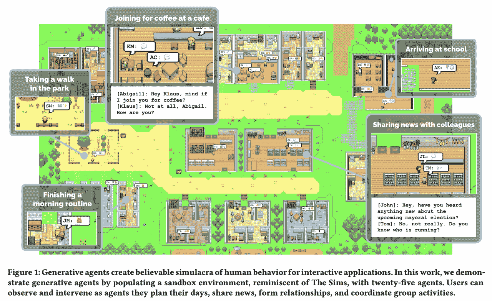

### 架构

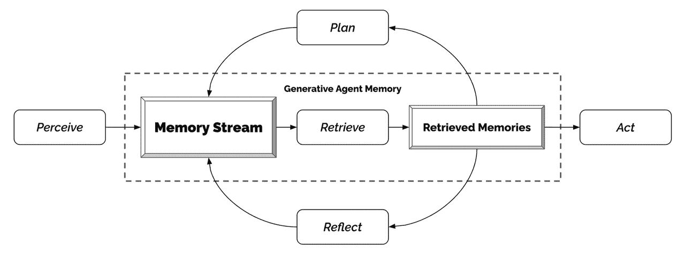

代理（Agents）感知他们的环境，当前代理所有的感知（完整的经历记录）都被保存在一个名为 "记忆流"（memory stream） 中。基于代理的感知，系统检索相关的记忆，然后使用这些检索到的行为来决定下一个行为。这些检索到的记忆也被用来形成长期计划，并创造出更高级的反思，这些都被输入到记忆流中以供未来使用。

#### 1. 记忆流与检索

记忆流（Memory Stream）记录了代理（Agent）的所有经历。它是一个内存对象列表，其中每个对象包含自然语言描述、创建时间戳和最近访问时间戳。记忆流的最基本元素是观察（Observation），这是代理直接感知的事件。常见的观察包括代理自己执行的行为，或者代理感知到的其他代理或非代理对象执行的行为（每个Agent都有自己独立的记忆流）。

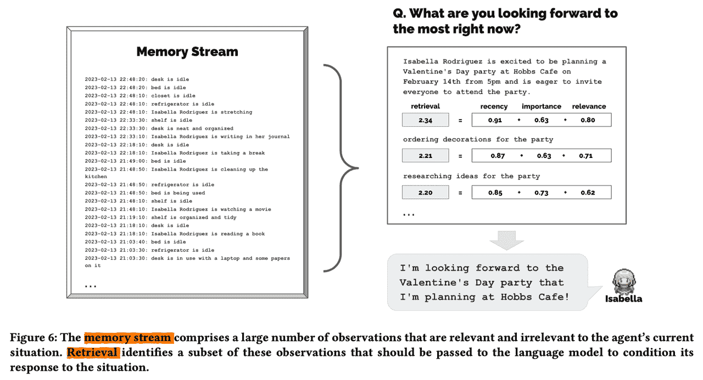

检索功能以代理的当前情况作为输入，检索出一部分记忆流，以传递给语言模型。

排序打分包括三个部分：

+   近期性（Recency）为最近访问的记忆对象分配更高的分数，因此刚刚发生的事件或今天早上的事件可能会保留在代理的注意力范围内。在作者的实现中，将近期性视为一个指数衰减函数，衰减的对象是自上次检索记忆以来的沙盒游戏小时数。衰减因子是0.99。
+   重要性（Importance）通过为代理认为重要的记忆对象分配更高的分数，区分了平凡记忆和核心记忆。例如，一个平凡的事件，如在房间里吃早餐，会产生一个低重要性分数，而与重要的他人分手则会产生一个高分。重要性分数的实现方式有很多种；作者直接使用LLM打分，输出一个整数分数。
+   prompt：
+   相关性（Relevance）为与当前情况相关的记忆对象分配更高的分数。使用常见的向量检索引擎即可。

最终的检索分数是上面三项的加权平均：

`score = α_recency ⋅ recency + α_importance ⋅ importance + α_relevance ⋅ relevance`

#### 2. 反思（Reflection）

挑战：仅配备原始观察记忆的代理，往往难以进行概括或推理。示例：用户问 Klaus Mueller：“If you had to choose one person of those you know to spend an hour with, who would it be?”仅通过观察记忆，代理简单地选择 Klaus 交互最频繁的人：Wolfgang，他的大学宿舍邻居。但是，Wolfgang 和 Klaus 只是偶尔见面，没有深入的互动。一个更理想的回答需要代理从 Klaus 花费数小时在研究项目上的记忆中概括出 Klaus 对研究的热情，并同样认识到 Maria 也在她自己的研究中付出努力（尽管是在不同的领域），从而反映出他们有共同的兴趣。使用下面的方法，当问 Klaus 要与谁共度时间时，Klaus 会选择 Maria 而不是 Wolfgang。

作者引入了第二种类型的记忆，称之为反思（Reflection）。反思是由代理生成的更高级别、更抽象的思考。因为反思也是一种记忆，所以在检索时，它们会与其他观察结果一起被包含在内。反思是周期性生成的；在作者的实现中，当代理感知到的最新事件的重要性评分之和超过一定阈值时，就会生成反思。在实践中，代理大约每天反思两到三次（一日三省吾身）。

反思的第一步是让代理确定要反思什么，通过确定代理最近的经历可以提出哪些问题。作者用代理记忆流中最近的100条记录（例如，“Klaus Mueller is reading a book on gentrification”，“Klaus Mueller is conversing with a librarian about his research project”，“desk at the library is currently unoccupied”）查询LLM，使用prompt：“Given only the information above, what are 3 most salient high-level questions we can answer about the subjects in the statements?”，生成候选问题：例如，“What topic is Klaus Mueller passionate about?”和“What is the relationship between Klaus Mueller and Maria Lopez?”

第二步，将这些生成的问题作为检索的查询，收集每个问题的相关记忆（包括其他反思）。然后使用LLM从中提取洞见（insight），并引用生成洞见对应的特定记录。下面是完整的提示：

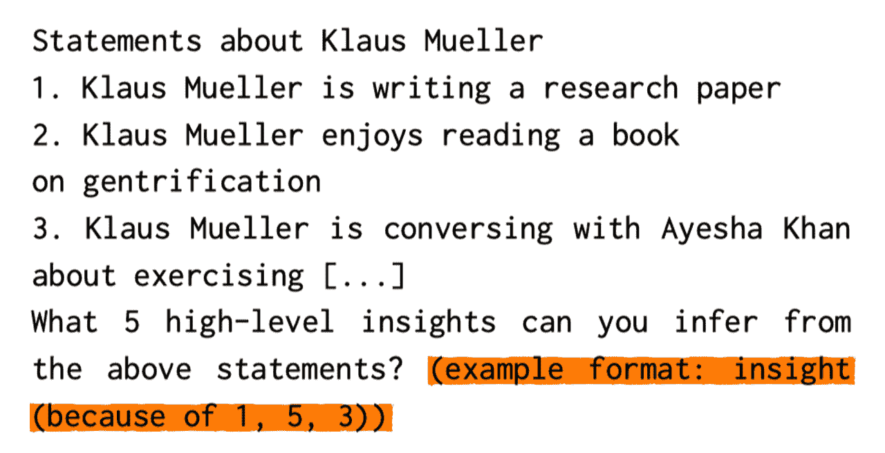

这个过程生成了一些洞见，比如“Klaus Mueller is dedicated to his research on gentrification (because of 1, 2, 8, 15)”。解析并将这个洞见存储为记忆流中的一个反思，包括指向被引用的内存对象的指针。

反思（Reflection）明确允许代理不仅反思他们的观察结果，还可以反思其他的反思：例如，上面关于Klaus Mueller的第二个陈述是Klaus之前的反思，而不是他从环境中得到的观察。因此，代理生成了反思树：树的叶节点代表基础观察，非叶节点代表的思考越往树上越抽象和高级。

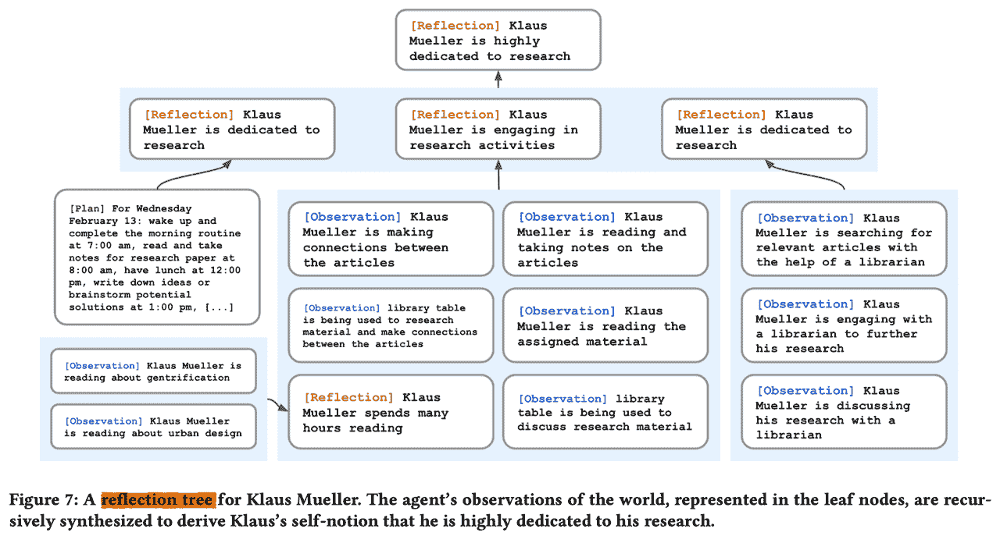

图中包含了3种 Memory：Observation、Reflection、Plan。

#### 3. 计划与响应

计划（Plan）是为了做更长时间的规划。

像反思一样，计划也被储存在记忆流中（第三种记忆），并被包含在检索过程中。这使得代理能够在决定如何行动时，同时考虑观察、反思和计划。如果需要，代理可能在中途改变他们的计划（即响应，reacting）。

为了创建这样的计划，作者的方法是从上到下，递归地生成更多的细节。

第一步是创建一个大致概述一天行程的计划。为了创建初始计划，使用代理的摘要描述（例如，名字、特征、和他们最近经历的总结）和他们前一天的总结来提示语言模型。下面是一个完整的示例提示，底部未完成，由LLM完成：

这会生成代理一天计划的大致草图，分为五到八个部分：

## 3 代理计划与执行

代理将此计划保存在记忆流中，然后递归分解它以创建更细粒度的动作，首先是一小时长的动作块 ——例如，Eddy从下午1点到5点的工作计划 “work on his new music composition” 变成：“1:00 pm : start by brainstorming some ideas for his music composition [...] 4:00 pm : take a quick break and recharge his creative energy before reviewing and polishing his composition”。然后我们再次递归分解这个计划，变成5-15分钟的动作块：例如，“4:00 pm : grab a light snack, such as a piece of fruit, a granola bar, or some nuts. 4:05 pm : take a short walk around his workspace [...] 4:50 pm : take a few minutes to clean up his workspace.”。这个过程可以根据需要的粒度进行调整。

### 3.1 响应和更新计划（Reacting and Updating Plans）

代理执行动作循环中的动作，每个时间步骤，它们感知周围的世界，这些感知到的观察结果被存储在它们的记忆流中。这些观察结果输入到LLM，让LLM 决定代理是否应该继续他们现有的计划，或者做出响应（reacting）。例如，站在画架前画画可能会触发对画架的观察，不太可能引发响应。然而，如果艾迪的父亲约翰记录下他看见艾迪在房子的花园里短暂散步，结果就不同了。下面是prompt，其中 `[Agent’s Summary Description]` 代表了一个动态生成的、长达一段落的对代理总体目标和性情的总结：

通过两个prompts “ What is `[observer]`’s relationship with the `[observed entity]`? ”和“ `[observed entity]` is `[action status of the observed entity]` ”来生成上下文摘要，并将它们的答案一起总结。输出建议 “ John could consider asking Eddy about his music composition project ”。然后，从响应发生的时间开始，重新生成代理的现有计划。最后，如果行动指示了代理之间需要互动，使用以下方式生成他们的对话。

### 3.2 对话

代理在互动时进行对话。根据它们对彼此的记忆来生成代理的对话。例如，当John开始和Eddy对话时，通过使用他对Eddy的总结记忆以及他决定询问Eddy关于他的"composition project"时的预期响应来生成John的第一句话。

结果：“ Hey Eddy, how’s the music composition project for your class coming along? ”

从Eddy的角度看，John发起的对话被视为一个他可能想要回应的事件。因此，就像John做的那样，Eddy检索并总结了他与John的关系记忆，以及可能与John在对话中的最后一句话相关的记忆。如果他决定回应，我们会使用他的总结记忆和当前的对话历史来生成Eddy的话语：

这生成了Eddy的回应：“ Hey Dad, it’s going well. I’ve been taking walks around the garden to clear my head and get some inspiration. ”

这个对话的延续是使用同样的机制生成的，直到两个代理中的一个决定结束对话。

本次分享结束。下次接着分享最近比较火的 Agent 框架。

## 分享视频

[Youtube](https://youtu.be/3fg3As-Y2M0)

<https://player.bilibili.com/player.html?bvid=1NN4y1o7vJ&vd_source=16f270683e0208432809f3715adeacf6>

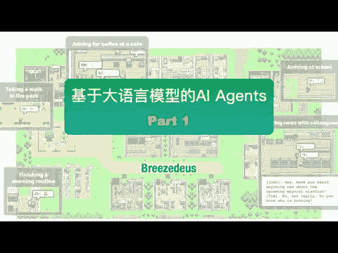

[Bilibili](https://www.bilibili.com/video/BV1NN4y1o7vJ/)

## References

1. 大模型下半场，关于Agent的几个疑问

1. [LLM Powered Autonomous Agents](https://lilianweng.github.io/posts/2023-06-23-agent/) | Lil'Log

1. [Generative Agents: Interactive Simulacra of Human Behavior](https://github.com/joonspk-research/generative_agents)

1. Agent：OpenAI的下一步，亚马逊云科技站在第5层

1. ReAct: `https://react-lm.github.io`

1. [Generative Agents: Interactive Simulacra of Human Behavior](https://github.com/joonspk-research/generative_agents)

1. [2023年新生代大模型Agents技术, ReAct, Self-Ask, Plan-and-execute, 以及 AutoGPT, HuggingGPT 等应用](https://zhuanlan.zhihu.com/p/642357544)

1. [LLM-based Agents survey](https://zhuanlan.zhihu.com/p/648376562) 基于大语言模型多智能代理简单综述及展望
