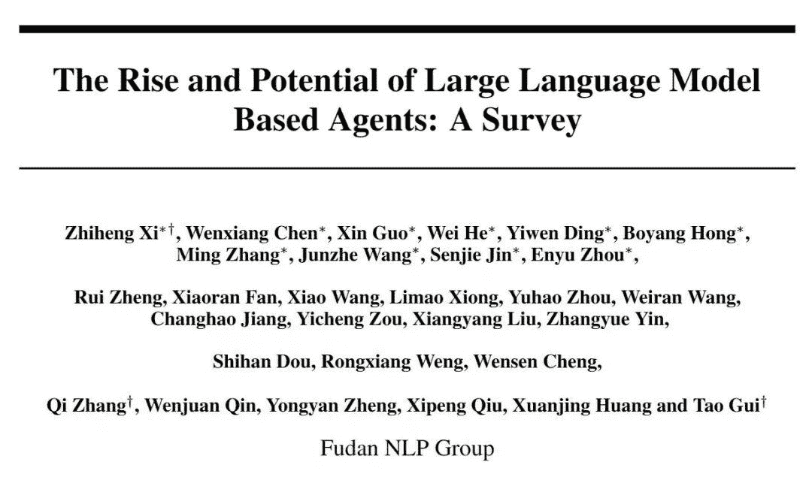
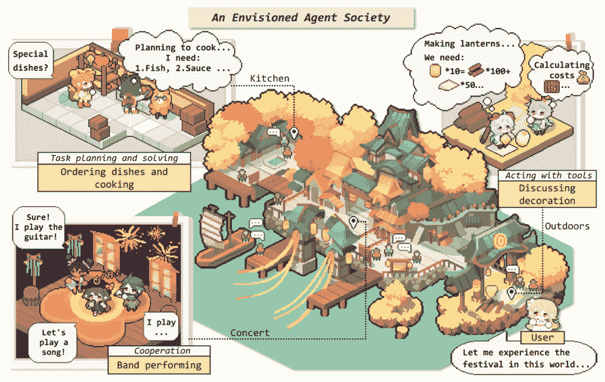
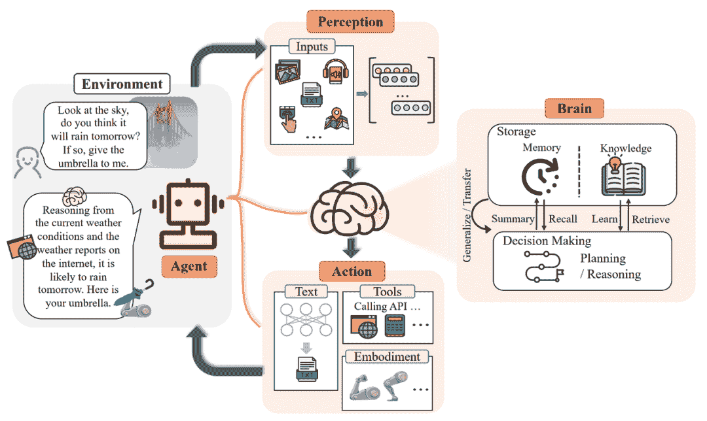
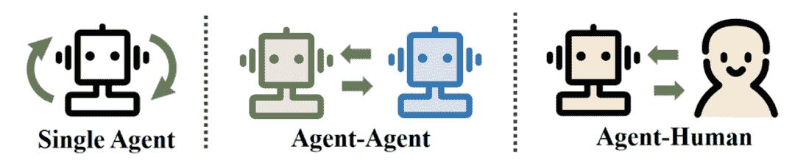
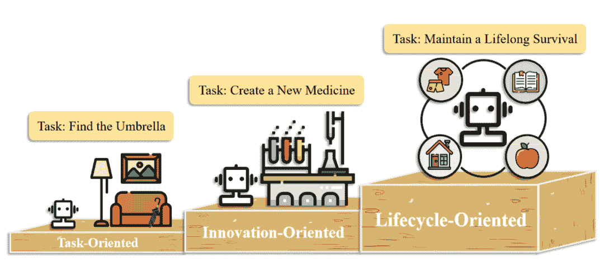
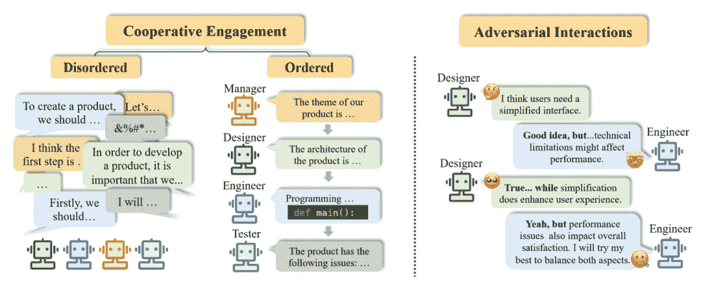
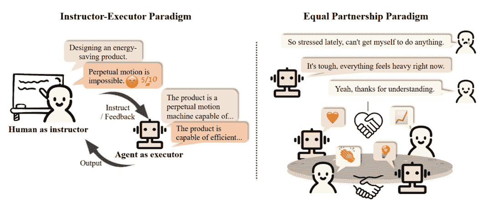
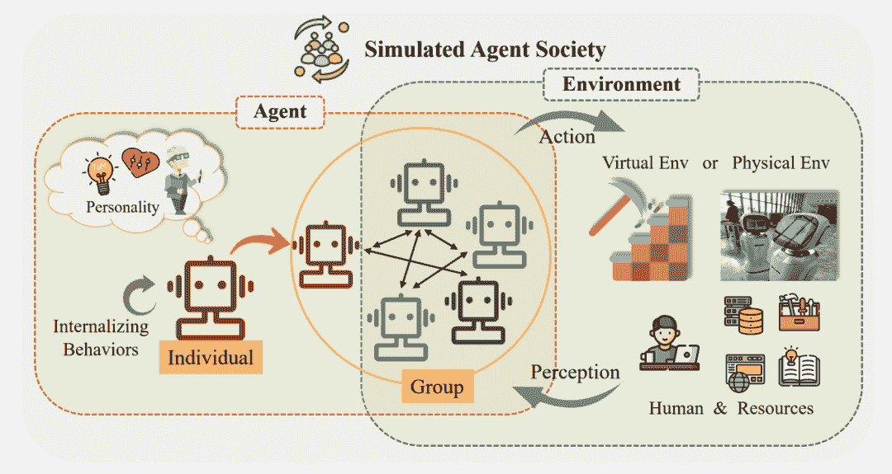
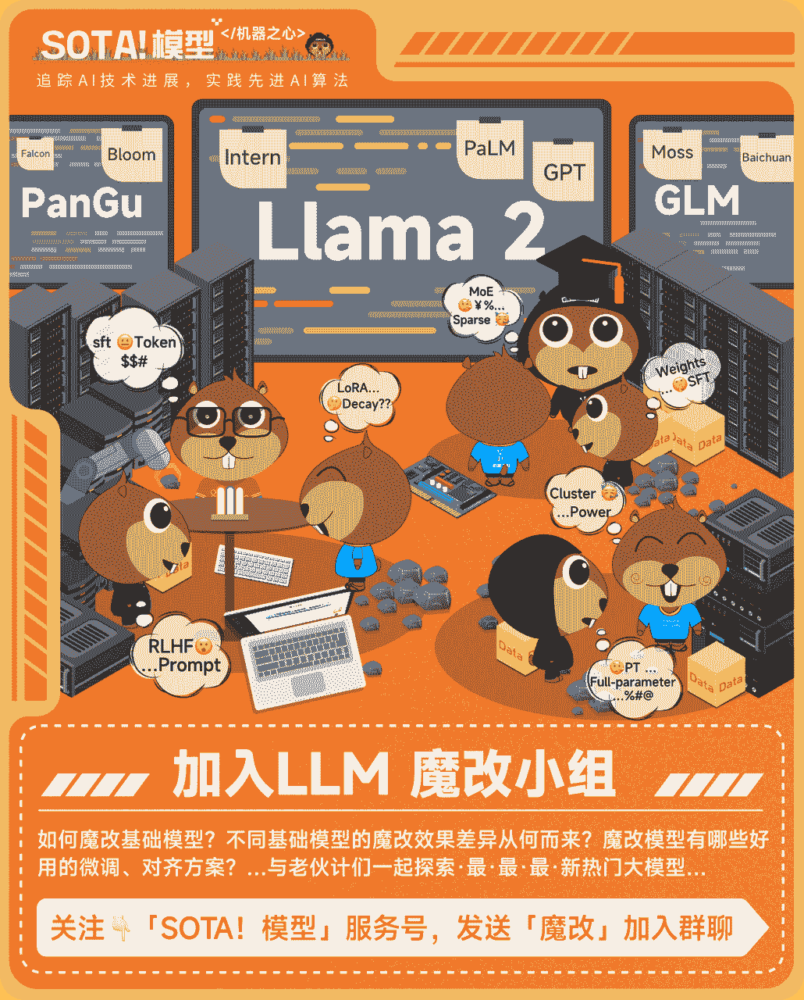

# 2023-09-17复旦NLP团队发布80页大模型Agent综述，一文纵览AI智能体的现状与未来

> 来源：[https://xuqiwei1986.feishu.cn/docx/EtAfdzcdAoTU0wxQyy1cvqIGnbd](https://xuqiwei1986.feishu.cn/docx/EtAfdzcdAoTU0wxQyy1cvqIGnbd)

12:39:29

> 🔗 原文链接： h[ttps://mp.weixin.q](https://mp.weixin.qq.com/s/eWlms4IxTd4wzka4V7Gu6w)q.com/s/eWlms4Ix...

>

机器之心

精确发文时间由壹伴提供

2023-09-17 12:39 发表于 北京

手机阅读

机器之心专栏

**机器之心编辑部**

> 智能体会成为打开 AGI 之门的钥匙吗？复旦 NLP 团队全面探讨 LLM-based Agents。

近期**，**复旦大学自然语言处理团队（FudanNLP）推出 LLM-based Agents 综述论文，全文长达 86 页，共有 600 余篇参考文献！作者们从 AI Agent 的历史出发， 全面梳理了基于大型语言模型的智能代理现状，包括：LLM-based Agent 的背景、构成、应用场景、以及备受关注的代理社会 。同时，作者们探讨了 Agent 相关的前瞻开放问题，对于相关领域的未来发展趋势具有重要价值。

+   论文链接：https://arxiv.org/pdf/2309.07864.pdf

+   LLM-based Agent 论文列表：https://github.com/WooooDyy/LLM-Agent-Paper-List

团队成员还将为每篇相关论文添加「一句话概括」，欢迎 Star 仓库。

**研究背景**

长期以来，研究者们一直在追求与人类相当、乃至超越人类水平的通用人工智能（Artificial General Intelligence，AGI）。早在 1950 年代，Alan Turing 就将「智能」的概念扩展到了人工实体，并提出了著名的图灵测试。这些人工智能实体通常被称为 —— 代理（Agent*）。「代理」这一概念起源于哲学，描述了一种拥有欲望、信念、意图以及采取行动能力的实体。在人工智能领域，这一术语被赋予了一层新的含义： 具有自主性、反应性、积极性和社交能力特征的智能实体 。

*Agent 术语的中文译名并未形成共识，有学者将其翻译为智能体、行为体、代理或智能代理，本文中出现的「代理」和「智能代理」均指代 Agent。

从那时起，代理的设计就成为人工智能社区的焦点。然而，过去的工作主要集中在增强代理的特定能力，如符号推理或对特定任务的掌握（国际象棋、围棋等）。这些研究更加注重算法设计和训练策略，而忽视了模型固有的通用能力的发展，如知识记忆、长期规划、有效泛化和高效互动等。事实证明， 增强模型固有能力是推动智能代理进一步发展的关键因素。

大型语言模型（LLMs）的出现为智能代理的进一步发展带来了希望。如果将 NLP 到 AGI 的发展路线分为五级：语料库、互联网、感知、具身和社会属性，那么目前的大型语言模型已经来到了第二级，具有互联网规模的文本输入和输出。在这个基础上，如果赋予 LLM-based Agents 感知空间和行动空间，它们将达到第三、第四级。进一步地，多个代理通过互动、合作解决更复杂的任务，或者反映出现实世界的社会行为，则有潜力来到第五级 —— 代理社会。

作者们设想的一个由智能代理构成的和谐社会，人类也可以参与其中。场景取材自《原神》中的海灯节。

**一个 Agent 的诞生**

拥有大**模型加持的智能代理会是什么样？作者们受**到达尔文「适者生存」法则的启发，提出了基于大模型的智能代理通用框架。一个人如果想要在社会中生存，就必须学会适应环境，因此需要具有认知能力，并且能够感知、应对外界的变化。同样，智能代理的框架也由三个部分组成： 控制端（Brain）、感知端（Perception）和行动端（Action）。

+   **控制端 **：通常由 LLMs 构成，是智能代理的核心。它不仅可以存储记忆和知识，还承担着信息处理、决策等不可或缺的功能。它可以呈现推理和计划的过程，并很好地应对未知任务，反映出智能代理的泛化性和迁移性。

+   **感知端 **：将智能代理的感知空间从纯文本拓展到包括文本、视觉和听觉等多模态领域，使代理能够更有效地从周围环境中获取与利用信息。

+   **行动端 **：除了常规的文本输出，还赋予代理具身能力、使用工具的能力，使其能够更好地适应环境变化，通过反馈与环境交互，甚至能够塑造环境。

LLM-based Agent 的概念框架，包含三个组成部分：控制端（Brain）、感知端（Perception）和行动端（Action） 。

作者们用一个例子来说明来了 LLM-based Agent 的工作流程：当人类询问是否会下雨时，感知端（Perception）将指令转换为 LLMs 可以理解的表示。然后控制端（Brain）开始根据当前天气和互联网上的天气预报进行推理和行动规划。最后，行动端（Action）做出响应并将雨伞递给人类。

通过重复上述过程，智能代理可以不断获得反馈并与环境交互。

**控制端：Brain**

控制端作为智能代理最核心的组成成分，作者们从五个方面展开介绍其能力：

**自然语言交互： **语言是沟通的媒介，其中包含着丰富的信息。得益于 LLMs 强大的自然语言生成和理解能力，智能代理能够通过自然语言与外界进行多轮交互，进而实现目标。具体而言，可以分为两个方面：

+   高质量文本生成：大量评估实验表明，LLMs 能够生成流畅、多样、新颖、可控的文本。尽管在个别语言上表现欠佳，但整体上具备良好的多语言能力。

+   言外之意的理解：除了直观表现出的内容，语言背后可能还传递了说话者的意图、偏好等信息。言外之意有助于代理更高效地沟通与合作，大模型已经展现出了这方面的潜力。

**知识： **基于大批量语料训练的 LLMs，拥有了存储海量知识（Knowledge）的能力。除了语言知识以外，常识知识和专业技能知识都是 LLM-based Agents 的重要组成部分。

虽然 LLMs 其本身仍然存在知识过期、幻觉等问题，现有的一些研究通过知识编辑或调用外部知识库等方法，可以在一定程度上得到缓解。

**记忆： ** 在本文框架中，记忆模块（Memory）储存了代理过往的观察、思考和行动序列。通过特定的记忆机制，代理可以有效地反思并应用先前的策略，使其借鉴过去的经验来适应陌生的环境。

通常用于提升记忆能力的方法有三种：

+   扩展 Backbone 架构的长度限制：针对 Transformers 固有的序列长度限制问题进行改进。

+   总结记忆（Summarizing）：对记忆进行摘要总结，增强代理从记忆中提取关键细节的能力。

+   压缩记忆（Compressing）：通过使用向量或适当的数据结构对记忆进行压缩，可以提高记忆检索效率。

此外，记忆的检索方法也很重要，只有检索到合适的内容，代理才能够访问到最相关和准确的信息。

**推理 & 规划： ** 推理能力（Reasoning）对于智能代理进行决策、分析等复杂任务而言至关重要。具体到 LLMs 上，就是以 思维链（Chain-of-Thought，CoT） 为代表的一系列提示方法。而规划（Planning）则是面对大型挑战时常用的策略。它帮助代理组织思维、设定目标并确定实现这些目标的步骤。在具体实现中，规划可以包含两个步骤：

+   计划制定（Plan Formulation）：代理将复杂任务分解为更易于管理的子任务。例如：一次性分解再按顺序执行、逐步规划并执行、多路规划并选取最优路径等。在一些需要专业知识的场景中，代理可与特定领域的 Planner 模块集成，提升能力。

+   计划反思（Plan Reflection）：在制定计划后，可以进行反思并评估其优劣。这种反思一般来自三个方面：借助内部反馈机制；与人类互动获得反馈；从环境中获得反馈。

**迁移性 & 泛化性： ** 拥有世界知识的 LLMs 赋予智能代理具备强大的迁移与泛化能力。一个好的代理不是静态的知识库，还应具备动态的学习能力：

+   对未知任务的泛化：随着模型规模与训练数据的增大，LLMs 在解决未知任务上涌现出了惊人的能力。通过指令微调的大模型在 zero-shot 测试中表现良好，在许多任务上都取得了不亚于专家模型的成绩。

+   情景学习（In-context Learning）：大模型不仅能够从上下文的少量示例中进行类比学习，这种能力还可以扩展到文本以外的多模态场景，为代理在现实世界中的应用提供了更多可能性。

+   持续学习（Continual Learning）：持续学习的主要挑战是灾难性遗忘，即当模型学习新任务时容易丢失过往任务中的知识。专有领域的智能代理应当尽量避免丢失通用领域的知识。

**感知端：Perception**

人类通过多模态的方式感知世界，所以研究者们对 LLM-based Agents 抱有同样的期待。多模态感知能加深代理对工作环境的理解，显著提升了其通用性。

**文本输入： ** 作为 LLMs 最基础的能力，这里不再赘述。

**视觉输入： ** LLMs 本身并不具备视觉的感知能力，只能理解离散的文本内容。而视觉输入通常包含有关世界的大量信息，包括对象的属性，空间关系，场景布局等等。常见的方法有：

+   将视觉输入转为对应的文本描述（Image Captioning）：可以被 LLMs 直接理解，并且可解释性高。

+   对视觉信息进行编码表示：以视觉基础模型 + LLMs 的范式来构成感知模块，通过对齐操作来让模型理解不同模态的内容，可以端到端的方式进行训练。

**听觉输入： ** 听觉也是人类感知中的重要组成部分。由于 LLMs 有着优秀的工具调用能力，一个直观的想法就是：代理可以将 LLMs 作为控制枢纽，通过级联的方式调用现有的工具集或者专家模型，感知音频信息。此外，音频也可以通过频谱图（Spectrogram）的方式进行直观表示。频谱图可以作为平面图像来展示 2D 信息，因此，一些视觉的处理方法可以迁移到语音领域。

**其他输入： ** 现实世界中的信息远不止文本、视觉和听觉。作者们希望在未来，智能代理能配备更丰富的感知模块，例如触觉、嗅觉等器官，用于获取目标物体更加丰富的属性。同时，代理也能对周围环境的温度、湿度和明暗程度有清楚的感受，采取更 Environment-aware 的行动。

此外，还可以为代理引入对更广阔的整体环境的感知：采用激光雷达、GPS、惯性测量单元等成熟的感知模块。

**行动端：Action **

在大脑做出分析、决策后，代理还需要做出行动以适应或改变环境：

**文本输出： ** 作为 LLMs 最基础的能力，这里不再赘述。

**工具使用： ** 尽管 LLMs 拥有出色的知识储备和专业能力，但在面对具体问题时，也可能会出现鲁棒性问题、幻觉等一系列挑战。与此同时，工具作为使用者能力的扩展，可以在专业性、事实性、可解释性等方面提供帮助。例如，可以通过使用计算器来计算数学问题、使用搜索引擎来搜寻实时信息。

另外，工具也可以扩展智能代理的行动空间。例如，通过调用语音生成、图像生成等专家模型，来获得多模态的行动方式。因此，如何让代理成为优秀的工具使用者，即学会如何有效地利用工具，是非常重要且有前景的方向。

目前，主要的工具学习方法包括从演示中学习和从反馈中学习。此外，也可以通过元学习、课程学习等方式来让代理程序在使用各种工具方面具备泛化能力。更进一步，智能代理还可以进一步学习如何「自给自足」地制造工具，从而提高其自主性和独立性。

**具身行动： **具身（Embodyment）是指代理与环境交互过程中，理解、改造环境并更新自身状态的能力。具身行动（Embodied Action）被视为虚拟智能与物理现实的互通桥梁。

传统的基于强化学习的 Agent 在样本效率、泛化性和复杂问题推理等方面存在局限性，而 LLM-based Agents 通过引入大模型丰富的内在知识，使得 Embodied Agent 能够像人类一样主动感知、影响物理环境。根据代理在任务中的自主程度或者说 Action 的复杂程度，可以有以下的原子 Action：

+   Observation 可以帮助智能代理在环境中定位自身位置、感知对象物品和获取其他环境信息；

+   Manipulation 则是完成一些具体的抓取、推动等操作任务；

+   Navigation 要求智能代理根据任务目标变换自身位置并根据环境信息更新自身状态。

通过组合这些原子行动，代理可以完成更为复杂的任务。例如「厨房的西瓜比碗大吗？」这类具身的 QA 任务。为了解决这个问题，代理需要导航到厨房，并在观察二者的大小后得出答案。

受限于物理世界硬件的高成本和具身数据集缺乏等问题，目前具身行动的研究仍主要集中于游戏平台《我的世界》等虚拟沙盒环境中。因此，一方面作者们期待有一种更贴近现实的任务范式和评价标准，另一方面，也需要大家在高效构建相关数据集上面有更多的探索。

Agent in Practice：多样化的应用场景

当下，LLM-based Agents 已经展现出了令人瞩目的多样性和强大性能。AutoGPT、MetaGPT、CAMEL 以及 GPT Engineer 等耳熟能详的应用实例正在以前所未有的速度蓬勃发展。

在介绍的具体的应用之前，作者们讨论了 Agent in Practice 的设计原则：

1. 帮助用户从日常任务、重复劳动中解脱出来，减轻人类的工作压力，提高解决任务的效率；

2. 不再需要用户提出显式的低级指令，就可以完全自主的分析、规划、解决问题；

3. 在解放用户的双手以后，尝试解放大脑：在前沿科学领域充分发挥潜能，完成创新性的、探索性的工作。

在这个基础上，代理的应用可以有三种范式：

LLM-based Agent 的三种应用范式：单代理、多代理、人机交互。

**单代理场景 **

可以接受人类自然语言命令，执行日常任务的智能代理目前备受用户青睐，具有很高的现实使用价值。作者们首先在单智能代理的应用场景中，阐述了其多样化的应用场景与对应能力。

在本文中，单智能代理的应用被划分为如下三个层次：

单代理应用场景的三个层次：任务导向、创新导向、生命周期导向。

+   在 **任务导向 **的部署中，代理帮助人类用户处理日常基本任务。它们需要具备基本的指令理解、任务分解、与环境交互的能力。具体来说，根据现有的任务类型，代理的实际应用又可以分为模拟网络环境与模拟生活场景。

+   在 **创新导向 **的部署中，代理能够在前沿科学领域展现出自主探究的潜力。虽然来自专业领域的固有复杂性和训练数据的缺乏给智能代理的构建带来了阻碍，但目前已经有许多工作在化学、材料、计算机等领域取得了进展。

+   在 **生命周期导向 **的部署中，代理具备在一个开放世界中不断探索、学习和使用新技能，并长久生存的能力。在本节中，作者们以《我的世界》游戏为例展开介绍。由于游戏中的生存挑战可以被认为是现实世界的一个缩影，已经有许多研究者将其作为开发和测试代理综合能力的独特平台。

**多代理场景**

早在 1986 年，Marvin Minsky 就做出了具有前瞻性的预言。他在《心智社会》（The Society of Mind）一书中提出了一种新颖的智力理论，认为智力是在许多较小的、特定功能的代理的相互作用中产生的。例如，一些代理可能负责识别模式，而其他代理可能负责做出决策或生成解决方案。

这一想法随着分布式人工智能的兴起得到了具体实践。多代理系统（Multi-Agent System）作为其中主要的研究问题之一，主要关注代理们如何有效地协调并协作解决问题。本文作者将多代理之间的交互划分为以下两种形式：

多代理应用场景的两种交互形式：合作型互动、对抗型互动。

**合作型互动： **作为实际应用中部署最为广泛的类型，合作型的代理系统可以有效提高任务效率、共同改进决策。具体来说，根据合作形式的不同，作者们又将合作型互动细分为无序合作与有序合作。

+   当所有代理自由地表达自己的观点、看法，以一种没有顺序的方式进行合作时，称为无序合作。

+   当所有代理遵循一定的规则，例如以流水线的形式逐一发表自己的观点时，整个合作过程井然有序，称为有序合作。

**对抗型互动： **智能代理以一种针锋相对（tit for tat）的方式进行互动。通过竞争、谈判、辩论的形式，代理抛弃原先可能错误的信念，对自己的行为或者推理过程进行有意义的反思，最终带来整个系统响应质量的提升。

**人机交互场景**

人机交互（Human-Agent Interaction），顾名思义，是智能代理通过与人类交互，合作完成任务。一方面，代理的动态学习能力需要沟通交流来支持；另一方面，目前的代理系统在可解释性上的表现依然不足，可能会存在安全性、合法性等方面的问题，因此需要人类参与进行规范与监督。

作者们在论文中将 Human-Agent 的交互划分为以下两种模式：

人机交互场景的的两种模式：Instructor-Executor 模式 vs. Equal Partnership 模式。

+   Instructor-Executor 模式 ： 人类作为指导者，给出指令、反馈意见；而代理作为执行者，依据指示逐步调整、优化。这种模式在教育、医疗、商业等领域得到了广泛的应用。

+   Equal Partnership 模式： 有研究观察到代理能够在与人类的交流中表现出共情能力，或是以平等的身份参与到任务执行中。智能代理展现出在日常生活中的应用潜力，有望在未来融入人类社会。

Agent 社会：从个性到社会性

长期以来，研究人员一直憧憬着构建「交互式的人工社会」，从沙盒游戏《模拟人生》到「元宇宙」，人们对模拟社会的定义可以概述为：环境 + 环境中生存、互动的个体。

在文章中，作者们用一张图描述了 Agent 社会的概念框架：

代理社会的概念框架，分为两个关键部分：代理和环境。

该框架中，我们可以看到：

1.  **左侧部分： **在个体层面上，代理表现出多种内化行为，例如计划、推理和反思。此外，代理还显现出内在的人格特征，涵盖认知、情感和性格三个方面。

1.  **中间部分： **单个代理可以与其他代理个体组成群体，共同展现出合作等群体行为，例如协同合作等。

1.  **右侧部分： **环境的形式可以是虚拟的沙盒环境，也可以是真实的物理世界。环境中的要素包括了人类参与者和各类可用资源。对于单个代理而言，其他代理也属于环境的一部分。

1.  **整体互动： **代理们通过感知外界环境、采取行动，积极参与整个交互过程。

**代理的社会行为与人格**

文章从外在行为和内在人格来审视了代理在社会中的表现：

**社会行为： **从社会的角度出发，可以将行为分为个体和集体两个层次：

+   个体行为构成了代理自身运作和发展的基础。包括以感知为代表的输入、行动为代表的输出，以及代理自身的内化行为。

+   群体行为是指两个以上代理自发交互时产生的行为。包括以协作为代表的积极行为、冲突为代表的消极行为，以及从众、旁观等中立行为。

**人格： ** 包括认知、情感和性格。就像人类在社会化过程中逐渐形成自己的特质一样，代理也展现了所谓的 "类人智能"，即通过与群体和环境的互动中逐渐塑造人格。

+   认知（Cognitive abilities）：涵盖了代理获取和理解知识的过程，研究表明，基于 LLM 的代理在某些方面能够表现出类似于人类的深思熟虑和智力水平。

+   情感（Emotional intelligence）：涉及主观感受和情绪状态，如喜怒哀乐，以及表现出同情和共情的能力。

+   性格（Character portrayal）：为了理解和分析 LLMs 的性格特征，研究人员利用了成熟的评测方式，如大五人格、MBTI 测试，以探究性格的多样性和复杂性。

**模拟社会的运行环境**

代理社会不仅由独立的个体构成，还包括了与其交互的环境。环境对代理的感知、行动和互动产生影响。反过来，代理也通过他们的行为和决策也改变着环境的状态。对于单个代理而言，环境包括其他自主代理、人类以及可使用的资源。

在此，作者探讨了环境的三种类型：

**基于文本的环境： ** 由于 LLMs 主要依赖语言作为其输入和输出格式，因此基于文本的环境是代理最自然的操作平台。通过文字的方式来描述社会现象和互动，文本环境提供了语义和背景知识。代理存在于这样的文本世界中，依赖文本资源来感知、推理和采取行动。

**虚拟沙盒环境： ** 在计算机领域，沙盒是指一种可受控且隔离的环境，常用于进行软件测试和病毒分析。而代理社会的虚拟沙盒环境则是作为模拟社会互动和行为仿真的平台，其主要特点包括：

+   可视化：可以使用简单的 2D 图形界面乃至复杂的 3D 建模来展示世界，以一种直观的方式刻画模拟社会的方方面面。

+   可扩展性：可以构建和部署各种不同的场景（Web、游戏等）进行各种实验，为代理提供了广阔的探索空间。

**真实的物理环境： **物理环境是由实际物体和空间组成的有形环境，代理在其中进行观察和行动。这种环境引入了丰富的感官输入（视觉、听觉和空间感）。与虚拟环境不同，物理空间对代理行为提出了更多的要求。即代理在物理环境中必须具备适应性，生成可执行的运动控制。

作者举了一个例子来解释物理环境的复杂性：想象智能代理在工厂里操作机械臂的情景，操作机械臂时需要精确控制力度，以避免损坏不同材质的物体；此外，代理需要在物理工作空间中导航，及时调整移动路径，以规避障碍物并优化机械臂的运动轨迹。

这些要求都增加了代理在物理环境中的复杂性和挑战性。

**模拟，启动！**

在文章中，作者们认为一个模拟社会应该具有开放性、持久性、情境性和组织性。开放性允许代理自主地进出模拟社会；持久性是指社会具有随着时间的推移而发展的连贯轨迹；情境性强调主体在特定环境中的存在和运作；组织性则确保模拟社会拥有类似物理世界的规则与限制。

至于模拟社会的意义，斯坦福大学的 Generative Agents 小镇为大家提供了生动的例子 ——Agent 社会可以用于探索群体智能的能力边界，例如代理们共同筹办了一场情人节派对；也可以用来加速社会科学的研究，例如通过模拟社交网络来观察传播学现象。 此外 ，还有研究通过模拟道德决策场景来探讨代理背后的价值观、通过模拟政策对社会的影响来辅助决策等。

进一步 地 ，作者指出这些模拟还可能存在一定风险，包括但不限于：有害社会现象；刻板印象和偏见；隐私安全问题；过度依赖与成瘾性。

**前瞻开放问题**

在论文的最后，作者还讨论了一些前瞻开放性问题，抛砖引玉，供读者思考：

智能代理与大语言模型的研究该如何互相促进、共同发展？ 大模型在语言理解、决策制定以及泛化能力等方面展现出强大的潜力，成为代理构建过程中的关键角色，而代理的进展也为大模型提出了更高的要求。

LLM-based Agents 会带来哪些挑战与隐忧？ 智能代理能否真正落地，需要经过严谨的安全性评估，避免对真实世界带来危害 。 作者总结了更多潜在威胁，例如：非法滥用、失业风险、对人类福祉造成影响等等。

代理数量的提升（scaling up）会带来哪些机遇和挑战？ 在模拟社会中，提升个体数量可以显著提升模拟的可信度与真实性。然而，随着代理数量的上升，通信与消息传播问题会变得相当复杂，信息的失真、误解或者幻觉现象都会显著降低整个模拟系统的效率。

**网络上关于 LLM-based Agent **是否是通向 AGI 的合适道路的争论。 有研究者认为，以 GPT-4 为代表的大模型已经在足够的语料上进行了训练，在此基础上构建的代理有潜力成为打开 AGI 之门的钥匙。但也有其他研究者认为，自回归语言建模（Auto-regressive Language Modeling）并不能显现出真正的智能，因为它们只是作出响应。一个更完备的建模方式，例如世界模型（World Model），才能通向 AGI。

**群体智能的演化历程。群体智能是一**种集结众人的意见进而转化为决策的过程。 然而，一味通过增加代理的数量，是否会产生真正的「智能」？此外，如何协调单个代理，让智能代理社会克服「团体迷思」和个人认知偏差？

代理即服务（Agent as a Service，AaaS）。 由于 LLM-based Agents 比大模型本身更加复杂，中小型企业或个人更加难在本地构建，因此云厂商可以考虑以服务的形式来将智能代理落地，即 Agent-as-a-Service。就像其他的云服务一样，AaaS 有潜力为用户提供高灵活性和按需的自助服务。

© THE END

转载请联系本公众号获得授权

投稿或寻求报道：content@jiqizhixin.com