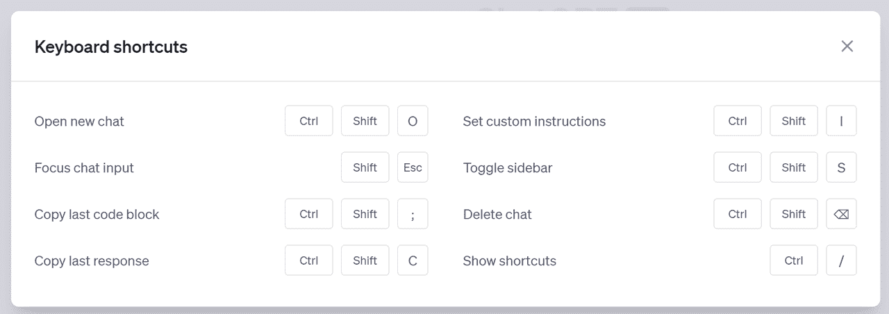

# GPT快捷键

> 来源：[https://xuqiwei1986.feishu.cn/docx/M84odMjUSoF22rxzrJucc9Hxnrg](https://xuqiwei1986.feishu.cn/docx/M84odMjUSoF22rxzrJucc9Hxnrg)

1. `Ctrl+Shift+O` - 打开新对话。

2. `Shift+Esc` - 鼠标光标转到输入框。

3. `Ctrl+Shift+；` - 复制最近一条代码模块。

4. `Ctrl+Shift+C` - 复制最新的回答。

5. `Ctrl+Shift+I` - 设置自定义提示词。 通过这个快捷键，快速进入自定义提示词模块，你可以定制你和AI的对话，引导AI给出你想要的答案。

6. `Ctrl+Shift+S` - 收起/展开侧边栏。 如果你想专注于当前的对话，或者想查看其他选项，这个快捷键会非常有用。

7. `Ctrl+Shift+退格键` - 删除对话。 如果你想删除当前的对话，这个快捷键可以帮助你迅速清理。

8. `Ctrl+/` - 展示快捷键。 如果你忘记了以上的快捷键，只需按这个快捷键，就可以看到所有的快捷键列表。

最后，希望这些快捷键能够帮助你提升使用ChatGPT的效率，让你的聊天体验更加顺畅。

收起

