# 2024-01-08使用微调定制属于自己的大模型 - 掘金

> 来源：[https://xuqiwei1986.feishu.cn/docx/T7xvdfXjyo4P8ExsC3yc4Dbonsf](https://xuqiwei1986.feishu.cn/docx/T7xvdfXjyo4P8ExsC3yc4Dbonsf)

> 🔗 原文链接： h[ttps://juejin.cn/p](https://juejin.cn/post/7321558573518241818)ost/732155857351...

### 背景

**我们日**常所认识的「大模型」都是经过 微调 之后得到的。大模型只是一个「文本续写的模型」。在未经过任何微调或者基于人类反馈的强化学习（RLHF）之前，模型只能实现基本的文本接龙，并没有直接理解用户任何指令或意图的能力。

下面是开源大模型零一万物 Yi-34b 未经过微调之前，模型的输出：

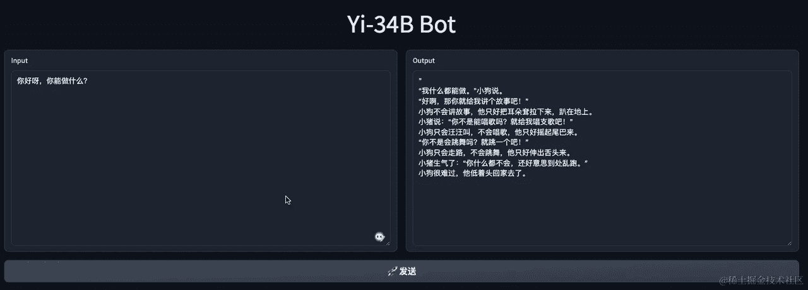

上面的输出其实从语法结构什么来说都是对的，但是它的输出并不是「对话」，而是像继续编写某个文本里的片段。

经过 Chat 数据微调训练之后，模型才学会如何和人类进行正常交流：

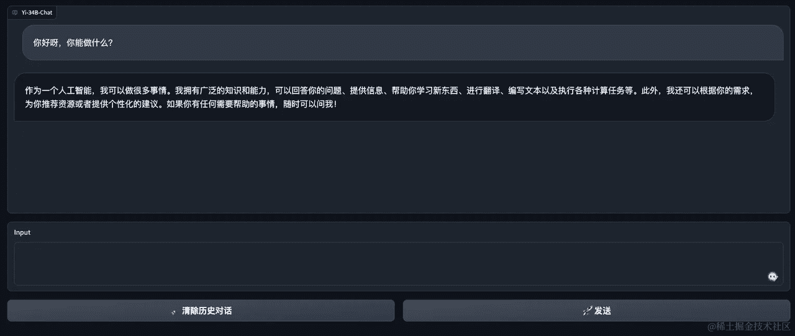

用来微调的 Chat 对话模型使**用的训练数**据为下图所示，由符合预期的「 一问一答 」数据组成：

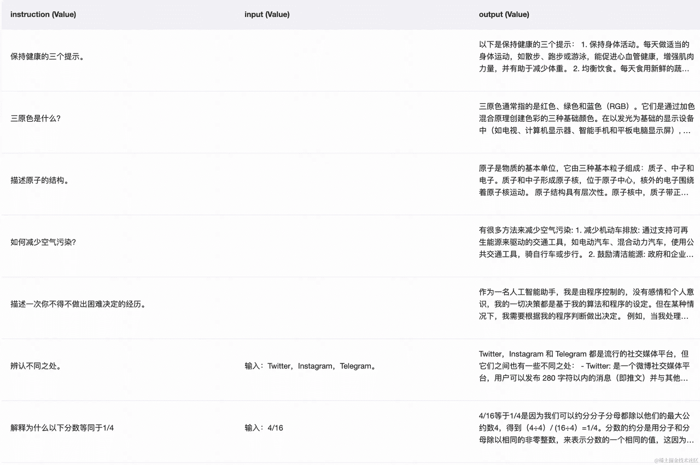

**社区上的**大模型**，无论**是 GPT 还是开源大模型，基本都遵循先进行 预训练 然后 微调 ，得到一个对话或者其他用途的模型。

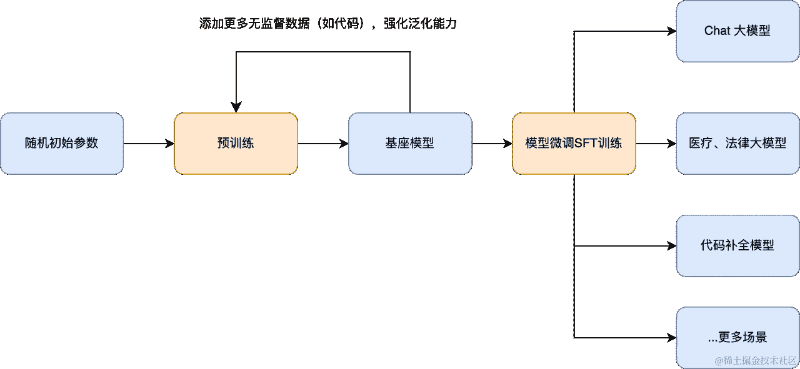

### 什么是预训练？

在预训练阶段，模型通过学习大量的数据来提取特征、理解语义和推理能力，从而对通识知识，代码知识获得一般性认识。质量较高的预训练数据可以增强模型的泛化能力，减少在后续特定任务上的训练调优时间和资源消耗。

+   预训练是一种无监督学习方式，是指使用随机文本片段在大规模数据集上对神经网络模型进行初始训练，以便模型能够学习广泛的特征和知识。

+   预训练使用的训练数据格式，「 **只有输出 **」，没有输入的标签。大模型使用这种大量没有标记的数据来自己学习训练数据中数据的规律（中英文语法，代码语法，通识知识等）

### 预训练适合什么场景？

+   从 0 开始训练一个新的通用大模型。

+   基座大模型 LLaMA2 中文数据非常少，只占 **0.13%，**有必要使用更多比例中文数据 继续预训练 使大模型学会中文表达。

+   基座大模型 LLaMA2 模型代码内容的占比同样也不高（4%），使用预训练添加更多比例的代码数据，强化大模型代码能力（Code LLaMA代码模型）

+   出了一门新的编程语言，为了让模型能够学到最新的编程语言结构，可以考虑预训练。

### 什么是微调？

+   微调使用 「一**问一答」的格式，即有标**注的训练数据 ， 在基于原有模型参数上 ，来让模型更清楚地知道什么样的输入下他应该给予什么样的输出，按照训练数据里的模式进行学习。

大模型先通过预训练学习基础知识，再通过微调让模型学会 基于它通过预训练已经学会的知识 ，学习如何去根据用户指令输出正确适当的内容。

### 我能用微调定制什么？

+   设置风格、语气、格式等定性方面：

+   **场景举例：创建一个语**音对话机器人， 不通过提示词的方式 ，每次让模型输出的内容尽可能精简如50字以内。

+   大模型智能Code Review，通过打标过的优质数据使得大模型 Review 的结果输出更加有效和高质量。

+   提高生成预期输出的可靠性：

+   将天气查询的需求转换为 JSON 请求参数，通过大量示例作为微调训练数据提升输出 JSON 的信息抽取的效果，并降低输出非法 JSON 内容的概率。

+   要求大模型只输出代码块，即使通过提示词告诉模型只能一次性输出代码块且不添加任何解释，但大模型偶尔也会输出解释和多个代码块。此时用一些少量微调数据可以改善这些问题。

+   提升效果

+   使用大模型生成 Pandas 数据分析和可视化代码。大模型本身理解 Pandas 代码的编写，但是编写准确率在一些场景下可能不是特别高，通过一系列经过打标正确的训练数据提升大模型理解用户需求编写 Pandas 代码的效果和正确率。

+   比较复杂的，有大量任务说明的提示词。

+   比如将用户的一段描述转换为一个甚至多个接口请求参数，需要在提示词里添加大量说明文档和样例。

+   减少 Token 占用

+   就像上面的例子，在提示词里添加大量文档说明，使用按 Token 计费的模型如 GPT4 会显得很贵。同时较少的 Token 能获得更快的推理速度。

### 可以使用微调来让大模型新增知识吗？

**不推荐 **，在需要有可信依据的场景上，比如构建智能客服机器人，通常会使用 RAG 的方式配合向量搜索等方式从文档库搜寻与用户询问问题最为相关的内容，并将匹配到的文档段落作为知识内容添加到提示词中，大模型使用提示词中的知识来回答用户的问题。

微调改善的是大模型在某种模式下的表现（如风格，准确度，幻觉问题等）。虽然微调也能一定程度上记忆新增的知识，但由于微调是改变模型的参数结构，使得模型在生成新 token 时输出与训练数据模式更相似的内容。从输出准确度上来说是不如在提示词中添加的知识内容。

### 微调方式

在大模型预训练参数上进行参数微调训练，有三种方式：

+   全参数微调，即完全监督微调，在所有参数层上根据标注数据去调整原始预训练模型中的 QKV 参数层。

+   LoRA，即 LLM 的低秩适配（Low-Rank Adaptation），通过两个较小的矩阵来拟合调整后的参数层，这个过程可以理解为 X + Z = Y ，其中 X 为原始参数，Y 为训练之后的参数，训练过程中就是寻找可以将 X 拟合为 Y 的 Z 矩阵。Z 矩阵由 两个较小的 Wa 矩阵 和 Wb 矩阵组成。

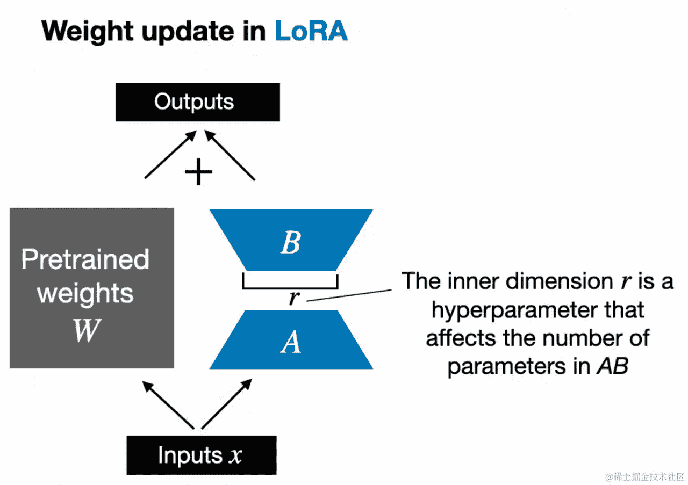

+   QLoRA, 与 LoRA 方式类似，也是训练两个拟合参数层来达到对**原始模型的调整。区别在于为了**节省训练硬件资源， QLoRA 会先将原始模型参数 量化至 4-bit 并冻结 ，然后添加一小组可学习的低秩适配器权重（ Low-rank Adapter weights），这些权重通过量化权重的反向传播梯度进行调优，在量化之后的参数上进行 LoRA 训练，这将大幅下降显存的占用（33b 的模型 以 FP16 全量加载需消耗 80GB 显存，量化至 4 bit之后模型加载仅需要 20 GB 左右显存的占用）

+   除了量化并冻结原始参数，QLoRA 还支持分页优化器：使用NVIDIA统一内存特性，将部分显存溢出的部分 offload 到内存中实现分页，来进一步避免 OOM 的问题。（即下图紫色箭头部分）

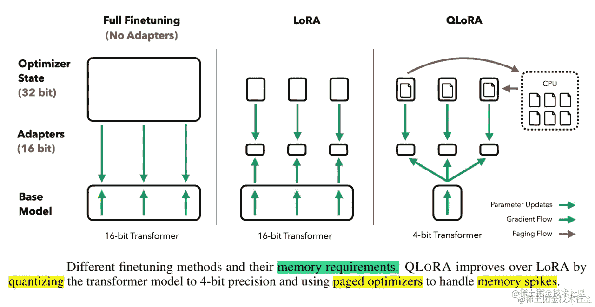

关于全量参数微调 和 LoRA 方式效果的对比，以下以 SQL 生成场景举例，柱状图从深到浅依次是未经过微调训练、LoRA 方式训练和全参数训练后模型生成的准确度：

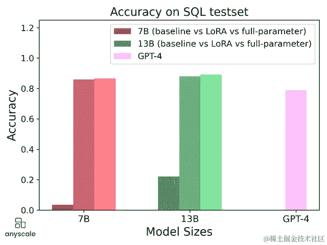

在 SQL 数据集上，根据模型大小和微调方法预测准确率，LoRA微调模型的表现几乎可与全参数微调模型相当。需要注意的是，LoRA 微调的 13B 模型的表现略优于全参数微调的 7B 模型。

关于 QLoRA 训练的效果：

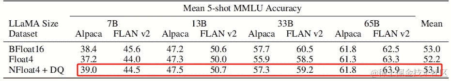

从上图中可以看到，在5-shot MMLU 场景下，QLoRA 效果与常规 LoRA 效果接近，甚至能反超常规 LoRA 微调效果。

关于资源消耗：

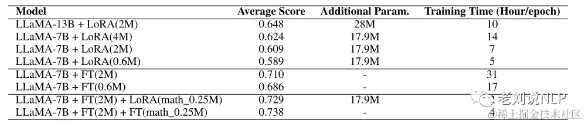

在上表中：

+   LLaMA-13B+LoRA（2M）表示使用 LLaMA-13B作为基本模型和 LoRA 训练方法在 200 万指令数据上训练的模型。

+   可以看到全量参数的训练时间约为 LoRA 方式的 2~3 倍。

+   从效果上来看，LoRA 与全参数微调效果差距在1 ~ 9%左右。但是在特定场景上（math 数据集）仅相差 1% 左右，因此在垂直领域训练上 LoRA 能保持较好的效果，同时显著降低训练时长。

以 6b 参数量的模型分别以不同方式启动训练，显存占用情况：

| 训练方式 | Full 全参数微调 | LoRA | 4bit-QLoRa |
| --- | --- | --- | --- |
| 占用 | 68450 MB | 15226 MB | 8422 MB |

从上表中可以看到：

+   全参数训练显存占用约为 LoRA 的 4.5倍

+   使用 QLoRA 方式显存占用相对于 LoRA 又可以省一倍。

+   6B 参数的微调，一张 24G 显存的显卡运行LoRA微调绰绰有余。

因此，结合训练效果看，LoRA 或者 QLoRA 的高效微调的方式成本较低效果相对也较好，因此以LoRA 的方式来对基座模型进行预训练是最为合适的。

### 微调训练框架的选择

2023 年各家推出的大模型浩如烟海，如 GPT4、Llama、ChatGLM、Baichuan、RWKV、Stable-Diffusion等。每个模型的训练方法可能都有略微区别，且业界提出了众多高效微调的方法， 例如Adapter-Tuning、Prompt-Tuning、LoRA、QLoRA等。不同的基座模型，不同的训练方法需要不同的代码去适配，造成了较高的上手门槛。

ModelScope 魔搭是阿里推出的下一代开源的模型即服务共享平台， 魔搭 ModelScope 开源社区推出了一套完整的轻量级训练和推理工具 SWIFT (Scalable lightWeight Infrastructure for Fine-Tuning)，通过框架代码、 CLI 的封装，可以使得普通开发者以几行代码就能启动模型训练、推理。


[ModelScope 魔搭社区](https://link.juejin.cn/?target=https%3A%2F%2Fmodelscope.cn%2Fhome)

SWIFT 启动训练代码，主要需要指定以下内容:

+   基座模型id，用什么基座模型，使用多大参数的模型进行训练

+   训练数据集

+   训练评估数据集

+   输入，输出长度

详细环境搭建，使用方法可参考: github.com/modelscope/…

本地微调开源大模型推荐有一张 24G 显存的显卡。如果没有的话，那么试试 GPT 官方的微调接口吧： platform.openai.com/docs/guides…

其他的还有可以调整的参数如训练模式，训练几个 epoch，checkpoint 记录步长，lora rank 等，不清楚的话可以先使用默认参数。

CLI 启动训练示例代码，最主要的部分就是设置custom_train_dataset_path和custom_val_dataset_path配置训练数据:

```
PYTHONPATH=../../.. \
CUDA_VISIBLE_DEVICES=0 \
python llm_sft.py \
    --model_id_or_path 01ai/Yi-6B \
    --model_revision master \
    --sft_type lora \
    --tuner_backend swift \
    --template_type default-generation \
    --dtype fp16 \
    --output_dir output \
    --train_dataset_sample -1 \
    --num_train_epochs 5 \
    --max_length 2048 \
    --max_new_tokens 2048 \
    --check_dataset_strategy warning \
    --lora_rank 8 \
    --lora_alpha 32 \
    --lora_dropout_p 0.05 \
    --lora_target_modules ALL \
    --gradient_checkpointing true \
    --batch_size 1 \
    --weight_decay 0.01 \
    --learning_rate 1e-4 \
    --gradient_accumulation_steps 16 \
    --max_grad_norm 0.5 \
    --warmup_ratio 0.03 \
    --eval_steps 100 \
    --save_steps 100 \
    --save_total_limit 2 \
    --logging_steps 10 \
    --quantization_bit 4 \
    --bnb_4bit_comp_dtype fp16 \
    --custom_train_dataset_path /root/train.jsonl \
    --custom_val_dataset_path /root/train_eval.jsonl
```

以下是魔搭有标注的训练数据格式，使用 query 和 response 两部分组成：

```
{&quot;query&quot;: &quot;11111&quot;, &quot;response&quot;: &quot;22222&quot;}
{&quot;query&quot;: &quot;aaaaa&quot;, &quot;response&quot;: &quot;bbbbb&quot;}
{&quot;query&quot;: &quot;AAAAA&quot;, &quot;response&quot;: &quot;BBBBB&quot;}
```

### 数据可视化场景的微调

数据分析中可视化是一个非常常见的场景。在各类可视化系统中，非常常见的逻辑就是先将数据源分类为一系列指标（或者叫度量）或者维度（类别）。通过指标和维度之间的组合加上适当的可视化类型，如折线图，柱图，饼图等，来生成可视化图表。

以 QuickBI 举例，如果需求为「展示每个产品类型的单价和利润情况」，那么需要从已知的维度列表中选择product_type，度量选择「利润金额」和「单价」，最后再选择柱图或者线图进行可视化。对于不那么熟悉指标维度概念的非专业数据分析人员，或者移动端场景来说，快速选择合适的指标和维度操作不是那么容易。

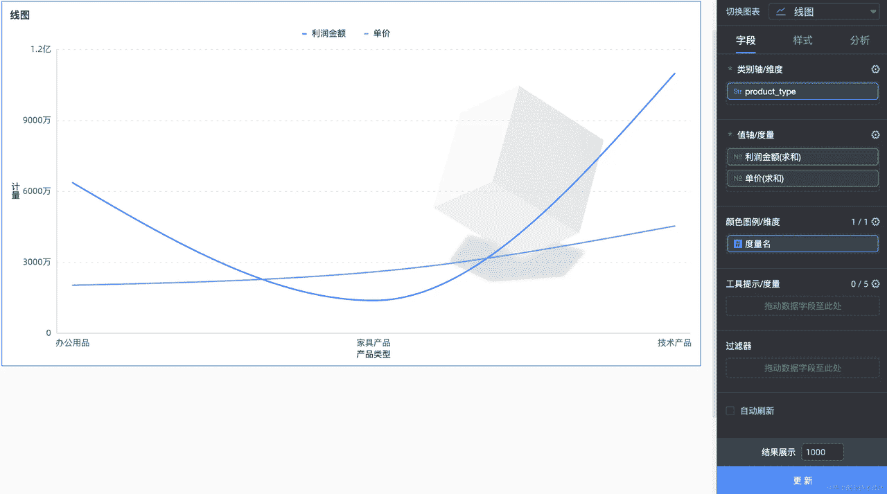

而利用 ChatGPT 或同类大语言模型，可以实现理解用户数据分析的意图并结合已知的指标维度列表，抽取其中的指标维度信息，并将抽取生成的配置映射为真实的可视化展示，通过自然语言的方式大大降低了用户操作的门槛。


**设计以下的提示词：**

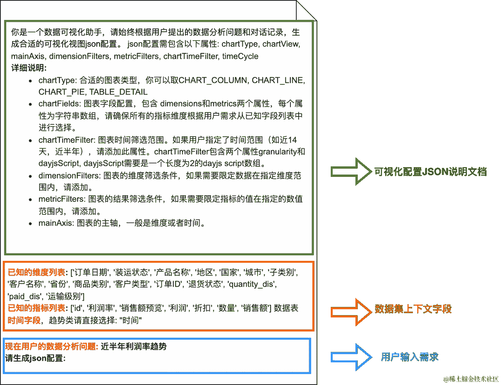

上面提示词中，绿色部分为固定说明，橙色部分为根据已知可使用的可视化字段列表动态进行替换的地方，而蓝色部分则替换为为用户实际的输入问题。

来测试一下，将以上提示词直接带入某开源大模型，得到以下输出：

```
{
  &quot;chartType&quot;: &quot;CHART_LINE&quot;,
  &quot;chartFields&quot;: {
    &quot;dimensions&quot;: [&quot;时间&quot;],
    &quot;metrics&quot;: [&quot;利润率&quot;]
  },
  &quot;chartTimeFilter&quot;: {
    &quot;granularity&quot;: &quot;day&quot;,
    &quot;dayjsScript&quot;: [&quot;subtract&quot;, 6, &quot;months&quot;]
  },
  &quot;dimensionFilters&quot;: [
    {
      &quot;field&quot;: &quot;时间&quot;,
      &quot;values&quot;: [
        &quot;2022-01-01&quot;,
        &quot;2022-01-02&quot;,
        &quot;2022-01-03&quot;,
        ...
      ]
    }
  ],
  &quot;metricFilters&quot;: [],
  &quot;mainAxis&quot;: &quot;时间&quot;
}
```

提取字段基本没问题，但是有一些问题，首先我们要求将时间范围输出 dayjsScript 来通过 JS 运行解析获取准确的近半年时间，但是这里没有这么生成。其次 dimensionFilters 这里错误地列出所有近半年具体日期，且今年也不是2022年。上面这些错误的输出其实就是典型的模型幻觉问题。

这样的效果肯定是没有办法接入到我们的应用流程中的。要**优化大**模型输出，我们只需要给大模型一个 例子 即可：

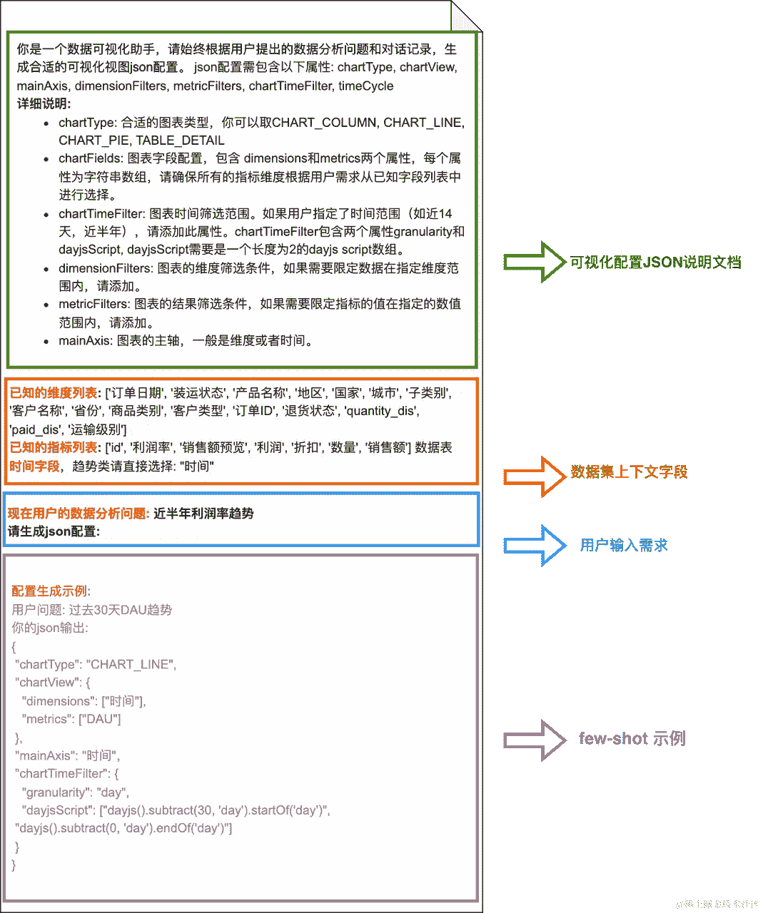

上面紫色框添加了一个示例，这样大模型可以基于已有描述和输出范例，更好地输出正确的内容。添加了示例之后的输出：

```
{
  &quot;chartType&quot;: &quot;CHART_LINE&quot;,
  &quot;chartView&quot;: {
    &quot;dimensions&quot;: [
      {
        &quot;name&quot;: &quot;时间&quot;
      }
    ],
    &quot;metrics&quot;: [
      {
        &quot;name&quot;: &quot;利润率&quot;
      }
    ]
  },
  &quot;mainAxis&quot;: &quot;时间&quot;,
  &quot;chartTimeFilter&quot;: {
    &quot;granularity&quot;: &quot;month&quot;,
    &quot;dayjsScript&quot;: [&quot;dayjs().subtract(6, &#x27;month&#x27;).startOf(&#x27;month&#x27;)&quot;, &quot;dayjs().subtract(0, &#x27;month&#x27;).endOf(&#x27;month&#x27;)&quot;]
  }
}
```

添加了示例后，可以看到大模型正确解析了近半年的时间范围对应的 Dayjs 代码： ["dayjs().subtract(6, 'month').startOf('month')", "dayjs().subtract(0, 'month').endOf('month')"] ，且没有输出多余的 dimensionFilters 属性。

#### 添加示例的限制

添加示例的确可以快速大幅提升模型的输出效果， 但是示例本身也是会占用 prompt 窗口长度的 ，越长的 prompt 调用成本越高，同时也会挤占后续多轮对话提示词的空间。

且示例的方式可能无法覆盖所有的边缘case。在实际测试过程中发现，会有一些情况比如时不时自己添加了大于 0 的指标筛选，模型根据自身理解添加了不在用户描述范围内的维度值，取了不在说明里的枚举值等等。虽然可以添加示例的方式来解决，但显然无法添加太多的示例，会大幅提高调用成本且会降低推理速度。

#### 使用微调解决

微调实际上有点类似于添加大量的「示例」数据，不通过提示词的方式直接训练模型调整其原本的参数，来更好地适应我们的任务。 这里所说的「示例」数据，其实就是大量有标注的数据，一个问题输入和问题输入对应的正确的输出，让模型自己学习什么样的输入应该有什么样的输出。

#### 训练数据怎么来？

**以下介绍两种方法 **：

+   从已有系统里尝试捞取含有图表描述和具体图表配置的图表，最后清洗整理得到训练数据。

+   给 GPT4或者其他效果较优的模型不**同场景和cas**e下的正确范例，让大模型 继续扩写示例 。

扩写示例的方式，其实就是使用「种子任务」构造指令池的过程：

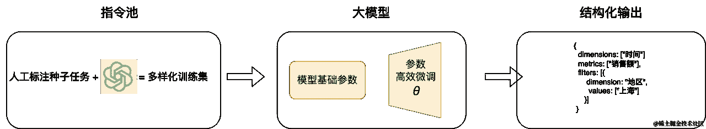

下面是生成可视化配置转 JSON 的具体提示词示例，将以下这段 prompt 输入给 GPT4 ，GPT4 就能按照示例的编写模式源源不断地生成更多的标注数据。

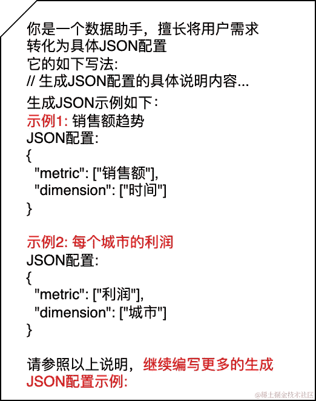

通过以上方式，生成了 600 多条训练数据，下面摘取三条进行展示：

```
{&quot;query&quot;:&quot;你是一个数据可视化助手，以下是一些数据可视化配置的说明，请根据用户需求将需求转换为对应的json配置。\njson配置可以选择以下属性:\nchartType, chartFields, mainAxis, sort, topN, dimensionFilters, metricFilters, chartTimeFilter\n\n详细说明: \n- chartType: 合适的图表类型，你可以取CHART_COLUMN, CHART_LINE, CHART_PIE, TABLE_DETAIL\n- chartFields: 图表视图配置，包含dimensions和metrics两个属性，每个属性都是字符串数组。\n- chartTimeFilter: 图表时间筛选范围。如果用户指定了时间范围（如近14天，近半年），请添加此属性。\n- dimensionFilters: 图表的维度筛选条件，只有当用户要求筛选维度值时才添加。\n- metricFilters: 图表的结果筛选条件，只有当用户明确要求查询的指标在指定的数值范围内才添加。\n- mainAxis: 图表的主轴，一般是维度或者时间。\n- sort属性: 图表的排序配置，只有当用户要求排序时才添加此属性。\n- topN属性: 图表的topN配置，只有当用户的需求是topN如前十，最大最小时才添加此属性。如果用户要求看最大最小值那么请使用sort属性。\n\n注意: \n- dimensionFilters需包含dimension, filter属性，condition属性只能取以下操作符类型: [\&quot;in\&quot;, \&quot;not-in\&quot;, &#x27;like&#x27;, &#x27;not-like&#x27;]。in和not-in表示\&quot;包含\&quot;和\&quot;不包含\&quot;, like和not-like表示\&quot;匹配\&quot;和\&quot;不匹配\&quot;\n- metricFilters需包含metric, filter属性，condition只能取以下操作符类型: [\&quot;greater\&quot;, \&quot;less\&quot;, \&quot;interval\&quot;]。value属性为一个数字，如果是区间需要用英文逗号隔开。\n- sort属性需包含以下属性: metric, sort, 其中sort只能为\&quot;ASC\&quot;或者\&quot;DESC\&quot;。\n- topN需包含以下属性: metric, sort, number。其中sort只能为\&quot;ASC\&quot;或者\&quot;DESC\&quot;，number为数字，metric为目标指标名称。\n- chartTimeFilter需包含以下属性: granularity, dayjsScript。其中granularity只能为\&quot;day\&quot;, \&quot;week\&quot;, \&quot;month\&quot;, \&quot;quarter\&quot;, \&quot;year\&quot;，dayjsScript为一个数组，数组中的每个元素都是一个dayjs脚本，用于计算时间范围。\n\n已知的维度列表:\n[\&quot;订单日期\&quot;, \&quot;地区\&quot;, \&quot;销售员\&quot;, \&quot;客户群\&quot;, \&quot;产品类别\&quot;]\n\n已知的指标列表: \n[\&quot;销售额\&quot;, \&quot;退货率\&quot;, \&quot;数量\&quot;, \&quot;利润率\&quot;, \&quot;客户满意度\&quot;]\n\n已知的时间字段: \&quot;订单日期\&quot;\n\n若是趋势图请使用时间字段作为主轴，并且图表类型设置为线图。\n\n现在用户需求: 今年第二季度各销售员在北方地区的销售额与退货率。\n\n请根据用户需求生成对应的可视化json配置: &quot;,&quot;response&quot;:&quot;```json\n{\n  \&quot;chartType\&quot;: \&quot;TABLE_DETAIL\&quot;,\n  \&quot;chartFields\&quot;: {\n    \&quot;dimensions\&quot;: [\n      \&quot;销售员\&quot;\n    ],\n    \&quot;metrics\&quot;: [\n      \&quot;销售额\&quot;,\n      \&quot;退货率\&quot;\n    ]\n  },\n  \&quot;mainAxis\&quot;: \&quot;销售员\&quot;,\n  \&quot;dimensionFilters\&quot;: [\n    {\n      \&quot;dimension\&quot;: \&quot;地区\&quot;,\n      \&quot;filter\&quot;: {\n        \&quot;condition\&quot;: \&quot;in\&quot;,\n        \&quot;value\&quot;: [\&quot;北方\&quot;]\n      }\n    }\n  ],\n  \&quot;chartTimeFilter\&quot;: {\n    \&quot;granularity\&quot;: \&quot;quarter\&quot;,\n    \&quot;dayjsScript\&quot;: [\&quot;dayjs().quarter(2).startOf(&#x27;quarter&#x27;)\&quot;, \&quot;dayjs().quarter(2).endOf(&#x27;quarter&#x27;)\&quot;]\n  }\n}\n\n```&quot;}
{&quot;query&quot;:&quot;你是一个数据可视化助手，以下是一些数据可视化配置的说明，请根据用户需求将需求转换为对应的json配置。\njson配置可以选择以下属性:\nchartType, chartFields, mainAxis, sort, topN, dimensionFilters, metricFilters, chartTimeFilter\n\n详细说明: \n- chartType: 合适的图表类型，你可以取CHART_COLUMN, CHART_LINE, CHART_PIE, TABLE_DETAIL\n- chartFields: 图表视图配置，包含dimensions和metrics两个属性，每个属性都是字符串数组。\n- chartTimeFilter: 图表时间筛选范围。如果用户指定了时间范围（如近14天，近半年），请添加此属性。\n- dimensionFilters: 图表的维度筛选条件，只有当用户要求筛选维度值时才添加。\n- metricFilters: 图表的结果筛选条件，只有当用户明确要求查询的指标在指定的数值范围内才添加。\n- mainAxis: 图表的主轴，一般是维度或者时间。\n- sort属性: 图表的排序配置，只有当用户要求排序时才添加此属性。\n- topN属性: 图表的topN配置，只有当用户的需求是topN如前十，最大最小时才添加此属性。如果用户要求看最大最小值那么请使用sort属性。\n\n注意: \n- dimensionFilters需包含dimension, filter属性，condition属性只能取以下操作符类型: [\&quot;in\&quot;, \&quot;not-in\&quot;, &#x27;like&#x27;, &#x27;not-like&#x27;]。in和not-in表示\&quot;包含\&quot;和\&quot;不包含\&quot;, like和not-like表示\&quot;匹配\&quot;和\&quot;不匹配\&quot;\n- metricFilters需包含metric, filter属性，condition只能取以下操作符类型: [\&quot;greater\&quot;, \&quot;less\&quot;, \&quot;interval\&quot;]。value属性为一个数字，如果是区间需要用英文逗号隔开。\n- sort属性需包含以下属性: metric, sort, 其中sort只能为\&quot;ASC\&quot;或者\&quot;DESC\&quot;。\n- topN需包含以下属性: metric, sort, number。其中sort只能为\&quot;ASC\&quot;或者\&quot;DESC\&quot;，number为数字，metric为目标指标名称。\n- chartTimeFilter需包含以下属性: granularity, dayjsScript。其中granularity只能为\&quot;day\&quot;, \&quot;week\&quot;, \&quot;month\&quot;, \&quot;quarter\&quot;, \&quot;year\&quot;，dayjsScript为一个数组，数组中的每个元素都是一个dayjs脚本，用于计算时间范围。\n\n已知的维度列表:\n[\&quot;订单日期\&quot;, \&quot;产品名称\&quot;, \&quot;客户群\&quot;, \&quot;销售员\&quot;, \&quot;省份\&quot;]\n\n已知的指标列表: \n[\&quot;销售额\&quot;, \&quot;数量\&quot;, \&quot;折扣率\&quot;, \&quot;退货率\&quot;, \&quot;利润率\&quot;]\n\n已知的时间字段: \&quot;订单日期\&quot;\n\n若是趋势图请使用时间字段作为主轴，并且图表类型设置为线图。\n\n现在用户需求: 上个月销售员中数量和折扣率双双居于前5的排名。\n\n请根据用户需求生成对应的可视化json配置: &quot;,&quot;response&quot;:&quot;```json\n{\n  \&quot;chartType\&quot;: \&quot;CHART_LINE\&quot;,\n  \&quot;chartFields\&quot;: {\n    \&quot;dimensions\&quot;: [\n      \&quot;销售员\&quot;\n    ],\n    \&quot;metrics\&quot;: [\n      \&quot;数量\&quot;,\n      \&quot;折扣率\&quot;\n    ]\n  },\n  \&quot;mainAxis\&quot;: \&quot;销售员\&quot;,\n  \&quot;sort\&quot;: {\n    \&quot;metric\&quot;: \&quot;数量\&quot;,\n    \&quot;sort\&quot;: \&quot;DESC\&quot;\n  },\n  \&quot;topN\&quot;: {\n    \&quot;metric\&quot;: \&quot;数量\&quot;,\n    \&quot;number\&quot;: 5,\n    \&quot;sort\&quot;: \&quot;DESC\&quot;\n  },\n  \&quot;chartTimeFilter\&quot;: {\n    \&quot;granularity\&quot;: \&quot;month\&quot;,\n    \&quot;dayjsScript\&quot;: [\&quot;dayjs().subtract(1, &#x27;month&#x27;).startOf(&#x27;month&#x27;)\&quot;, \&quot;dayjs().subtract(1, &#x27;month&#x27;).endOf(&#x27;month&#x27;)\&quot;]\n  }\n}\n\n```&quot;}
{&quot;query&quot;:&quot;你是一个数据可视化助手，以下是一些数据可视化配置的说明，请根据用户需求将需求转换为对应的json配置。\njson配置可以选择以下属性:\nchartType, chartFields, mainAxis, sort, topN, dimensionFilters, metricFilters, chartTimeFilter\n\n详细说明: \n- chartType: 合适的图表类型，你可以取CHART_COLUMN, CHART_LINE, CHART_PIE, TABLE_DETAIL\n- chartFields: 图表视图配置，包含dimensions和metrics两个属性，每个属性都是字符串数组。\n- chartTimeFilter: 图表时间筛选范围。如果用户指定了时间范围（如近14天，近半年），请添加此属性。\n- dimensionFilters: 图表的维度筛选条件，只有当用户要求筛选维度值时才添加。\n- metricFilters: 图表的结果筛选条件，只有当用户明确要求查询的指标在指定的数值范围内才添加。\n- mainAxis: 图表的主轴，一般是维度或者时间。\n- sort属性: 图表的排序配置，只有当用户要求排序时才添加此属性。\n- topN属性: 图表的topN配置，只有当用户的需求是topN如前十，最大最小时才添加此属性。如果用户要求看最大最小值那么请使用sort属性。\n\n注意: \n- dimensionFilters需包含dimension, filter属性，condition属性只能取以下操作符类型: [\&quot;in\&quot;, \&quot;not-in\&quot;, &#x27;like&#x27;, &#x27;not-like&#x27;]。in和not-in表示\&quot;包含\&quot;和\&quot;不包含\&quot;, like和not-like表示\&quot;匹配\&quot;和\&quot;不匹配\&quot;\n- metricFilters需包含metric, filter属性，condition只能取以下操作符类型: [\&quot;greater\&quot;, \&quot;less\&quot;, \&quot;interval\&quot;]。value属性为一个数字，如果是区间需要用英文逗号隔开。\n- sort属性需包含以下属性: metric, sort, 其中sort只能为\&quot;ASC\&quot;或者\&quot;DESC\&quot;。\n- topN需包含以下属性: metric, sort, number。其中sort只能为\&quot;ASC\&quot;或者\&quot;DESC\&quot;，number为数字，metric为目标指标名称。\n- chartTimeFilter需包含以下属性: granularity, dayjsScript。其中granularity只能为\&quot;day\&quot;, \&quot;week\&quot;, \&quot;month\&quot;, \&quot;quarter\&quot;, \&quot;year\&quot;，dayjsScript为一个数组，数组中的每个元素都是一个dayjs脚本，用于计算时间范围。\n\n已知的维度列表:\n[\&quot;订单日期\&quot;, \&quot;客户群\&quot;, \&quot;产品名称\&quot;, \&quot;省份\&quot;, \&quot;地区\&quot;]\n\n已知的指标列表: \n[\&quot;客户满意度\&quot;, \&quot;数量\&quot;, \&quot;销售额\&quot;, \&quot;利润率\&quot;, \&quot;退货率\&quot;]\n\n已知的时间字段: \&quot;订单日期\&quot;\n\n若是趋势图请使用时间字段作为主轴，并且图表类型设置为线图。\n\n现在用户需求: 本周每天的客户满意度变化趋势。\n\n请根据用户需求生成对应的可视化json配置: &quot;,&quot;response&quot;:&quot;```json\n{\n  \&quot;chartType\&quot;: \&quot;CHART_LINE\&quot;,\n  \&quot;chartFields\&quot;: {\n    \&quot;dimensions\&quot;: [\n      \&quot;订单日期\&quot;\n    ],\n    \&quot;metrics\&quot;: [\n      \&quot;客户满意度\&quot;\n    ]\n  },\n  \&quot;mainAxis\&quot;: \&quot;订单日期\&quot;,\n  \&quot;chartTimeFilter\&quot;: {\n    \&quot;granularity\&quot;: \&quot;day\&quot;,\n    \&quot;dayjsScript\&quot;: [\&quot;dayjs().startOf(&#x27;week&#x27;)\&quot;, \&quot;dayjs().endOf(&#x27;week&#x27;)\&quot;]\n  }\n}\n\n```&quot;}
```

#### 实际效果

使用上面 GPT 和种子任务的方式，生成了600多条训练数据，并在零一万物 Yi-6B 的模型上进行训练后，在一些基准case上评估结果如下，接近 GPT4 使用 few-shot 添加示例的方式：

| 模型 | 正确率 |
| --- | --- |
| Yi-6b-sft | 90% |
| GPT-4-few-shot | 96% |
| GPT-3.5-few-shot | 79% |

### 总结

+   只经过预训练的大模型只是一个单纯的「文本续写」模型， 通过微调训练可以让大模型更好地执行与训练数据模式类似的任务。

+   使用「示例」的方式在提示词中添加有标注数据也能改善模型效果，但是会存在 token 占用多，响应速度变慢的问题。

+   使用 LoRA 高效微调的方式可以有效降低模型训练使用硬件资源。

+   通过「种子任务」的方式让 GPT4 或其他模型编写和提示词类似的数据可以更加高效地生成训练数据。

### 参考资料

+   www.anyscale.com/blog/fine-t…

+   arxiv.org/pdf/2305.14…

+   www.yichen.ink/post/2023/0…