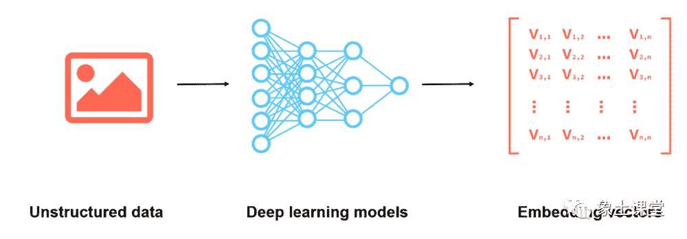
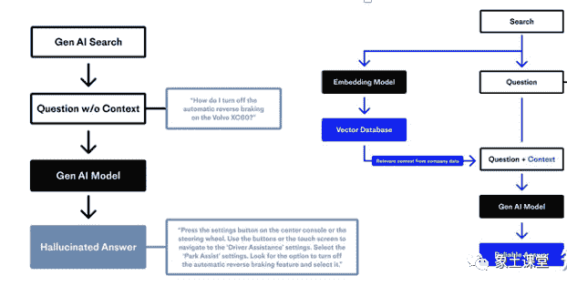
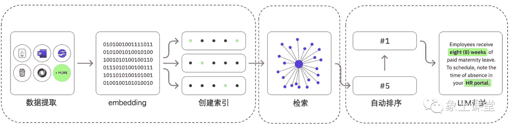
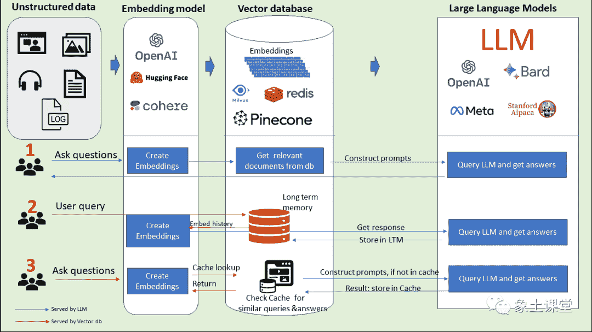
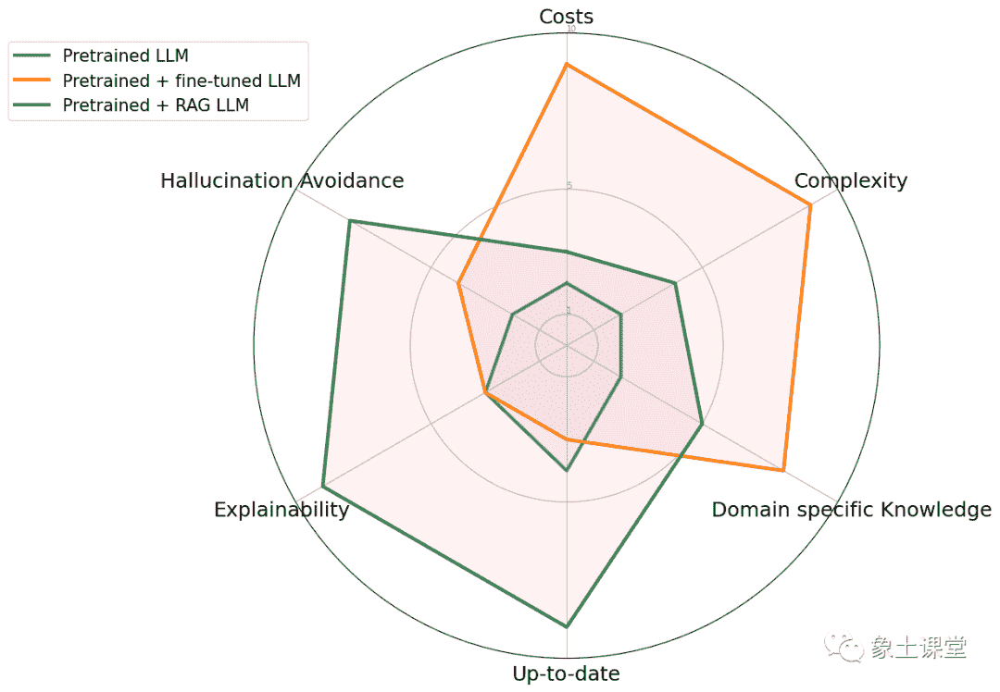

# 2023-12-20大模型行业问答知识总结：数据向量化、RAG、langchain、Agent技术

> 来源：[https://xuqiwei1986.feishu.cn/docx/Ee3gda3U1oFK6ZxFe12c1VR5ndd](https://xuqiwei1986.feishu.cn/docx/Ee3gda3U1oFK6ZxFe12c1VR5ndd)

> 🔗 原文链接： h[ttps://mp.weixin.q](https://mp.weixin.qq.com/s/PnHO0cwDQfitbF4oF_2YhQ)q.com/s/PnHO0cwD...

象土课堂 老刘说NLP 2023-12-20 11:40 发表于 北京

手机阅读

在大模型的工程实践中，我们会发现它有一些局限性，这对我们的落地产生了很大的挑战。今天我们来探讨一下这些局限性以及相应解决方案。

## 一、大模型的局限性

**幻觉问题 **：LLM 文本生成的底层原理是基于概率的 token by token 的形式，因此会不可避免地产生“一本正经的胡说八道”的情况。

**知识盲点于实时性： **大模型通过预训练获得通用语言能力，但不具备专业领域的知识。对某些专业问题无法做出准确回答。有些知识不停的有更新，大模型需要在训练和微调时才能灌入新知识。

**记忆力有限： **大语言模型参数量虽然很大，但仍然无法记住大量具体的事实知识。容易在需要记忆的任务上表现不佳。

**时效性问题 **：大语言模型的规模越大，大模型训练的成本越高，周期也就越长。那么具有时效性的数据也就无法参与训练，所以也就无法直接回答时效性相关的问题，例如“帮我推荐几部热映的电影？”。

**数据安全问题 **：通用大语言模型没有企业内部数据和用户数据，那么企业想要在保证安全的前提下使用大语言模型，最好的方式就是把数据全部放在本地，企业数据的业务计算全部在本地完成。而在线的大模型仅仅完成一个归纳的功能。

**没有外部世界感知： **大语言模型无法感知外部世界，缺少视觉、听觉输入。对涉及感知的问题无法直接建模。

**无用户建模： **大语言模型没有建模特定用户的能力，对不同用户给出同样的反应和回复，无法进行个性化的对话。

我们今天会基于上面的LLM的局限性，探讨向量化和RAG的一套解决方案的理论供大家学习和参考。好了，我们先来聊聊数据向量化的问题。

## 二、数据向量化

文本、图像和音频等非结构化数据缺乏预定义格式，这给传统数据库带来了挑战。为了在人工智能和机器**学习应用中利用这些数据，需要**使用嵌入将其转换为数字表示。我们先来探讨一个概念： 什么是 Embedding？

为了储存非结构化数据，我们需要对其进行编码为向量表示，但原始的向量通常高度稀疏，这对计算机的计算和处理不利，Embedding 的主要作用是就将高维的稀疏向量转化为稠密向量以方便对模型进一步处理。具体而言，假设我们将如下字典通过 One-hot 编码。 那么我们就可以用矩阵来表示“乐土科技”这个短语：

[000001]

[000010]

[000100 ]

[001000 ]

向量化可以基于传统的NLP的方法有： Word2vec： GloVe（Global Vectors for Word Representation）、FastText。 但今天我们来介绍一种新的方式通过大模型（Embedding model）来完成数据向量化。

## 三、RAG（检索增强生成）技术

传统的方式是问题通过解析后形成问题正文然后传导给大模型，大模型完成回答。RAG又称为“检索增强生成”。搜索内容通过Embeding Model向量化，然后存储到向量化数据库，然后将形成问题的正文给到LLM。LLM返回应答结果。工作原理如下图：

下面详细介绍几种RAG的调用模式：

**模式一： **非结构化数据通过Embedding Model把非结构化数据进行embedding存到向量数据库中，然后形成Construct Prompts给到LLM。LLM返回结果给到用户。

**模式二： **用户提出问题，下一步把问题通过Embedding Model向量化，然后保存到长时记忆数据库（向量数据库）中，然后调用LLM完成问题的回答，接下来将大模型的回答存到长时记忆数据库中，最后返回给用户。

**模式三： **用户问问题，下一步把问题通过Embedding Model向量化，然后从Cache中（向量数据库）查询类似的问题和答案，返回给用户。如果没有命中，则去和LLM交互。然后把LLM的回答存到Cache中，最后把回答返回给用户。

这三种形式就是典型的RAG的调用模式。它可以解决不同类型的数据如何让大模型知道的问题，同时在性能和效率上得到了提高，解决了长时记忆的问题，幻觉问题也有很大改善。

## 四、RAG-优势、劣势和替代方案

|  | RAG | SFT |
| --- | --- | --- |
| Data | 动态数据。RAG 不断查询外部源，确保信息保持最新，而无需频繁的模型重新训练。 | (相对)静态数据，并且在动态数据场景中可能很快就会过时。SFT 也不能保证记住这些知识。 |
| External Knowledge | RAG 擅长利用外部资源。通过在生成响应之前从知识源检索相关信息来增强 LLM 能力。它非常适合文档或其他结构化/非结构化数据库。 | SFT 可以对 LLM 进行微调以对齐预训练学到的外部知识，但对于频繁更改的数据源来说可能不太实用。 |
| Model Customization | RAG 主要关注信息检索，擅长整合外部知识，但可能无法完全定制模型的行为或写作风格。 | SFT 允许根据特定的语气或术语调整LLM 的行为、写作风格或特定领域的知识。 |
| Reducing Hallucinations | RAG 本质上不太容易产生幻觉，因为每个回答都建立在检索到的证据上。 | SFT 可以通过将模型基于特定领域的训练数据来帮助减少幻觉。但当面对不熟悉的输入时，它仍然可能产生幻觉。 |
| Transparency | RAG 系统通过将响应生成分解为不同的阶段来提供透明度，提供对数据检索的匹配度以提高对输出的信任。 | SFT 就像一个黑匣子，使得响应背后的推理更加不透明。 |
| Technical Expertise | RAG 需要高效的检索策略和大型数据库相关技术。另外还需要保持外部数据源集成以及数据更新。 | SFT 需要准备和整理高质量的训练数据集、定义微调目标以及相应的计算资源。 |

与预训练或微调基础模型等传统方法相比，RAG 提供了一种经济高效的替代方法。RAG 从根本上增强了大语言模型在响应特定提示时直接访问特定数据的能力。为了说明 RAG 与其他方法的区别，请看下图。雷达图具体比较了三种不同的方法：预训练大语言模型、预训练 + 微调 LLM 、预训练 + RAG LLM。

今天我们分享了数据向量化和RAG技术，这些内容可以帮你在遇到大模型的幻觉、记忆问题、时效问题等问题上得到参考。但我们也知道这还远远不够，真正落地才是大家最关注的。所以我们也为大家精心准备了langchain、向量数据库、Agent、MemGPT Autogen self rag的实践课程内容。课程会带领大家一步步完成代码级的实践。最终带领大家做一个落地的SalesGPT项目，帮助大家快速掌握向量化、RAG、Agent技术,将它们应用到你们的实践工作中去。

《向量化、RAG、Agent技术课程》

超越大语言模型的局限,开发智能外部大脑

### 课程亮点

l 学习如何让大模型 拥有专业知识和记忆能力 ；

l 学习通过向量化 连接外部知识；

l 掌握检索增强生成RAG技术；

l 掌握langchain、 MemGPT、Autogen 工具的使用方法；

l 掌握Agent技术；

l 学习构建prompt、设计复杂流程、链接矢量数据库；

l 实现SalesGPT这样的专业商务助手 。

### 课程形式

录播课学习，共计5.3课时。

### 课程目录

第1节 大模型的局限性

第2节 数据的处理和利用

第3节 向量化基本概念

第4节 文本向量化

第5节 使用语言模型向量化

第6节 RAG检索增强生成

第7节 RAG工作原理

第8节 RAG优势劣势和替代方案

第9节 LangChain-架构

第10节 LangChain-核心组件

第11节 langchain[加载器、文档、文本分割、向量化数据库]

第12节 自定义prompt

第13节 langchain使用本地向量化模型

第14节 LangChain-百川大模型-本地向量化

第15节 langchain-agent

第16节 LangChain-实现SalesGPT架构

第17节 LangChain-实现SalesGPT代码讲解

第18节 LangChain-SalesGPT示例运行讲解

第19节 Autogen是什么

第20节 Autogen运行讲解

第21节 MemGPT

第22节 Autogen+MemGPT介绍

第23节 Autogen+MemGPT运行讲解

第24节 RAG的挑战

第25节 多向量搜索器

第26节 向量化模型的再训练

第27节 Self-RAG介绍

第28节 Self-RAG代码运行讲解

感兴趣的朋友请加老师🛰️咨询。

