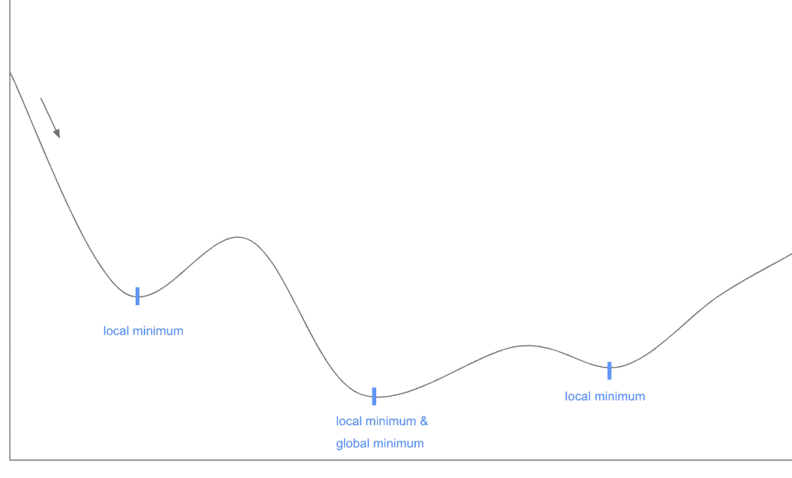

# 2023-11-20训练一个大型语言模型需要多少钱？-今日头条

> 来源：[https://xuqiwei1986.feishu.cn/docx/STG9dHRQpou6ETxozpQcjAzMnQh](https://xuqiwei1986.feishu.cn/docx/STG9dHRQpou6ETxozpQcjAzMnQh)

> 🔗 原文链接： h[ttps://www.toutiao](https://www.toutiao.com/article/7303378120143651338/?log_from=eebef78ef956f_1703127295987).com/article/730...

# 训练一个大型语言模型需要多少钱？

作者 | Harper Carroll 译者 | 明明如月

责编 | 夏萌

出品 | CSDN（ID：CSDNnews）

机器学习正在深刻影响各个领域。然而，关于训练大型语言模型（LLM）的具体成本，目前似乎尚无明确答案。OpenAI 在 2023 年的开发者日中宣布，构建一款模型的起始费用高达 200 万至 300 万美元。

鉴于这一昂贵的成本，业界普遍在探讨这样的投入是否必要。要准确回答训练 LLM 的成本问题并非易事，尽管没有直接且简易的计算方法，但我们知道成本主要取决于 计算需求 和 训练时间 两大因素。

为了便于理解训练 LLM 成本的估算过程，我编制了一份结构化的概览，其中详细介绍了影响模型训练时间和计算需求的各种因素。

请注意，本文没有将下面的成本计算在内：

+   开发和运营成本（包括工程师薪资、调试、集成开发环境、版本控制系统、监测模型性能的工具、基础设施设置，例如尝试使用 Brev 等）

+   运用更优化的机器学习库/接口以降低成本

+   代码许可与法律考量

+   数据隐私、安全及监管合规性

+   模型偏见与公平性评估/道德审核

+   对抗性训练（用于防止对抗性攻击）和其他安全措施

+   在生产环境中的部署

在确定计算需求和训练时间时，我们需考虑 模型架构 、 训练动态 和 优化训练性能的方 法 这三个关键变量。

首先，我们应当了解这些模型所依赖的硬件，以便理解这些变量如何互相作用。

## 硬件成本分析

硬件成本主要取决于 GPU 的选择，尤其是其内存容量，这常常是成本和性能的限制因素。这里所说的 GPU 内存容量，指的是 GPU 能够一次性在内存中处理的数据量（如模型和参数）。一个常见的误解是，很多人认为必须使用昂贵且供应紧张的 A100 或 H100 GPU（配备 40GB 或 80GB 内存）。实际上，更小型、成本更低、更易获得的设备往往已足够使用。

我已发布了一系列关于微调的指南，例如在 Hugging Face（HF）数据集上使用 Mistral 进行微调（ Mistral 在 HF 数据集上的微调 ）、在私有数据集上使用 Mistral 和 Llama 进行微调（ Mistral 在自有数据集上的微调 和 Llama 在自有数据集上的微调 ）。在这些指南中，我采用了 QLoRA 技术和所有线性层的 LoRA 以及LoRA（应用于所有线性层）和 4 位量化技术，将可训练参数量削减了 98%。因此，我能够在单个 A10G（拥有 24GB GPU 内存，每小时成本仅为 1 美元，在 Brev 上可用）上训练这些模型。在 Brev 平台上，我们提供了跨云服务商的 GPU 服务，无供应商锁定，支持包括 AWS、GCP 和 Lambda Labs 在内的多个云服务商。以我自己的数据集为例，训练大约需 10 分钟，进行 500 次迭代处理 200 个样本。而在 HF 数据集上，训练时间大约为一个小时，处理 6,000 个样本进行 1000 次迭代。需要注意的是，这些模型可能不适用于生产环境，我只是将这些数据作为参考基准。

此外，直接的成本因素还包括云服务供应商的费用以及选择现货实例还是预留实例的决策。如果选择使用云 GPU，不同供应商和地区的定价可能有显著差异。现货实例虽然价格更低，但稳定性较差，因为在训练过程中可能会丢失资源；而预留实例虽然成本较高，但可以确保资源的可用性。

## 模型架构

### 规模和结构

模型的结构，包括其深度（层数）、宽度（每层的神经元数量）和参数总量，均对 GPU 内存需求和训练时间产生显著影响。具有更多层或更宽层的模型能学习更复杂的特征，但相应地增加了计算需求。参数数量的增加也会导致预期的训练时间及 GPU 内存需求上升。采用如低秩矩阵分解（例如 LoRA ）和稀疏性技术（其中张量被修剪，产生大量的零值），可以减少可训练参数的数量，从而降低成本，但这需要精细的调整。稀疏性通常应用于变压器的注意力机制（详见下文），或在权重中实现（如在块稀疏模型中）。

### 注意力机制

变压器模型利用自我注意力机制，通过多头注意力关注序列的不同部分，以提升学习效能，但这会增加计算成本。传统变压器注意力机制会将上下文窗口中的每个令牌与其他每个令牌比较，导致内存需求与上下文窗口大小的平方成正比，即 (O(n^2))。然而，稀疏注意力模型通过只关注位置的子集（例如局部注意力），降低了计算负担，通常可减至 (O(n\sqrt{n}))（ 来源 ）。

### 效率优化

激活函数和门控机制的选择也会影响计算强度和训练时间。不同激活函数的数学复杂性不同；例如，ReLU 的复杂性较低，而 sigmoid 或 tanh 则更为复杂。另外，通过参数共享——例如跨层的权重共享——可以减少独特参数的数量，从而降低内存需求。

## 训练动态

### 学习率和批处理大小

学习率和批处理大小显著影响模型的训练速度和稳定性。模型的学习率影响它在梯度的反方向（即朝着最小化成本或损失函数的方向）上的步长大小。这被称为梯度下降。批处理大小指在更新模型参数之前处理的样本数量。确实，你的批处理越大，需要的内存就越多；它与批处理大小成线性比例。然而，更大的批处理大小可以导致更快的收敛，因为在每一步中，你可以得到更好的真实梯度估计。

需要注意的是，即使有大量的 GPU 内存，也不宜选择过大的批处理大小。较小的批处理大小会在梯度中引入噪声，有助于模型避免陷入局部最小值，这也是“随机梯度下降”的由来：“随机”指的是每个批次从训练集中抽取样本的随机性。

学习率的大小(幅度)和训练过程中的变化速度可以影响收敛速度和稳定性。学习率越大，模型在梯度下降过程中每次步长就越大。这虽然可以加快收敛速度，但也可能导致超越极小值点，从而使训练变得不稳定。相反，如果学习率太小，收敛就会变慢(到达极小点需要更长时间)，模型也可能陷入局部极小值点。下图中的局部极小值点与全局极小值点例子可以帮助理解。简单来说，如果一个所谓的极小值点实际上不是全局最优解，而我们继续向前一步就可能找到更好的解,那么这个点就是一个局部极小值点。

###

### 精度和量化

计算精度，例如使用 16 位（FP 16）和 32 位（ FP 32 ）来表示每个浮点数，以及量化技术，是平衡内存使用和性能的关键因素。采用半精度（FP 16）而非单精度（FP 32）浮点数可以将张量大小减少一半，从而节省内存空间，并通过加速运算及增加并行处理提高训练速度。然而，这种做法会牺牲一定的计算精度，并可能导致数值错误（如溢出或下溢错误），因为较少的位数无法准确表示过大或过小的数值。虽然这可能降低模型的精确度，但在一些情况下，它可以作为一种正则化手段，减少模型过拟合，并提高其在实际数据集上的表现。此外，混合精度训练是另一种方法，它将部分浮点数以 FP 16 表示，部分以 FP 32 表示。不过，决定哪些矩阵应该用 FP 16 或 FP 32 表示可能需要一些实验，这也是一项需要考虑的成本因素。

量化技术将高精度浮点数转换为低精度数值，常用 8 位或 4 位固定点整数表示。这种方法可以将张量大小减少 75% 甚至 87.5% ，但通常会显著降低模型的准确性。然而，正如之前所述，量化有时实际上可以帮助模型更好地泛化，因此开展实验可能是一个值得考虑的选择。

### 超参数调整

超参数指的是模型不会自行学习得到的外部配置变量，如学习率、模型架构（包括神经元或层数量）和注意力机制等。超参数调整是通过实验训练不同模型，使用各种超参数设置组合的过程，它帮助模型为特定的数据集和任务找到最优的超参数组合。然而，这个过程在计算上代价高昂，因为需要训练多个模型以确定最佳配置。

### 检查点/提前停止

定期保存模型的状态（即创建检查点）会增加磁盘使用量，但提供了更多的回滚选择；如果模型出现过拟合或在训练早期有更佳表现，可以在检查点保存这些状态，并在需要时载入这些模型。提前停止是一种策略，当模型在验证集上的表现不再提升时，便停止训练。这种做法可以节省训练时间。

## 优化训练性能

### 基础模型状态

开始训练时使用一个预训练模型——尤其是对类似任务已有训练经验的模型——能显著缩短训练时间。如果模型的初始权重更接近理想的最终权重，训练过程将更为迅速。相比之下，从零开始构建模型——即使用随机初始化的权重或类似方法——需要显著地更多计算资源，并且通常并不推荐这种做法。

### 并行性和分布式训练

并行计算通常在一台配备多个处理器的计算机上进行，其中处理器同时执行多项任务以提高效率。分布式计算则涉及到多台计算机（它们可能物理上相隔甚远）分别处理一部分任务，之后再将结果汇总。这两种技术通常被联合使用。并行处理能够加速训练过程，但同时也会增加复杂性和计算需求。存在多种并行化手段，例如流水线模型并行化，这种方法中，模型被分割成不同的阶段并分布到多个 GPU 上，以及数据并行化，即数据集被分割并分配到多个 GPU 上。分布式训练尽管效率更高，但它需要更多的计算资源并增加了实施的复杂度。

### 数据考虑因素

将训练数据从存储中快速输入到模型中，对训练时间有显著影响。需要考虑的因素包括：

+   GPU 的位置：将数据传输到远程云服务器可能需要更长的时间。

+   机器的 I/O 带宽：影响存储与 GPU 之间的数据传输速度。

+   利用数据缓存、预取以及在 GPU 上并行加载数据，可以减少数据传输时间。

此外，更复杂的数据可能需要更长时间供模型学习和识别模式，即损失收敛的时间可能会增加。训练数据的相关性和质量对训练效率也有重要影响。数据的预处理和增强可以改善结果，但可能会增加计算负担。

## 结论

这些内容有助于理解微调或训练大型语言模型（LLM）背后成本的复杂性。没有一成不变的答案或简单公式；主要需要理解的是，找到最适合你的情况和用例的方法需要大量实验，这也是机器学习的乐趣所在。因此，尝试各种方法很重要，尽管其中许多可能不奏效，但通过这样的尝试，你会发现什么方法能带来最佳效果。

最后，由像 OpenAI 这样的机构提供的大型语言模型训练成本可能非常高。对许多人来说，微调一个较小的模型，并保持对专有数据的控制，可能是一个更切实可行的解决方案。

> 文章中提到了各种减少训练成本的技术，如量化和并行处理。你是否尝试过这些技术？它们的效果如何？请在评论区分享您的经验。

参考链接

1、Mistral 在 HF 数据集上的微调：https://github.com/brevdev/notebooks/blob/main/mistral-finetune.ipynb

2、Mistral 在自有数据集上的微调：https://github.com/brevdev/notebooks/blob/main/mistral-finetune-own-data.ipynb

3、Llama 在自有数据集上的微调：https://github.com/brevdev/notebooks/blob/main/llama2-finetune.ipynb

4、QLoRA：https://brev.dev/blog/how-qlora-works

5、Brev：https://brev.dev/

6、LoRA：https://brev.dev/blog/how-qlora-works

7、来源：https://arxiv.org/abs/1904.10509

