# 2023-11-05​idea中使用chatgpt之X-ChatGPT详解

> 来源：[https://xuqiwei1986.feishu.cn/docx/RCLydWQCQo7D8sx3zeKcZyGDnCe](https://xuqiwei1986.feishu.cn/docx/RCLydWQCQo7D8sx3zeKcZyGDnCe)

> 🔗 原文链接： h[ttps://articles.zs](https://articles.zsxq.com/id_r3jwg4c3wcon.html)xq.com/id_r3jwg4...

>

# 一、X-ChatGPT安装

在idea中依照路径Preferences->Plugins,在搜索框中输入“X-ChatGPT”，然后点击“Search”按钮,然后安装,重启idea，并且按照自己想要的方式进行登录即可使用。

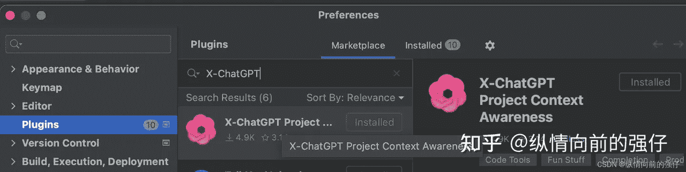

# 二、使用介绍

我们在选中自己体检的代码的git记录时候会出现生成日报和代码审查这两个字眼

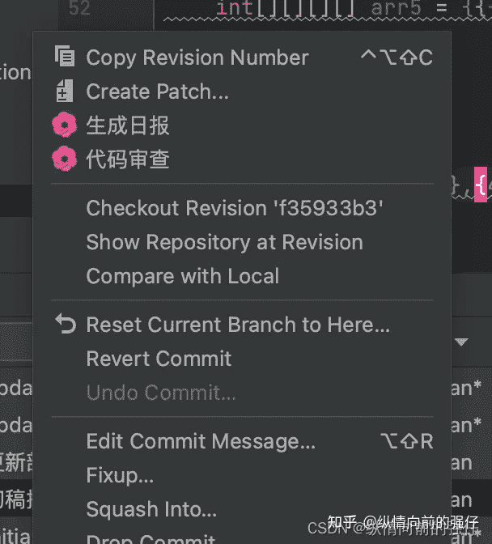

在选中一段代码的时候，我们会看到这样一些功能，例如：加入感知、X-Prompt作用是可以自定义以代码为内容进行上送处理，X-ChatGPT显示也和之前的几个插件线上功能差不多。

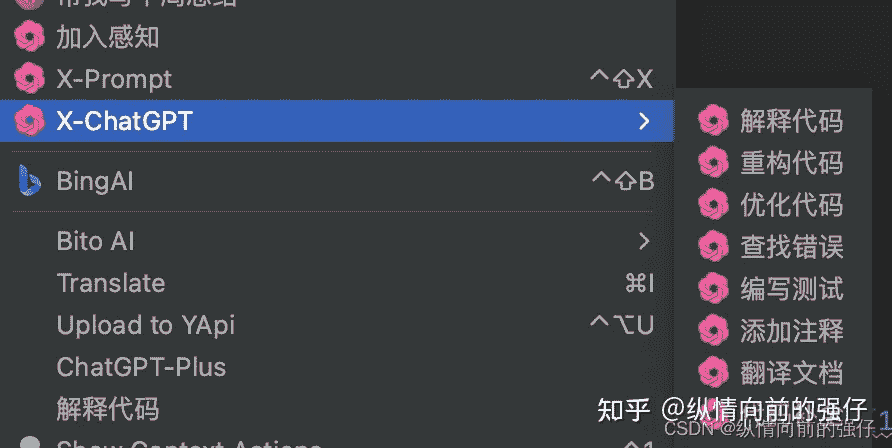

1、生成日报中发现的各种强大功能

我们在选中自己体检的代码的git记录时候会出现生成日报和代码审查这两个字眼，再点击

**1、1生成日报**

可以在idea的左侧看到生成了日报，如果没有是需要登录官网来使用这些功能 ，虽然生成的日报功能一般，但是在这里让我发现了一个功能，

**1、2设置**

这个对话框的最左侧有一个设置的按钮，打开可以看到可以设置很多功能

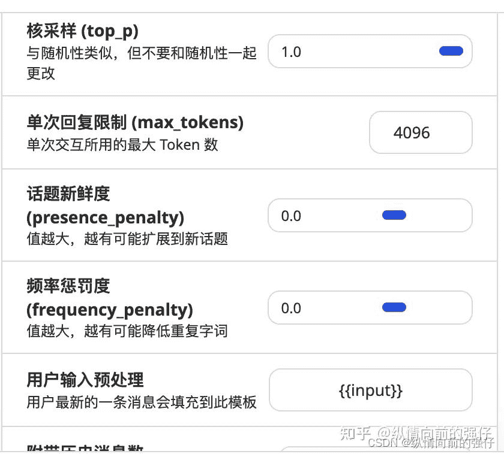

**1、3各种强大的角色**

在第三个按钮可以看到一些快捷功能

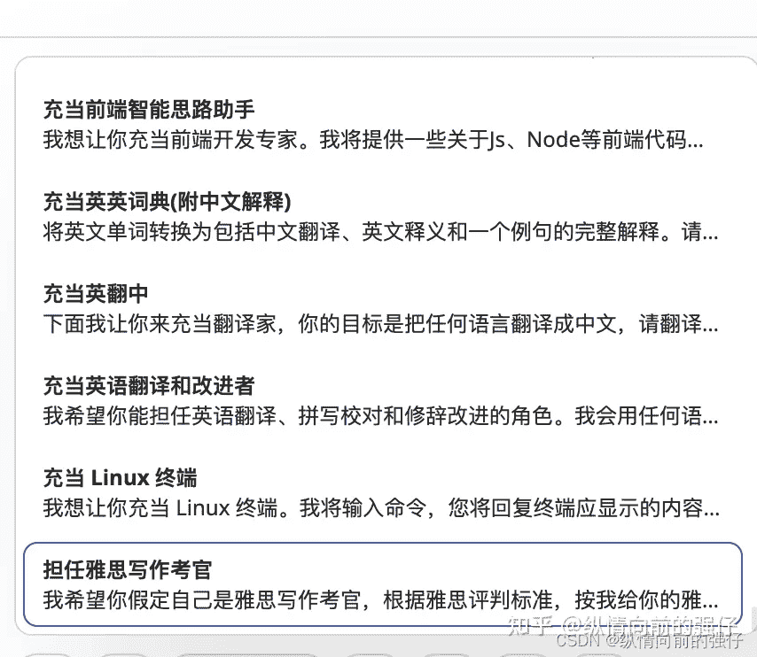

测试了一下linux的终端，感觉确实可以

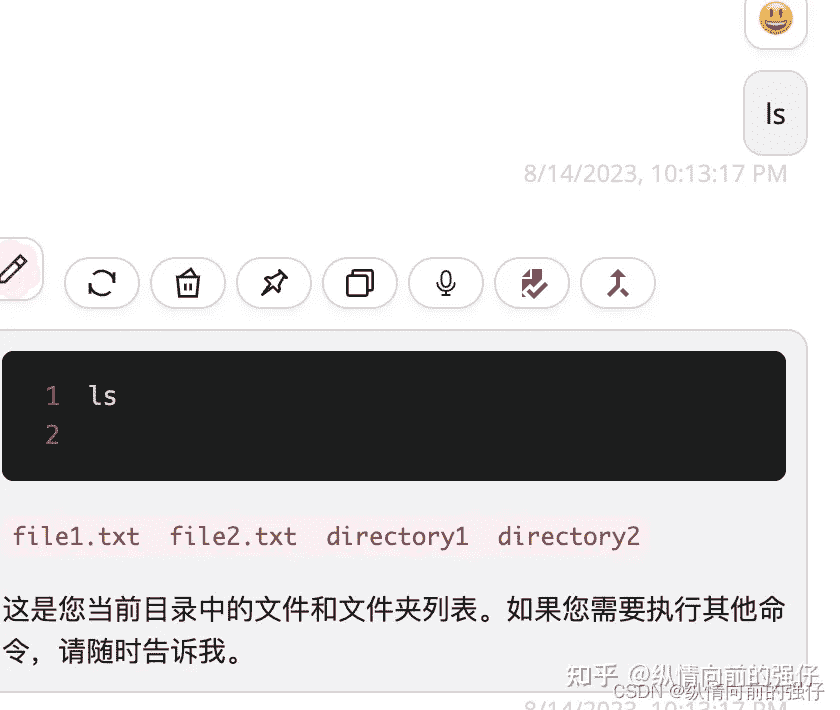

在所有面具里可以看到更多功能

**2、代码审查**

我们在选中自己体检的代码的git记录时候会出现生成日报和代码审查这两个字眼，在点击代码审查

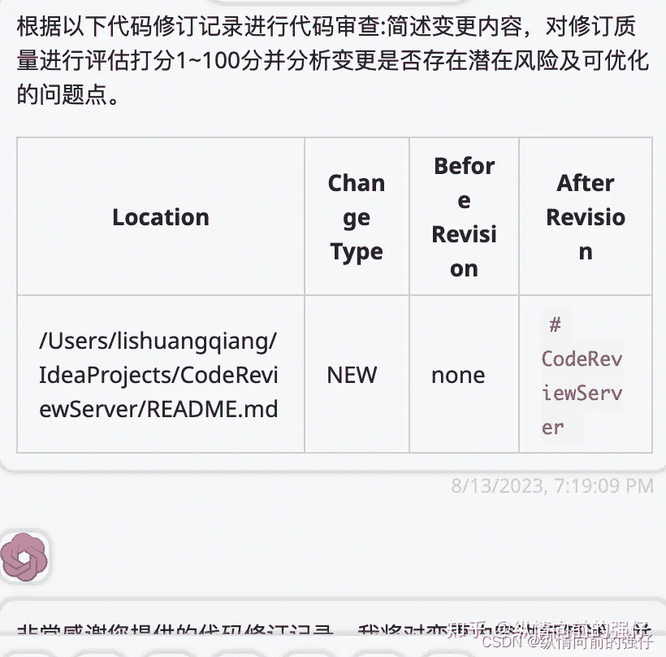

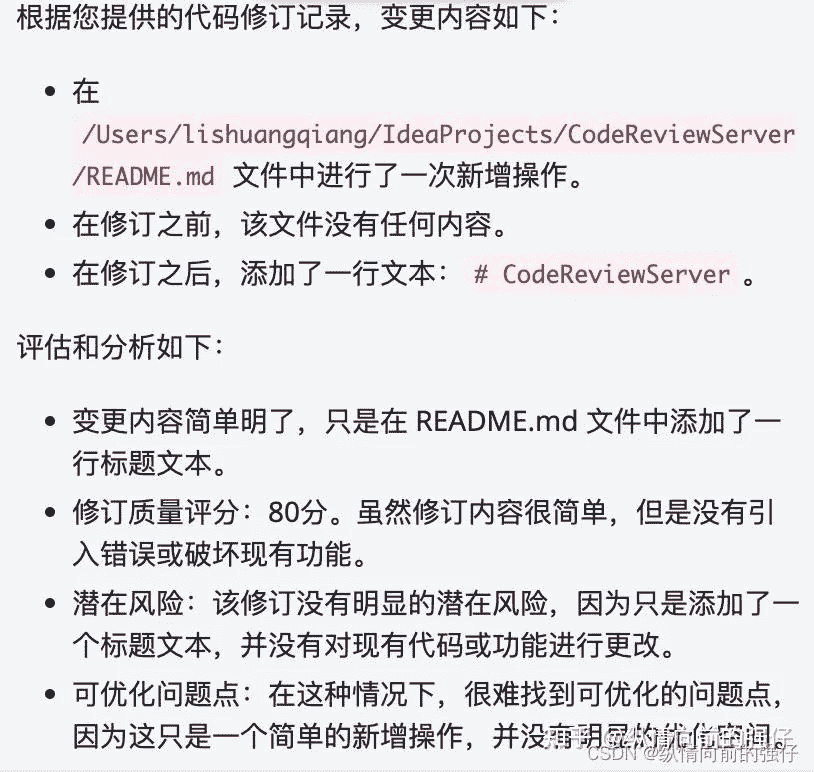

可以看到这这个审查做的还是比较好的，但是我发现代码量比较大的情况下，它就受限了，实际多少可能要实地验证

**3、X-Prompt**

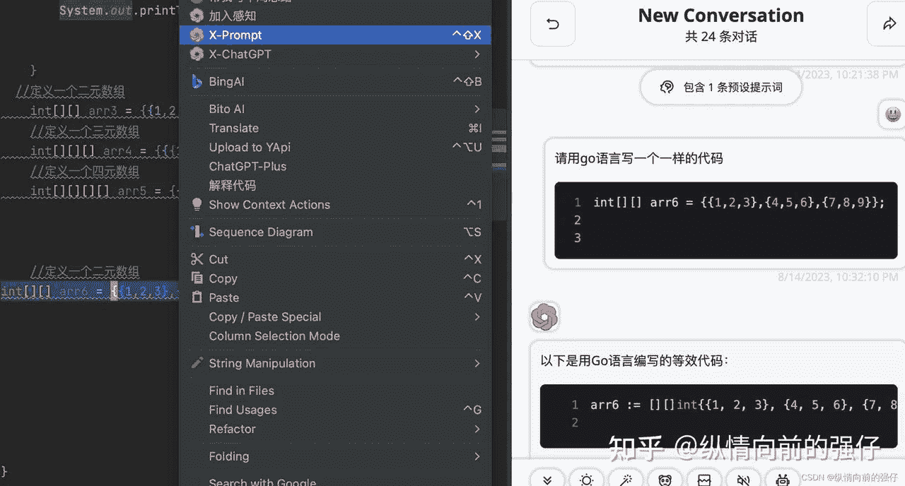

当选中一段代码，在框里面写一个自己想让完成的事，看我让它用go写一段一样含义的代码，它很好的理解并且写出来了，真的很棒。

**4、解释代码**

选中一段代码，让其解释代码，可以看到解释的是真的好，

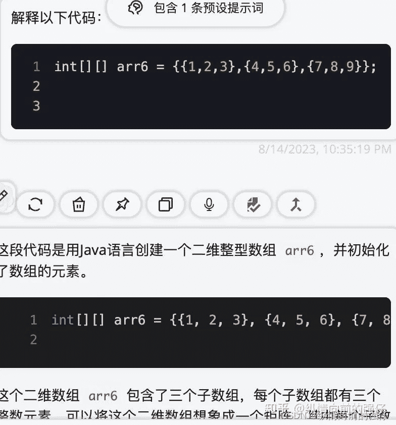

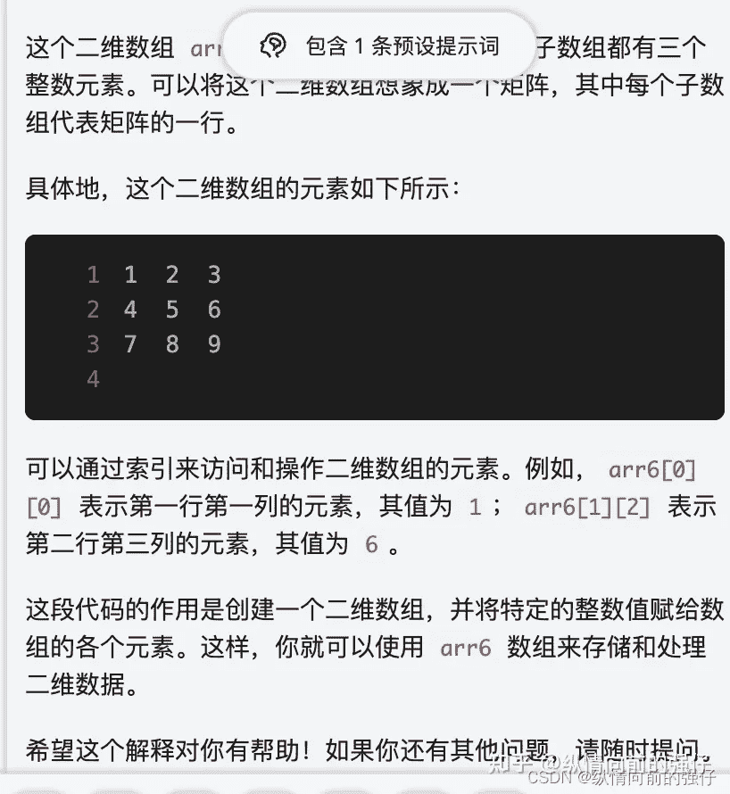

**5、重构代码**

选中一段代码，让其重构代码，也还行

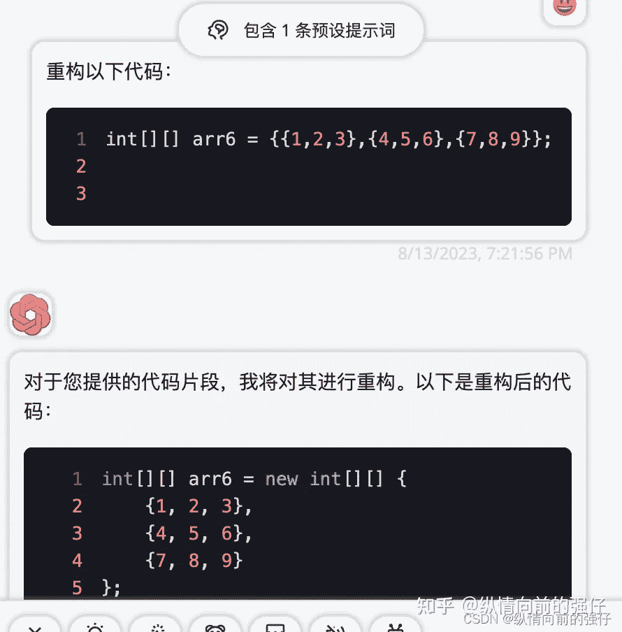

**6、优化代码**

选中一段代码让其优化，可以看到其不仅生成了优化代码，并且解释了优化原因，厉害

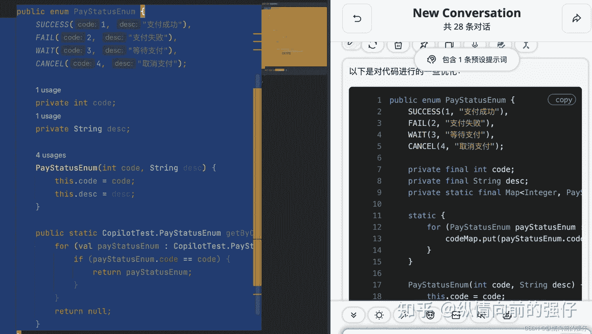

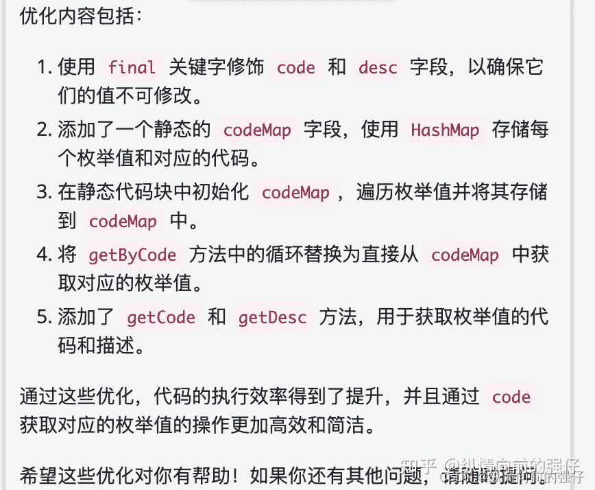

还可以重新优化

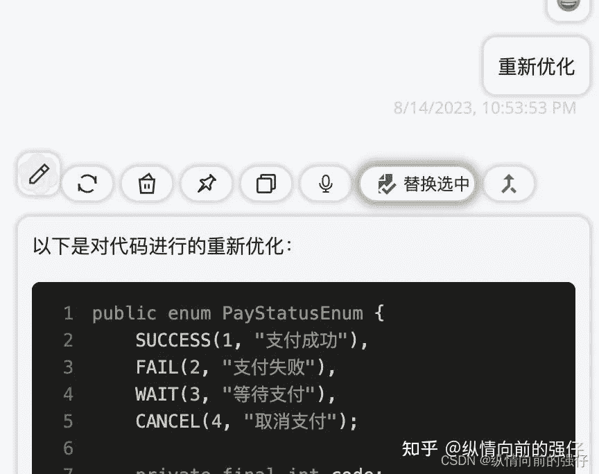

**7、查找错误**

选中一段代码，让其查找错误，可以看到不仅找到了错误，并且生成了修复后的代码：

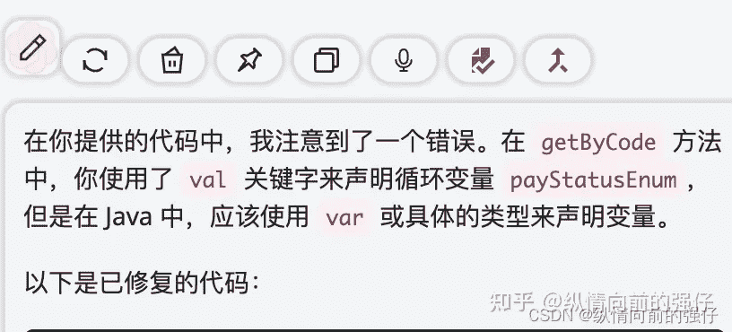

**8、编写测试**

选中一段代码，让其生成测试代码，可以看到生成的测试代码也是可以直接运行的

import org.junit.jupiter.api.Test;

import static org.junit.jupiter.api.Assertions.*;

public class PayStatusEnumTest {

@Test

public void testGetByCode() {

PayStatusEnum success = PayStatusEnum.getByCode(1);

assertEquals(PayStatusEnum.SUCCESS, success);

PayStatusEnum fail = PayStatusEnum.getByCode(2);

assertEquals(PayStatusEnum.FAIL, fail);

PayStatusEnum wait = PayStatusEnum.getByCode(3);

assertEquals(PayStatusEnum.WAIT, wait);

PayStatusEnum cancel = PayStatusEnum.getByCode(4);

assertEquals(PayStatusEnum.CANCEL, cancel);

PayStatusEnum notFound = PayStatusEnum.getByCode(5);

assertNull(notFound);

}

}

**9、添加注释**

选中一段代码，让其添加注释，可以看到生成的真的很详细，比一般写的详细多了

/**

* 支付状态枚举类型

*/

public enum PayStatusEnum {

SUCCESS(1, "支付成功"), // 支付成功状态，代码为1，描述为"支付成功"

FAIL(2, "支付失败"), // 支付失败状态，代码为2，描述为"支付失败"

WAIT(3, "等待支付"), // 等待支付状态，代码为3，描述为"等待支付"

CANCEL(4, "取消支付"); // 取消支付状态，代码为4，描述为"取消支付"

private int code; // 支付状态代码

private String desc; // 支付状态描述

/**

* 枚举类型构造函数

*

* @param code 支付状态代码

* @param desc 支付状态描述

*/

PayStatusEnum(int code, String desc) {

this.code = code;

this.desc = desc;

}

/**

* 根据代码获取对应的支付状态枚举值

*

* @param code 支付状态代码

* @return 对应的支付状态枚举值，如果未找到则返回null

*/

public static PayStatusEnum getByCode(int code) {

for (PayStatusEnum payStatusEnum : PayStatusEnum.values()) {

if (payStatusEnum.code == code) {

return payStatusEnum;

}

}

return null;

}

}

**10、翻译文档**

选中一段代码，让其解释代码，可以看到解释的很详细：

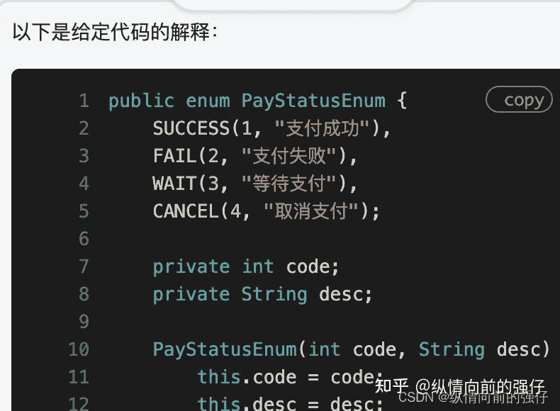

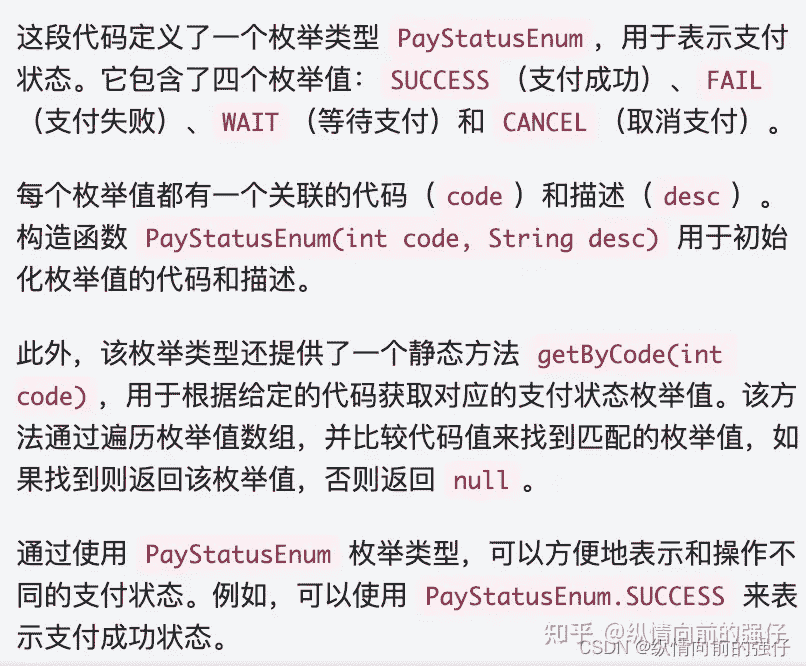

**11、代码补全**

我选中了这部分代码，让其进行代码补全

public static CopilotTest.PayStatusEnum getByCode(int code) {

for (val payStatusEnum : CopilotTest.PayStatusEnum.values()) {

if (payStatusEnum.code == code) {

return payStatusEnum;

}

}

补全的代码为

public static PayStatusEnum getByCode(int code) {

for (PayStatusEnum payStatusEnum : PayStatusEnum.values()) {

if (payStatusEnum.getCode() == code) {

return payStatusEnum;

}

}

return null;

}

并且给出了为什么补全：

在给定的代码中，我补全了方法的代码块。根据注释，该方法的作用是根据给定的代码获取对应的支付状态枚举值。我使用了增强的for循环遍历枚举类型的所有值，然后通过调用getCode()方法获取每个枚举值的代码，并与给定的代码进行比较。如果找到匹配的枚举值，则返回该枚举值；如果未找到匹配的枚举值，则返回null。

真的太牛啦。

这部分是大模型的功能，测试下来真的会省30%以上的开发量，安全起见今后觉得在企业内部之后有自己训练好的大模型，但是还在探索类似MetaGPT的产品，那样真的工作少了很多了。

扫码加入星球

查看更多优质内容

https://wx.zsxq.com/mweb/views/joingroup/join_group.html?group_id=48884185121218