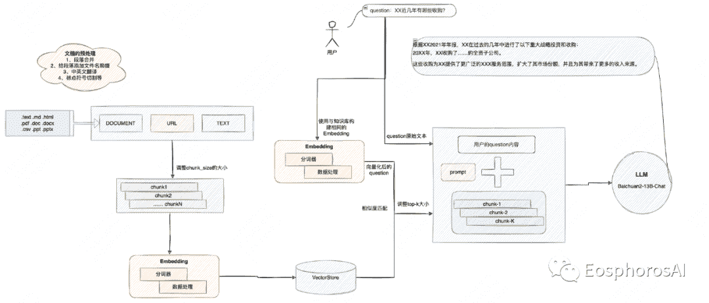
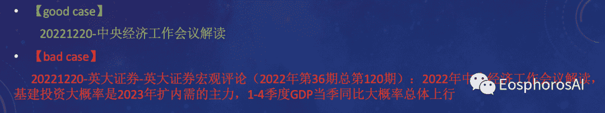
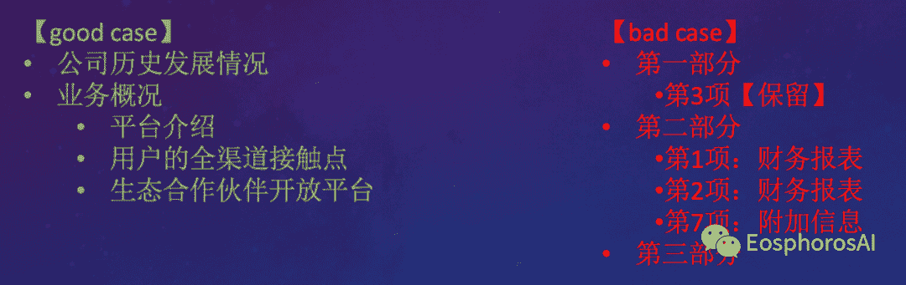
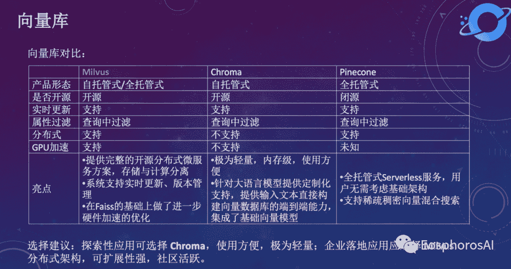
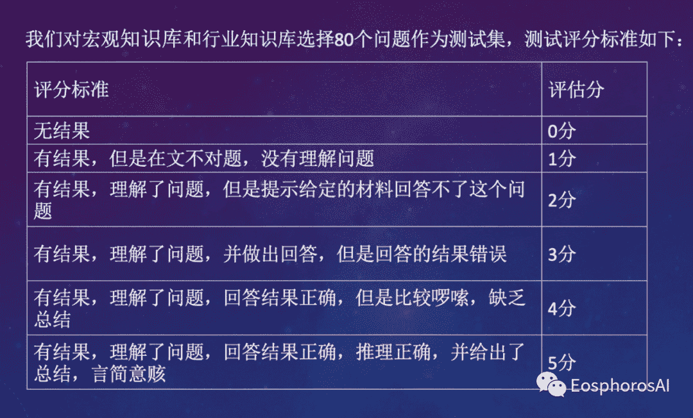
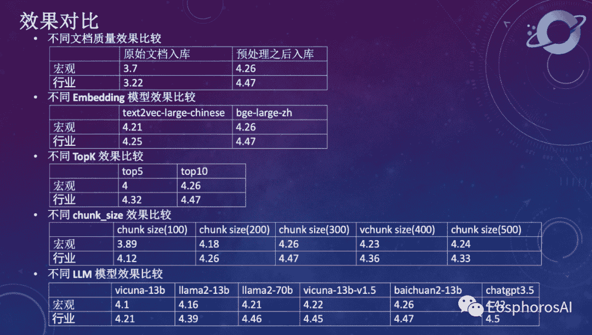
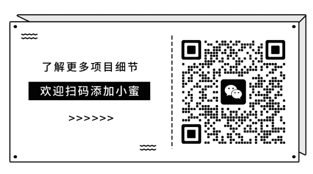
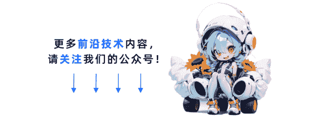

# 2023-09-26落地实践｜ 92% 的准确率！如何用 DB-GPT 打造企业级的知识库问答系统

> 来源：[https://xuqiwei1986.feishu.cn/docx/TttCdA9Vpoz0kbxd7k0crSJwnOh](https://xuqiwei1986.feishu.cn/docx/TttCdA9Vpoz0kbxd7k0crSJwnOh)

> 🔗 原文链接： h[ttps://mp.weixin.q](https://mp.weixin.qq.com/s/Isfj9WxCZmwzCLVp70bagQ)q.com/s/Isfj9WxC...

>

原创 DB-GPT EosphorosAI

2023-09-26 11:16:53

精确发文时间由壹伴提供

2023-09-26 11:16 发表于 北京

手机阅读

本文是基于社区核心成员 cm-liushaodong 在 B 站分享的关于知识库实践落地的内容整理的文字版，视频讲解内容可以登录 B 站搜索 DB-GPT 官方号观看哦。

**PART 1**

**CVP STACK**

**01**

**什么是**

**CVP STACK ？**

+   C 是以 ChatGPT 为代表的大语言模型。现在表现最好的通用 LLM 是 GPT-4，两者都是属于 OpenAI 公司的产品，但是 GPT-4 的价格是 ChatGPT-3.5 的 20 倍。本地 LLM 表现比较好的是百川智能在近期发布的 Baichuan2-13B-Chat。我们建议，在知识库问答场景，如果不涉及隐私数据，可调用 ChatGPT-3.5，涉及隐私数据时，可基于 DB-GPT 本地部署 Baichuan2-13B-Chat 来做推理，通过我们的测评这种模式的效果也是很好的。

+   V 是（Vector Database）向量数据库的缩写。区别于传统的数据库，向量数据库专门存储和管理向量数据，通常采用基于向量索引的存储方式，将向量数据映射到高维空间中，并在这个空间中构建索引结构，以支持高效的相似度查询。

+   P 即 Prompt，但是这里的 Prompt 不单指 LLM 的提示词，更广义地表示提示工程和产品交互部分。Prompt 包括 zero-shot、one-shot 跟 few-shot 三类，分别表示不举例子，举一个例子和举少量例子（一般为5，10，15等），一般情况下，few-shot 的效果要明显好于前两者。

+

+

**02**

**为什么要选择**

**CVP STACK？**

企**业借助 **L**LM 能**力提升生产力是目前 LLM 落地的一个重要方向。围绕这个方向的探索大致分为两大流派： 传统流派 将垂域内容、私域内容补充到数据集里，微调甚至重训 LLM ，希望模型具有端到端的能力，即单模型架构； 新兴流派 则引入了向量数据库为 LLM 提供长期记忆，采用通用 LLM 集成领域知识库的方案来提供服务，即CVP架构。

相比于单模型架构，CVP架构在可扩展性、实时性和成本三个维度都有明显优势。

+   传统流派需要将垂域、私域内容更新到模型参数中，需要微调 LLM ，需要花费大量的计算资源，同时需要专业的同学去完成这个工作，但是结果不稳定，有可能花费数周都无法微调出一个令人满意的模型，甚至是负优化。这个过程也被形象地比喻为“炼丹”！

+   新兴流派引入了向量库为 LLM 补充一个外部记忆体，存储垂域、私域的知识。不需要微调 LLM ，只需要将实时知识添加到向量库中即可完成知识的更新，而非微调 LLM 。

+   我们在 AI 问答助手产品的落地中发现，即使 CVP 架构依赖于本地部署的 Baichu**an2-13B**-Chat，其问答效果也可以显著超过 GPT-4 的单模型架构。 当然这套架构的核心是垂域、私域知识库的构建， 知识库的质量 直接决定了 CVP 架构的问答效果。

**PART 2**

**AI 工作助手的工作原理 **

AI 问答助手如上图所示总共有以下几个流程：

文档的预处理 -> 文档切割 -> Embedding 存储到向量数据库 -> 用户提问 -> 将问题用同样引擎做 Embedding -> 问题向量化 -> 到知识库所在到向量数据库中进行相似的匹配 ->召回得分最高的 k 个 Chunks-> 用户原始提问文本+用户的 prompt + k 个 Chunks 三者输入到本地大模型（LLM） -> 返回给用户问题的回答。

了解完成工作流程，接下来进行核心环节的拆解，方便后续我们做体系化的调优。

**01**

**文档预处理**

即在文档上传知识库之前做的文档预处理工作。预处理工作的准则是，能系统化的步骤则系统化，不能系统化的步骤按照 SOP 人工处理之后，需要达到入知识库的标准。不满足标准的文档不允许入库，这样能够保证整个知识库的整体质量。

文档预处理阶段核心要考量的点：

• **文档语言统一 **：我们在构建知识库时发现，有的文档是中英文结合的，例如，同一行中左边是中文（简体）、右边是英文，这种需要删掉英文，只保留中文（简体）；如果是中文（繁体），则需要转成中文（简体）；如果文档是英文，则需要转成中文（简体）。我们这么做的原因主要是在实际应用中发现不同的 Embedding 引擎对于中英文、繁简体的支持是不一样的，如果文档不做处理，引擎会把中英文切到一个 chunk 里面，向量化之后有一半可能是乱码，有一半是没有用的数据。

• **文档格式统一 **：我们测试发现，相比于 .pdf格式，.docx格式的效果更好，推荐使用该格式，需要将 .pdf 格式转换成 .docx 格式。

• **文档命名规整 **：文档名应控制在 10 字左右，使用简洁明了的词语或短语来命名文档，避免使用无意义的数字、符号或缩写。

**02**

**文档切割**

+   **文档内容规整 **：

+   一/二级标题规整：标题名应控制在 5 字左右，使用简洁明了的词语或短语来命名文档,避免使用无意义的数字、符号或缩写，对于过大的文档也建议要做三、四级标题的打标和规整。

+

+

+

+

+   段落合并：合并段落的阈值（默认是 100 个字，段落不满足 100 个字会和下一个段落合并）需要根据文档切割的 chunk_size 大小来调整。chunk_size 参数控制每个切割块的字符长度，DB-GPT 支持调整该参数的大小同时也调整文档切割的方法，目前需要在代码中调节，我们默认使用的是 zh_core_web_sm。

+

+   **段落打标加权 **：为了防止大的文档出现召回准确性的问题，我们会标注一下这个 chunk 来自于那个文档的那个段落，打标的格式为文档名+一级标题+二级标题等，这样召回准确性会有显著的提升。

**03**

**Embedding 阶段**

评估 Embedding 阶段做的是否好的标准为：一般采用 Top5 的召回准确率和 Top10 的召回准确率。TopN 召回准确率 = TopN 条 chunk 包含了答案的问题数/总的问题数

**从我们实际应用经验来看，目**前对于中文文档而言， bge-large-zh Embedding 引擎效果是最好的。

对于向量数据库的使用选型，基于我们的实践经验有如下图所示的建议，大家可以自行参考。

**04**

**召回 TOP-K 阶段**

K的选择：文档内容足够丰富时（文档数>10），调大该值；文档内容比较少时，调小该值，具体值需要根据实际的使用场景去不断测试。

**这里需要注意 **：K * chunk_size 不得超过 LLM 允许的最大输入 tokens，假如说我们用的 LLM 是 baichuan-13B，该模型的最大输入 tokens 是 < 4k,则 K * chunk_size 这两个值的乘积则不可以超过 4k 。

**05**

**Prompt**

知识库问答场景下的 prompt 工程相对比较简单因此不需要太多调整，不同知识库固化一个当前知识库通用的 prompt 即可。

**06**

**LLM**

对于中文**知识库问**答来说，目前表现最好的开源 LLM 是 Baichuan2-13B-Chat，上面我们也提到，在 CVP 架构中，我们不需要太强的 LLM，就可以有很好的效果，我们以 Baichuan2-13B-Chat 作为本地 LLM，在 AI 问答助手场景中，可以获得 85% 以上的准确率，在实际使用场景已经可以达到 92% 的准确率。

**PART 3**

**知识库构建理论**

在构建 AI 问答知识库时，最开始为了提高用户体验，减少用户在多个知识库之间进行切换的操作，我们将所有的文档都放到了一个知识库中，包括宏观政策、经济和行业调研分析的文档，但是发现效果并不好，研究 badcase 发现，用户问宏观政策环境问题时，会召回财报中讲述宏观政策环境对企业经营的影响；用户问某个企业的经营状况时，又会召回很多宏观政策经济的内容，知识互相揉杂，导致不准确。后续我们又拆成了三个知识库，效果有了明显改善，研究 badcase 发现，用户对于宏观政策库、经济库的问题，往往需要结合宏观政策和经济材料才能完美回答，我们研究材料发现确实如此宏观政策中夹带经济，经济中夹带宏观政策，所以我们最后建了两个库：宏观库和行业库。效果达到了最优，问答准确率达到了 92%。

因此**，在尝试划分知识库的时候**，我们也发现，知识库构建遇到的问题，答案基本都能在数仓建模中找到，上述的案例其实是数仓建模分主题域的理论：域内高内聚、域间低耦合。推广到知识库的分知识库理论为： 库内高内聚、库间低耦合。 可以理解为分到一个知识库里面的文档以及所有的知识要尽量保持这所有的文档的内容都是有比较强的相似度，而不同的库与库之间尽量不要有重叠或者有相似的文档的部分。

**01**

**评分标准**

**02**

**效果展示**

**PART 4**

**未来的挑战和思路**

# **01**

超大文档集下，我们是否需要三级标题进行打标？打标内容过多会不会冲淡真实的信息熵？

对于超大文档集， 是需要三级标题、甚至四级标题进行打标 ，但是打标的质量需要特别关注：打标应言简意赅，精简打标的内容，如果无法在打标的内容上再精简，则需要相应地增大chunk size的大小，以此控制打标部分的占比不应超过 chunk 的10%，防止打的标覆盖掉真实的信息内容。

# **02**

文档中的表格和图片上的指标如何识别？

DB-GPT目前不识别文档中的图片，我们可以采用 OCR 的方式来将文档中的图片抽离出来，单独处理。但是经过测试 OCR识别还达不到落地应用的效果，所以我们要求在图片加必要的文字说明，特别是对于包含指标值的图片，需要人工将其解析成文字。

# **03**

后续如何做推理框架升级、推理提速？

目前 DB-GPT 使用的是 FastChat 作为推理框架，推理速度和并发均有很大的提升空间，目前我们正在做 vLLM的调研，希望在Q4可以将其融合到DB-GPT工程里。

**附录**

DB-GPT 社区: https://github.com/eosphoros-ai

Text2SQL 微调：https://github.com/eosphoros-ai/DB-GPT-Hub

Text2SQL 发展调研：https://github.com/eosphoros-ai/Awesome-Text2SQL

