# 2023-09-03 大模型训练之框架篇--`DeepSpeed` 介绍_舒克与贝克的博客-CSDN博客

> 来源：https://xuqiwei1986.feishu.cn/docx/OYiBdxoKqotxURxO59XcN5aInHh

> 🔗 原文链接：https://zengwenqi.blog.csdn.net/article/details/130732601?spm=1001.2014.3001.5502

> https://zengwenqi.blog.csdn.net/?type=blog

## 一 为什么需要`DeepSpeed`

+ 分布式计算环境中，主节点负责协调其他节点和进程的工作

+ `PyTorch`官方提供的分布式训练工具`Accelerate`只支持nvlink，而T4，3090这类显卡是PIX，检测方式：`nvidia-smi topo -m`；`DeepSpeed`支持更大规模的模型训练

+ 混合精度训练

+ `ZeRO`可以减少内存占用，优化大模型训练，将模型参数分成了三个部分：`Optimizer States`、`Gradient` 和 `Model Parameter`。在使用`ZeRO`进行分布式训练时，可以选择`ZeRO-Offload`和`ZeRO-Stage3`等不同的优化技术。

大模型（`LLM`）在训练时往往需要大量内存来存储中间激活、权重等参数，百亿模型甚至无法在单个 `GPU` 上进行训练，使得模型训练在某些情况下非常低效和不可能。这就需要进行多卡，或者多节点分布式训练。

在大规模深度学习模型训练中有个主要范式：

+ 数据并行

+ 模型并行

目前训练超大规模语言模型技术路线：`GPU` + `PyTorch` + `Megatron-LM` + `DeepSpeed`

`DeepSpeed`是由`Microsoft`提供的分布式训练工具，旨在支持更大规模的模型和提供更多的优化策略和工具。与其他框架相比，`DeepSpeed`支持更大规模的模型和提供更多的优化策略和工具。其中，主要优势在于支持更大规模的模型、提供了更多的优化策略和工具（例如`ZeRO`和`Offload`等）

+ 用`3D`并行化实现万亿参数模型训练：`DeepSpeed`实现了三种并行方法的灵活组合：`ZeRO`支持的数据并行，流水线并行和张量切片模型并行。`3D`并行性适应了不同工作负载的需求，以支持具有万亿参数的超大型模型，同时实现了近乎完美的显存扩展性和吞吐量扩展效率。此外，其提高的通信效率使用户可以在网络带宽有限的常规群集上以`2-7`倍的速度训练有数十亿参数的模型。

+ `ZeRO-Offload`使`GPU`单卡能够训练10倍大的模型：为了同时利用`CPU`和`GPU`内存来训练大型模型，我们扩展了`ZeRO-2`。我们的用户在使用带有单张英伟达`V100` GPU 的机器时，可以在不耗尽显存的情况下运行多达130亿个参数的模型，模型规模扩展至现有方法的10倍，并保持有竞争力的吞吐量。此功能使数十亿参数的模型训练更加大众化，并为许多深度学习从业人员打开了一扇探索更大更好的模型的窗户。

+ 通过`DeepSpeed Sparse Attention`用6倍速度执行10倍长的序列：`DeepSpeed`提供了稀疏 attention kernel——一种工具性技术，可支持长序列的模型输入，包括文本输入，图像输入和语音输入。与经典的稠密 Transformer 相比，它支持的输入序列长一个数量级，并在保持相当的精度下获得最高6倍的执行速度提升。它还比最新的稀疏实现快`1.5-3`倍。此外，我们的稀疏 kernel 灵活支持稀疏格式，使用户能够通过自定义稀疏结构进行创新。

+ `1`比特`Adam`减少5倍通信量：`Adam`是一个在大规模深度学习模型训练场景下的有效的（也许是最广为应用的）优化器。然而，它与通信效率优化算法往往不兼容。因此，在跨设备进行分布式扩展时，通信开销可能成为瓶颈。我们推出了一种`1`比特`Adam`新算法，以及其高效实现。该算法最多可减少5倍通信量，同时实现了与`Adam`相似的收敛率。在通信受限的场景下，我们观察到分布式训练速度提升了`3.5`倍，这使得该算法可以扩展到不同类型的`GPU`群集和网络环境。

### 1.1 基本概念

+ 在分布式计算环境中，需要理解几个非常基础的概念：节点编号、全局进程编号、局部进程编号、全局总进程数和主节点。其中，主节点负责协调所有其他节点和进程的工作，因此是整个系统的关键部分。

+ `DeepSpeed`还提供了`mpi`、`gloo`和`nccl`等通信策略，可以根据具体情况进行选择和配置。在使用`DeepSpeed`进行分布式训练时，可以根据具体情况选择合适的通信库，例如在`CPU`集群上进行分布式训练，可以选择`mpi`和`gloo`；如果是在`GPU`上进行分布式训练，可以选择`nccl`。

+ `ZeRO`（`Zero Redundancy Optimizer`）是一种用于大规模训练优化的技术，主要是用来减少内存占用。`ZeRO`将模型参数分成了三个部分：`Optimizer States`、`Gradient` 和 `Model Parameter`。在使用`ZeRO`进行分布式训练时，可以选择`ZeRO-Offload`和`ZeRO-Stage3`等不同的优化技术。

+ 混合精度训练是指在训练过程中同时使用`FP16`（半精度浮点数）和`FP32`（单精度浮点数）两种精度的技术。使用`FP16`可以大大减少内存占用，从而可以训练更大规模的模型。在使用混合精度训练时，需要使用一些技术来解决可能出现的梯度消失和模型不稳定的问题，例如动态精度缩放和混合精度优化器等。

+ 结合使用`huggingface`和`deepspeed`

在分布式计算环境中，有几个非常基础的概念需要理解：

+ 节点编号（`node_rank`）：分配给系统中每个节点的唯一标识符，用于区分不同计算机之间的通信。

+ 全局进程编号（`rank`）：分配给整个系统中的每个进程的唯一标识符，用于区分不同进程之间的通信。

+ 局部进程编号（`local_rank`）：分配给单个节点内的每个进程的唯一标识符，用于区分同一节点内的不同进程之间的通信。

+ 全局总进程数（`word_size`）：在整个系统中运行的所有进程的总数，用于确定可以并行完成多少工作以及需要完成任务所需的资源数量。

+ 主节点（`master_ip+master_port`）：在分布式计算环境中，主节点负责协调所有其他节点和进程的工作，为了确定主节点，我们需要知道它的`IP`地址和端口号。主节点还负责监控系统状态、处理任务分配和结果汇总等任务，因此是整个系统的关键部分。

### 1.2 通信策略

`deepspeed`还提供了`mpi`、`gloo`和`nccl`等通信策略，可以根据具体情况进行选择和配置。

+ `mpi`是一种跨节点通信库，常用于`CPU`集群上的分布式训练；

+ `gloo`是一种高性能的分布式训练框架，支持`CPU`和`GPU`上的分布式训练；

+ `nccl`是`NVIDIA`提供的`GPU`专用通信库，被广泛应用于`GPU`上的分布式训练。

在使用`DeepSpeed`进行分布式训练时，可以根据具体情况选择合适的通信库。通常情况下，如果是在`CPU`集群上进行分布式训练，可以选择`mpi`和`gloo`；如果是在`GPU`上进行分布式训练，可以选择`nccl`。

```
export CUDA_LAUNCH_BLOCKING=1
```

### 1.3 `DeepSpeed`训练介绍

+ 在`DeepSpeed`中，可以通过在配置文件中设置`"bf16.enabled": true`来启用`BF16`混合精度训练，减少占用内存。

+ 混合精度训练是指在训练过程中同时使用`FP16`（半精度浮点数）和`FP32`（单精度浮点数）两种精度的技术。

+ `deepspeed`可以根据具体情况选择合适的通信库，例如在`CPU`集群上进行分布式训练，可以选择`mpi`和`gloo`；如果是在`GPU`上进行分布式训练，可以选择`nccl`。

+ `mpi`是一种跨节点通信库，常用于`CPU`集群上的分布式训练；

+ `gloo`是一种高性能的分布式训练框架，支持`CPU`和`GPU`上的分布式训练；

+ `nccl`是`NVIDIA`提供的`GPU`专用通信库，被广泛应用于`GPU`上的分布式训练。

+ `DeepSpeed`的核心技术：

+ `Zero`（`Zero Redundancy Optimizer`，`3D`优化与卸载）：在`deepspeed`中通过`zero_optimization.stage=0/1/2/3`设置，卸载通过`zero_optimization.offload_optimizer.device`设置

+ `DeepSpeed`的推理优化技术：

+ `Deep fusion`：如下图，红色虚线框是以该单位为优化Kernel，对应的数字是优化的效率倍数

+ `Inference-customized GeMM`

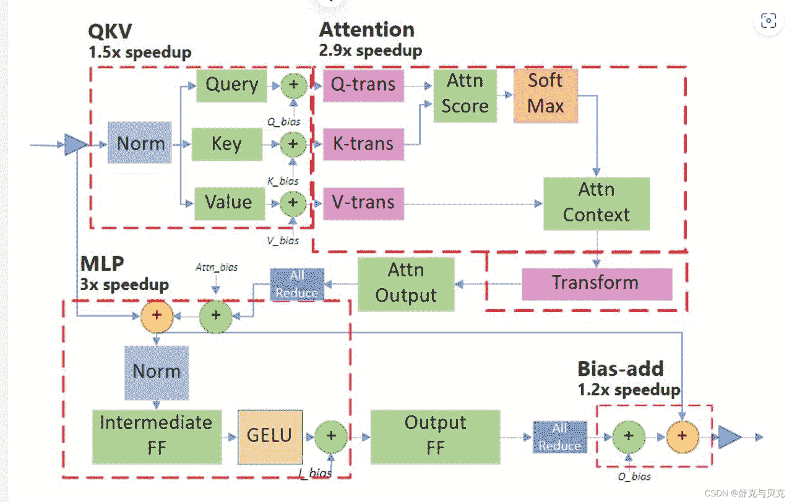

## 二 `Zero`（`3D`优化与卸载）

微软开发`ZeRO`是为了克服数据并行性和模型并行性的限制，同时实现两者的优点。`ZeRO`通过在数据并行进程中划分模型状态（参数，梯度和优化器状态），而不是复制它们，从而消除了数据并行进程中的内存冗余。它在训练期间使用动态通信计划，以在分布式设备之间共享必要的状态，以保持计算粒度和数据并行性的通信量。

`ZeRO`驱动的数据并行性，它允许每个设备的内存使用量随数据并行性的程度线性扩展，并产生与数据并行性相似的通信量。`ZeRO`支持的数据并行性可以适合任意大小的模型，只要聚合的设备内存足够大以共享模型状态即可。

`ZeRO`（`Zero Redundancy Optimizer`）是一种用于大规模训练优化的技术，主要是用来减少内存占用。在大规模训练中，内存占用可以分为`Model States`和`Activation`两部分，而`ZeRO`主要是为了解决`Model States`的内存占用问题。

`ZeRO`将模型参数分成了三个部分：`Optimizer States`、`Gradient` 和 `Model Parameter`。

+ `Optimizer States`是`Optimizer`在进行梯度更新时所需要用到的数据，例如`SGD`中的`Momentum`。

+ `Gradient`是在反向传播后所产生的梯度信息，其决定了参数的更新方向。

+ `Model Parameter`则是模型参数，也就是我们在整个过程中通过数据“学习”的信息。

`ZeRO-Offload`和`ZeRO-Stage3`是`DeepSpeed`中的不同的`Zero-Redundancy Optimization`技术，用于加速分布式训练，主要区别在资源占用和通信开销方面。

+ `ZeRO-Offload`将模型参数分片到不同的`GPU`上，通过交换节点间通信来降低显存占用，但需要进行额外的通信操作，因此可能会导致训练速度的下降。

+ `ZeRO-Stage3`将模型参数分布在`CPU`和`GPU`上，通过`CPU`去计算一部分梯度，从而减少显存占用，但也会带来一定的计算开销。

### 2.1 三个级别

`ZeRO-0`：禁用所有类型的分片，仅使用`DeepSpeed`作为`DDP`（`Distributed Data Parallel`）

`ZeRO-1`：分割`Optimizer States`，减少了4倍的内存，通信容量与数据并行性相同

`ZeRO-2`：分割`Optimizer States`与`Gradients`，`8x`内存减少，通信容量与数据并行性相同

`ZeRO-3`：分割`Optimizer States`、`Gradients`与`Parameters`，内存减少与数据并行度和复杂度成线性关系。

`ZeRO-Infinity`是`ZeRO-3`的拓展。允许通过使用`NVMe`固态硬盘扩展`GPU`和`CPU`内存来训练大型模型。`ZeRO-Infinity`需要启用`ZeRO-3`。

在`deepspeed`中通过`zero_optimization.stage=0/1/2/3`设置，

卸载通过`zero_optimization.offload_optimizer.device`设置

### 2.2 混合精度

混合精度训练是指在训练过程中同时使用`FP16`（半精度浮点数）和`FP32`（单精度浮点数）两种精度的技术。使用`FP16`可以大大减少内存占用，从而可以训练更大规模的模型。但是，由于`FP16`的精度较低，训练过程中可能会出现梯度消失和模型不稳定的问题。因此，需要使用一些技术来解决这些问题，例如动态精度缩放（`Dynamic Loss Scaling`）和混合精度优化器（`Mixed Precision Optimizer`）等。

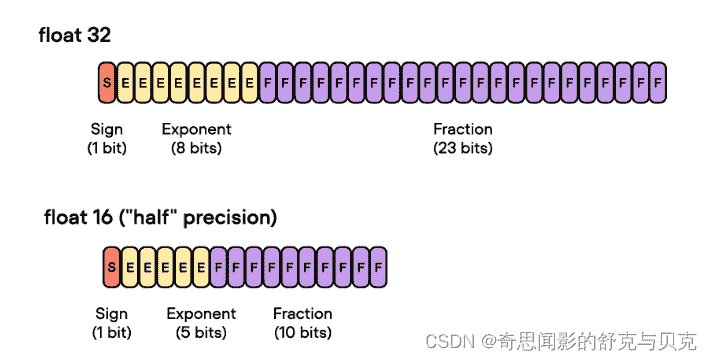

`deepspeed`提供了混合精度训练的支持，可以通过在配置文件中设置`"fp16.enabled": true`来启用混合精度训练。在训练过程中，`deepspeed`会自动将一部分操作转换为`FP16`格式，并根据需要动态调整精度缩放因子，从而保证训练的稳定性和精度。

在使用混合精度训练时，需要注意一些问题，例如梯度裁剪（`Gradient Clipping`）和学习率调整（`Learning Rate Schedule`）等。梯度裁剪可以防止梯度爆炸，学习率调整可以帮助模型更好地收敛。因此，在设置混合精度训练时，需要根据具体情况进行选择和配置。

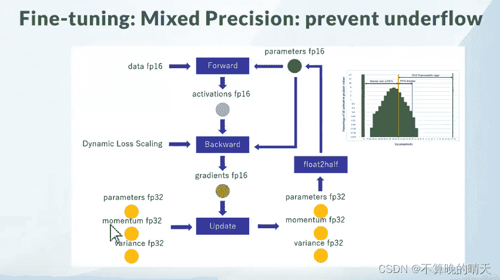

#### `BF16`

`BF16`和`FP16`都是混合精度训练中使用的浮点数表示格式。

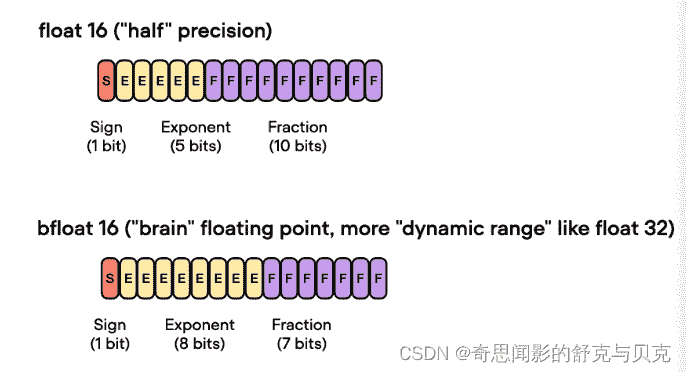

`BF16`是一种`Brain Floating Point`格式，由英特尔提出，可以提供更好的数值稳定性和更高的精度，但需要更多的存储空间。在混合精度训练中，`BF16`可以作为一种精度更高的替代品，用于一些关键的计算操作，例如梯度累加和权重更新等。使用`BF16`可以提高模型的训练速度和精度，并减少内存占用。

在`DeepSpeed`中，可以通过在配置文件中设置`"bf16.enabled": true`来启用`BF16`混合精度训练。这将会将一部分操作转换为`BF16`格式，并根据需要动态调整精度缩放因子，从而提高模型的训练速度和精度，并减少内存占用。

`NVIDIA Tesla V100`不支持`BF16`

### 2.3 显存占用分析

混合精度训练，字如其名，同时存在`fp16`和`fp32`两种格式的数值，其中模型参数、模型梯度都是`fp16`，此外还有`fp32`的模型参数，如果优化器是`Adam`，则还有`fp32`的`momentum`和`variance`。

总的来说，模型训练时显存主要分为两部分。

**第一部分**是模型权重、梯度和优化器状态；

**第二部分**是激活和临时缓存区。

`ZeRO-DP`主要是优化第一部分的显存占用，所以这里主要介绍第一部分的显存。

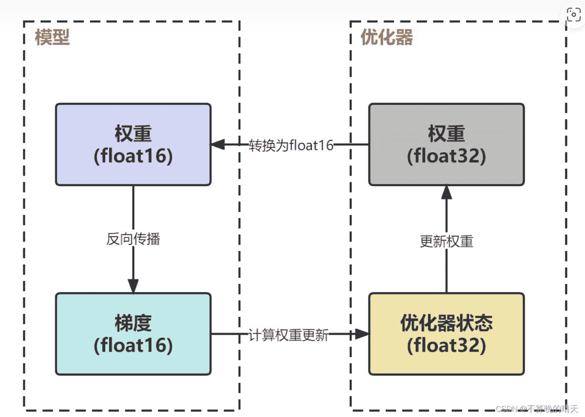

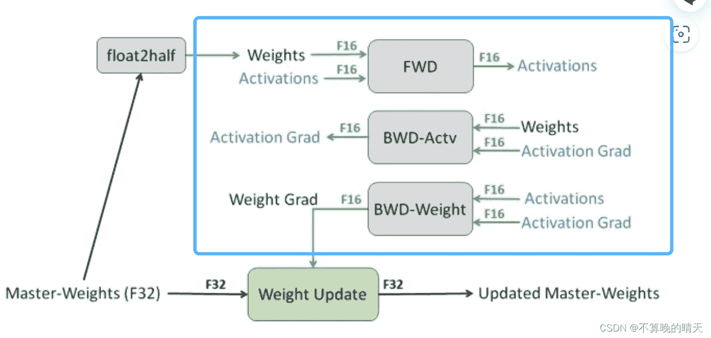

1. 将权重转换为`FP16`：在这一步中，神经网络的权重（或参数）最初是`FP32`格式，被转换为低精度的`FP16`格式。这减少了内存的占用，并允许更快的计算，因为`FP16`操作需要更少的内存，并且可以被硬件更快地处理。

计算梯度：神经网络的前向和后向通道是使用较低精度的`FP16`权重进行的。这一步计算损失函数相对于网络权重的梯度（部分导数），在优化过程中用于更新权重。

2. 将梯度转换为`FP32`：在`FP16`中计算梯度后，它们被转换回高精度的`FP32`格式。这种转换对于保持数值稳定性和避免使用低精度算术时可能出现的梯度消失或爆炸等问题至关重要。

乘以学习率和更新权重：现在是`FP32`格式，梯度被乘以学习率（一个标量值，决定了优化过程中的步长）。乘积被用来更新原始`FP32`神经网络权重。学习率有助于控制优化过程的收敛性，对于实现良好的性能至关重要。

1. **模型状态**（`model states`）：假设模型的参数量是`Ψ`，使用`Adam`为优化器进行混合精度训练。

a. 由于模型的参数和梯度使用`float16`，所以显存消耗分别为`2Ψ`和`2Ψ`。

b. `Adam`会维护一个`float32`的模型备份副本，消耗`4Ψ`显存。`Adam`优化器本身会为模型的每个参数维护两个`float32`的辅助变量（`fp32`的`momentum`和`fp32`的`variance`），所以显存消耗占用为`4Ψ+4Ψ`。

总的来说，模型会消耗`2Ψ+2Ψ=4Ψ`，`Adam`优化器这消耗`4Ψ+4Ψ+4Ψ=12Ψ`。最终的总消耗为`4Ψ+12Ψ=16Ψ`。

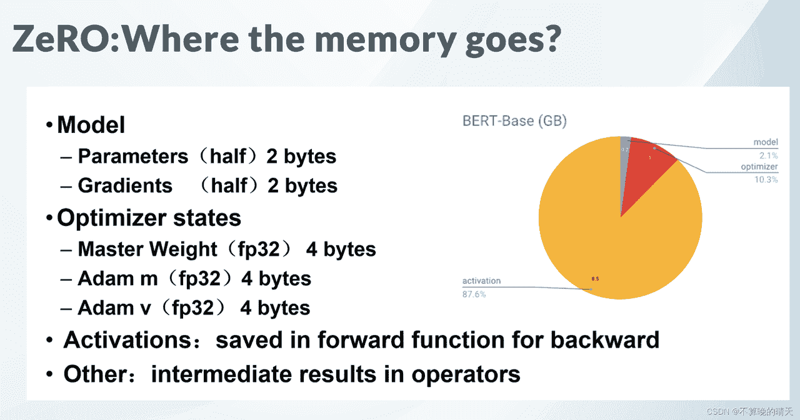

这里为了方便讨论，将优化器显存占用表示为`KΨ`（不同的优化器不同），则混合精度训练的显存占用为`4Ψ+KΨ`。

来看一个例子，`GPT-2`含有`1.5B`个参数，如果用`fp16`格式，只需要`1.5G*2Byte=3GB`显存

但是模型状态实际上需要耗费`1.5*16=24GB`，相比之下，激活值可以用`activation checkpointing`来大大减少，所以模型状态就成了头号显存杀手，它也是`ZeRO`的重点优化对象。而其中`Adam`状态又是第一个要被优化的。


比如说有一个模型参数量是1M，在一般的深度学习框架中(比如说`PyTorch`)，一般是32位存储。32位存储的意思就是1个参数用32个bit来存储。那么这个拥有1M参数量的模型所需要的存储空间的大小即为：`1M * 32 bit = 32Mb = 4MB`。因为`1 Byte = 8 bit`。现在的quantization技术就是减少参数量所占的位数：比如我用16位存储，那么：所需要的存储空间的大小即为：`1M * 16 bit = 16Mb = 2MB`。

### 2. 剩余状态（residual states）

除了模型状态之外的显存占用，包括激活值（activation）、各种临时缓冲区（buffer）以及无法使用的显存碎片（fragmentation）。

显然，激活在训练中也会消耗大量的显存。一个具体的例子，模型为1.5B的GPT-2，序列长度为1K，batch size为32，则消耗显存为60GB。Activation checkpointing(或者activation recomputation)则是一种常见的降低激活占用显存的方法。该方法以33%的重计算为代价，将激活的显存占用减少至总激活的均分更。即激活显存占用从60GB降低至8GB。

尽管激活的显存占用已经显著减少，但是对于更大的模型来说，激活所占用的显存也会非常大。例如，对于100B参数量的GPT模型且batch size为32，即使用来activation checkpointing，显存占用也需要60GB。

临时缓存区(`Temporary buffers`) 。对于大模型，用于存储中间结果的临时buffer也会消耗大量显存。例如在`all-reduce`时，需要一个平坦的buffer来融合所有的梯度，从而改善吞吐量。例如，跨设备的`all-reduce`操作会随着消息的增大而增加。虽然，梯度本文是`fp16`的张量，但是有些操作中可能需要融合的buffer为`fp32`。当模型尺寸很大时，临时的buffer也不小。例如，对于1.5B参数的模型，一个`fp32`的buffer需要6GB的显存。

显存碎片。即使在有足够显存的情况下，也可能会导致`Out of Memory`，这是由于显存碎片导致的。在进程发出显存请求时，如果没有连续的显存来满足请求，即使总的显存仍然足够，该请求也会失败。当训练非常大的模型时，可以观察到明显的显存碎片。极端情况下，可能会导致30%的显存碎片。

## 三 ZeRO-DP

`ZeRO-DP`(`Zero Redundancy Optimizer-Data Parallelism`)是来自于论文《`ZeRO: Memory Optimizations Toward Training Trillion Parameter Models`》中的一种显存优化方法`ZeRO`的核心部分。通过该方法可以大幅度的优化显存占用， 从而在有限的资源下训练更大的模型 。

针对模型状态的存储优化（去除冗余），`ZeRO`使用的方法是分片（`partition`），即每张卡只存 `1/N`的模型状态量，这样系统内只维护一份模型状态。

这里`os`指的是`optimizer`

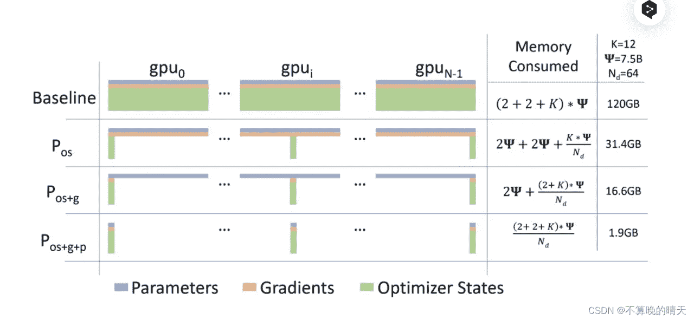

看上去比较高大上，可能让你很难专心去理解，但实际上，这个概念非常简单。这只是通常的 `DDP`，只是没有每个 GPU 都复制完整的模型参数、梯度和优化器状态，而是每个 GPU 只存储其中的一部分。在随后的运行过程中，当需要给定层的完整层参数时，所有 GPU 同步以相互提供它们缺失的部分 —— 仅此而已。

第二列给出了一个示例： `K=12`, `Ψ=7.5B`, `N=64` 可以看到显存优化相当明显。

在标准的数据并行中，每个显卡（`rank`）都会保存独立的权重、梯度和优化器状态，如上图中的 `baseline` 所示。那么每个显卡是否有必要存储全部的这些信息呢？ `ZeRO-DP`的答案是不需要 。`ZeRO-DP`能够对模型状态(权重、梯度和优化器状态)进行划分(不像标准`DP`那样进行复制)，然后通过动态通信调度来最小化通信开销。`ZeRO-DP`能够在保持整体通信开销接近标准`DP`的同时，线性地降低模型的 单显卡 显存占用。

### 3.1. ZeRO-DP的细节

总的来说，`ZeRO-DP`可以分为三个阶段：`Pos`, `Pg`, `Pp` 。三个阶段对应优化器状态划分、梯度划分和模型参数划分，并且三个阶段可以叠加使用(上图展示了三个阶段的叠加)。 关于三个阶段是否会增加通信量，会在后面分析，目前先接受这三个阶段并不会显著增加通信开销。

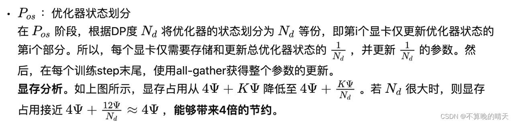

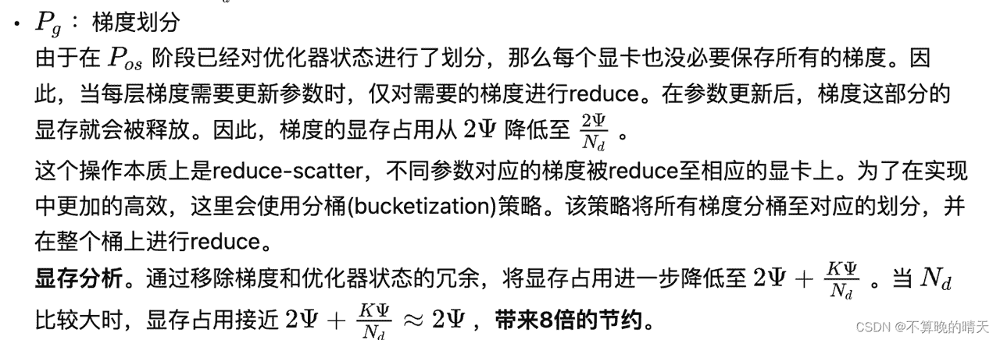

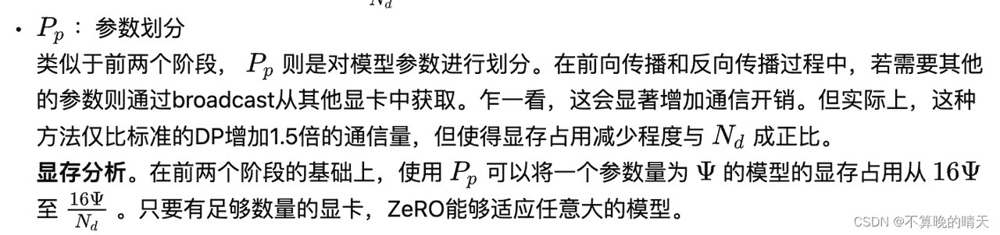

在`DeepSpeed`中，一般使用`ZeRO-1`就足够了。

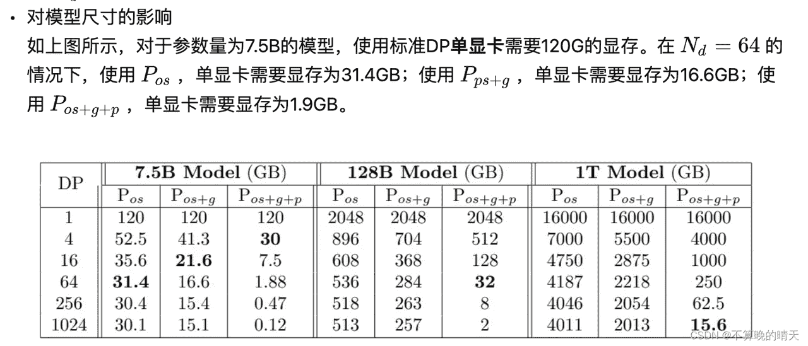

### 3.2 ZeRO-DP通信量

`ZeRO`通过去除显存的冗余来提升模型尺寸，那么该方法是否是通过通信量换取的显存效率。换句话说，`ZeRO-DP`相较于标准`DP`来说，通信量增大了吗？

答案分为两部分：(1) `ZeRO-DP`在使用 `Pos` 和 `Pg` 的情况下，能够带来8倍的显存降低且不增加额外的通信量；(2) 当同时使用 `Pos`、`Pg` 和 `Pp` 时，通信量增加1.5倍，同时降低倍的显存。

在分析之前，我们先回顾下常用的集合通信（`collective communication`）函数 `Collective Operations` 。

#### a. 标准数据并行的通信量

在标准的数据并行训练中，在反向传播结束后，跨显卡的梯度会被平均。这个平均的过程使用`all-reduce`。对于大尺寸的模型，`all-reduce`通信是整个通信带宽的上界，因此分析主要集中在`all-reduce`上。

传统数据数据并行在每一步（`step`/`iteration`）计算梯度后，需要进行一次`AllReduce`操作来计算梯度均值，目前常用的是`Ring AllReduce`，分为`ReduceScatter`和`AllGather`两步，每张卡的通信数据量（发送+接受）。总的来说，单个显卡在`reduce-scatter`或者`all-gather`的过程中，都会有 `Ψ` 的通信量。那么，整个`all-reduce`的单显卡通信量为 `2Ψ` 。

参考： [深度学习]Ring All-reduce的数学性质-CSDN博客

#### b. Zero-DP的通信量

`Pos` 的通信量

在单独使用 `Pos`的情况下，单个显卡会保存完整的模型参数和梯度。随后使用`reduce-scatter`将梯度`reduce`至不同的显卡上( 此时不同显卡仅拥有完整平均梯度的一部分 )，该步骤的通信量是 `Ψ` 。各个显卡使用部分梯度更新对应的优化器状态，然后再更新对应的参数( 此时每个显卡上的模型都更新了一部分参数 )。最后，使用`all-gather`将分布在各个显卡上的更新后参数分发自所有显卡上( 此时所有显卡上都有了完整的更新后参数 )，该步骤的通信量是 `Ψ` 。总的来说，各个显卡仅需要持有部分优化器状态即可，且总的通信量仍然是 `2Ψ` 。

## 四 DeepSpeed训练

### 4.1 基本训练的介绍

安装 `DeepSpeed`：

```
pip install deepspeed
```

1. 在训练脚本中导入 `DeepSpeed` 模块：

1. 在训练脚本中导入 `Trainer` 模块：

1. 创建 `Trainer` 对象，将模型、训练数据集、优化器等参数传入：

```
import deepspeed

from transformers import Trainer

trainer = Trainer(
    model=model,
    args=args,
    train_dataset=train_dataset,
    data_collator=data_collator,
    optimizer=optimizer,
)
trainer.train()
```

1. 使用 `DeepSpeed` 命令行工具运行训练脚本（单机）：

```
deepspeed --num_gpus=8 train.py
```

其中， `--num_gpus` 表示使用的 `GPU` 数量。

多节点：

```
deepspeed  --hostfile=hostfile  --master_port 60000 --include="node1:0,1,2,3@node2:0,1,2,3" run.py \
--deepspeed ds_config.json
```

`hostfile`

增加`hostfile`文件，填写`host`的相应的`gpu`数量(`slots=4`代表有4个`gpu`)

```
node1_ip slots=4
node2_ip slots=4
```

`include`参数，指定机器和`gpu`,如下代表使用`host1`机器的3号和`host2`的2、3号`gpu`

`ds_config.json`

```
{
  "fp16": {
    "enabled": true,
    "loss_scale": 0,
    "loss_scale_window": 1000,
    "initial_scale_power": 16,
    "hysteresis": 2,
    "min_loss_scale": 1
  },
  "optimizer": {
    "type": "AdamW",
    "params": {
      "lr": 3e-5,
      "betas": [0.8, 0.999],
      "eps": 1e-8,
      "weight_decay": 3e-7
    }
  },
  "scheduler": {
    "type": "WarmupLR",
    "params": {
      "warmup_min_lr": 0,
      "warmup_max_lr": 3e-5,
      "warmup_num_steps": 500
    }
  },
  "zero_optimization": {
    "stage": 3,
    "offload_optimizer": {
      "device": "cpu",
      "pin_memory": true
    },
    "offload_param": {
      "device": "cpu",
      "pin_memory": true
    },
    "overlap_comm": true,
    "contiguous_gradients": true,
    "sub_group_size": 1e9,
    "reduce_bucket_size": 1e6,
    "stage3_prefetch_bucket_size": 0.94e6,
    "stage3_param_persistence_threshold": 1e4,
    "stage3_max_live_parameters": 1e9,
    "stage3_max_reuse_distance": 1e9,
    "stage3_gather_16bit_weights_on_model_save": true
  },
  "steps_per_print": 2000,
  "wall_clock_breakdown": false
}
```

### 4.2 训练实战介绍

#### 1. 预处理和Json文件

首先是利用`huggingface`的`datasets.map`对数据集的样本自定义操作；`transformers`可以通过`trainer`集成`deepspeed`功能，这种用法需要提供配置文件，如下面的`deepspeed`配置文件`ds_config.json`文件。关于这个config具体配置可参考文档。

这里用的`FLAN-T5`模型；启动`deepspeed`：`deepspeed --include=localhost:1,2 train.py`，启动前两张显卡；注意使用`ZeRO3`需要有足够的内存

如果不使用`trainer`来集成`deepspeed`，`from_pretrained`和 `from_config`这样的核心功能应该包含`DeepSpeed`中的重要部分，例如`zero`。初始化`Zero`的时候应该为`stage3`或者更高。参考文档。

```
{
  "bf16": {
    "enabled": "auto"
  },
  "optimizer": {
    "type": "AdamW",
    "params": {
      "lr": "auto",
      "betas": "auto",
      "eps": "auto",
      "weight_decay": "auto"
    }
  },
  "scheduler": {
    "type": "WarmupLR",
    "params": {
      "warmup_min_lr": "auto",
      "warmup_max_lr": "auto",
      "warmup_num_steps": "auto"
    }
  },
  "zero_optimization": {
    "stage": 3,
    "offload_optimizer": {
      "device": "cpu",
      "pin_memory": true
    },
    "offload_param": {
      "device": "cpu",
      "pin_memory": true
    },
    "overlap_comm": true,
    "contiguous_gradients": true,
    "sub_group_size": 1e9,
    "reduce_bucket_size": "auto",
    "stage3_prefetch_bucket_size": "auto",
    "stage3_param_persistence_threshold": "auto",
    "stage3_max_live_parameters": 1e9,
    "stage3_max_reuse_distance": 1e9,
    "stage3_gather_16bit_weights_on_model_save": false
  },
  "gradient_accumulation_steps": "auto",
  "gradient_clipping": "auto",
  "steps_per_print": 2000,
  "train_batch_size": "auto",
  "train_micro_batch_size_per_gpu": "auto",
  "wall_clock_breakdown": false
}
```

#### 2. 训练代码

+ 数据：`samsum`数据集

+ 模型：`google/flan-t5-xxl`大模型


## 训练脚本

```python
import nltk
import torch
import evaluate
import datasets
import numpy as np
from nltk.tokenize import sent_tokenize
from torch.utils.data import DataLoader
from torch.nn.utils.rnn import pad_sequence
from transformers import AutoTokenizer, AutoModelForSeq2SeqLM
from transformers import Seq2SeqTrainer, Seq2SeqTrainingArguments

nltk.download("punkt")

dataset_name = "samsum" 
model_name = "google/flan-t5-xxl" 
max_input_length = 512
max_gen_length = 128
output_dir = "checkpoints"
num_train_epochs = 5
learning_rate = 5e-5
deepspeed_config = "./ds_config.json" 
per_device_train_batch_size = 1 
per_device_eval_batch_size = 1
gradient_accumulation_steps = 2 

tokenizer = AutoTokenizer.from_pretrained(model_name)

dataset = datasets.load_dataset(dataset_name)
print(dataset["train"][0])

def preprocess(examples):
    dialogues = ["summarize:" + dia for dia in examples["dialogue"]]

    model_inputs = tokenizer(dialogues, max_length=max_input_length, truncation=True)
    labels = tokenizer(text_target=examples["summary"], max_length=max_gen_length, truncation=True)
    model_inputs["labels"] = labels["input_ids"]
    return model_inputs

tokenized_dataset = dataset.map(preprocess, batched=True, remove_columns=["dialogue", "summary", "id"])

def collate_fn(features):
    batch_input_ids = [torch.LongTensor(feature["input_ids"]) for feature in features]
    batch_attention_mask = [torch.LongTensor(feature["attention_mask"]) for feature in features]
    batch_labels = [torch.LongTensor(feature["labels"]) for feature in features]

    batch_input_ids = pad_sequence(batch_input_ids, batch_first=True, padding_value=tokenizer.pad_token_id)
    batch_attention_mask = pad_sequence(batch_attention_mask, batch_first=True, padding_value=0)
    batch_labels = pad_sequence(batch_labels, batch_first=True, padding_value=-100)

    return {
        "input_ids": batch_input_ids,
        "attention_mask": batch_attention_mask,
        "labels": batch_labels
    }

model = AutoModelForSeq2SeqLM.from_pretrained(model_name)

metric = evaluate.load("rouge")

def compute_metrics(eval_preds):
    preds, labels = eval_preds
    if isinstance(preds, tuple):
        preds = preds[0]
    decoded_preds = tokenizer.batch_decode(preds, skip_special_tokens=True)
    labels = np.where(labels != -100, labels, tokenizer.pad_token_id)
    decoded_labels = tokenizer.batch_decode(labels, skip_special_tokens=True)
    decoded_preds = ["\n".join(sent_tokenize(pred.strip())) for pred in decoded_preds]
    decoded_labels = ["\n".join(sent_tokenize(label.strip())) for label in decoded_labels]
    result = metric.compute(predictions=decoded_preds, references=decoded_labels, use_stemmer=True)
    result = {k: round(v * 100, 4) for k, v in result.items()}
    prediction_lens = [np.count_nonzero(pred != tokenizer.pad_token_id) for pred in preds]
    result["gen_len"] = np.mean(prediction_lens)
    return result

training_args = Seq2SeqTrainingArguments(
    output_dir=output_dir,
    per_device_train_batch_size=per_device_train_batch_size,
    per_device_eval_batch_size=per_device_eval_batch_size,
    gradient_accumulation_steps=gradient_accumulation_steps,
    eval_accumulation_steps=1, 
    predict_with_generate=True,
    fp16=False,
    learning_rate=learning_rate,
    num_train_epochs=num_train_epochs,

    logging_dir="logs",
    logging_strategy="steps",
    logging_steps=50, 
    evaluation_strategy="steps",
    eval_steps=500, 
    save_steps=500,
    save_total_limit=2,
    load_best_model_at_end=True,
    deepspeed=deepspeed_config, 
    report_to="all"
)

trainer = Seq2SeqTrainer(
    model=model,
    args=training_args,
    train_dataset=tokenized_dataset["train"],
    eval_dataset=tokenized_dataset["validation"],
    data_collator=collate_fn,
    compute_metrics=compute_metrics,
)

trainer.train()

print(trainer.evaluate(tokenized_dataset["validation"]))

print(trainer.evaluate(tokenized_dataset["test"]))

trainer.save_model("best")
```

## 加速训练方法

加速训练方法：量化 [工具包](https://so.csdn.net/so/search?q=%E5%B7%A5%E5%85%B7%E5%8C%85&spm=1001.2101.3001.7020)`bitsandbytes`、`deepspeed`（先读`torch.distributed`和`ColossalAI`在搞）、`llama.cpp`量化模型

### 4.3 deepspeed加速Bloom lora微调

#### 1. 配置文件

```json
{
  "train_micro_batch_size_per_gpu": "auto",
  "gradient_accumulation_steps": "auto",
  "steps_per_print": 50,
  "gradient_clipping": 1.0,
  "zero_optimization": {
    "stage": 2,
    "offload_optimizer": {
      "device": "cpu"
    },
    "contiguous_gradients": true,
    "overlap_comm": true
  },
  "zero_allow_untested_optimizer": true,
  "fp16": {
    "enabled": true,
    "loss_scale": 0,
    "loss_scale_window": 1000,
    "hysteresis": 2,
    "min_loss_scale": 1
  },
  "optimizer": {
    "type": "Adam",
    "params": {
      "lr": "auto",
      "betas": "auto",
      "eps": "auto",
      "weight_decay": "auto"
    }
  },
  "activation_checkpointing": {
    "partition_activations": true,
    "contiguous_memory_optimization": true
  },
  "wall_clock_breakdown": false
}
```

#### 2. 训练代码

- 数据：使用`BELLE`提供的100万条指令微调数据
- 模型：`bloomz-7b1-mt`模型

`deepspeed --include=localhost:0,1,2,3 train.py` 启动


# [【LLM】DeepSpeed分布](https://blog.csdn.net/qq_35812205/article/details/131607096)式训练框架_山顶夕景的博客-CSDN博客

## 依赖导入与随机种子设置

```
import os
import torch
import random
import datasets
import numpy as np
from tqdm import tqdm
from typing import Dict
from torch.utils.data import DataLoader
from transformers import (
    AutoModelForCausalLM,
    AutoTokenizer,
    DataCollatorForSeq2Seq,
    TrainingArguments,
    Trainer
)
from peft import (
    LoraConfig,
    TaskType,
    get_peft_model,
    get_peft_model_state_dict,
    set_peft_model_state_dict
)

def set_random_seed(seed):
    if seed is not None and seed > 0:
        random.seed(seed)
        np.random.seed(seed)
        torch.manual_seed(seed)
        torch.random.manual_seed(seed)
        torch.cuda.manual_seed(seed)
        torch.cuda.manual_seed_all(seed)
        torch.backends.cudnn.deterministic = True

set_random_seed(1234)
```

## 数据与模型配置

```
LORA_R = 8
LORA_ALPHA = 32
LORA_DROPOUT = 0.1

EPOCHS = 3
LEARNING_RATE = 5e-5
OUTPUT_DIR = "./checkpoints"
BATCH_SIZE = 4
GRADIENT_ACCUMULATION_STEPS = 3

MODEL_PATH = "bigscience/bloomz-7b1-mt"
DATA_PATH = "./data/belle_open_source_1M.train.json"
MAX_LENGTH = 512
PATTERN = "{}\n{}"
DS_CONFIG = "ds_zero2_config.json"
tokenizer = AutoTokenizer.from_pretrained(MODEL_PATH)

dataset = datasets.load_dataset("json", data_files=DATA_PATH)
```

## 数据预处理

```
def tokenize(text: str, add_eos_token=True):
    result = tokenizer(
        text,
        truncation=True,
        max_length=MAX_LENGTH,
        padding=False,
        return_tensors=None
    )

    if (result["input_ids"][-1] != tokenizer.eos_token_id
            and len(result["input_ids"]) < MAX_LENGTH
            and add_eos_token):
        result["input_ids"].append(tokenizer.eos_token_id)
        result["attention_mask"].append(1)
    result["labels"] = result["input_ids"].copy()
    return result


def preprocess(example: Dict, train_on_inputs: bool = False):
    prompt = example["input"]
    response = example["target"]
    text = PATTERN.format(prompt, response)
    tokenized_inp = tokenize(text)

    if not train_on_inputs:
        tokenized_prompt = tokenize(prompt, add_eos_token=False)
        prompt_tokens_len = len(tokenized_prompt["input_ids"])
        tokenized_inp["labels"] = [-100] * prompt_tokens_len + tokenized_inp["labels"][prompt_tokens_len:]
    return tokenized_inp


train_data = dataset["train"].shuffle().map(preprocess, remove_columns=["id", "input", "target"])
print(train_data[0])


collate_fn = DataCollatorForSeq2Seq(tokenizer, pad_to_multiple_of=8, return_tensors="pt", padding=True)
```

## 模型加载与 LoRA 微调

```
device_map = {"": int(os.environ.get("LOCAL_RANK") or 0)}

model = AutoModelForCausalLM.from_pretrained(MODEL_PATH, torch_dtype=torch.float16, device_map=device_map)


lora_config = LoraConfig(
    task_type=TaskType.CAUSAL_LM,
    inference_mode=False,
    r=LORA_R,
    lora_alpha=LORA_ALPHA,
    lora_dropout=LORA_DROPOUT,
)

model = get_peft_model(model, lora_config)
model.config.use_cache = False
old_state_dict = model.state_dict
model.state_dict = (
    lambda self, *_, **__: get_peft_model_state_dict(self, old_state_dict())
).__get__(model, type(model))

model.print_trainable_parameters()
```

## 训练参数配置与模型训练

```
args = TrainingArguments(
    output_dir=OUTPUT_DIR,
    per_device_train_batch_size=BATCH_SIZE,
    gradient_accumulation_steps=GRADIENT_ACCUMULATION_STEPS,
    warmup_steps=100,
    num_train_epochs=EPOCHS,
    learning_rate=LEARNING_RATE,
    fp16=True,
    logging_steps=50,
    evaluation_strategy="no",
    save_strategy="steps",
    save_steps=2000,
    save_total_limit=5,
    deepspeed=DS_CONFIG
)


trainer = Trainer(
    model=model,
    train_dataset=train_data,
    eval_dataset=None,
    args=args,
    data_collator=collate_fn
)
trainer.train()
model.save_pretrained("best_model")
```
