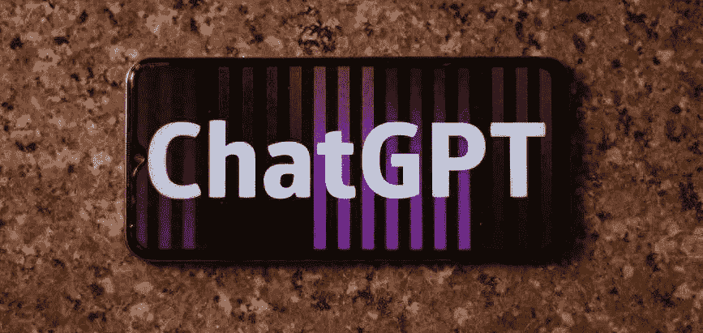

# 2023-08-25“如何从0-1训练出一个ChatGPT？”-今日头条

> 来源：https://xuqiwei1986.feishu.cn/docx/DHxwdRejPoa93uxwOpNcZLXhnng  
> 🔗 原文链接：https://www.toutiao.com/article/7271098636459819557/?log_from=b62fbfcf02585_1693808875486

2023-08-25 11:41 · i黑马

1. 什么是AI？大模型的本质是什么？
2. AI大模型，能实际帮企业干什么？
3. 如何从0-1训练出一个大模型？
4. 设计AI大模型产品有哪些经验？
5. 产业AI化，大模型给产业带来哪些变革？
6. AI产业化，大模型自身产业会如何发展?
7. 未来大模型发展将面临哪些新挑战？

只有真做大模型的企业，才能回答出这7个问题

循环智能 发布了自主研发的千循大模型。此前，循环智能跟华为云一起联合发布了盘古大模型。当时大模型参数量级超过了1000亿，也就是说循环智能在2021年就已经迈入千亿大模型俱乐部。

麒麟合盛APUS 发布了天燕大模型AiLMe。基于天燕大模型AiLMe，APUS还推出了文本模型、图像模型、视频模型、音频模型四个垂直领域精炼模型，并研发出智能问答大师、简笔成画、墨染等 7 款 AI 消费端产品。

竹间智能 以大小模型双轮驱动，以NLP为核心技术。在以ChatGPT为代表的LLM（大语言模型）技术掀起全球浪潮之际，竹间对所有产品系列进行了全线升级，并推出运用多种LLM技术的成熟AIGC企业级产品。

## 01 什么是人工智能？大模型的本质是什么？

麒麟合盛APUS邓小波

说到人工智能，就无法绕过机器学习这个概念。

过去，大多数计算模型都是基于参数规模较小的判决式算法，是一些“小模型”。

如今发现，基于大量数据和海量算力的“大模型”，是一条相对更容易的路径。

基于海量训练数据和大参数规模神经网络的大模型输出的语言或文字，能更好地满足用户问答或各种场景需求，从而将人工智能的能力应用到自动驾驶、智能助理等各行各业。

这很有可能，成为整个人类社会的第四次科技革命，影响力甚至超越互联网。

实际上，我们也判断这可能是未来30-50年间最大的技术浪潮，是唯一一个可以同电力革命相媲美的技术革命。

正因为如此，在国内现在已经有100多家企业在做大模型，还有很多的企业在观望如何参与其中。

那么，大模型的本质是什么？为什么它会有如此巨大的影响力？

大模型是人类历史上，第一次将所有的知识浓缩到一个模型里。

巨大的参数量，形成了足够大的神经网络，能够包容全世界所有的知识和信息。不但包括人类图书馆中的书籍、论文等，甚至包括在多模态下收集的各种图片和视频信息，这样它就可以更好地利用数据进行智能决策。

过去的“小模型”，比如阿尔法狗、人脸识别算法等，解决了局部领域或专业行业中的问题，效果还不错，但它们更多地是从局部的知识中学习，快速获得范式或相关内容。由于缺乏足够的常识，当需要跨出专业领域，与其他系统进行对接，或者与其他人进行交互时，会遇到许多瓶颈。

而“大模型”，具有了人类的常识，会出现“智能涌现”现象。

例如In-context Learning上下文学习，CoT知识链推理。这有点类似于人类中出现贝多芬和爱因斯坦这样的天才的情况，你无法预测哪个环节会出现贝多芬或爱因斯坦。

这就意味着，机器具备了像人一样，举一反三的能力。

虽然有些知识我们可能没有教过它，但是它可以处理相关问题。

更重要的是，大模型和小模型在商业化范式上也会有所不同。

对于小模型来说，每个场景可能都需要单独训练，遇到不同场景，还要重新开始训练，每次训练需要付出对应的成本，这样成本一直不会降低；

而对于大模型来说，建设基础通用大模型的初始投入可能会比较大，但它精炼行业模型并应用到千行百业中的边际成本相对比较低，是一种用固定成本取代边际成本的商业范式，应用越广平均成本越低，让人工智能产业有了更大的盈利可能。

当年互联网最性感的地方，就在于增加新用户时，它的边际成本相对较低，大模型也是如此。

大模型会成为未来AI时代的“操作系统”，在它上面会生成很多应用，承载无数应用场景，为人类生活和生产提供赋能。

## 02 AI 大模型，能实际帮企业干什么？

循环智能施杨乐

拿我们自身举例，我们通过锚定三件事，来给企业赋能。

第一，是提升了解客户的能力。

第二，是提升整体企业团队服务的能力。

第三，是提升企业的管理能力，让管理者听见一线的“炮火”。

我们认为，最重要的第一件事情就是提升认知客户的能力。

在现在的经济环境下，我们的增量红利已经快要消失了，所以大家在维护客户、客户引流转化的过程中，更多是强调对现有的客户做更精细化的运营。那么我们应该怎么了解我们的客户、怎么做市场调研、怎么对客户做分层呢？

传统的做法一般是在线上找卖点、找咨询公司做调研问卷等，但是这些手段的弊端其实显而易见，比如说线上埋点，一个促销活动搞两个礼拜，你埋点都埋了一个多礼拜，这容易导致时效性不高。调研问卷也是如此，而且调查问卷还存在真实性存疑的问题。

那么AI大模型怎么能够怎样帮我们去分析这件事情？

你可以想象成，销售或服务人员在服务过程中，旁边都坐了“第三个人”——大模型。

它不仅默默的听你跟客户聊什么东西，它还能够通过发现问题、进行解决方案提炼、情感分析、根因分析等，最后告诉你客户提到了什么问题、原因是什么，并帮你做一个总结提炼。

有了这样的技术，我们就可以对客户分析进行批量处理了，这个场景非常符合前面提到的4个特征，双边实时、广泛、流动和智能。当我们对每一个客户都做总结的时候，它可能每一通会话都非常精炼，但它不规范。但这时我可以让大模型对已经总结过的提炼和问题再做总结归纳，然后再进行统计分析，因为这些资料已经归一化了。

AI大模型可以帮助我们对一个非常广泛的数据、大量的数据、新鲜的数据马上做一个分析，并针对你当时想到的问题做高度的总结提炼和最终结论的输出。

第二件事情，是我们要去提升整体团队的服务能力。

我们在客户服务的过程中，客户会问问题，有的时候也会遇到挑战我们专业服务情况出现。在这里面，AI大模型就会承担一个智慧小秘书的角色。虽然前些年也有非常多的产品在做智慧辅助这件事，但AI大模型最大的不同其实在于以下两点，第一个它能够更加精准的识别客户的问题，包括识别上下文、识别情感等。第二个是它提供的答案会更加准确，因为它的知识检索效率非常高。

那么AI大模型在线下的客户服务场景中能不能用呢？其实也能用，比如房地产和汽车的线下销售，很多销售人员在跟客户见完面以后都会有做笔记的习惯，甚至一个汽车的4s店销售曾跟我说，每个客户长什么样子、穿什么衣服、身高多少，他可能都会用小笔记记一下，这样客户下一次来的时候，才能第一眼就认出对方，并知道他之前有过什么样需求，以此实现更好地转化。

做小笔记这件事情，其实完全可以用自主录入的工具去完成，比如我们的一个产品“客户的智慧描摹”，销售在接待完客户之后，可以马上掏出手机进行录音，录音的过程中会提到客户长什么样子、有什么需求、需要什么产品、对我们产品是什么要求等，讲完后AI系统就会帮忙分析，并且记录客户的重要点。这相当于给每一个销售服务人员都配备了一个导师，帮助提升他们的营销转化效率和能力。

第三件事，就是提升我们管理的质量，让管理者听见一线的炮火。

很多中高层的管理脱离一线久了，都会想知道现在的一线是如何服务客户，但如果他没有亲自下一线，就很难去了解相关内容。现在通过AI大模型，只要是能够拿到客户的沟通记录，我们的AI就可以去提炼一个完整的客户服务SOP流程。

通过大模型，我们可以看到业绩比较优秀的服务人员、销售人员的服务模式是什么样的，他的话术、服务逻辑又是什么样的。大模型有能力去分析每一通服务的过程，管理者就不需要自己去听录音了，听录音效率很低，而AI大模型可以通过总结和提炼直接告诉你最终的结果。

我们的大模型也可以去做一些决策类的分析。

我们曾给汽车领域的客户做过一个产品，场景是通过大量的沟通内容分析后对大模型进行提问，比如：

今天的客户怎么样？总结一下今天的优势客户？客户一共提了哪些问题？客户意向怎么样？接下来我的跟进策略是什么？

因为大模型它有能力去读取更加广泛、实时、大量的信息，经过一定的推理之后，是可以结合一些预先业务输入进行判断的。虽然它的判断不一定完全准确，但也可以给到我们的决策者更多的数据支撑。我相信很多管理者的决策都是要基于一个更加真实的数据样本，才能做出更加正确的决策和更加有效的管理动作。

## 03 如何从 0-1 训练出一个大模型？

麒麟合盛APUS邓小波

根据我们的经验，训练一个大模型，在技术路线上分为三个阶段：

在最初阶段，追求的是大参数，也就是说模型需要有足够大的容量，就像我们人类一样，要有足够多的脑细胞来承载知识。

在第二阶段，我们发现大型训练数据集比大参数更加重要，只有大型训练数据集才能获得更好的训练效果。

最近，我们进一步研究发现，更精准和清洁的数据、更加实时的数据，可能会取得更好的训练效果。

实际上，大参数就相当于大模型的底盘，大底盘能承载更多理论知识，但最终并不能决定这个模型的优劣。

以Google为例，曾推出过一个5400亿参数的大模型PaLM，但实际上评测效果反而不如ChatGPT1750亿参数的模型，这也引发了行业内很多反思。

大模型的成长也有成熟期，到了成熟期，当拥有了基础参数和一定的规模能力以后，大脑的聪明程度更多取决于神经网络的发展。当参数规模扩大后，如果其吸收能力无法满足训练数据的规模增长，也无法达到理想效果。国外的一些理论研究表明，使用20倍以上参数规模的数据去训练的时候，效果会比较好。

通用大模型预训练阶段，采用的数据基本上是无标注的，海量原始数据可能存在不精准或互相矛盾等问题，从而影响到最终训练效果。需要在后续的微调过程中，通过提升数据质量来进行输出对齐，使其更精准、更实时、更有效，让大模型的输出效果变得更好。

除了选择技术路线之外，大模型训练还有四大要素——场景、数据、算法、算力。

许多专家都会提到后面三个要素，但是在我们看来，场景一个是非常重要的要素。

在算法层面，对于一些大型企业来说，大家的差异并不大，主要集中在框架中的神经网络层数、参数规模、token维数、学习率等许多细节方面。

今年上半年，大家都在关注如何购买足够的算力，为未来的大规模计算做战略储备。

我们预测，在今年下半年之后，人们会意识到最终决定应用效果的最重要因素仍是大模型本身的性能效果，而影响其性能效果的关键是训练数据。

在大模型应用层面，将需要更多的行业内专业人员来对数据进行整理和输出，以便更好地与行业数据对齐，从而达到期望的效果。

与此同时，大模型开发者也需要更快地与场景和行业结合，以获取更好的行业数据进行模型训练，不断迭代服务，实现数据飞轮的运转。

因此，我们认为：

下半年场景和数据可能是大模型企业或相关产业链条中决战的关键因素。大模型谁最终能跑得好，主要取决于谁能拥有更好的数据和更多应用场景。

一个大模型在训练结束后，在教会大模型掌握全人类的知识和常识后，还要让它学会在不同行业中的话术，进行沟通交流，让专业人员更好地理解和适应它——我们称之为“对齐”。

“对齐”实际上包括很多方面，既包括知识对齐，也包括法律法规和价值观对齐。在运行过程中也可能存在一些矛盾，比如需要人员去帮助它了解哪些观点是正确的，以及如何将话术转化为让客户更能接受或喜闻乐见的内容等等。

在行业应用中，模型本身并不创造任何价值，它只是在技术上的储备，只有在行业“对齐”并输出后，帮助行业赋能，实现产业升级，才能创造价值。

## 04 设计 AI 大模型产品有哪些经验？

循环智能施杨乐

设计AI大模型产品需要满足4个特征。

我们要思考的问题，即什么样的AI应用才能够给我们的企业带来超额的价值。注意，我这里强调的是“超额的价值”，因为用老旧的技术其实也能解决一些问题，以前我们能做到8分，现在通过一个跨世纪的技术如果只提升到9分，价值就不够明显。

因此我们需要遵循高价值AI应用的4个特征，去设计我们的AI大模型应用和产品。

第一个特征，数据实时双边在线。

即数据应用一定是输入、输出同时在线，它的整体价值才会达到最大。比如抖音为什么火爆、在海外上线两个月就能突破1亿人的注册量？很重要的原因之一就是因为抖音的创作者发布视频非常方便，并且一经发布，用户马上就可以看到。

第二个特征，数据处理消耗大量边际计算资源。

这句话乍一听，好像有点不太有道理，为什么消耗资源越多就越有价值？因为这点指的是调动更多的资源来为它服务。比如搜索一个问题，如果你只在自己的电脑上搜索，就只能搜索到电脑里的知识库和文档；但如果通过谷歌、百度等搜索网站，调动的就是全世界的知识来帮你解决问题，这时它消耗的边际资源虽然很大，但是回报也非常大。

第三个特征，数据流动和交换的速度快，范围广。

比如以前没有高速公路的时候，从A地到B地可能需要半个月、一个月，有了高速公路我们可能只花一天就到了，它带来的效益是非常大的。所以我们需要快速的数据流动、广泛的应用数据，这样对我们的价值才更宝贵。

第四个特征，做现在用人工做不到的事。

我举两个案例。第一个是谷歌翻译，可能全世界的翻译工作者一年翻译的书还不及谷歌翻译一天翻译出来的文字量大，所以这是人类做不到的事情，只有技术才能做到。

第二个是智慧城市，一个城市一天产生的交通道路监控视频，光靠⼈可能100年都看不完，这些宝贵的数据绝大多数还没有发挥过作用就已经被默默删除。但由于人工智能的兴起，这些数据靠人虽然做不完，但是靠技术可以，可以通过视频去抓违章、查看走私人口、抓逃犯等。

所以我们的AI也一定是遵照这4个特征去做，过去靠人工无法做到的事情，带来的价值将更大。

## 05 产业 AI 化，大模型给产业带来哪些变革？

竹间智能孙彬

AI大模型给产业带来哪些变革？

我来站在从业者的视角分析一下。

首先想一下，Chat GPT给大家带来的是什么？

相信所有跟它做过对话的人都不仅仅是为了好玩，大家会感觉到“我是在跟一个智能体对话”。

这代表了什么？代表人类可以跟大模型进行沟通了。

它能理解你，能回答你，能帮你去执行。大语言模型最好的一点就是它用一种“暴力”的方式带来了足够多的知识，然后又可以理解人的情绪，可以跟人对话，这恰恰将以前人和机器交互的瓶颈问题解决了。

我的第一个判断，是大模型会改变我们现在的软件范式。

相信做IT的同事们对此都有切身体会，当PC出现的时候，当互联网到来的时候，当手机应用开始爆发的时候，软件范式都曾发生过改变，从工业软件到PC软件，到网站和手机APP，再到现在的大模型热潮，软件范式又将被改写一次。

那么，大语言模型来了以后，软件应用会是什么范式？我们通过对话的方式就可以调动各种各样的应用。

如果说以前我们是应用为主导，今后我们可以非常明确地想象，人会跟手机或者智能硬件沟通，然后由它来完成相应的软件操作，所有应用之间的屏蔽会被打破，应用的能力会被调用，大语言模型直接调动应用能力会形成新的交互方式，这将是一个新的操作系统，新的“iPhone 时刻”。

在未来2到3年内,我们大量的C端应用，都会因为对话方式的改变而改变，很有可能不再是触摸式输入，而是语音输入，很多行动也会打破应用的边界，可能每个手机都会有个AI助手，它可以通过对话的方式调度多个应用能力，下单、叫车、购买都可以通过语音来完成，接下来会有千千万万个基于类ChatGPT模型的应用出现。

以上是C端的变化，那么B端会怎样变化？

我的第二个判断是，在B端，企业/行业的私域知识会变得至关重要，产生大量的企业ChatGPT、行业ChatGPT。

目前，大语言模型的特点是它可以高度理解人的语义，并且可以做一些深层次的工作，比如写作、推理、分析等等，但是它的知识是不可被依赖的。这是因为用来训练的互联网数据是不可靠的，今天的大语言模型实际上是一个对话模型，并不是一个问答模型。

它是为了对话而产生的，所以它会妥协，会认错，为了让对话继续进行下去，它会根据对话的人的喜好改变内容，但是它并不是一个具备正确知识的模型。

但对企业客户来说，我们的行业总监、客服、营销人员、政策咨询人员，绝对不能给客户不准确的知识。

所以，在B端一定会发展成这样的范式：大语言模型做沟通和理解，加上私域知识——准确的私域知识——然后驱动行业/企业的应用，行业/企业的应用也会因为这一变化而变化。

那么，企业的私域知识怎样构建？我们可以回顾一下企业数字化的发展过程：

最早的时候，我们把设备联网叫数字化，这是第一代的生产数字化。

第二步，我们将ERP，包括生产制造系统使用起来，实现全业务流程IT化，这是第二代的资产数字化。

现在，我们有了大语言模型，有了行业/企业的私域知识，真正地让企业的hr部门、行政部门、销售部门、客服部门……所有的知识全部用对话或者阅读的方式表达出来，就真正让企业智能化了。

人工智能发展到一定阶段之后，可以将知识利用起来，就实现了进化，我们将从数字化时代进化到数智化时代。

在接下来的时间，我们会看到越来越多的企业将部门的知识、企业的知识甚至行业的知识利用人工智能技术变成知识库，变成可以被AI构建和调用的知识，形成知识流，然后让这些知识变成数字人，服务我们的企业，服务我们的客户。

我们可以预测,在未来的一年，企业服务的这些内容会呈现指数级的增长，会提升至少10倍以上。从事To B行业的创业者，一定要对此做好准备。

## 06 AI 产业化，大模型自身产业会如何发展?

麒麟合盛APUS邓小波

未来的人工智能大模型产业架构，可以与城市生态做类比：

算力是一种资源，相当于土地，需要我们投入真金白银购买、租用或生产。

大模型相当于基建，可以与专利结合起来，形成有用的数据资产。就像土地开发一样，单纯土地的价值可能不大，但完成基建建设后，土地才可能会变成有价值的地产。

在大模型之上，会提炼出各行各业的行业模型和精炼大模型，就像在城市基建基础上，开发出各种不同的商业和住宅。

在不同的商业和住宅区，还会形成不同的社区生态，大模型应用中同样也会实现不同的产业应用生态，供不同的终端用户或客户使用。

这就是整个人工智能大模型产业的架构。

在这里，我们可以看到两个关键点：

1）行业模型在确定性和控制性方面可能比普通消费者使用的模型要求更高；

2）对于消费者来说，更多的模型需要创新和开放，以生成更多新内容。两者的侧重点可能略有不同。实际上，在大模型开发中，这是一种能力的体现，你需要有侧重点，以达到最终的生态要求。

# 07 AI 大模型发展将面临哪些新挑战？

竹间智能孙彬

作为技术从业者，我在这里跟大家分享几个我们看到的新挑战：

## 第一个挑战：大模型阅读还是知识图谱预建？

过去我们做了很多的知识图谱，但是今天的大语言模型可以阅读文档，可以阅读那些非结构化的数据。那么，到底是不是还需要建立知识图谱？换一种说法，就是今天是要预设好答案，方便来问答和查询，还是要让大语言模型自己去阅读内容，然后给你答案？

其实，这两种实践路径都可以完成很多的内容查询，但是最终哪个效果好，哪个准确率高，我相信应该是不同的场景使用不同的模式。也许有人会问两种结合在一起会不会更好？答案很值得期待，希望我们的从业团队用工程能力给出结果。

## 第二个新挑战：`Prompt`、`Embedding` 与 `Fine-tuning`

这三个词都是现在特别热的词。`Prompt`是提示词，`Embedding`指嵌入接口，`Fine-tuning`指模型微调，都是训练大模型要做的工作。但目前其实并没有多少团队能够把模型调好，可能在微调的过程中间，越调越差。

所以今天我给到大家的建议，就是不要迷恋对大语言模型进行微调，最终要以结果可控和高质量目标作为标准。利用大语言模型的能力加上自身的工程能力，比如对知识图谱、对客户数据的调用，然后利用数据的能力，最终满足客户的需要才是王道。

## 第三个新挑战：通用大模型还是专业模型？

我的观点是通用大语言模型有它的优势，专业模型也有它的场景，每个模型其实都有它的能力特点。我们认为通用大语言模型适合于To C端进行对话和训练，专业的模型适合于在行业内调取专业的知识，完成专业的任务。

## 第四个新挑战：大模型应该云端调用还是私域部署？

在10年前，大家就在讨论公有云好还是私有云好，其实我们看到今天这两者是并存的。云计算和`AIGC`产业发展有相似之处，通用模型适合于各种各样的中小企业，通用灵活；专业模型安全性高，数据可以控制，它要为企业服务，数据要准确，要完成不同的任务。

所以我们可以这样预测，未来会有几个头部的企业提供最优秀的大语言模型来为大家服务，但同时也会有千千万万的行业私有云、企业私有云，千千万万的行业模型和企业模型。

未来，公有的大模型一定会越做越强，会由头部的几个企业来领导，行业的私有模型一定会百花齐放，这也是我们很多To B企业的商机。

我们相信，`ChatGPT`现象将给我们带来巨大的`AIGC`红利。写作类、绘画类、创作类的职业会实现巨大的提效。

大模型归根到底是一个工具，会使用工具的人将会淘汰不会用工具的人。

智能家居行业会有很大的发展，过去每个家庭的环境太复杂，所以大家没有办法在家庭环境中预设好各种对话，现在大语言模型应用之后，对智能家居行业又会有很大的促进。

同样还有个人助手类的应用，我认为会有极大的发展。`AI`可以帮你订机票、订餐、更改日期，还有去执行一些预约，甚至去购买一些东西，我们期待着今年下半年会有很多个人助理类的应用大爆发。

此外，还有元宇宙的`IP`众包模式、情感陪伴类产品等等，都会迎来爆发。

感谢：竹间智能总裁兼COO孙彬、APUS麒麟合盛联合创始人邓小波、循环智能解决方案高级总监施杨乐 等人的真诚分享。
