# 大模型专属知识库搭建 SOP

> 来源：[https://xuqiwei1986.feishu.cn/docx/HQ5rdPQP6o4AlZxpe9ecMkVNn1e](https://xuqiwei1986.feishu.cn/docx/HQ5rdPQP6o4AlZxpe9ecMkVNn1e)

大家好，我是river，正在参加AI之心写作营。

得益于海量的训练数据和大量的模型参数，类 `chatgpt` 大模型在各个知识领域上均有令人惊艳的表现。

> 大模型（large language model, 后续简称 LLM ），一般指模型参数达到 10 亿级别以上的模型，如 `chatglm`（60 亿）、`OpenLLaMA`（130 亿）、`gpt3`（1750 亿）等。为什么都开始用大模型呢？因为研究发现，当模型参数增大到一定量级，模型效果会产生跨越式的提升，就像我们经常说的量变产生质变。

但是，对于一些特定的或是未曾学习过的专属知识领域，大模型却难以给出符合期望的结果。比如，企业客服、私有知识问答等。

那么，如何利用大模型搭建专属知识库问答助手呢？以下，我对各类方案进行了一个汇总，包含方案原理和具体实操，希望对你有所帮助。

# 一、方案原理

大模型在专有知识问答上表现不佳，原因是模型没有见过或学习过这些知识，自然也给不出我们想要的结果。解决思路就是：让模型看见或学习这些知识。

具体的，有两条路线：

（1）模型训练：根据专有知识做一个训练数据集，然后用大模型在数据集上进行微调，让模型去学习这些知识。类似于，你给模型出了一大本练习题，包含题目和答案，手把手教他做题。等他学会了，考试遇到类似的题目，就知道怎么做了

（2）外挂知识库：在问模型问题的时候，额外给他一些专有知识中的相关信息，让他从中找到正确的答案。类似于，你给模型出了一道阅读理解题，让他先读一大段文字，然后回答问题。

从描述中大家可以看出，路线 1 实现起来相对复杂，难度较大，具有较高的门槛，此处不做详细说明；本文收集的方案都是基于路线 2 完成的，也就是外挂知识库。

实现路线 2，有两个关键的步骤：（1）从知识库中挑选出与问题相关的内容。这里涉及到对文档的加载、切分、向量化、相似度比对等一系列的操作。（2）将挑选出的内容与问题，一起输入给大模型。主要涉及 `prompt` 的编写。

## 一）怎样从知识库中找到与问题相关的内容？

知识库的内容一般比较多，要想模型快速、准确地回答问题，首先需要为模型提供最相关的信息。

这一步对于最终的问答效果有着非常重要的影响。

试想一下，如果找到的信息太多、或者相关度不高，模型很容易迷失其中，难以给出准确的答案；类似于，你直接丢给他一本书，让他去书中寻找问题的答案，效果可想而知。另一方面，如果给的信息不足、甚至完全没有相关信息，模型也就无从参考。

那么，如何从海量的知识库中寻找与问题相关的信息？

### 1、知识库预处理

+ 加载、读取文件：读取存储在本地的知识库文件，通常是将其转化为文本格式

+ 文本分割（`Text splitter`）：按照一定的规则（例如段落、句子、`token` 数量等）将文本分割成各个部分，方便后续找到和问题相关度高的文本。

### 2、文本向量化和存储

+ 文本向量化：这通常涉及到 `NLP` 的特征抽取，可以通过诸如 `TF-IDF`、`word2vec`、语言模型等方法将分割好的文本转化为数值向量，方便后续的文本相似度计算，即检索和问题相关的文本。

+ 向量存储：文本向量化之后存储到数据库 `vectorstore`，常见的有 `Pincone`, `Qdrant`, `Waviate`, `Milvus`, `Chroma`等。

### 3、问句向量化

采用和知识库文本相同的向量化处理方式，将查询问题转为语义向量，用于问题和知识库文本之间的相似度计算。

### 4、从知识库文本中挑选 `top k` 个相关文本

这一步是信息检索的核心，一般可通过余弦相似度、欧氏距离等计算方式，找出与问题向量最接近的文本向量。这样，我们就找到了知识库中与问题最相关的 `top k` 个文本

## 二）将挑选出的内容与问题，一起输入给大模型

挑选出与问题的相关文本后，和问题一起组合成 `prompt`，输入给大模型。

prompt 示例如下：

```
"""已知信息：{context}

根据上述已知信息，简洁和专业的来回答用户的问题。如果无法从中得到答案，请说 “根据已知信息无法回答该问题” 或 “没有提供足够的相关信息”，不允许在答案中添加编造成分，答案请使用中文。 问题是：{question}"""
```

其中，`context` 部分就是相关的知识库文本，`question` 是查询问题。

## 三）整体流程图

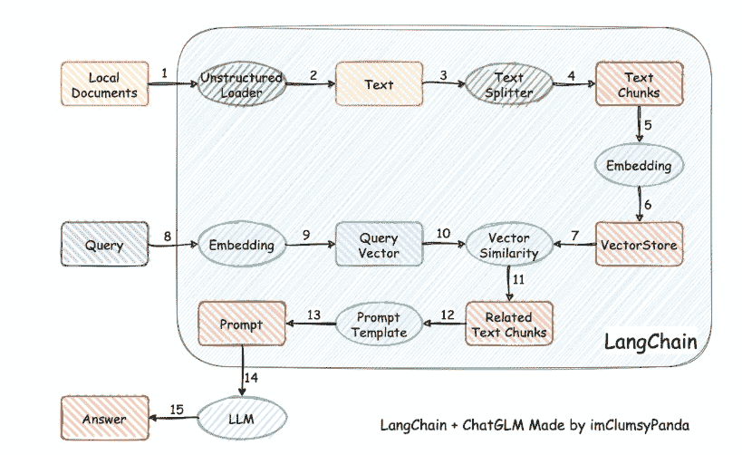

# 二、方案实现

具体的方案实现，主要在于以下几点：

+ 模型的选择和使用方式：开源模型或收费模型？本地部署还是调用 `API`？

+ 模型应用开发工具：`langchain`、`Quivr`、`闻达`

+ 知识库外挂形式：文档、`pdf`、数据库、知识图谱、联网搜索等

## 一）模型选择和使用方式

### 1、开源模型

+ 优点：免费，自由度高

+ 缺点：效果不及收费的商用大模型；需要 `GPU` 资源进行部署

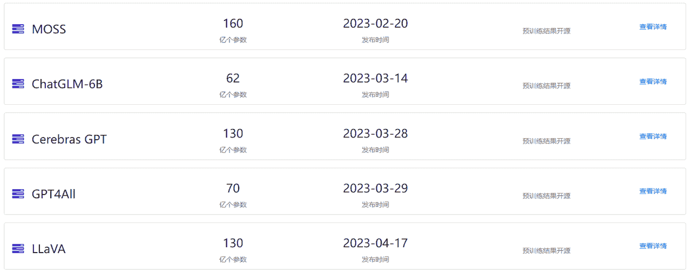

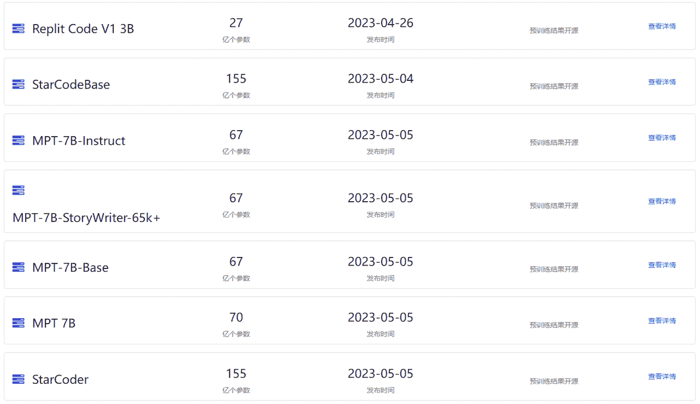

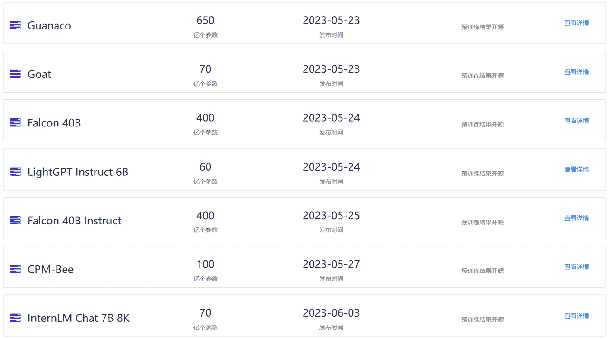

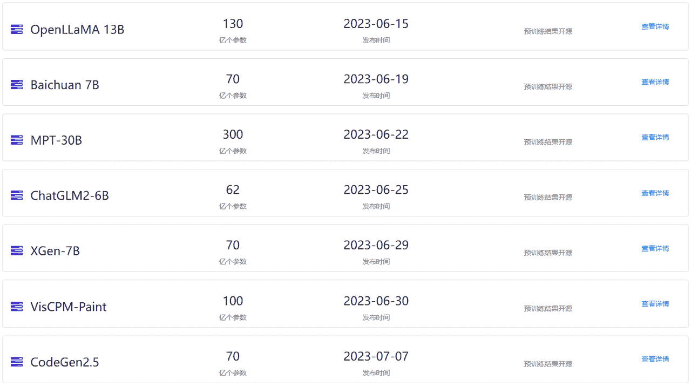

### 2、收费模型

+ 优点：效果好，`API` 调用，无需 `GPU` 资源

+ 缺点：收费、自由度低

更多大模型参考：

1）`https://github.com/zhengzangw/awesome-huge-models`

2）`https://www.datalearner.com/ai-models/pretrained-models?&aiArea=-1&language=-1&contextLength=-1&openSource=-1&publisher=-1`

## 二）模型应用开发工具

从上述的方案原理可以看出，要实现外挂知识库的大模型问答，需要实现多个功能模块：如文本加载、分割、向量化、模型调用等等。从头开始实现非常困难和复杂的。不过，做程序员这一行的都知道，你只需要用现成的轮子就行了。接下来，让我们看看几款大模型问答应用的开发工具。

### 1、`LangChain`

`LangChain`（`https://github.com/langchain-ai/langchain`）是一个大模型应用开发框架，将大模型开发应用的许多功能进行了模块化的封装，大幅提升开发效率。

按照官网的划分，主要有 6 大功能模块：

+ `Data Augmented Generation`

数据增强生成，其实就是我们这里说到的基于额外信息的问答。提供额外信息的形式有很多种，比如 `txt` 文档、`pdf`、知识图谱数据等。

这个功能模块中包含了文档加载、分割、向量化、存储、索引等所有功能，可以快速集成各类知识文档。

+ `LLMs and Prompts`

大模型和提示词。大模型部分封装了对不同模型的和管理和调用，如 `chatglm`、`palm`、`chatgpt` 系列等等，配置即用；提示词部分定义、封装了不同的提示词模版，如问答、对话、fewshot 等等。

+ `Memory`

记忆模块，用来保存和模型交互时的上下文状态，处理长期记忆，获得更加准确的结果。

主要包含两个部分：

1）将交互过程中的输入、输出进行记忆并结构化存储，为下一步的交互提供上下文；

2） 根据交互历史构建知识图谱，提供更多相关信息。

+ `Chains`

链接，其实就是针对不同应用场景，封装了对模型和多个组件的一系列调用。

具体的，针对不同形式的知识库，`chains`实现了不同的调用方式：

1) 与`Elasticsearch`数据库交互的：`elasticsearch_database`；

2) 基于知识图谱问答的：`graph_qa`: 其中 `chains/graph_qa/base.py` 便实现了一个基于知识图谱实现的问答系统，具体步骤如下：

首先，根据提取到的实体在知识图谱中查找相关的信息，它返回的是与实体相关的所有信息，形式为三元组；

然后，将所有的三元组组合起来，形成上下文；最后，将问题和上下文一起输入到 `qa_chain`，得到最后的答案；

3）自动生成代码并执行的：`llm_math` 等等

4）面向私域数据的：`qa_with_sources`，其中的这份代码文件 `chains/qa_with_sources/vector_db.py` 则是使用向量数据库的问题回答

5）面向SQL数据源的：`sql_database`，可以重点关注这份代码文件：`chains/sql_database/base.py`

6）面向模型对话的：`chat_models`，包括这些代码文件：`__init__.py`、`anthropic.py`、`azure_openai.py`、`base.py`、`fake.py`、`google_palm.py`、`human.py`、`jinachat.py`、`openai.py`、`promptlayer_openai.py`、`vertexai.py`

7）`constitutional_ai`：对最终结果进行偏见、合规问题处理的逻辑，保证最终的结果符合价值观

8）`llm_checker`：能让 `LLM` 自动检测自己的输出是否有没有问题的逻辑

+ `Agents`

代理，其实就是执行任务的一个具体对象，你可以理解为工具人，需要去调用上述的各个组件，如信息获取、模型调用、处理输出等等，直到任务完成。

`LangChain` 只是提供了大模型应用的各个功能模块，要搭建完整的知识库问答应用，还需要进行大量的代码开发。

### 2、`闻达`

`闻达`（`https://github.com/wenda-LLM/wenda`），官方介绍：一个 `LLM` 调用平台。目标为针对特定环境的高效内容生成，同时考虑个人和中小企业的计算资源局限性，以及知识安全和私密性问题，集成了以下功能：

1）知识库：支持对接本地离线向量库、本地搜索引擎、在线搜索引擎等。

2）多种大语言模型：目前支持离线部署模型有`chatGLM-6B\chatGLM2-6B`、`chatRWKV`、`llama`系列(不推荐中文用户)、`moss`(不推荐)、`baichuan`(需配合`lora`使用，否则效果差）、`Aquila-7B`、`InternLM`，在线`API`访问`openai api`和`chatGLM-130b api`。

3）`Auto`脚本：通过开发插件形式的`JavaScript`脚本，为平台附件功能，实现包括但不限于自定义对话流程、访问外部`API`、在线切换`LoRA`模型。

4）其他实用化所需能力：对话历史管理、内网部署、多用户同时使用等。

从功能来看，与 `langchain` 有些相似，也支持外挂知识库和多种大语言模型，但没有 `langchain` 全面和通用。

不过，这也和`闻达`的定位有关，针对的是开源模型的本地部署和调用；同时，封装了更多实际应用的功能，如多用户同时使用、对话历史管理等；也可以通过 `Auto` 脚本开发的形式，自定义一些功能角色（就是封装 `prompt`）。

相比于 `langchain`，`闻达`的封装程度更高，还提供了懒人安装包，可以一键运行部署，基本没什么代码开发量。

### 3、`Quivr`

`Quivr`（`https://github.com/StanGirard/quivr`），是专门面向知识库问答的开源解决方案，可本地部署，开箱即用。`Quivr`的特点在于：

1）直接调用大模型 `API`，如 `chatgpt` 系列、`claude`。（开源模型部署调用目前只支持 `GPT4ALL`）

2）文本向量化采用 `OpenAI embedding` 模型

3）采用 `Supabase` 向量数据库进行向量存储

4）支持各类形式的文件：`Text`、`Markdown`、`PDF`、`Powerpoint`、`Excel`、`Word`、`Audio`、`Video`

5）`Quivr` 使用了 `langchain` 框架

使用`Quivr`搭建知识库，你只需要部署完 `Quivr` 并配置好大模型 `API-key`、`Supabase` 链接，即可进行知识库的问答。不过，你需要解决网络限制的问题。

## 三）如何选择模型和应用工具

如何选择具体的方案，视具体情况而定。以下是我的一些个人看法，供参考。

首先你需要确定使用哪种大模型。商用大模型可直接调用 `API`，无需 `GPU` 资源，但存在持续使用费用，同时国外大模型可能还存在网络和合规问题；使用开源模型，则需要 `GPU` 资源支持，但不存在边际成本。

其次，选择应用工具。如果追求应用开发的高度灵活性，可使用`langchain`，各个功能模块可自由选择、设计，后续迭代、拓展也比较方便。如果想快速上线、没有什么定制化功能，可选择`闻达`或者 `Quivr`，基本没有开发工作。其中，`闻达`更适合选择开源大模型本地部署，`Quivr` 更适合调用商用模型的 `API`。

# 三、方案范例

了解了方案原理和实现方式，接下来，让我们一起看看几个优秀案例，动手搭建自己的专属知识库，体验一下实际效果。

## 一）基于 `LangChain` + `ChatGLM2` 搭建知识库

### 1、项目介绍

本地知识库的问答应用，对中文场景与开源模型支持友好、可离线运行

大模型：`ChatGLM2`（`https://github.com/THUDM/ChatGLM2-6B`）

`embedding`模型：`GanymedeNil/text2vec-large-chinese`

开发框架：`LangChain`

项目地址：`https://github.com/chatchat-space/langchain-ChatGLM`

特点：高度灵活、免费、数据安全性高，需要`GPU`资源支持

### 2、实操

运行环境：此处白嫖阿里云 `PAI-DSW` 产品，可免费体验 `A10`、`V100` 等 `GPU`。

1）下载源码

`git clone https://github.com/chatchat-space/langchain-ChatGLM.git`

2) 安装依赖

`cd langchain-ChatGLM`

`pip install -r requirements.txt`

3）下载`ChatGLM2`模型和`embedding`模型

`git lfs install`

`git clone https://huggingface.co/THUDM/chatglm2-6b $PWD/chatglm2-6b`

`git clone https://huggingface.co/GanymedeNil/text2vec-large-chinese $PWD/text2vec`

4）修改配置

在 `configs/model_config.py` 文件中，修改`embedding_model_dict`和`llm_model_dict`中的模型路径，分别配置为上一步下载的模型路径

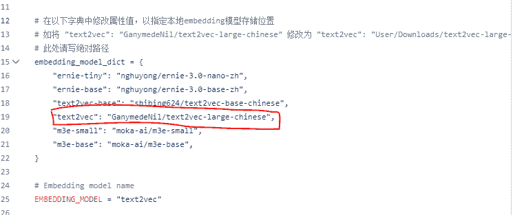

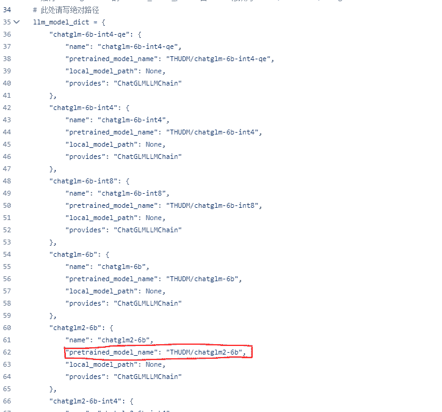

同时，`LLM_MODEL` 配置为 `chatglm2-6b`

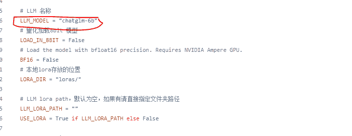

5）启动项目

`python webui.py`

6）上传文档，即可开始知识库问答

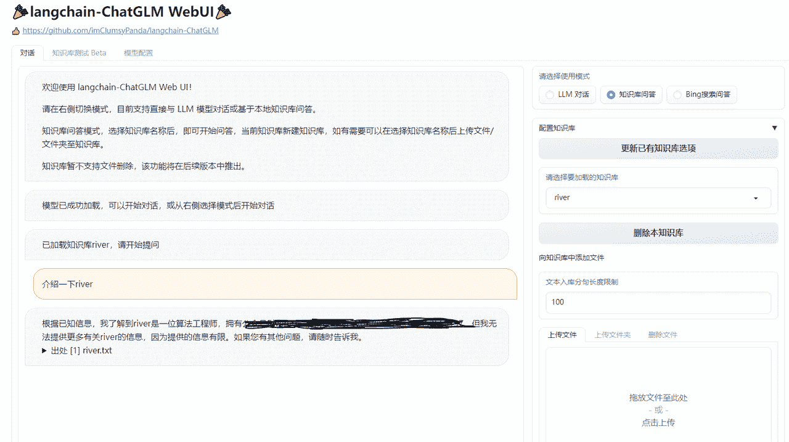

## 二）基于 `Quivr` 搭建知识库

### 1、项目介绍

直接采用 `Quivr` 工具搭建知识库，服务器部署好 `Quivr`，上传文件即可。

大模型：`gpt3.5/gpt4`

`embedding`模型：`openai embedding`模型

向量数据库：`supabase`

项目地址：`https://github.com/StanGirard/quivr`

特点：开箱即用，灵活性低、有持续费用、数据会经由外网、需要解决网络问题

### 2、实操

1）注册`supabase`（`https://supabase.com/`）账号并创建项目，用来存储向量化之后的知识库

注册很简单，用邮箱注册即可。登陆页面之后，点击创建项目，按照提示依次填写信息即可。


创建好项目之后，关注三个配置参数，后续会用到。

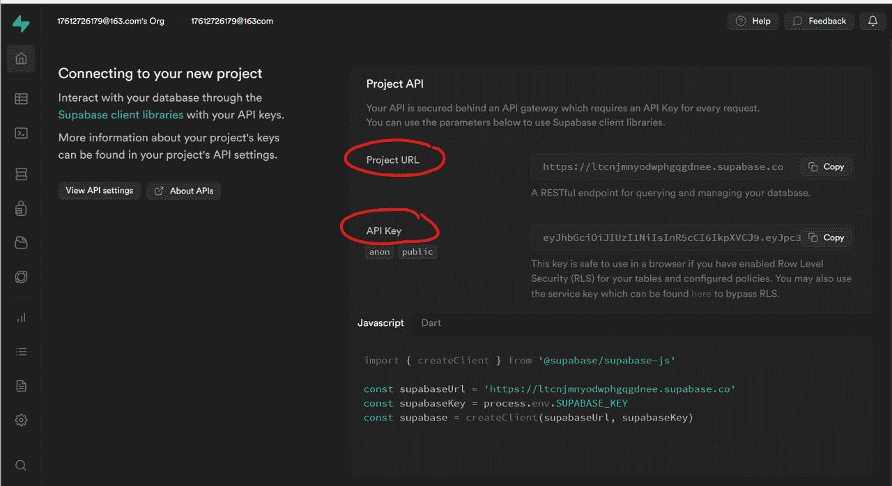

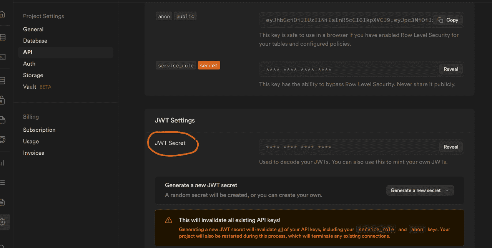

2）在创建好的 `supabase` 项目中创建库表

依次点击以下图标，在脚本编辑界面中粘贴以下三个`sql`语句，然后点击执行，创建库表。

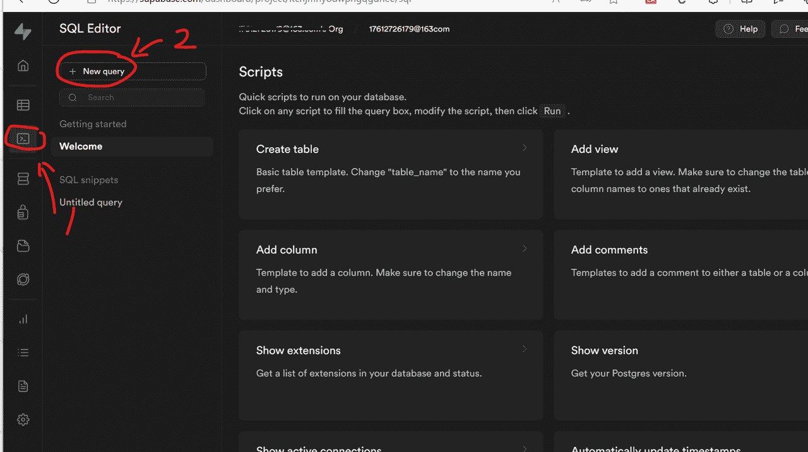

```
create extension vector;

-- Create a table to store your documents

create table if not exists documents (

id bigserial primary key,

content text, -- corresponds to Document.pageContent

metadata jsonb, -- corresponds to Document.metadata

embedding vector(1536) -- 1536 works for OpenAI embeddings, change if needed

);

CREATE FUNCTION match_documents(query_embedding vector(1536), match_count int)

RETURNS TABLE(

id bigint,

content text,

metadata jsonb,

-- we return matched vectors to enable maximal marginal relevance searches
```


```sql
embedding vector(1536),

similarity float)

LANGUAGE plpgsql

AS $$

# variable_conflict use_column

BEGIN

RETURN query

SELECT

id,

content,

metadata,

embedding,

1 -(documents.embedding <=> query_embedding) AS similarity

FROM

documents

ORDER BY

documents.embedding <=> query_embedding

LIMIT match_count;

END;

$$;
```

```sql
create table stats (

-- A column called "time" with data type "timestamp"
time timestamp,

-- A column called "details" with data type "text"
chat boolean,

embedding boolean,

details text,

metadata jsonb,

-- An "integer" primary key column called "id" that is generated always as identity
id integer primary key generated always as identity

);
```

```sql
create table if not exists summaries (

id bigserial primary key,

document_id bigint references documents(id),

content text, -- corresponds to the summarized content

metadata jsonb, -- corresponds to Document.metadata

embedding vector(1536) -- 1536 works for OpenAI embeddings, change if needed

);
```

```sql
CREATE OR REPLACE FUNCTION match_summaries(query_embedding vector(1536), match_count int, match_threshold float)

RETURNS TABLE(

id bigint,

document_id bigint,

content text,

metadata jsonb,

-- we return matched vectors to enable maximal marginal relevance searches

embedding vector(1536),

similarity float)

LANGUAGE plpgsql

AS $$

# variable_conflict use_column

BEGIN

RETURN query

SELECT

id,

document_id,

content,

metadata,

embedding,

1 -(summaries.embedding <=> query_embedding) AS similarity

FROM

summaries

WHERE 1 - (summaries.embedding <=> query_embedding) > match_threshold

ORDER BY

summaries.embedding <=> query_embedding

LIMIT match_count;

END;

$$;
```

执行成功后，可以在databse中看见创建的三张表。

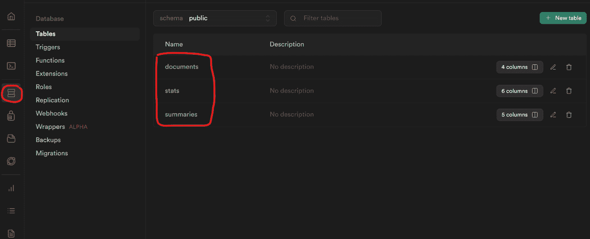

### 3) Quirv 部署

+ 下载源码，依次执行以下命令

```
git clone https://github.com/StanGirard/quivr.git && cd quivr
```

```
git checkout v0.0.4
```

```
git checkout -b v0.0.4
```

+ 配置参数

```
cp .backend_env.example backend/.env
```

```
cp .frontend_env.example frontend/.env
```

配置 `frontend/.env`， 图中的两个参数对应上文创建 supabase project 提到的 Project Url 和 anon key。

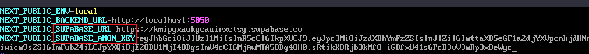

配置 `backend/.env`，`supabase_url`、`supabase_service_key` 分别对应 supabase project 中的 Project Url  和service key，`jwt_secret_key` 对应上文 supabase 中的 jwt secret。另外，因为要调用 openai 的 gpt 模型和embedding 模型，需配置上 openai 的 `api_key`。

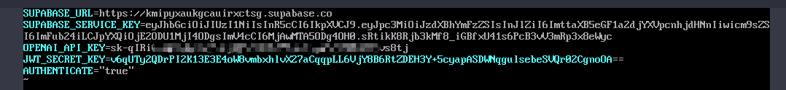

+ 启动项目

quirv 采用 `docker` 进行部署，部署环境需要安装 `docker`。大家可根据具体的部署环境安装 `docker`。安装好之后，在 quirv 根目录下执行以下命令：

```
docker compose build && docker compose up
```

如果 `docker compose` 用不了，改成 `docker-compose`；权限问题，添加 `sudo`。

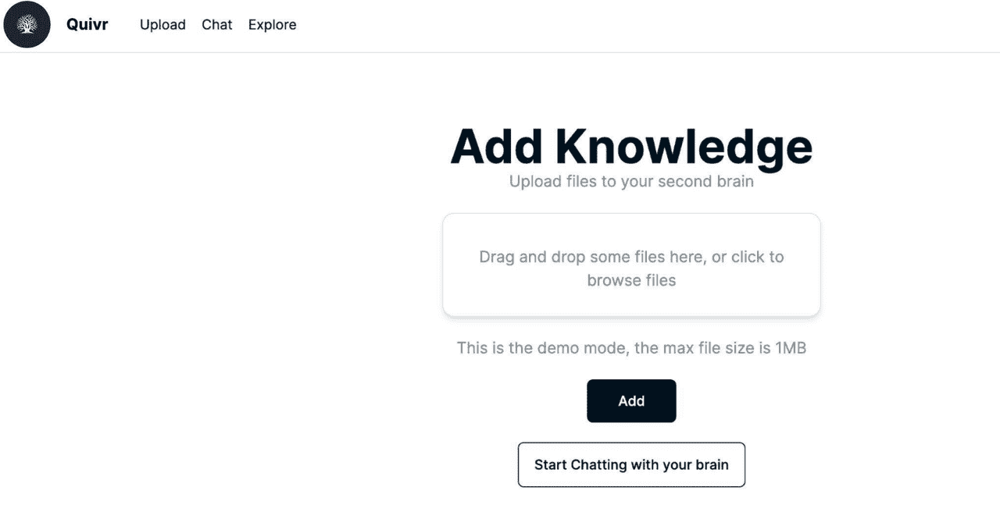

# 四、总结

以上，对大模型专属知识库问答的原理、实现、具体案例进行了大致的梳理和说明，并针对不同情况给出了方案选择的参考意见，如有错误，恳请指正。另外，如果大家有更好的解决方案，欢迎留言告知。

需要注意的是，在实际体验的过程中，基于知识库的大模型问答仍然存在漏答、回答不准确的情况。要想达到令人满意的效果，还需要做大量的测试和优化工作。
