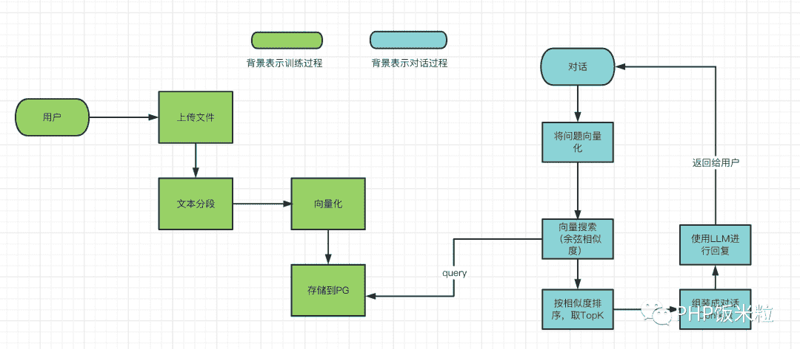
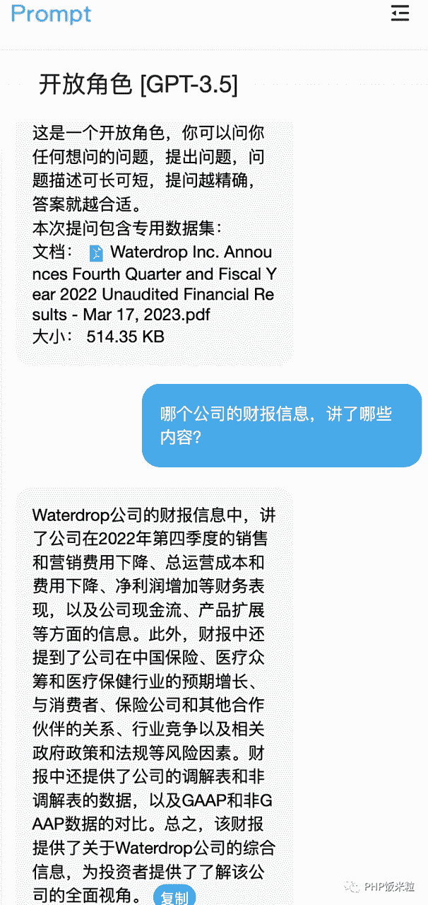
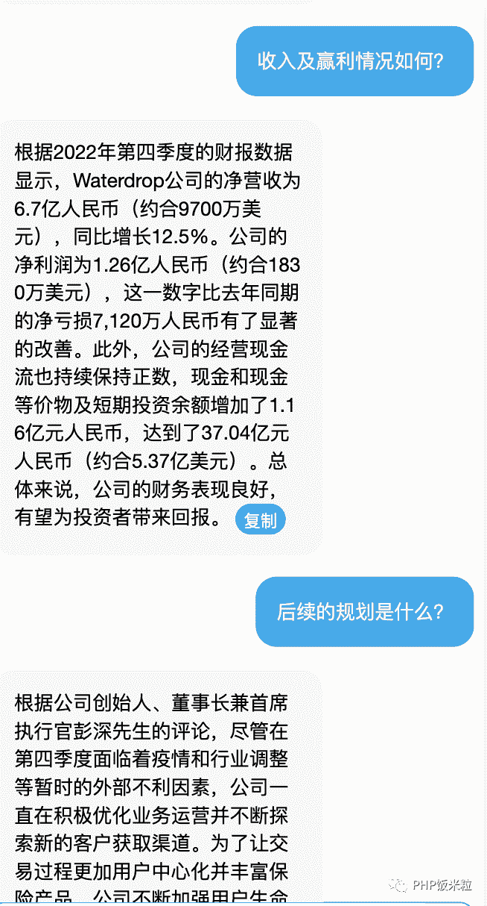
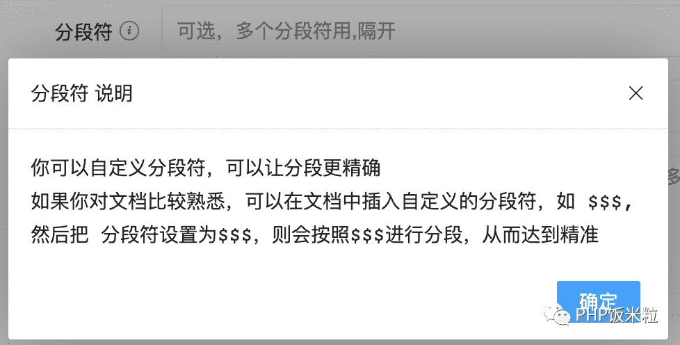
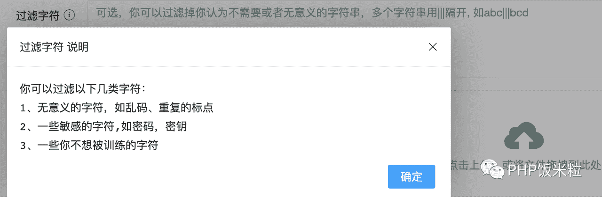

# 2023-05-29自有知识库的训练

> 来源：[https://xuqiwei1986.feishu.cn/docx/Dh5LdltZ0owhqjx1lHRcQrPjnOc](https://xuqiwei1986.feishu.cn/docx/Dh5LdltZ0owhqjx1lHRcQrPjnOc)

> 🔗 原文链接： h[ttps://articles.zs](https://articles.zsxq.com/id_sm2ks43wm9xp.html)xq.com/id_sm2ks4...

>

在使用ChatGPT的过程中，可能会遇到两个明显的弱点：

其一，知识库的更新截止到2021年9月

其二，对于输入的上下文有一定的上限

这些限制可能在某些情况下阻碍了ChatGPT的应用，特别是当面临需求更新和处理长文本的情况时。

然而，借助自有知识库的训练，我们不仅可以突破这些限制，还可以提升ChatGPT的性能和适用性。

首先，让我们解决知识库的更新问题 。

由于ChatGPT的训练数据截止到2021年9月，这意味着在这个日期之后发生的事件和信息，ChatGPT并无法获取。

对于快速发展的领域，如科技、医药等，这个局限性可能导致ChatGPT无法提供最新的信息。

这就是自有知识库的训练的重要性所在。

借助自有知识库的训练，我们可以向ChatGPT提供更新的信息。

这样，不仅可以提供最新的数据，还可以确保该数据的质量和准确性，从而提高ChatGPT的准确性和实用性。

**其实，解决上下文有上限的问题**

ChatGPT处理长文本的能力有限，在处理大量数据或需要深入分析的复杂问题时，这可能成为一个问题，你无法直接把一段长本文丢进去让他回复

然而，自有知识库的训练提供了一个解决方案。

我们可以使用自有知识库训练工具对长文本进行分段，训练，从而避免了上下文长度的限制。

这样，我们可以让ChatGPT处理更复杂的问题，从而提高其应用范围。

**如何实现？**

下面一个基础的原理

这里面有几个核心的点：

文本如何分段，这个会取决于搜索出来的结果质量，如果你文本分的太长，那匹配出来的结果可能只是文本段里的一部分，并不那么精确，如果你文本分的太短，那么上下文可能不会保持那么好，这里面需要一些策略。

相似度如何选择，以及你的prompt如何写，也会影响最终回复的质量，这里提供一个我目前在用的sql: $sql = " SELECT q, 1  - (vector <=> '{vector}') as similarity FROM modeldata where model_id = {model_id} AND AND 1 - (vector <=> '{vector}') > {similarity} order by similarity DESC LIMIT {topK}

{}里的都是参数，你可以调整，特别是similarity参数，我一般选择0.8

**效果：**

这是我拿前司的财报做了一个简单的训练，pdf是纯英文的，但你可以直接用中文问答，整体效果还不错：

如果你想直接体验这个功能，

http://chat2.givemeprompt.com/

也欢迎大家转发和我交流chatGPT、midjourney等相关的AI技术

之前写了一篇文章： 自有知识库的训练：突破chatGPT的局限性 ， 介绍了如何解决chatGPT目前的两个局限性 这一篇文章，将继续探讨这一话题，把里面的一些技术细节展开 （这几篇文章都是实战经验，适合有一定开发基础，正在开发自己的AI应用的同学）

**第一个细节，如何将文本分段**

我们要理解为什么分段，本质是什么？

把长文章打散，这样就能方便放到chatGPT的上下文中

尽可能要保持每个段落的独立性，如果你把一句话从中截断了，这肯定会影响最终的效果

如果分段不合理，会有什么影响？

首先，分段不能太长，至少对于chatGPT3.5来讲，你肯定不能超过4096个token，否则第1点就不满足了，另外文本长，也意味着段落的信息足够多，这是一个双刃剑，好处是可能有更好的上下文，坏处是可能有更多的干扰信息

其次，分段也不能太短，太短了，信息就很割裂，上下文可能不会那么完整

所以这里面有一些策略，下面是我自己总结的一些策略： 最好的策略是自定义分段 这个比较适合你对文档很熟悉，你想把这个文档训练之后，提供给别人使用，下图是我的一个实现:

但这个要求比较高，因为我们大多数场景看的并不是自己熟悉的文档

所以常用的策略是按照文档的自然的组织格式进行分段，比如段落和段落之间，一般都是二个换行符或以上，句和句之间，可能是一个换行符或者有空格，千万要避免把一句话从中隔段的情况。

假设我现在想把一个文档分成每500个字一段，那我们该如何实现呢？ 1、先按 \n\n切分，如果切分出来的段有大于500个字

2、再按\n切分，如果切分出来的段还有大于500个字 3、最后再按空格切分

最后你就会得到一个段落的list，然后把这个段落list投喂给chatGPT进行向量化 但如果直接用这个策略切，也会有问题，因为有些段会很短，比如就短短的一句话 所以最后的建议的策略是，再把分出来的段再进行匹配组合，尽可能让每一段接近500字，且保持段落相对的独立性。 这里也提供有一些小的tips: 1、过滤掉一些不可见字符，占位符等，向量化，存入数据库，可以节省空间和token数

2、对于中文来讲，长度计算和英文不一样，所以统一按unicode的方式计算长度会比较合适

**第二个细节，隐私问题 **

当我们进行自有知识库进行训练的时候，会有两个环节会把数据投喂到chagGPT：

第一个环节是：向量化的过程，我们会把文本数据调用chagGPT的相关接口拿到向量化后的数据，然后再存入到自有的存储里

第二个环节是：回答的过程，我们通过会通过向量匹配，把相关的段落文本放到chatGPT的context里，然后再通过chatGPT二次加工之后，返回最终的答案

所以这两个环节都可能会泄露你的数据，除非你不用chatGPT，而用自己的llm，否则这个是无法避免的，但也有一些技巧或者方式来尽量避免：

技巧一：在文本分段的时候，进行敏感数据过滤或者加密，比如：

过滤一些密码相关的，密钥相关的数据

把一些敏感的数据进行过滤或者加密，在最终输出的时候进行解密

如我现在的实现：

技巧二：如果你是在智能客服场景，或者已经沉淀出了很多标准的SOP或者问答的场景，那么里只要训练问题就行了，然后通过用户的输入去匹配最合适问题，再通过问题返回标准的答案

通过实战、代码经验的积累，你可以做出更多更加强大的AI应用。大家如果有什么好的经验也可以多多分享。

扫码加入星球

查看更多优质内容

https://wx.zsxq.com/mweb/views/joingroup/join_group.html?group_id=15552545485212